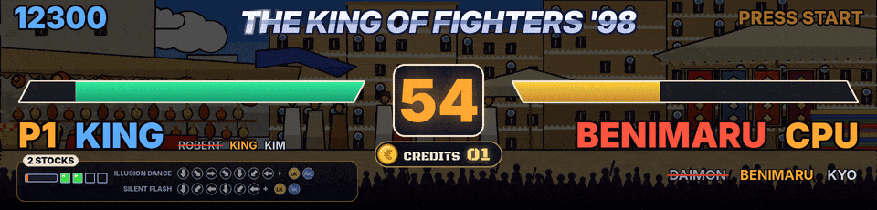
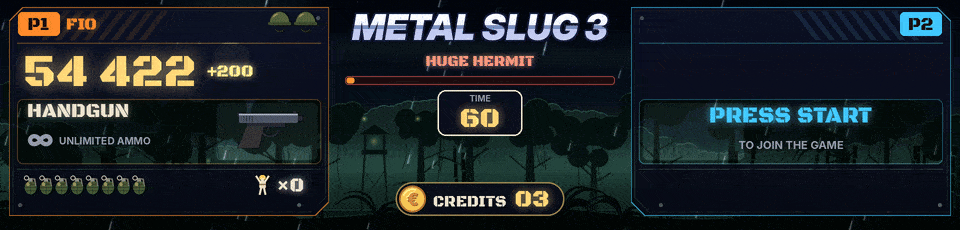
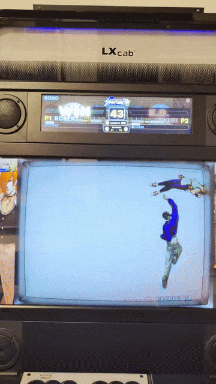
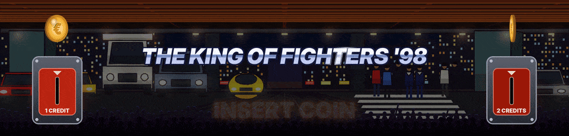
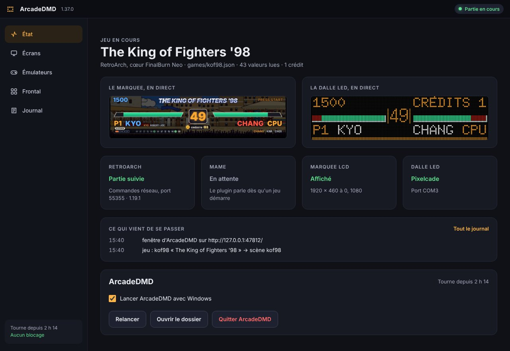

# ArcadeDMD

In English, [README.md](README.md).

Score, vies, crédits et événements des jeux MAME et RetroArch en direct sur le marquee d'une borne d'arcade, avec une scène animée propre à chaque jeu. Sur une dalle LED 128x32 (**Pixelcade LED**, **ZeDMD**), ou en HD lisse sur un écran LCD de marquee (le marquee 1920 x 460 d'une Vewlix par exemple).

**ArcadeDMD est en BETA.** Comment l'installer, le régler et s'en servir est dans le **[wiki](https://github.com/Byoyoyo/ArcadeDMD/wiki/Accueil)**, en français et en anglais.

## Ce qu'il fait

- Lit la mémoire du jeu en direct, avec un plugin MAME ou par les commandes réseau de RetroArch (FinalBurn Neo, Genesis Plus GX). Rien n'est modifié dans le jeu ni dans l'émulateur.
- Scènes prêtes pour Metal Slug 1 à 5 et X, les 57 jeux de combat Neo Geo, quatre-vingt-dix-sept jeux Neo Geo faits un par un et tous les autres jeux Neo Geo selon leur genre, tous les jeux Capcom CPS1, CPS2 et CPS3 (34 jeux de combat dans leurs décors et cinquante jeux faits un par un, de Final Fight à 1944), tous les jeux Cave (37 jeux, DoDonPachi, Dai-Ou-Jou, Ketsui, Espgaluda, Mushihime-sama, Deathsmiles, Akai Katana...), After Burner II, Sonic 1 et 2.
- Scènes HD avec des décors animés qui suivent le stage ou la mission du jeu, et un effet pour chaque événement (coups, combos, K.O., armes, bombes, pièces...).
- Le logo du jeu au lancement (ton Clear Logo LaunchBox, ou le logo téléchargé par le scraper de RetroBat). Quand personne ne joue, les jeux de combat attendent une pièce. Mets-en une, elle tombe dans la fente, les crédits roulent, puis PRESS START.
- Tout est dessiné par le programme. Tes propres images peuvent remplacer certains dessins ([Tes propres images](https://github.com/Byoyoyo/ArcadeDMD/wiki/Tes-propres-images)).
- Un outil d'apprentissage trouve les adresses manquantes (score, crédits...) à partir de quelques captures.
- Une fenêtre et une icône près de l'horloge, à la place d'une console. Le jeu en cours avec le marquee et la dalle LED en direct, l'écran du marquee choisi parmi ceux que Windows voit, RetroArch et le plugin MAME vérifiés et corrigés d'un clic, le frontal, le journal.
- Marche à côté de LaunchBox et BigBox, RetroBat, HyperSpin ou n'importe quel autre frontend. En anglais et en français. Windows, Python 3.12 ou plus récent.

## La fenêtre

ArcadeDMD tourne près de l'horloge. Un clic sur son icône ouvre sa fenêtre, avec cinq onglets, État, Écrans, Émulateurs, Frontal et Journal. Voir [Utilisation](https://github.com/Byoyoyo/ArcadeDMD/wiki/Utilisation).

## Les jeux les plus soignés

Chaque jeu a sa scène, mais ceux-ci ont été réglés sur une vraie borne, round après round, avec des vidéos, des photos, les journaux des jeux et, depuis la 1.33, une partie enregistrée en entier (les valeurs lues, la mémoire du jeu, ses captures d'écran, voir [Enregistrer une partie](https://github.com/Byoyoyo/ArcadeDMD/wiki/Enregistrer-une-partie)), jusqu'à ce que le marquee suive le jeu à l'instant près. Les jeux finalisés en 1.33, vérifiés image par image sur une partie enregistrée, sont The King of Fighters '98, les six Metal Slug Neo Geo, Windjammers et Puzzle Bobble 2.

- **The King of Fighters '98.** Ses neuf décors dessinés d'après les lieux du jeu, en style cartoon, qui changent avec les rounds comme dans le jeu, l'écran de sélection qui montre les choix. Sous chaque joueur, ses coups désespérés avec leurs commandes, les flèches qui s'allument quand le stick les fait, RATÉ, DM ! et SDM !, la jauge, les stocks et le MAX comme le jeu les montre. ROUND, FIGHT !, K.O., WIN, PERFECT, le combattant suivant qui entre en scène, l'équipe éliminée, et les matchs gagnés entre deux humains. Voir [Jeux de combat](https://github.com/Byoyoyo/ArcadeDMD/wiki/Jeux-de-combat).
- **Metal Slug 1 à 5 et X.** Les six, chacun réglé sur une partie enregistrée en entier (1.33). Le soldat choisi (Marco, Tarma, Eri, Fio...) à côté de J1 / J2, son arme et ses munitions, le laser en rayon tenu, les bombes et la grenade qui explose quand celle du jeu explose, les véhicules de chaque joueur (le char, le chameau, le Slugnoid, le Slug Flyer, le Slug Mariner, le Slug Gunner...) avec leur énergie et leurs obus, les vies comme le jeu les écrit, les prisonniers libérés, la vie de tous les ennemis à l'écran, le boss de la mission 1 de chaque jeu avec WARNING, son nom et sa barre de vie (Tetsuyuki, The Keesi II, Iron Nokana MKII, Huge Hermit, Brave Guerrier, Metal Rear), BOSS DÉTRUIT et MISSION COMPLETE au moment du jeu, les décors de chaque mission, les crédits avec la pièce qui tombe. Les boss des missions suivantes sont reconnus à leur vie et nommés d'après la liste du jeu, à confirmer en jouant.
- **Windjammers.** Le terrain du jeu en carte vivante, le disque et les deux joueurs là où le jeu les met, lus à chaque image, les lobs, un super qui se charge dans un anneau de flammes puis SUPER ! avec le nom du tir, les buts qui poussent toute l'image dans le mur, les sets et le match, les joueurs nommés comme dans le jeu, les pièces comptées même appuyées très vite.
- **Puzzle Bobble et Puzzle Bobble 2.** Les deux scores, la bulle du lanceur et la suivante à leurs couleurs, la flèche qui tourne comme celle du jeu, chaque bulle tirée qui part dans sa direction, le round, les matchs VS et les manches gagnées.
- **DoDonPachi.** Le score avec les continues, le compteur de hits, le vaisseau et son type, six stages dessinés d'après les cartes du jeu, et le boss de chaque stage avec sa vie lue dans le jeu, qui tombe quand elle est à zéro.
- **Appris sur une borne aussi.** Twinkle Star Sprites (sa propre scène, les cœurs et les chaînes), The King of Fighters 2002 et Fatal Fury (leurs écrans de sélection, leurs rounds et leurs équipes lus sur des parties enregistrées), Marvel vs. Capcom, X-Men vs. Street Fighter, Marvel Super Heroes vs. Street Fighter, X-Men: Children of the Atom et Hyper Street Fighter II (scores, crédits, la jauge POWER, les équipiers), Strikers 1945 Plus, Giga Wing et Mercs (scores, chrono, SUPER SHOT).

Les autres jeux lisent les adresses des bases de codes de triche et de RetroAchievements, qui restent à confirmer en jeu. [PROGRESS.md](PROGRESS.md) dit où en est chacun.

## Démarrage rapide

1. Télécharge le zip de la dernière version sur la page [Releases](../../releases/latest). Avant de l'extraire, fais un clic droit dessus, Propriétés, et coche « Débloquer ».
2. Extrais le dossier `ArcadeDMD` dans un chemin sans accents, idéalement `C:\ArcadeDMD`.
3. Lance `install.bat`. Il installe ce qu'il faut (Python 3.13 aussi s'il manque), copie le plugin dans MAME et règle la Pixelcade.
4. Avec un marquee LCD, lance `screen_setup.bat`, ou choisis l'écran plus tard dans l'onglet Écrans de la fenêtre. Avec RetroArch, active « Commandes réseau » (Réglages, Réseau) et joue avec le cœur Arcade (FinalBurn Neo).
5. Lance `demo_fight.bat` pour voir une scène sans jeu, puis `run.bat`. Son icône se met près de l'horloge et sa fenêtre s'ouvre. Joue depuis ton frontend.

Chaque étape en détail est dans [Installer ArcadeDMD](https://github.com/Byoyoyo/ArcadeDMD/wiki/Installer-ArcadeDMD), et quoi faire quand quelque chose ne va pas dans [Dépannage](https://github.com/Byoyoyo/ArcadeDMD/wiki/D%C3%A9pannage).

## Le wiki

| Français | English |
|---|---|
| [Accueil](https://github.com/Byoyoyo/ArcadeDMD/wiki/Accueil) | [Home](https://github.com/Byoyoyo/ArcadeDMD/wiki/Home) |
| [Installer ArcadeDMD](https://github.com/Byoyoyo/ArcadeDMD/wiki/Installer-ArcadeDMD) | [Installation](https://github.com/Byoyoyo/ArcadeDMD/wiki/Installation) |
| [Utilisation](https://github.com/Byoyoyo/ArcadeDMD/wiki/Utilisation) | [Usage](https://github.com/Byoyoyo/ArcadeDMD/wiki/Usage) |
| [Réglages](https://github.com/Byoyoyo/ArcadeDMD/wiki/R%C3%A9glages) | [Configuration](https://github.com/Byoyoyo/ArcadeDMD/wiki/Configuration) |
| [Marquee HD](https://github.com/Byoyoyo/ArcadeDMD/wiki/Marquee-HD) | [HD Marquee](https://github.com/Byoyoyo/ArcadeDMD/wiki/HD-Marquee) |
| [Dalle Pixelcade](https://github.com/Byoyoyo/ArcadeDMD/wiki/Dalle-Pixelcade) | [Pixelcade LED](https://github.com/Byoyoyo/ArcadeDMD/wiki/Pixelcade-LED) |
| [ZeDMD et matériel](https://github.com/Byoyoyo/ArcadeDMD/wiki/ZeDMD-et-mat%C3%A9riel) | [ZeDMD and Hardware](https://github.com/Byoyoyo/ArcadeDMD/wiki/ZeDMD-and-Hardware) |
| [OBS et DOFLinx](https://github.com/Byoyoyo/ArcadeDMD/wiki/OBS-et-DOFLinx) | [OBS and DOFLinx](https://github.com/Byoyoyo/ArcadeDMD/wiki/OBS-and-DOFLinx) |
| [Avec MAME](https://github.com/Byoyoyo/ArcadeDMD/wiki/Avec-MAME) | [MAME](https://github.com/Byoyoyo/ArcadeDMD/wiki/MAME) |
| [Avec RetroArch](https://github.com/Byoyoyo/ArcadeDMD/wiki/Avec-RetroArch) | [RetroArch](https://github.com/Byoyoyo/ArcadeDMD/wiki/RetroArch) |
| [Jeux de combat](https://github.com/Byoyoyo/ArcadeDMD/wiki/Jeux-de-combat) | [Fighting Games](https://github.com/Byoyoyo/ArcadeDMD/wiki/Fighting-Games) |
| [Les Metal Slug](https://github.com/Byoyoyo/ArcadeDMD/wiki/Les-Metal-Slug) | [Metal Slug](https://github.com/Byoyoyo/ArcadeDMD/wiki/Metal-Slug) |
| [Jeux Neo Geo](https://github.com/Byoyoyo/ArcadeDMD/wiki/Jeux-Neo-Geo) | [Neo Geo Games](https://github.com/Byoyoyo/ArcadeDMD/wiki/Neo-Geo-Games) |
| [Capcom et Cave](https://github.com/Byoyoyo/ArcadeDMD/wiki/Capcom-et-Cave) | [Capcom and Cave](https://github.com/Byoyoyo/ArcadeDMD/wiki/Capcom-and-Cave) |
| [Autres jeux](https://github.com/Byoyoyo/ArcadeDMD/wiki/Autres-jeux) | [Other Games](https://github.com/Byoyoyo/ArcadeDMD/wiki/Other-Games) |
| [Apprendre les adresses](https://github.com/Byoyoyo/ArcadeDMD/wiki/Apprendre-les-adresses) | [Learning Addresses](https://github.com/Byoyoyo/ArcadeDMD/wiki/Learning-Addresses) |
| [Enregistrer une partie](https://github.com/Byoyoyo/ArcadeDMD/wiki/Enregistrer-une-partie) | [Recording a Game](https://github.com/Byoyoyo/ArcadeDMD/wiki/Recording-a-Game) |
| [Fichiers des jeux](https://github.com/Byoyoyo/ArcadeDMD/wiki/Fichiers-des-jeux) | [Game Files](https://github.com/Byoyoyo/ArcadeDMD/wiki/Game-Files) |
| [Tes propres images](https://github.com/Byoyoyo/ArcadeDMD/wiki/Tes-propres-images) | [Your Own Pictures](https://github.com/Byoyoyo/ArcadeDMD/wiki/Your-Own-Pictures) |
| [Dépannage](https://github.com/Byoyoyo/ArcadeDMD/wiki/D%C3%A9pannage) | [Troubleshooting](https://github.com/Byoyoyo/ArcadeDMD/wiki/Troubleshooting) |

## Suivre le projet

Ce qui change à chaque version est dans [CHANGELOG.md](CHANGELOG.md), où en est chaque jeu et la suite dans [PROGRESS.md](PROGRESS.md). Pour signaler un problème ou demander un nouveau jeu, vois [CONTRIBUTING.md](CONTRIBUTING.md). Une partie enregistrée sur ta borne aide le plus ([Enregistrer une partie](https://github.com/Byoyoyo/ArcadeDMD/wiki/Enregistrer-une-partie)).

## Licences et crédits

ArcadeDMD © 2026 Byoyoyo, sous licence MIT (fichier `LICENSE`). Tu peux l'utiliser, le modifier et le partager, à condition de garder la mention de copyright et la licence avec. Polices bitmap issues des polices X11 « misc-fixed » (domaine public). Les polices HD sont Inter (The Inter Project Authors) et Black Ops One (The Black-Ops Project Authors), toutes deux sous licence SIL Open Font License, voir le dossier `fonts`. Les sprites, les décors HD et les effets sont dessinés par le programme ou pour lui, aucune image ne vient d'un jeu. ZeDMD (firmware GPLv2) et libzedmd (GPLv3) sont téléchargés séparément depuis leurs dépôts officiels https://github.com/PPUC. Les noms de jeux servent uniquement à les identifier. Les adresses viennent des bases de triche de la communauté (FinalBurn Neo, MAME 2003-Plus), des scripts d'entraînement de peon2 et des désassemblages de Sonic, merci à leurs auteurs.

Byoyoyo voulait créer ArcadeDMD depuis longtemps, et l'a lancé après ses échanges avec Vera AI. Merci à Vera AI pour ces échanges.
