# ArcadeDMD

In English, [README.md](README.md).

Score, vies, crédits et événements des jeux MAME et RetroArch en direct sur le marquee d'une borne d'arcade, avec une scène animée propre à chaque jeu. Sur une dalle LED 128x32 (**Pixelcade LED**, **ZeDMD**), ou en HD lisse sur un écran LCD de marquee (le marquee 1920 x 460 d'une Vewlix par exemple).

**ArcadeDMD est en BETA.** Comment l'installer, le régler et s'en servir est dans le **[wiki](https://github.com/Byoyoyo/ArcadeDMD/wiki/Accueil)**, en français et en anglais.

[Ce qu'il fait](#ce-quil-fait) · [Les jeux en images](#les-jeux-en-images) · [Démarrage rapide](#démarrage-rapide) · [Le wiki](#le-wiki)

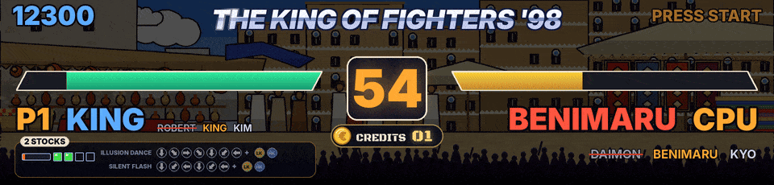
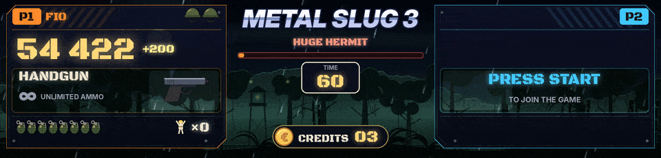
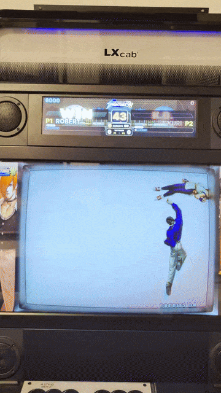
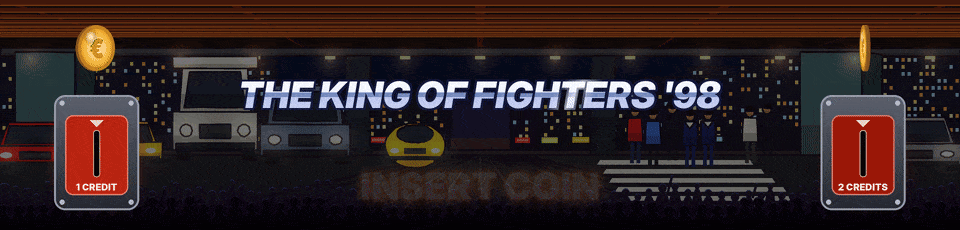
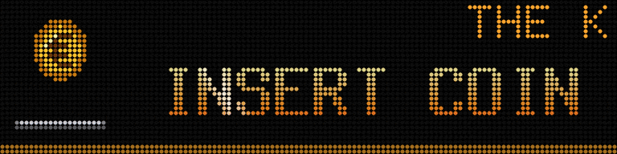

## Ce qu'il fait

- Lit la mémoire du jeu en direct, avec un plugin MAME ou par les commandes réseau de RetroArch (FinalBurn Neo, Genesis Plus GX). Rien n'est modifié dans le jeu ni dans l'émulateur.
- Scènes prêtes pour Metal Slug 1 à 5 et X, les 57 jeux de combat Neo Geo, quatre-vingt-dix-sept jeux Neo Geo faits un par un et tous les autres jeux Neo Geo selon leur genre, tous les jeux Capcom CPS1, CPS2 et CPS3 (34 jeux de combat dans leurs décors et cinquante jeux faits un par un, de Final Fight à 1944), tous les jeux Cave (37 jeux, DoDonPachi, Dai-Ou-Jou, Ketsui, Espgaluda, Mushihime-sama, Deathsmiles, Akai Katana...), After Burner II, Sonic 1 et 2.
- Scènes HD avec des décors animés qui suivent le stage ou la mission du jeu, et un effet pour chaque événement (coups, combos, K.O., armes, bombes, pièces...).
- Le logo du jeu au lancement (ton Clear Logo LaunchBox, ou le logo téléchargé par le scraper de RetroBat). Quand personne ne joue, les jeux de combat attendent une pièce. Mets-en une, elle tombe dans la fente, les crédits roulent, puis PRESS START.
- Dans les jeux de combat Neo Geo, les coups spéciaux de chaque combattant s'affichent sous son nom et s'allument quand ils sont faits au stick, et FIGHT ! arrive avec l'annonce du jeu.
- Un robot fait jouer les jeux Neo Geo tout seuls dans RetroArch et les enregistre, pour que chaque fichier de jeu soit vérifié contre une vraie partie (`robot.bat`). Les LED de la borne peuvent suivre le jeu par HyperHDR.
- Tout est dessiné par le programme. Tes propres images peuvent remplacer certains dessins ([Tes propres images](https://github.com/Byoyoyo/ArcadeDMD/wiki/Tes-propres-images)).
- Un outil d'apprentissage trouve les adresses manquantes (score, crédits...) à partir de quelques captures.
- Une fenêtre et une icône près de l'horloge, à la place d'une console. Le jeu en cours avec le marquee et la dalle LED en direct, l'écran du marquee choisi parmi ceux que Windows voit, RetroArch et le plugin MAME vérifiés et corrigés d'un clic, le frontal, le journal.
- Marche à côté de LaunchBox et BigBox, RetroBat, HyperSpin ou n'importe quel autre frontend. En anglais et en français. Windows, Python 3.12 ou plus récent.

## La fenêtre

ArcadeDMD tourne près de l'horloge. Un clic sur son icône ouvre sa fenêtre, avec cinq onglets, État, Écrans, Émulateurs, Frontal et Journal. Voir [Utilisation](https://github.com/Byoyoyo/ArcadeDMD/wiki/Utilisation).

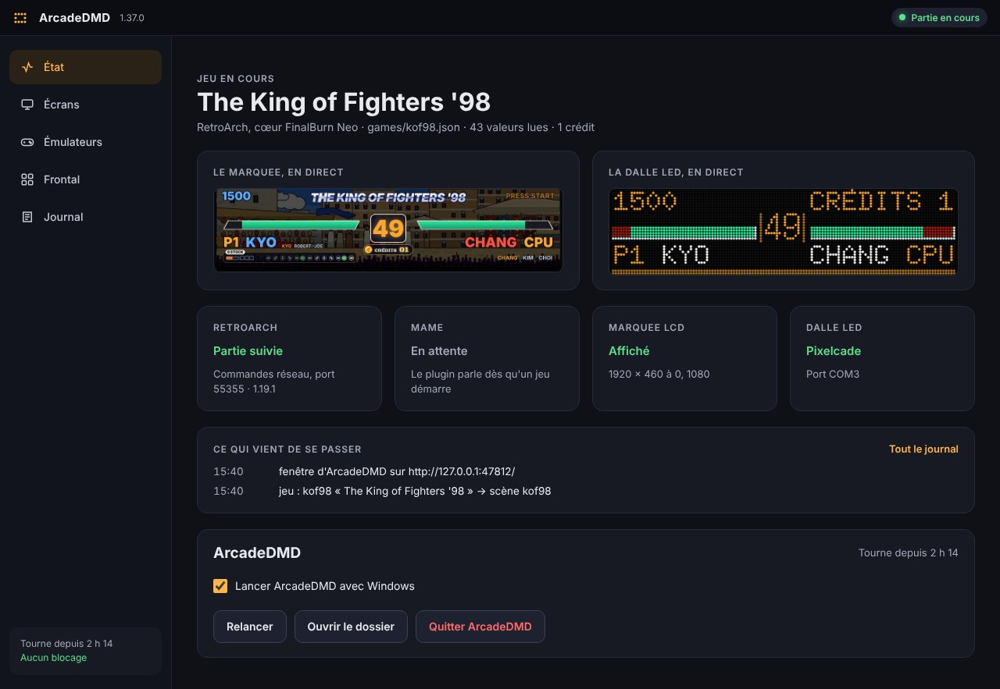

## Les jeux les plus soignés

Chaque jeu a sa scène, mais ceux-ci ont été réglés sur une vraie borne, round après round, avec des vidéos, des photos, les journaux des jeux et, depuis la 1.33, une partie enregistrée en entier (les valeurs lues, la mémoire du jeu, ses captures d'écran, voir [Enregistrer une partie](https://github.com/Byoyoyo/ArcadeDMD/wiki/Enregistrer-une-partie)), jusqu'à ce que le marquee suive le jeu à l'instant près. Les jeux finalisés en 1.33, vérifiés image par image sur une partie enregistrée, sont The King of Fighters '98, les six Metal Slug Neo Geo, Windjammers et Puzzle Bobble 2.

- **The King of Fighters '98.** Ses neuf décors dessinés d'après les lieux du jeu, en style cartoon, qui changent avec les rounds comme dans le jeu, l'écran de sélection qui montre les choix. Sous chaque joueur, ses coups désespérés avec leurs commandes, les flèches qui s'allument quand le stick les fait, RATÉ, DM ! et SDM !, la jauge, les stocks et le MAX comme le jeu les montre. ROUND, FIGHT !, K.O., WIN, PERFECT, le combattant suivant qui entre en scène, l'équipe éliminée, et les matchs gagnés entre deux humains. Voir [Jeux de combat](https://github.com/Byoyoyo/ArcadeDMD/wiki/Jeux-de-combat).
- **Metal Slug 1 à 5 et X.** Les six, chacun réglé sur une partie enregistrée en entier (1.33). Le soldat choisi (Marco, Tarma, Eri, Fio...) à côté de J1 / J2, son arme et ses munitions, le laser en rayon tenu, les bombes et la grenade qui explose quand celle du jeu explose, les véhicules de chaque joueur (le char, le chameau, le Slugnoid, le Slug Flyer, le Slug Mariner, le Slug Gunner...) avec leur énergie et leurs obus, les vies comme le jeu les écrit, les prisonniers libérés, la vie de tous les ennemis à l'écran, le boss de la mission 1 de chaque jeu avec WARNING, son nom et sa barre de vie (Tetsuyuki, The Keesi II, Iron Nokana MKII, Huge Hermit, Brave Guerrier, Metal Rear), BOSS DÉTRUIT et MISSION COMPLETE au moment du jeu, les décors de chaque mission, les crédits avec la pièce qui tombe. Les boss des missions suivantes sont reconnus à leur vie et nommés d'après la liste du jeu, à confirmer en jouant.
- **Windjammers.** Le terrain du jeu en carte vivante, le disque et les deux joueurs là où le jeu les met, lus à chaque image, les lobs, un super qui se charge dans un anneau de flammes puis SUPER ! avec le nom du tir, les buts qui poussent toute l'image dans le mur, les sets et le match, les joueurs nommés comme dans le jeu, les pièces comptées même appuyées très vite.
- **Puzzle Bobble et Puzzle Bobble 2.** Les deux scores, la bulle du lanceur et la suivante à leurs couleurs, la flèche qui tourne comme celle du jeu, chaque bulle tirée qui part dans sa direction, le round, les matchs VS et les manches gagnées.
- **DoDonPachi.** Le score avec les continues, le compteur de hits, le vaisseau et son type, six stages dessinés d'après les cartes du jeu, et le boss de chaque stage avec sa vie lue dans le jeu, qui tombe quand elle est à zéro.
- **Appris sur une borne aussi.** Twinkle Star Sprites (sa propre scène, les cœurs et les chaînes), The King of Fighters 2002 et Fatal Fury (leurs écrans de sélection, leurs rounds et leurs équipes lus sur des parties enregistrées), Marvel vs. Capcom, X-Men vs. Street Fighter, Marvel Super Heroes vs. Street Fighter, X-Men: Children of the Atom et Hyper Street Fighter II (scores, crédits, la jauge POWER, les équipiers), Strikers 1945 Plus, Giga Wing et Mercs (scores, chrono, SUPER SHOT).

Les autres jeux lisent les adresses des bases de codes de triche et de RetroAchievements, qui restent à confirmer en jeu. [PROGRESS.md](PROGRESS.md) dit où en est chacun.

## Les jeux en images

Les 155 jeux Neo Geo ci-dessous, chacun sur le marquee HD et, dessous, sur la dalle LED 128 x 32. Les deux sont dessinés par ArcadeDMD lui-même à partir d'une partie enregistrée, avec les fichiers de jeux de cette version. Chaque famille peut se replier.

<b>Jeux de combat Neo Geo</b> (54)

**3 Count Bout** (`3countb`). 8 combattants nommés, leurs coups sous le nom, coups reconnus au stick.

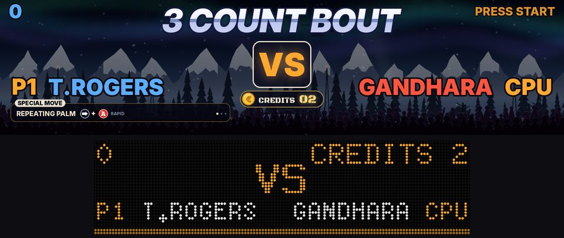

**Aggressors of Dark Kombat** (`aodk`). Barres de vie, 7 lieux.

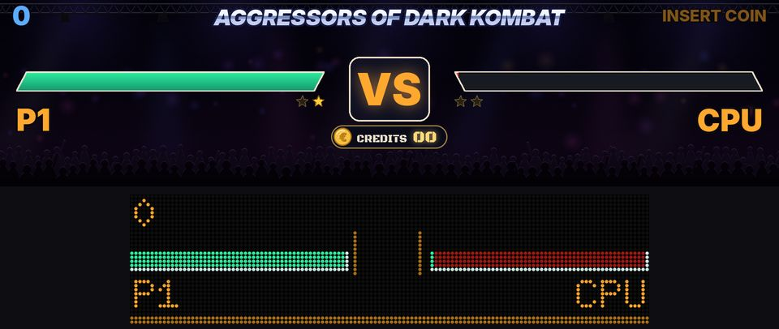

**Art of Fighting** (`aof`). Barres de vie, chrono, 10 combattants nommés, leurs coups sous le nom, coups reconnus au stick, 10 lieux, jauge.

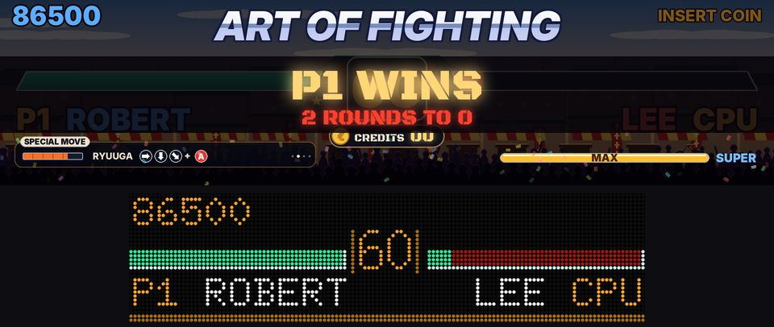

**Art of Fighting 2** (`aof2`). Barres de vie, chrono, 13 combattants nommés, leurs coups sous le nom, coups reconnus au stick, 12 lieux, jauge.

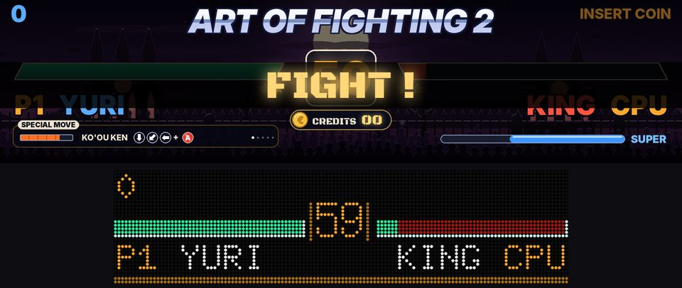

**Art of Fighting 3** (`aof3`). Barres de vie, chrono, 10 combattants nommés, leurs coups sous le nom, coups reconnus au stick, 10 lieux.

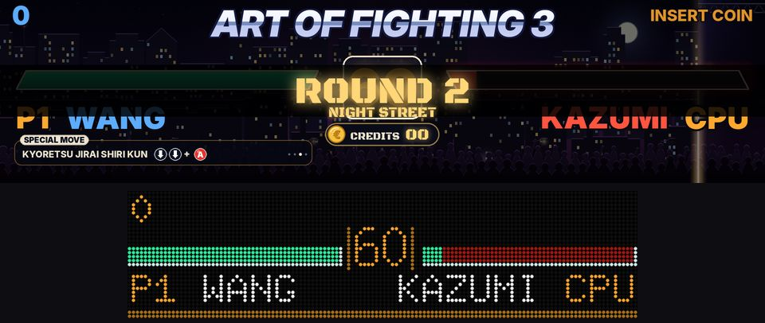

**Breakers** (`breakers`). Barres de vie, chrono, 9 combattants nommés, leurs coups sous le nom, coups reconnus au stick, 9 lieux.

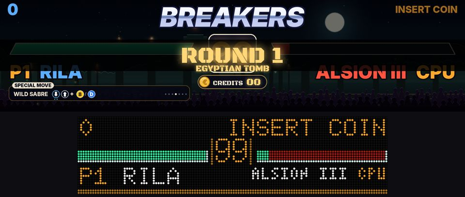

**Breakers Revenge** (`breakrev`). Barres de vie, chrono, 10 combattants nommés, leurs coups sous le nom, coups reconnus au stick, 10 lieux.

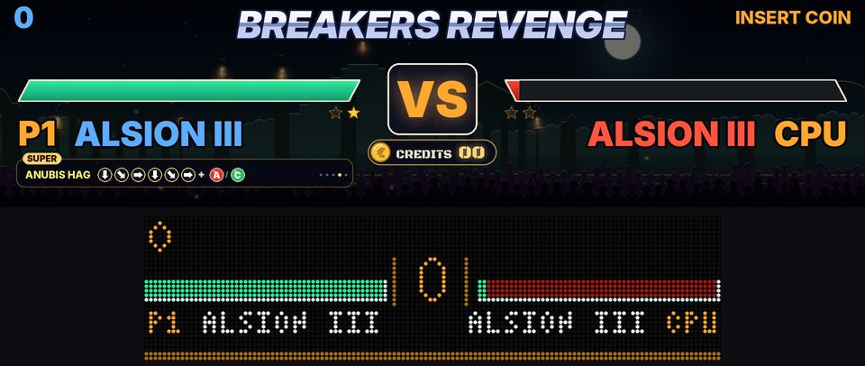

**Double Dragon** (`doubledr`). Barres de vie, chrono, 14 combattants nommés, leurs coups sous le nom, coups reconnus au stick, 6 lieux.

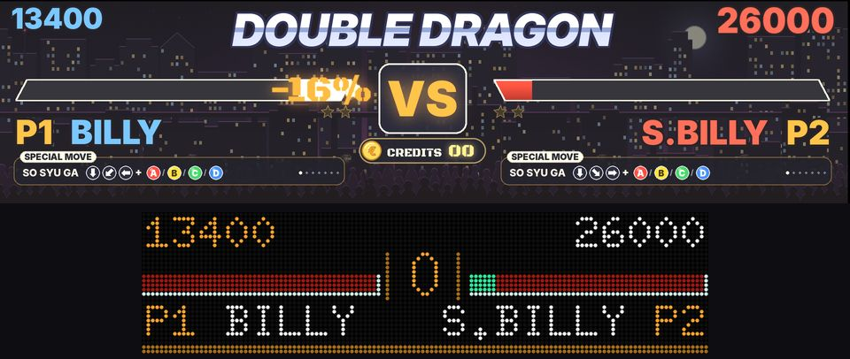

**Fatal Fury** (`fatfury1`). Barres de vie, chrono, 14 combattants nommés, leurs coups sous le nom, coups reconnus au stick.

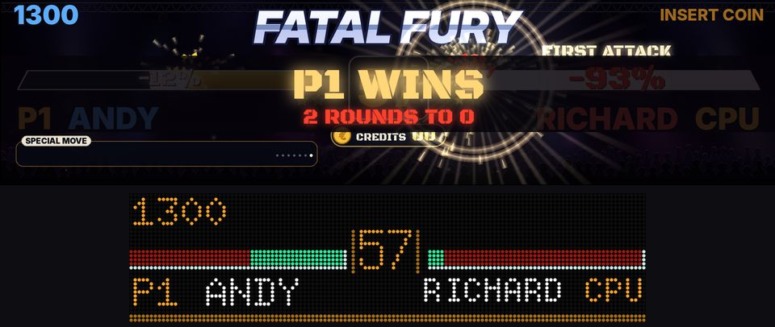

**Fatal Fury 2** (`fatfury2`). Barres de vie, chrono, 12 combattants nommés, leurs coups sous le nom, coups reconnus au stick, 12 lieux.

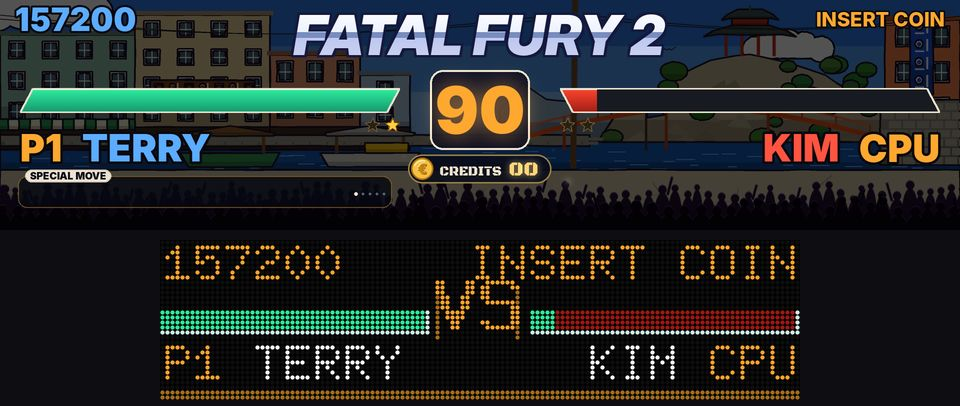

**Fatal Fury 3** (`fatfury3`). Barres de vie, chrono, 13 combattants nommés, leurs coups sous le nom, coups reconnus au stick, 15 lieux.

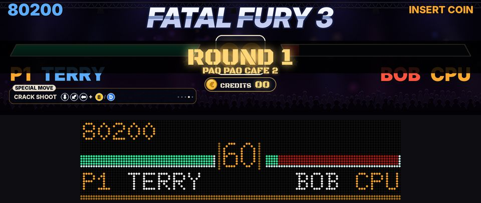

**Fatal Fury Special** (`fatfursp`). Barres de vie, chrono, 12 combattants nommés, leurs coups sous le nom, coups reconnus au stick, les décors du jeu.

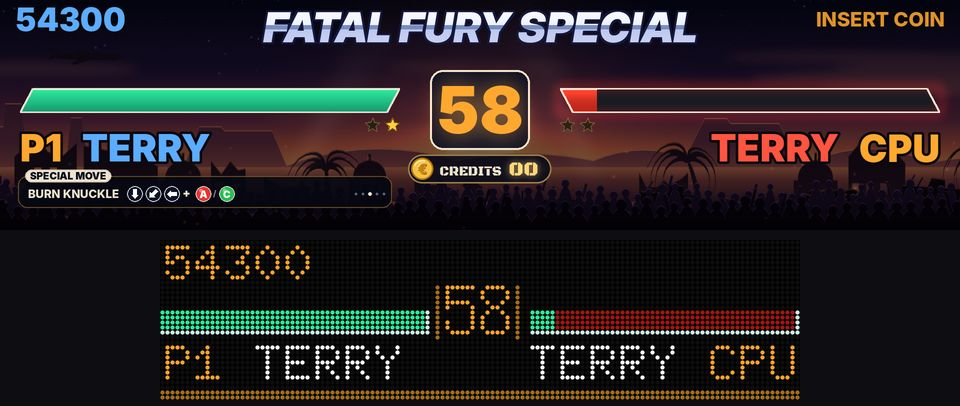

**Fight Fever** (`fightfev`). Barres de vie, chrono, 10 combattants nommés, leurs coups sous le nom, coups reconnus au stick, 10 lieux.

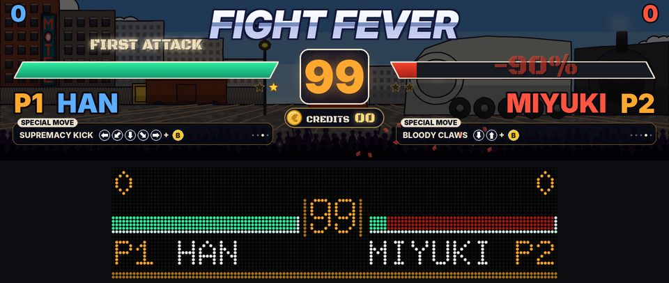

**Galaxy Fight** (`galaxyfg`). Barres de vie, chrono, 10 combattants nommés, leurs coups sous le nom, coups reconnus au stick, 9 lieux.

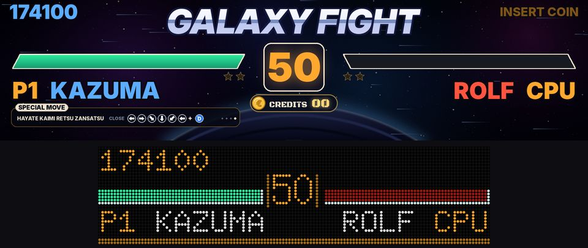

**Garou** (`garou`). Barres de vie, chrono, 14 combattants nommés, leurs coups sous le nom, coups reconnus au stick, 14 lieux, jauge.

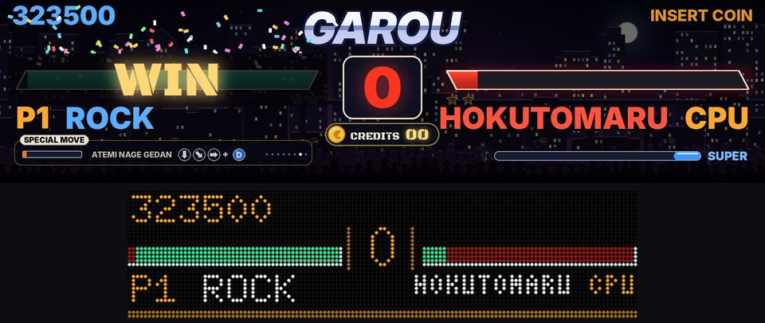

**Kabuki Klash** (`kabukikl`). Barres de vie, chrono, 12 combattants nommés, leurs coups sous le nom, coups reconnus au stick, 10 lieux, jauge.

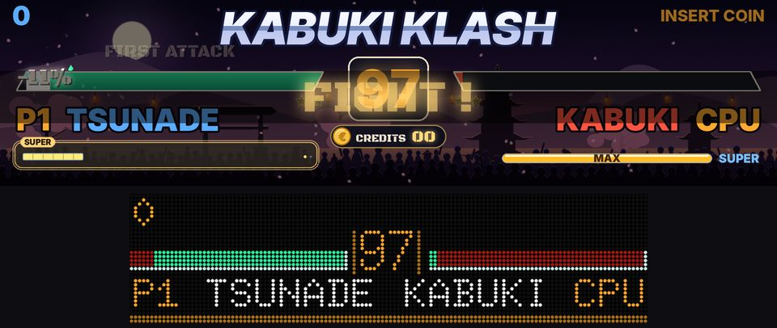

**Karnov's Revenge** (`karnovr`). Barres de vie, chrono, 14 combattants nommés, leurs coups sous le nom, coups reconnus au stick.

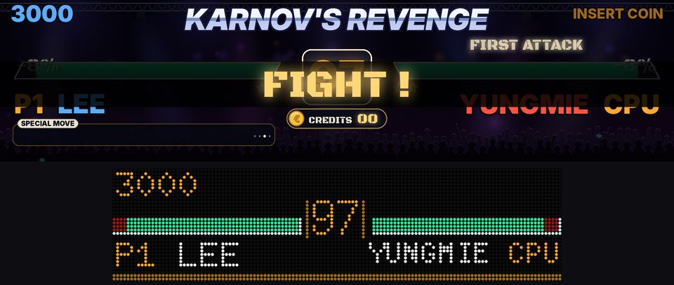

**King of the Monsters** (`kotm`). Barres de vie.

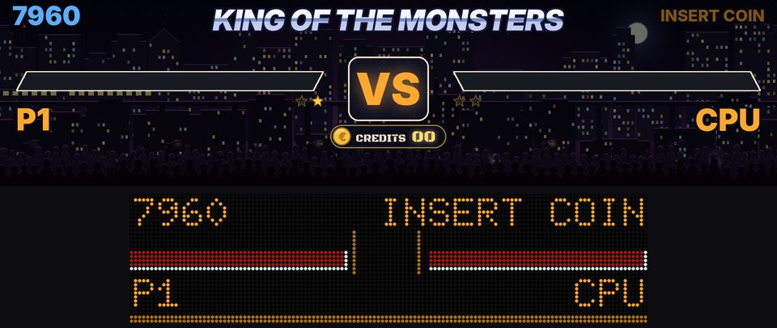

**King of the Monsters 2** (`kotm2`). Barres de vie, chrono, 10 combattants nommés.

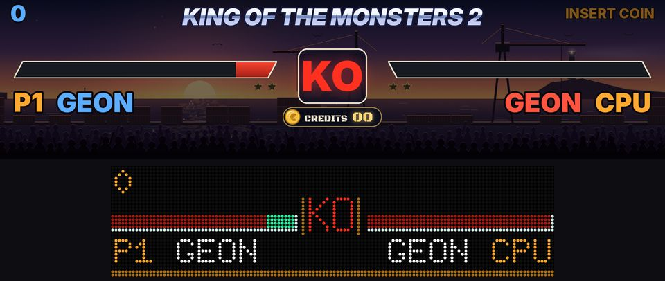

**Kizuna Encounter** (`kizuna`). Barres de vie, chrono, 13 combattants nommés, leurs coups sous le nom, coups reconnus au stick, 10 lieux.

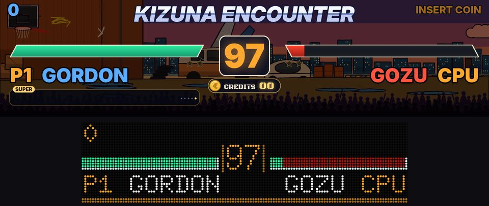

**Legend of Success Joe** (`legendos`). Barres de vie.

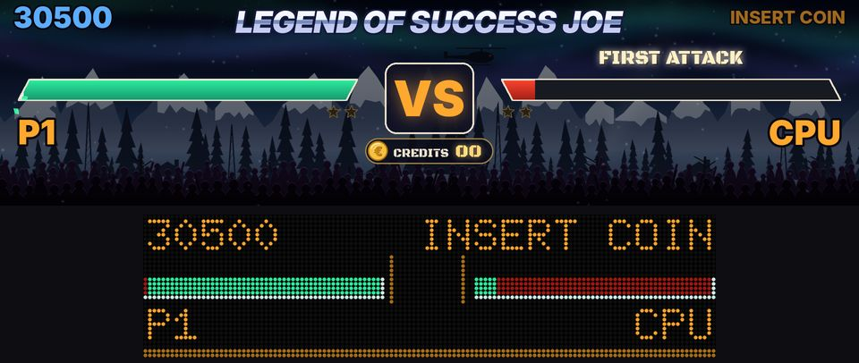

**Matrimelee** (`matrim`). Barres de vie, chrono, 16 combattants nommés, leurs coups sous le nom, coups reconnus au stick, 9 lieux.

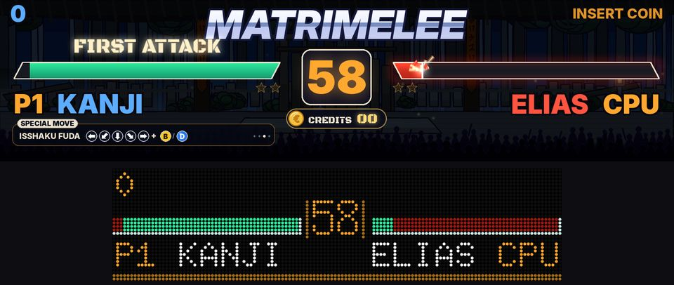

**Ninja Master's** (`ninjamas`). Barres de vie, chrono, 12 combattants nommés, leurs coups sous le nom, coups reconnus au stick, 12 lieux, jauge.

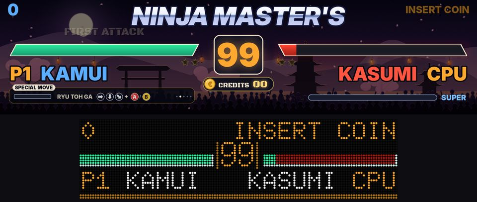

**Rage of the Dragons** (`rotd`). Barres de vie, chrono, 16 combattants nommés, leurs coups sous le nom, coups reconnus au stick, 8 lieux, jauge.

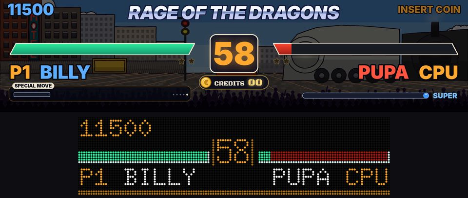

**Ragnagard** (`ragnagrd`). Barres de vie, 12 combattants nommés, leurs coups sous le nom, coups reconnus au stick, 4 lieux.

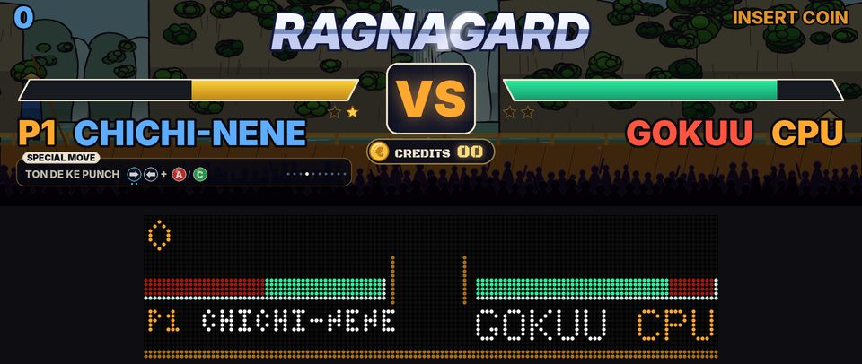

**Real Bout Fatal Fury** (`rbff1`). Barres de vie, chrono, 16 combattants nommés, leurs coups sous le nom, coups reconnus au stick, 13 lieux, jauge.

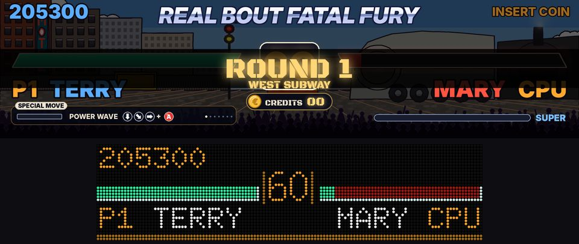

**Real Bout Fatal Fury 2** (`rbff2`). Barres de vie, chrono, 23 combattants nommés, leurs coups sous le nom, coups reconnus au stick, 10 lieux, jauge.

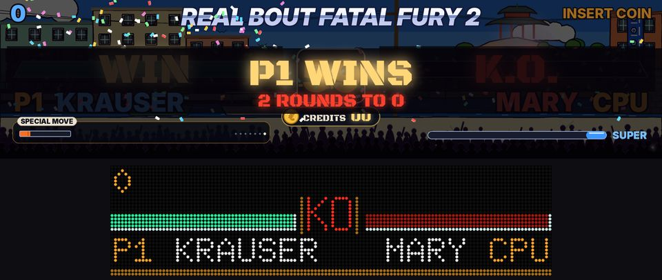

**Real Bout Fatal Fury Special** (`rbffspec`). Barres de vie, chrono, 20 combattants nommés, leurs coups sous le nom, coups reconnus au stick, 10 lieux, jauge.

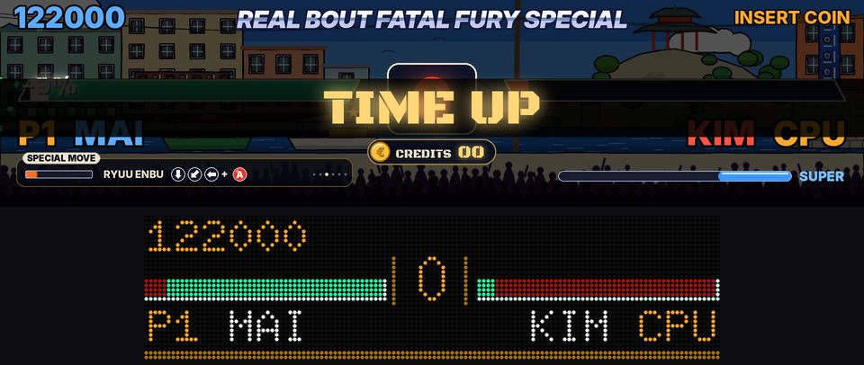

**Samurai Shodown** (`samsho`). Barres de vie, chrono, 13 combattants nommés, leurs coups sous le nom, coups reconnus au stick, 12 lieux.

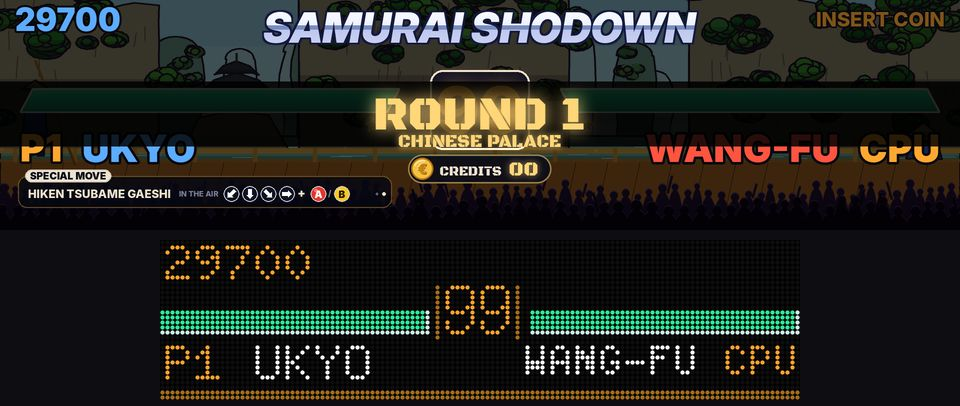

**Samurai Shodown II** (`samsho2`). Barres de vie, chrono, 17 combattants nommés, leurs coups sous le nom, coups reconnus au stick, 12 lieux, jauge.

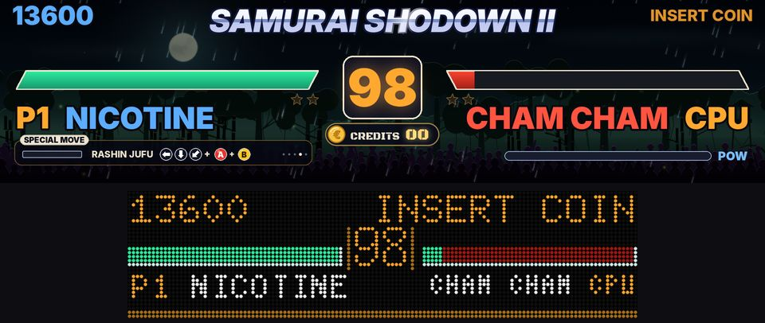

**Samurai Shodown III** (`samsho3`). Barres de vie, chrono, 14 combattants nommés, leurs coups sous le nom, coups reconnus au stick, 3 lieux, jauge.

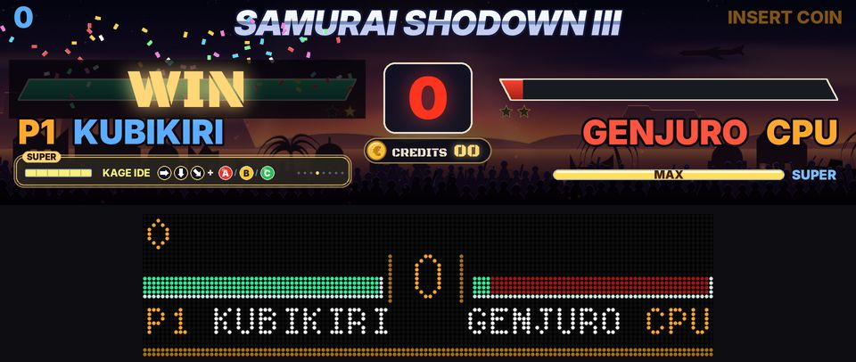

**Samurai Shodown IV** (`samsho4`). Barres de vie, chrono, 18 combattants nommés, leurs coups sous le nom, coups reconnus au stick, 12 lieux, jauge.

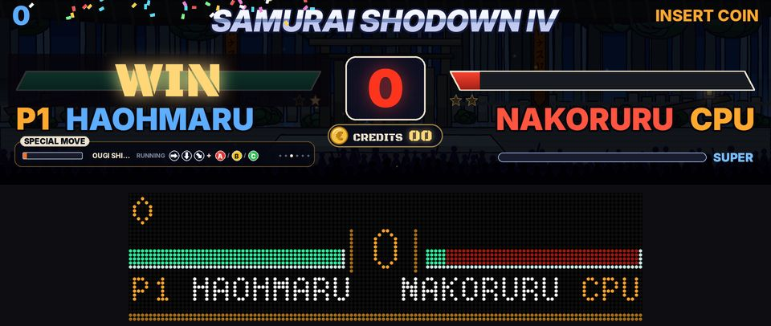

**Samurai Shodown V** (`samsho5`). Barres de vie, chrono, 28 combattants nommés, leurs coups sous le nom, coups reconnus au stick, 15 lieux, jauge.

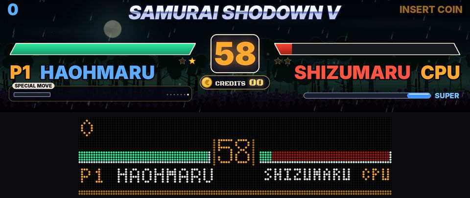

**Samurai Shodown V Special** (`samsh5sp`). Barres de vie, chrono, 28 combattants nommés, leurs coups sous le nom, coups reconnus au stick, 15 lieux, jauge.

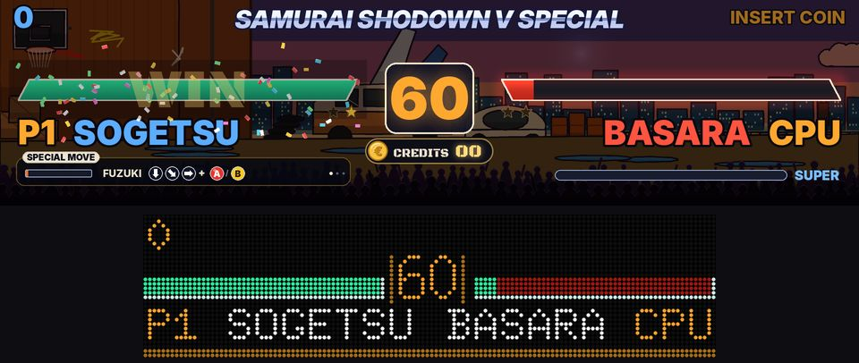

**Savage Reign** (`savagere`). 12 combattants nommés, leurs coups sous le nom, coups reconnus au stick, 5 lieux.

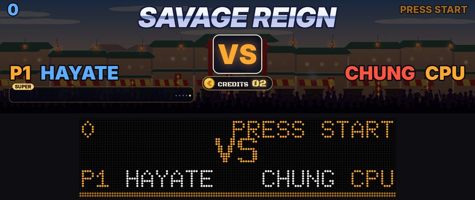

**SNK vs. Capcom** (`svc`). Barres de vie, chrono, 36 combattants nommés, leurs coups sous le nom, coups reconnus au stick, 8 lieux.

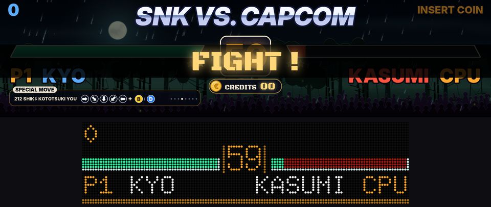

**The King of Fighters '94** (`kof94`). Barres de vie, chrono, 26 combattants nommés, leurs coups sous le nom, coups reconnus au stick, 9 lieux, jauge.

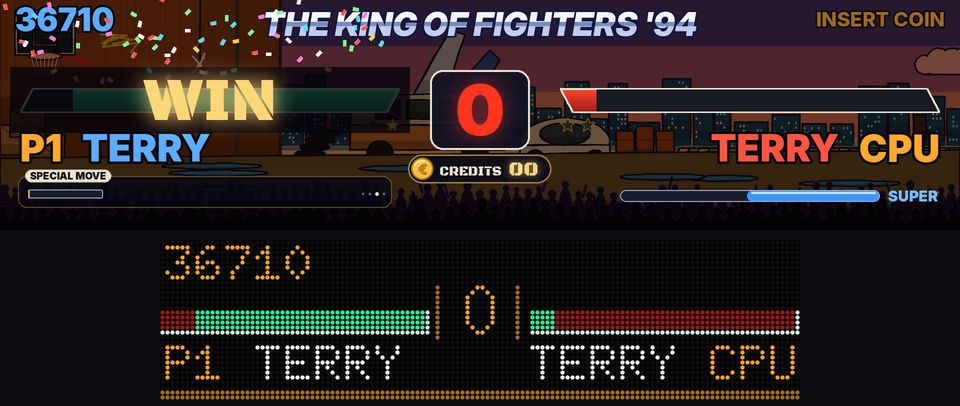

**The King of Fighters '95** (`kof95`). Barres de vie, chrono, 26 combattants nommés, leurs coups sous le nom, coups reconnus au stick, 9 lieux, jauge.

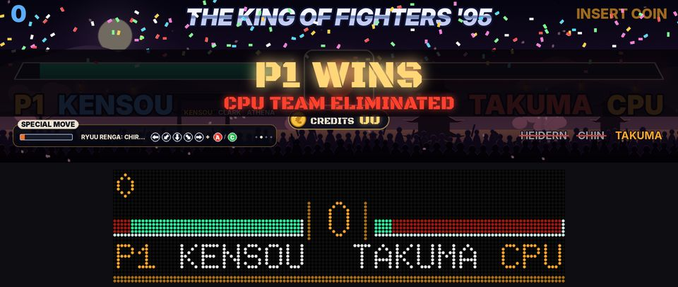

**The King of Fighters '96** (`kof96`). Barres de vie, chrono, 29 combattants nommés, leurs coups sous le nom, coups reconnus au stick, 9 lieux, jauge.

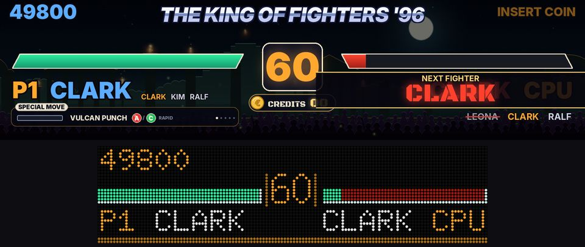

**The King of Fighters '97** (`kof97`). Barres de vie, chrono, 32 combattants nommés, coups désespérés sous la jauge, coups reconnus au stick, 6 lieux.

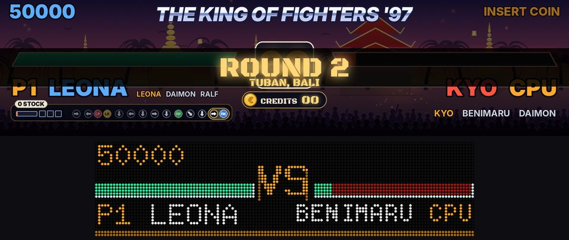

**The King of Fighters '98** (`kof98`). Barres de vie, chrono, 38 combattants nommés, coups désespérés sous la jauge, coups reconnus au stick, 9 lieux.

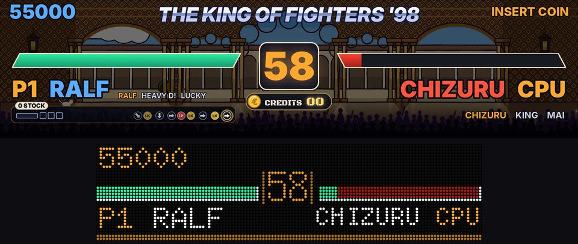

**The King of Fighters '99** (`kof99`). Barres de vie, chrono, 34 combattants nommés, leurs coups sous le nom, coups reconnus au stick, 6 lieux.

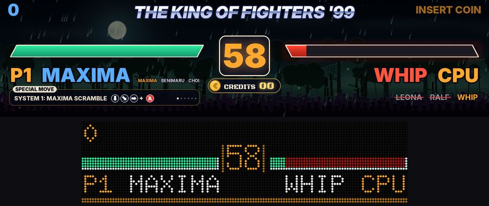

**The King of Fighters 2000** (`kof2000`). Barres de vie, chrono, 36 combattants nommés, leurs coups sous le nom, coups reconnus au stick, 9 lieux.

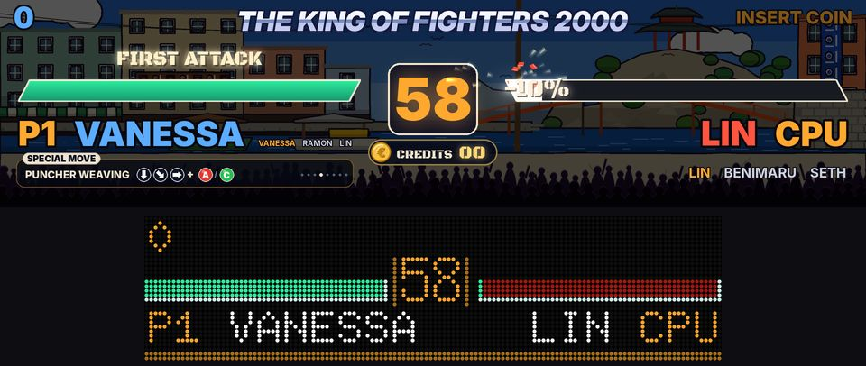

**The King of Fighters 2001** (`kof2001`). Barres de vie, chrono, 42 combattants nommés, leurs coups sous le nom, coups reconnus au stick, 6 lieux.

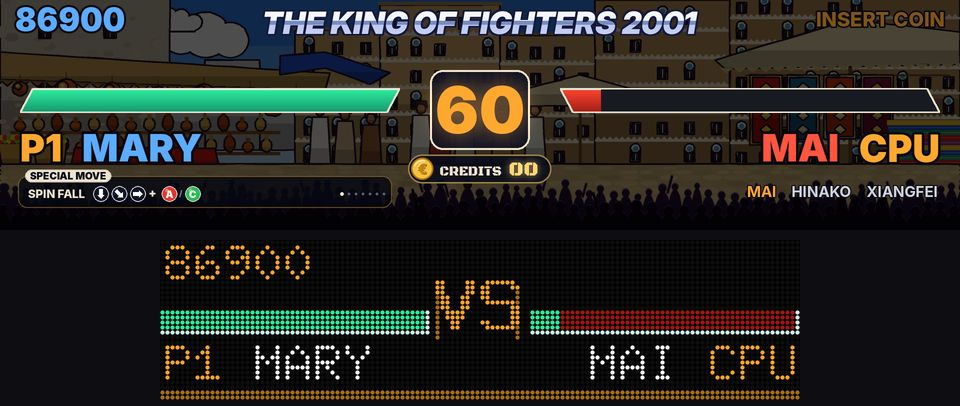

**The King of Fighters 2002** (`kof2002`). Barres de vie, chrono, 41 combattants nommés, coups désespérés sous la jauge, coups reconnus au stick, 7 lieux, jauge.

**The King of Fighters 2003** (`kof2003`). Chrono, 37 combattants nommés, leurs coups sous le nom, coups reconnus au stick.

**The Last Blade** (`lastblad`). Barres de vie, chrono, 15 combattants nommés, leurs coups sous le nom, coups reconnus au stick, 9 lieux.

**The Last Blade 2** (`lastbld2`). Barres de vie, chrono, 20 combattants nommés, leurs coups sous le nom, coups reconnus au stick, 10 lieux, jauge.

**Voltage Fighter Gowcaizer** (`gowcaizr`). Barres de vie, chrono, 12 combattants nommés, leurs coups sous le nom, coups reconnus au stick, 12 lieux.

**Waku Waku 7** (`wakuwak7`). Barres de vie, chrono, 9 combattants nommés, leurs coups sous le nom, coups reconnus au stick, 6 lieux.

**World Heroes** (`wh1`). Barres de vie, chrono, 9 combattants nommés, leurs coups sous le nom, coups reconnus au stick, 15 lieux.

**World Heroes 2** (`wh2`). Barres de vie, chrono, 16 combattants nommés, leurs coups sous le nom, coups reconnus au stick, 15 lieux.

**World Heroes 2 Jet** (`wh2j`). Barres de vie, chrono, 17 combattants nommés, leurs coups sous le nom, coups reconnus au stick, 21 lieux.

**World Heroes Perfect** (`whp`). Barres de vie, chrono, 19 combattants nommés, leurs coups sous le nom, coups reconnus au stick, 12 lieux, jauge.

<b>Shoot'em up</b> (15)

**Aero Fighters 2** (`sonicwi2`). Score, vies, bombes, puissance.

**Aero Fighters 3** (`sonicwi3`). Score, vies, bombes, puissance.

**Alpha Mission II** (`alpham2`). Score, vies, puissance.

**Andro Dunos** (`androdun`). Score, vies.

**Blazing Star** (`blazstar`). Score, vies, puissance.

**Captain Tomaday** (`ctomaday`). Vies, puissance.

**Choutetsu Brikin'ger** (`ironclad`). Score, puissance.

**Ghost Pilots** (`gpilots`). Score, vies, bombes, puissance.

**Last Resort** (`lresort`). Score, vies, puissance.

**Prehistoric Isle 2** (`preisle2`). Score, vies, bombes, puissance.

**Pulstar** (`pulstar`). Score, vies, stage.

**Strikers 1945 Plus** (`s1945p`). Score, vies, bombes, puissance.

**Twinkle Star Sprites** (`twinspri`). Score, vies, bombes, puissance, stage.

**Viewpoint** (`viewpoin`). Score, vies.

**Zed Blade** (`zedblade`). Score, vies, bombes.

<b>Run and gun</b> (11)

**Cyber-Lip** (`cyberlip`). Score, chrono, vies.

**Metal Slug** (`mslug`). Score, chrono, vies, bombes, mission.

**Metal Slug 2** (`mslug2`). Score, chrono, vies, bombes, mission.

**Metal Slug 3** (`mslug3`). Score, chrono, vies, bombes, mission.

**Metal Slug 4** (`mslug4`). Score, chrono, vies, bombes, mission.

**Metal Slug 5** (`mslug5`). Score, chrono, vies, bombes, mission.

**Metal Slug X** (`mslugx`). Score, chrono, vies, bombes, mission.

**NAM-1975** (`nam1975`). Score.

**Ninja Commando** (`ncommand`). Score, chrono.

**Shock Troopers** (`shocktro`). Score, chrono, bombes.

**Shock Troopers 2nd Squad** (`shocktr2`). Score, chrono, vies, puissance.

<b>Action et plates-formes</b> (21)

**Bang Bang Busters** (`b2b`). Vies.

**Blue's Journey** (`bjourney`). Score, chrono, vies.

**Burning Fight** (`burningf`). Score, chrono, vies.

**Crossed Swords** (`crsword`). Scène de son genre.

**Digger Man** (`diggerma`). Vies, bombes.

**Eight Man** (`eightman`). Score, chrono, vies, bombes.

**Ganryu** (`ganryu`). Score, chrono, vies.

**Magician Lord** (`maglord`). Vies, puissance.

**Mutation Nation** (`mutnat`). Score, bombes.

**Neo Bomberman** (`neobombe`). Vies, bombes, stage.

**Neo Mr. Do!** (`neomrdo`). Score, vies.

**Nightmare in the Dark** (`nitd`). Score, chrono, vies.

**Ninja Combat** (`ncombat`). Score, chrono, vies, puissance.

**Robo Army** (`roboarmy`). Vies, bombes.

**Sengoku** (`sengoku`). Score, vies.

**Sengoku 2** (`sengoku2`). Score, vies.

**Sengoku 3** (`sengoku3`). Score, chrono.

**Spin Master** (`spinmast`). Score, vies, bombes.

**The Super Spy** (`superspy`). Score.

**Top Hunter - Roddy & Cathy** (`tophuntr`). Chrono, vies, puissance.

**Zupapa!** (`zupapa`). Score, vies.

<b>Sport</b> (22)

**2020 Super Baseball** (`2020bb`). Chrono.

**Bang Bead** (`bangbead`). Score, puissance.

**Baseball Stars 2** (`bstars2`). Scène de son genre.

**Baseball Stars Professional** (`bstars`). Chrono.

**Battle Flip Shot** (`flipshot`). Score, chrono.

**Football Frenzy** (`fbfrenzy`). Scène de son genre.

**Goal! Goal! Goal!** (`goalx3`). Chrono.

**League Bowling** (`lbowling`). Chrono.

**Neo Turf Masters** (`turfmast`). Puissance.

**Neo-Geo Cup '98** (`neocup98`). Scène de son genre.

**Pleasure Goal** (`pgoal`). Scène de son genre.

**Power Spikes II** (`pspikes2`). Puissance.

**Soccer Brawl** (`socbrawl`). Scène de son genre.

**Street Hoop** (`strhoop`). Scène de son genre.

**Super Dodge Ball** (`sdodgeb`). Score, chrono, puissance.

**Super Sidekicks** (`ssideki`). Scène de son genre.

**Super Sidekicks 2** (`ssideki2`). Scène de son genre.

**Super Sidekicks 3 - The Next Glory** (`ssideki3`). Scène de son genre.

**Tecmo World Soccer '96** (`twsoc96`). Scène de son genre.

**The Ultimate 11 - The SNK Football Championship** (`ssideki4`). Puissance.

**Top Player's Golf** (`tpgolf`). Chrono.

**Windjammers** (`wjammers`). Score, chrono.

<b>Course</b> (6)

**Neo Drift Out - New Technology** (`neodrift`). Chrono.

**Over Top** (`overtop`). Chrono.

**Riding Hero** (`ridhero`). Chrono.

**Stakes Winner** (`stakwin`). Scène de son genre.

**Stakes Winner 2** (`stakwin2`). Puissance.

**Thrash Rally** (`trally`). Chrono.

<b>Réflexion</b> (16)

**Ghostlop** (`ghostlop`). Chrono.

**Gururin** (`gururin`). Scène de son genre.

**Magical Drop II** (`magdrop2`). Scène de son genre.

**Magical Drop III** (`magdrop3`). Scène de son genre.

**Money Puzzle Exchanger** (`miexchng`). Scène de son genre.

**Panic Bomber** (`panicbom`). Score, puissance.

**Pochi and Nyaa** (`pnyaa`). Score.

**Pop 'n Bounce** (`popbounc`). Vies.

**Puzzle Bobble** (`pbobblen`). Score.

**Puzzle Bobble 2** (`pbobbl2n`). Score.

**Puzzle De Pon!** (`puzzledp`). Score, chrono.

**Puzzle De Pon! R!** (`puzzldpr`). Score, chrono.

**Puzzled** (`joyjoy`). Scène de son genre.

**Super Bubble Pop** (`sbp`). Score.

**The Irritating Maze** (`irrmaze`). Chrono, vies.

**Zintrick** (`zintrckb`). Chrono.

<b>Quiz, mahjong et shogi</b> (10)

**Bakatonosama Mahjong Manyuuki** (`bakatono`). Scène de son genre.

**Chibi Maruko-chan Deluxe Quiz** (`marukodq`). Vies.

**Idol Mahjong Final Romance 2** (`froman2b`). Scène de son genre.

**Janshin Densetsu** (`janshin`). Chrono.

**Mahjong Kyo Retsuden** (`mahretsu`). Scène de son genre.

**Minasan no Okagesamadesu!** (`minasan`). Scène de son genre.

**Quiz Daisousa Sen** (`quizdais`). Vies.

**Quiz King of Fighters** (`quizkof`). Vies.

**Quiz Meitantei Neo & Geo** (`quizdai2`). Vies.

**Shougi no Tatsujin** (`moshougi`). Scène de son genre.

<b>Capcom CPS1, CPS2 et CPS3, Cave</b>

Ces scènes sont dessinées avec des valeurs simulées, leurs jeux n'ont pas encore été enregistrés.

## Démarrage rapide

1. Télécharge le zip de la dernière version sur la page [Releases](../../releases/latest). Avant de l'extraire, fais un clic droit dessus, Propriétés, et coche « Débloquer ».
2. Extrais le dossier `ArcadeDMD` dans un chemin sans accents, idéalement `C:\ArcadeDMD`.
3. Lance `install.bat`. Il installe ce qu'il faut (Python 3.13 aussi s'il manque), copie le plugin dans MAME et règle la Pixelcade.
4. Avec un marquee LCD, lance `screen_setup.bat`, ou choisis l'écran plus tard dans l'onglet Écrans de la fenêtre. Avec RetroArch, active « Commandes réseau » (Réglages, Réseau) et joue avec le cœur Arcade (FinalBurn Neo).
5. Lance `demo_fight.bat` pour voir une scène sans jeu, puis `run.bat`. Son icône se met près de l'horloge et sa fenêtre s'ouvre. Joue depuis ton frontend.

Chaque étape en détail est dans [Installer ArcadeDMD](https://github.com/Byoyoyo/ArcadeDMD/wiki/Installer-ArcadeDMD), et quoi faire quand quelque chose ne va pas dans [Dépannage](https://github.com/Byoyoyo/ArcadeDMD/wiki/D%C3%A9pannage).

## Le wiki

| Français | English |
|---|---|
| [Accueil](https://github.com/Byoyoyo/ArcadeDMD/wiki/Accueil) | [Home](https://github.com/Byoyoyo/ArcadeDMD/wiki/Home) |
| [Installer ArcadeDMD](https://github.com/Byoyoyo/ArcadeDMD/wiki/Installer-ArcadeDMD) | [Installation](https://github.com/Byoyoyo/ArcadeDMD/wiki/Installation) |
| [Utilisation](https://github.com/Byoyoyo/ArcadeDMD/wiki/Utilisation) | [Usage](https://github.com/Byoyoyo/ArcadeDMD/wiki/Usage) |
| [Réglages](https://github.com/Byoyoyo/ArcadeDMD/wiki/R%C3%A9glages) | [Configuration](https://github.com/Byoyoyo/ArcadeDMD/wiki/Configuration) |
| [Marquee HD](https://github.com/Byoyoyo/ArcadeDMD/wiki/Marquee-HD) | [HD Marquee](https://github.com/Byoyoyo/ArcadeDMD/wiki/HD-Marquee) |
| [Dalle Pixelcade](https://github.com/Byoyoyo/ArcadeDMD/wiki/Dalle-Pixelcade) | [Pixelcade LED](https://github.com/Byoyoyo/ArcadeDMD/wiki/Pixelcade-LED) |
| [ZeDMD et matériel](https://github.com/Byoyoyo/ArcadeDMD/wiki/ZeDMD-et-mat%C3%A9riel) | [ZeDMD and Hardware](https://github.com/Byoyoyo/ArcadeDMD/wiki/ZeDMD-and-Hardware) |
| [OBS et DOFLinx](https://github.com/Byoyoyo/ArcadeDMD/wiki/OBS-et-DOFLinx) | [OBS and DOFLinx](https://github.com/Byoyoyo/ArcadeDMD/wiki/OBS-and-DOFLinx) |
| [Avec MAME](https://github.com/Byoyoyo/ArcadeDMD/wiki/Avec-MAME) | [MAME](https://github.com/Byoyoyo/ArcadeDMD/wiki/MAME) |
| [Avec RetroArch](https://github.com/Byoyoyo/ArcadeDMD/wiki/Avec-RetroArch) | [RetroArch](https://github.com/Byoyoyo/ArcadeDMD/wiki/RetroArch) |
| [Jeux de combat](https://github.com/Byoyoyo/ArcadeDMD/wiki/Jeux-de-combat) | [Fighting Games](https://github.com/Byoyoyo/ArcadeDMD/wiki/Fighting-Games) |
| [Les Metal Slug](https://github.com/Byoyoyo/ArcadeDMD/wiki/Les-Metal-Slug) | [Metal Slug](https://github.com/Byoyoyo/ArcadeDMD/wiki/Metal-Slug) |
| [Jeux Neo Geo](https://github.com/Byoyoyo/ArcadeDMD/wiki/Jeux-Neo-Geo) | [Neo Geo Games](https://github.com/Byoyoyo/ArcadeDMD/wiki/Neo-Geo-Games) |
| [Capcom et Cave](https://github.com/Byoyoyo/ArcadeDMD/wiki/Capcom-et-Cave) | [Capcom and Cave](https://github.com/Byoyoyo/ArcadeDMD/wiki/Capcom-and-Cave) |
| [Autres jeux](https://github.com/Byoyoyo/ArcadeDMD/wiki/Autres-jeux) | [Other Games](https://github.com/Byoyoyo/ArcadeDMD/wiki/Other-Games) |
| [Les jeux en images](https://github.com/Byoyoyo/ArcadeDMD/wiki/Les-jeux-en-images) | [Games in Pictures](https://github.com/Byoyoyo/ArcadeDMD/wiki/Games-in-Pictures) |
| [Apprendre les adresses](https://github.com/Byoyoyo/ArcadeDMD/wiki/Apprendre-les-adresses) | [Learning Addresses](https://github.com/Byoyoyo/ArcadeDMD/wiki/Learning-Addresses) |
| [Enregistrer une partie](https://github.com/Byoyoyo/ArcadeDMD/wiki/Enregistrer-une-partie) | [Recording a Game](https://github.com/Byoyoyo/ArcadeDMD/wiki/Recording-a-Game) |
| [Fichiers des jeux](https://github.com/Byoyoyo/ArcadeDMD/wiki/Fichiers-des-jeux) | [Game Files](https://github.com/Byoyoyo/ArcadeDMD/wiki/Game-Files) |
| [Tes propres images](https://github.com/Byoyoyo/ArcadeDMD/wiki/Tes-propres-images) | [Your Own Pictures](https://github.com/Byoyoyo/ArcadeDMD/wiki/Your-Own-Pictures) |
| [Dépannage](https://github.com/Byoyoyo/ArcadeDMD/wiki/D%C3%A9pannage) | [Troubleshooting](https://github.com/Byoyoyo/ArcadeDMD/wiki/Troubleshooting) |

## Suivre le projet

Ce qui change à chaque version est dans [CHANGELOG.md](CHANGELOG.md), où en est chaque jeu et la suite dans [PROGRESS.md](PROGRESS.md). Pour signaler un problème ou demander un nouveau jeu, vois [CONTRIBUTING.md](CONTRIBUTING.md). Une partie enregistrée sur ta borne aide le plus ([Enregistrer une partie](https://github.com/Byoyoyo/ArcadeDMD/wiki/Enregistrer-une-partie)).

## Licences et crédits

ArcadeDMD © 2026 Byoyoyo. À partir de la version 1.39.1 il est gratuit pour un usage personnel et non commercial : tu peux l'installer sur tes propres bornes et le modifier pour toi. Le vendre, tout usage commercial et le redistribuer demandent l'accord de l'auteur (fichier `LICENSE`). Les versions jusqu'à la 1.39.0 restent sous licence MIT. Polices bitmap issues des polices X11 « misc-fixed » (domaine public). Les polices HD sont Inter (The Inter Project Authors) et Black Ops One (The Black-Ops Project Authors), toutes deux sous licence SIL Open Font License, voir le dossier `fonts`. Les sprites, les décors HD et les effets sont dessinés par le programme ou pour lui, aucune image ne vient d'un jeu. ZeDMD (firmware GPLv2) et libzedmd (GPLv3) sont téléchargés séparément depuis leurs dépôts officiels https://github.com/PPUC. Les noms de jeux servent uniquement à les identifier. Les adresses viennent des bases de triche de la communauté (FinalBurn Neo, MAME 2003-Plus), des scripts d'entraînement de peon2 et des désassemblages de Sonic, merci à leurs auteurs.

Byoyoyo voulait créer ArcadeDMD depuis longtemps, et l'a lancé après ses échanges avec Vera AI. Merci à Vera AI pour ces échanges.
