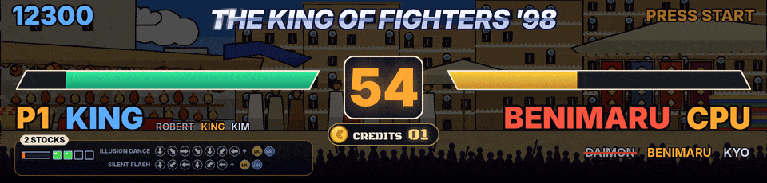
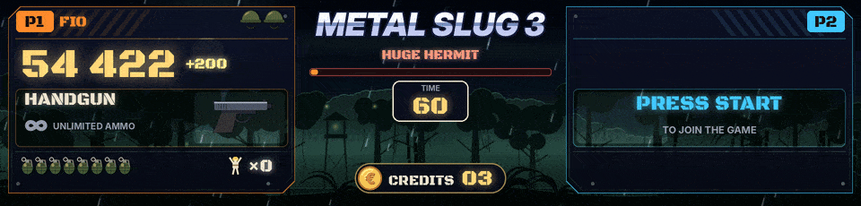
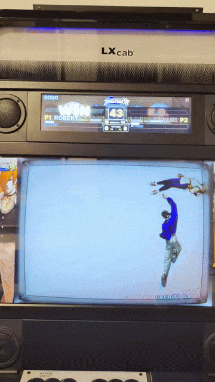
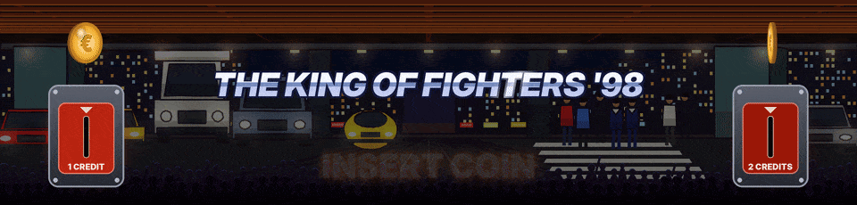
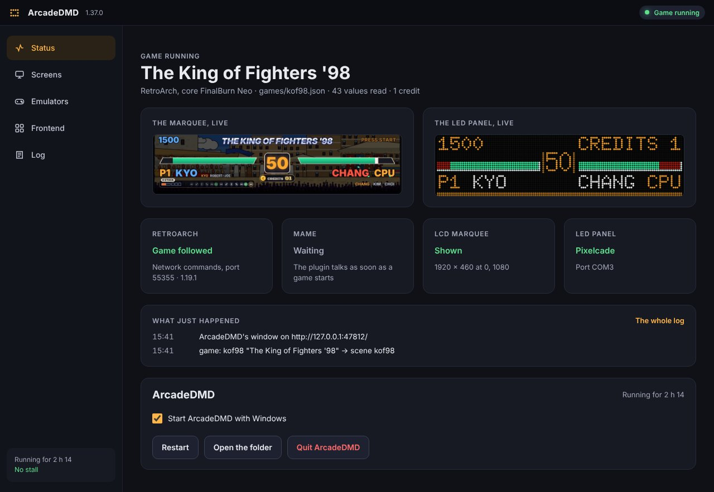

# ArcadeDMD

En français, [README.fr.md](README.fr.md).

Live score, lives, credits and game events from MAME and RetroArch games, shown on the marquee of an arcade cabinet, with an animated scene for each game. On a 128x32 LED panel (**Pixelcade LED**, **ZeDMD**), or in smooth HD on an LCD marquee screen (a 1920 x 460 Vewlix marquee, for example).

**ArcadeDMD is in BETA.** How to install it, set it up and use it is in the **[wiki](https://github.com/Byoyoyo/ArcadeDMD/wiki)**, in English and in French.

## What it does

- Reads the game memory live, with a MAME plugin or through RetroArch's network commands (FinalBurn Neo, Genesis Plus GX). Nothing in the game or the emulator is modified.
- Ready-made scenes for Metal Slug 1 to 5 and X, the 57 Neo Geo fighting games, ninety-seven Neo Geo games done one by one and every other Neo Geo game by genre, every Capcom CPS1, CPS2 and CPS3 game (34 fighting games on their own stages and fifty games done one by one, from Final Fight to 1944), every Cave game (37 games, DoDonPachi, Dai-Ou-Jou, Ketsui, Espgaluda, Mushihime-sama, Deathsmiles, Akai Katana...), After Burner II, Sonic 1 and 2.
- HD scenes with animated backgrounds that follow the game's stage or mission, and an effect for every event (hits, combos, K.O., weapons, bombs, coins...).
- The game's logo when it starts (your LaunchBox Clear Logo, or the logo RetroBat's scraper downloaded). With nobody playing, the fighting games wait for a coin. Insert one and it drops into the slot, the credits roll, then PRESS START.
- Everything is drawn by the program. Your own pictures can replace some drawings ([Your Own Pictures](https://github.com/Byoyoyo/ArcadeDMD/wiki/Your-Own-Pictures)).
- A learning tool finds the missing addresses (score, credits...) from a few captures.
- A window and an icon near the clock, in place of a console. The game running with the marquee and the LED panel live, the marquee screen picked among those Windows sees, RetroArch and the MAME plugin checked and fixed in one click, the frontend, the log.
- Works next to LaunchBox and BigBox, RetroBat, HyperSpin or any other frontend. English and French. Windows, Python 3.12 or newer.

## The window

ArcadeDMD runs near the clock. A click on its icon opens its window, with five tabs, Status, Screens, Emulators, Frontend and Log. See [Usage](https://github.com/Byoyoyo/ArcadeDMD/wiki/Usage).

## The games done with the most care

Every game has a scene, but these were tuned on a real cabinet, round after round, with videos, photos, logs of the games and, since 1.33, one game recorded whole (the values read, the game's memory, its screenshots, see [Recording a Game](https://github.com/Byoyoyo/ArcadeDMD/wiki/Recording-a-Game)), until the marquee follows the game to the moment. The games finished in 1.33, checked frame by frame against a recorded game, are The King of Fighters '98, the six Neo Geo Metal Slug games, Windjammers and Puzzle Bobble 2.

- **The King of Fighters '98.** Its nine stages drawn after the game's places, in a cartoon style, changing with the rounds as the game does, the select screen showing the picks. Under each player, his desperation moves with their commands, the arrows lighting up as the stick does them, RATÉ, DM ! and SDM !, the power gauge, the stocks and MAX as the game shows them. ROUND, FIGHT !, K.O., WIN, PERFECT, the next fighter entering, the team eliminated, and the matches won between two humans. See [Fighting Games](https://github.com/Byoyoyo/ArcadeDMD/wiki/Fighting-Games).
- **Metal Slug 1 to 5 and X.** All six, each tuned on one game recorded whole (1.33). The soldier chosen (Marco, Tarma, Eri, Fio...) beside J1 / J2, his weapon and ammo, the laser as a held beam, the bombs and the grenade that blows up when the game's does, the vehicles of each player (the tank, the camel, the Slugnoid, the Slug Flyer, the Slug Mariner, the Slug Gunner...) with their energy and shells, the lives as the game writes them, the prisoners freed, the lives of every enemy on screen, the boss of mission 1 of each game with WARNING, its name and its life bar (Tetsuyuki, The Keesi II, Iron Nokana MKII, Huge Hermit, Brave Guerrier, Metal Rear), BOSS DESTROYED and MISSION COMPLETE at the game's moment, the backdrops of each mission, the credits with the coin dropping in. The bosses of the later missions are recognised by their life and named after the game's list, to confirm in play.
- **Windjammers.** The game's court as a live map, the disc and the two players where the game puts them, read at every frame, the lobs, a super charging in a ring of flames then SUPER ! with the shot's name, the goals pushing the whole image into the wall, the sets and the match, the players named as in the game, the coins counted even when pressed very fast.
- **Puzzle Bobble and Puzzle Bobble 2.** Both scores, the bubble in the launcher and the next one in their colours, the arrow turning as the game's, each bubble shot leaving in its direction, the round, the VS matches and the rounds won.
- **DoDonPachi.** The score with the continues, the hit counter, the ship and its type, six stages drawn after the maps of the game, and the boss of each stage with its life read in the game, falling when it runs out.
- **Learned on a cabinet too.** Twinkle Star Sprites (its own scene, the hearts and chains), The King of Fighters 2002 and Fatal Fury (their select screens, rounds and teams read from recorded games), Marvel vs. Capcom, X-Men vs. Street Fighter, Marvel Super Heroes vs. Street Fighter, X-Men: Children of the Atom and Hyper Street Fighter II (scores, credits, the POWER gauge, the partners), Strikers 1945 Plus, Giga Wing and Mercs (scores, timer, SUPER SHOT).

The other games read the addresses of the cheat databases and of RetroAchievements, which still have to be confirmed in game. [PROGRESS.md](PROGRESS.md) says where each one stands.

## Quick start

1. Download the zip of the latest version from the [Releases](../../releases/latest) page. Before extracting it, right-click it, choose Properties and tick "Unblock".
2. Extract the `ArcadeDMD` folder to a path with no accented characters, ideally `C:\ArcadeDMD`.
3. Run `install.bat`. It installs what is needed (Python 3.13 too if it is missing), copies the plugin into MAME and sets up the Pixelcade.
4. With an LCD marquee, run `screen_setup.bat`, or pick the screen later in the Screens tab of the window. With RetroArch, turn on "Network Commands" (Settings, Network) and play with the Arcade (FinalBurn Neo) core.
5. Run `demo_fight.bat` to see a scene without a game, then `run.bat`. Its icon sits near the clock and its window opens. Play from your frontend.

Every step in detail is in [Installation](https://github.com/Byoyoyo/ArcadeDMD/wiki/Installation), and what to do when something goes wrong in [Troubleshooting](https://github.com/Byoyoyo/ArcadeDMD/wiki/Troubleshooting).

## The wiki

| English | Français |
|---|---|
| [Home](https://github.com/Byoyoyo/ArcadeDMD/wiki/Home) | [Accueil](https://github.com/Byoyoyo/ArcadeDMD/wiki/Accueil) |
| [Installation](https://github.com/Byoyoyo/ArcadeDMD/wiki/Installation) | [Installer ArcadeDMD](https://github.com/Byoyoyo/ArcadeDMD/wiki/Installer-ArcadeDMD) |
| [Usage](https://github.com/Byoyoyo/ArcadeDMD/wiki/Usage) | [Utilisation](https://github.com/Byoyoyo/ArcadeDMD/wiki/Utilisation) |
| [Configuration](https://github.com/Byoyoyo/ArcadeDMD/wiki/Configuration) | [Réglages](https://github.com/Byoyoyo/ArcadeDMD/wiki/R%C3%A9glages) |
| [HD Marquee](https://github.com/Byoyoyo/ArcadeDMD/wiki/HD-Marquee) | [Marquee HD](https://github.com/Byoyoyo/ArcadeDMD/wiki/Marquee-HD) |
| [Pixelcade LED](https://github.com/Byoyoyo/ArcadeDMD/wiki/Pixelcade-LED) | [Dalle Pixelcade](https://github.com/Byoyoyo/ArcadeDMD/wiki/Dalle-Pixelcade) |
| [ZeDMD and Hardware](https://github.com/Byoyoyo/ArcadeDMD/wiki/ZeDMD-and-Hardware) | [ZeDMD et matériel](https://github.com/Byoyoyo/ArcadeDMD/wiki/ZeDMD-et-mat%C3%A9riel) |
| [OBS and DOFLinx](https://github.com/Byoyoyo/ArcadeDMD/wiki/OBS-and-DOFLinx) | [OBS et DOFLinx](https://github.com/Byoyoyo/ArcadeDMD/wiki/OBS-et-DOFLinx) |
| [MAME](https://github.com/Byoyoyo/ArcadeDMD/wiki/MAME) | [Avec MAME](https://github.com/Byoyoyo/ArcadeDMD/wiki/Avec-MAME) |
| [RetroArch](https://github.com/Byoyoyo/ArcadeDMD/wiki/RetroArch) | [Avec RetroArch](https://github.com/Byoyoyo/ArcadeDMD/wiki/Avec-RetroArch) |
| [Fighting Games](https://github.com/Byoyoyo/ArcadeDMD/wiki/Fighting-Games) | [Jeux de combat](https://github.com/Byoyoyo/ArcadeDMD/wiki/Jeux-de-combat) |
| [Metal Slug](https://github.com/Byoyoyo/ArcadeDMD/wiki/Metal-Slug) | [Les Metal Slug](https://github.com/Byoyoyo/ArcadeDMD/wiki/Les-Metal-Slug) |
| [Neo Geo Games](https://github.com/Byoyoyo/ArcadeDMD/wiki/Neo-Geo-Games) | [Jeux Neo Geo](https://github.com/Byoyoyo/ArcadeDMD/wiki/Jeux-Neo-Geo) |
| [Capcom and Cave](https://github.com/Byoyoyo/ArcadeDMD/wiki/Capcom-and-Cave) | [Capcom et Cave](https://github.com/Byoyoyo/ArcadeDMD/wiki/Capcom-et-Cave) |
| [Other Games](https://github.com/Byoyoyo/ArcadeDMD/wiki/Other-Games) | [Autres jeux](https://github.com/Byoyoyo/ArcadeDMD/wiki/Autres-jeux) |
| [Learning Addresses](https://github.com/Byoyoyo/ArcadeDMD/wiki/Learning-Addresses) | [Apprendre les adresses](https://github.com/Byoyoyo/ArcadeDMD/wiki/Apprendre-les-adresses) |
| [Recording a Game](https://github.com/Byoyoyo/ArcadeDMD/wiki/Recording-a-Game) | [Enregistrer une partie](https://github.com/Byoyoyo/ArcadeDMD/wiki/Enregistrer-une-partie) |
| [Game Files](https://github.com/Byoyoyo/ArcadeDMD/wiki/Game-Files) | [Fichiers des jeux](https://github.com/Byoyoyo/ArcadeDMD/wiki/Fichiers-des-jeux) |
| [Your Own Pictures](https://github.com/Byoyoyo/ArcadeDMD/wiki/Your-Own-Pictures) | [Tes propres images](https://github.com/Byoyoyo/ArcadeDMD/wiki/Tes-propres-images) |
| [Troubleshooting](https://github.com/Byoyoyo/ArcadeDMD/wiki/Troubleshooting) | [Dépannage](https://github.com/Byoyoyo/ArcadeDMD/wiki/D%C3%A9pannage) |

## Following the project

What changed in each version is in [CHANGELOG.md](CHANGELOG.md), where each game stands and what comes next in [PROGRESS.md](PROGRESS.md). To report a problem or ask for a new game, see [CONTRIBUTING.md](CONTRIBUTING.md). A game recorded on your cabinet helps the most ([Recording a Game](https://github.com/Byoyoyo/ArcadeDMD/wiki/Recording-a-Game)).

## Licenses and credits

ArcadeDMD is © 2026 Byoyoyo, released under the MIT license (`LICENSE` file). You may use, modify and share it, as long as the copyright notice and the license stay with it. The bitmap fonts come from the X11 "misc-fixed" fonts (public domain). The HD fonts are Inter (The Inter Project Authors) and Black Ops One (The Black-Ops Project Authors), both under the SIL Open Font License, see the `fonts` folder. The sprites, the HD backgrounds and the effects are drawn by the program or for it, no image comes from a game. ZeDMD (GPLv2 firmware) and libzedmd (GPLv3) are downloaded separately from their official repositories https://github.com/PPUC. Game names are used only to identify the games. The addresses come from the community cheat databases (FinalBurn Neo, MAME 2003-Plus), peon2's training scripts and the Sonic disassemblies, with thanks to their authors.

Byoyoyo had wanted to build ArcadeDMD for a long time, and started it after his exchanges with Vera AI. Thanks to Vera AI for those exchanges.
