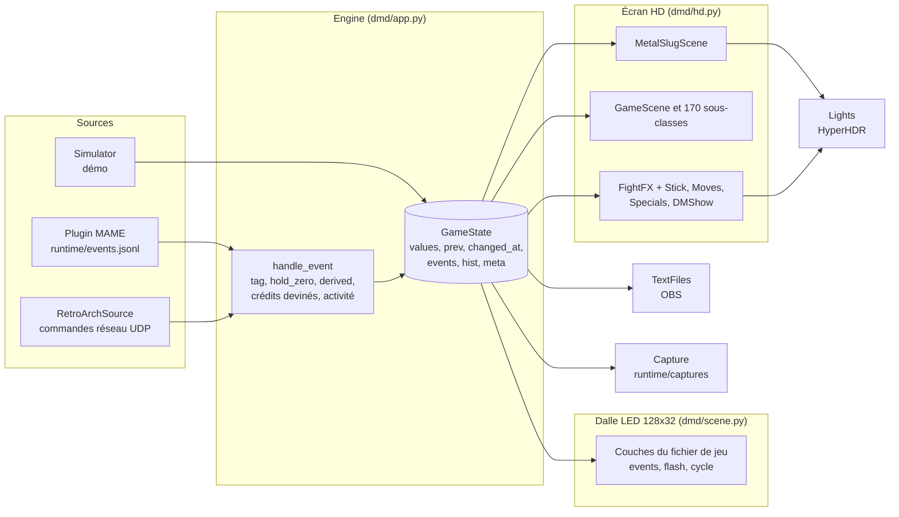
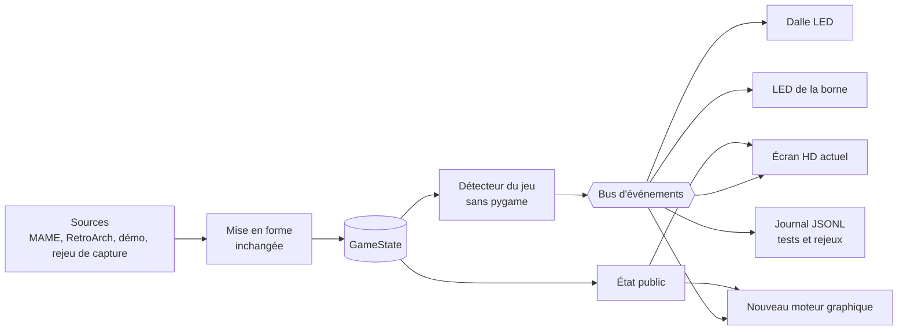

# ArcadeDMD, passage de relais du moteur d'événements

Ce document décrit comment ArcadeDMD lit la mémoire des jeux, comment il en tire des événements, et où cette intelligence est aujourd'hui mêlée au dessin. Il propose une interface pour qu'un nouveau moteur graphique reçoive l'état du jeu et les événements sans relire la mémoire et sans perdre les synchronisations déjà réglées.

C'est un audit et une proposition. Rien n'est modifié dans le moteur. Aucune fonction n'est supprimée, aucune adresse, aucune temporisation et aucune règle de détection ne change. La refonte ne commence qu'après validation de l'architecture décrite au chapitre 6.

Trois fichiers vont ensemble.

| Fichier | Contenu | Origine |
| --- | --- | --- |
| `docs/EVENT_ENGINE_HANDOFF.md` | Ce document | Écrit à la main, vérifié contre le code |
| [`docs/EVENT_ENGINE_CATALOG.md`](EVENT_ENGINE_CATALOG.md) | Chaque jeu, sa scène, ses valeurs, ses annonces LED, puis chaque scène avec ses annonces et leurs conditions | Produit par `python tools/event_catalog.py` |
| [`docs/EVENT_ENGINE_VALUES.md`](EVENT_ENGINE_VALUES.md) | Chaque adresse de chaque fichier de jeu | Produit par le même outil |

`tools/event_catalog.py` ne fait que lire. `python tools/event_catalog.py --check` dit si les deux catalogues sont à jour.

## 0. État décrit et branches

Le document décrit le code de la version 1.39.2, publiée et présente dans `main`. Les numéros de ligne cités valent pour cette version.

| Branche | État | Ce qu'il faut savoir |
| --- | --- | --- |
| `main` | 1.39.2 publiée | La référence. Contient la classe `Machines`, la scène `SecondSquadScene`, la règle de départ de la scène de base (`SETTLE`), les annonces de Metal Slug limitées à ce que le jeu donne en jeu, le contrôle `tools/scenes_check.py` |
| `feature/visual-engine` | Essai du nouveau moteur visuel, parti de la 1.39.1 | Touche `dmd/hd_mslug.py` (dessin seulement) et lit `Player.recoil_t`, `Player.bomb_t`, `Player.hit_t`. Doit reprendre `main` pour avoir les corrections de la 1.39.2 |
| `docs/event-engine-handoff` | Ce document | N'ajoute que de la documentation et l'outil de catalogue |

`feature/visual-engine` et `main` se fusionnent sans conflit (vérifié avec `git merge-tree`, rien n'a été écrit). Tant que cette branche n'a pas repris `main`, elle garde les défauts corrigés par la 1.39.2, par exemple 1UP annoncé à chaque continue dans Metal Slug. Toute comparaison de comportement doit se faire sur une base qui contient la 1.39.2.

Les dessins du dépôt sont faits pour ArcadeDMD, aucun ne vient d'un jeu. Les images propres au propriétaire de la borne vont dans `sprites/<jeu>/`, que `.gitignore` écarte (`sprites/*/`). Un nouveau moteur de rendu doit garder cette séparation.

## 1. Vue d'ensemble



Le point central de l'audit tient en une phrase. La lecture mémoire et la mise en forme des valeurs sont déjà séparées du dessin, mais la détection des événements vit à l'intérieur des scènes de l'écran HD, dans la même passe que le dessin, et une partie dépend de l'état des animations.

Il y a aujourd'hui trois endroits où un événement est décidé.

1. Dans les fichiers de jeu, par des expressions (`tag`, `derived`) et par les règles d'annonce de la dalle LED (`events`).
2. Dans le moteur (`dmd/app.py`), pour ce qui dit qui joue et combien de crédits il y a.
3. Dans les scènes HD (`dmd/hd_mslug.py`, `dmd/hd_fight.py`, `dmd/hd_games*.py` et leurs voisines), pour tout le reste. C'est là que se trouvent les réglages les plus fins.

## 2. Cartographie des modules

Catégories. **A** acquisition, **N** mise en forme des valeurs, **E** état, **D** détection, **R** rendu, **D+R** détection et rendu dans la même classe.

### 2.1 Acquisition et mise en forme

| Module | Cat. | Rôle | Fonctions clés |
| --- | --- | --- | --- |
| `mame-plugin/arcadedmd/init.lua` | A | Lit la mémoire dans MAME et écrit des lignes JSON dans `runtime/events.jsonl`. Une lecture toutes les `poll_frames` images (2 par défaut), le stick et les boutons à chaque image | |
| `dmd/retroarch.py` | A | Lit la mémoire par les commandes réseau de RetroArch (`READ_CORE_RAM`, UDP 55355) et envoie au moteur les mêmes messages que le plugin | `RetroArchSource` (l. 691), `read_values` (l. 621), `_poll_fast` (l. 794), `Layout` (l. 385), `resolve` (l. 550) |
| `dmd/memvalues.py` | N | Décode une valeur à partir d'octets, calcule les valeurs `derived` et `tag` | `decode` (l. 89), `target` (l. 68), `game_values` (l. 166), `resolve_value` (l. 312), `derive` (l. 317), `forget_seen` (l. 196) |
| `dmd/app.py` | N, E | Boucle principale, choix du jeu, mise en forme des valeurs, état partagé | `Engine.handle_event` (l. 986), `Engine.start_game` (l. 832), `Engine.step` (l. 1375), `Engine._activity` (l. 1038), `Engine._hold_zero` (l. 1245), `EventTail` (l. 331), `Simulator` (l. 422) |
| `dmd/neocoins.py` | N | Crédits d'une Neo Geo MVS devinés d'après le BIOS quand ils ne se lisent pas | `NeoCoins.update` (l. 121), `NeoCoins.add` (l. 101) |
| `dmd/coinbuttons.py` | A, N | Boutons de pièces et de départ de la borne, comptés quand le jeu ne dit pas ses crédits | `CoinButtons`, `Engine.coin_in` (l. 1198), `Engine.start_in` |
| `dmd/scene.py` (début) | E | L'état partagé | `GameState` (l. 21), `GameState.update` (l. 40), `check_when` (l. 180) |
| `dmd/capture.py` | E | Écrit chaque changement de valeur avec son heure dans `runtime/captures/<jeu>-<date>.log` | `Capture.poll` (l. 81), `read_capture` (l. 132) |

### 2.2 Détection et rendu de l'écran HD

| Module | Cat. | Rôle | Fonctions où se décide un événement |
| --- | --- | --- | --- |
| `dmd/hd.py` | R | Choisit la scène d'un jeu et dessine le combat et l'écran générique | `HDRenderer._render_scene` (l. 636), `draw_fight` (l. 708) |
| `dmd/hd_mslug.py` | D+R | Les six Metal Slug et leurs versions | `update` (l. 994), `_player` (l. 1406), `_diff` (l. 1472), `_vehicle` (l. 1582), `_boss` (l. 1112), `_throws` (l. 1851), `_throw` (l. 1857), `_explode_live` (l. 1891) |
| `dmd/hd_fight.py` | D+R | Tous les jeux de combat | `FightFX.update` (l. 343), `_fight` (l. 1076), `_go` (l. 1117), `_hit` (l. 863), `_rounds` (l. 302), `_round_over` (l. 989), `_match_won` (l. 1007), `_select_phase` (l. 737), `_hyper_watch` (l. 806), `_dm_watch` (l. 839) |
| `dmd/hd_stick.py` | D | Coups spéciaux reconnus au stick | `Stick.update`, `Stick.round_start` |
| `dmd/hd_moves.py`, `dmd/hd_dm.py` | D+R | Coups désespérés de The King of Fighters '97, '98 et 2002 | `Moves.update`, `DMShow.hit`, `DMShow.ko` |
| `dmd/hd_specials.py` | D+R | Coups et supers sous le nom du joueur, jauge pleine | `Specials.gauge`, appel `lights.event("super")` (l. 164) |
| `dmd/hd_games.py` | D+R | Scène de base de tous les autres jeux, shoot'em up de base, Puzzle Bobble, Windjammers, suivi des gros engins, Shock Troopers | `GameScene.render` (l. 529), `changed` (l. 161), `starting` (l. 184), `one_up` (l. 190), `BlazingStarScene.update` (l. 730), `score_events` (l. 784), `Machines.machines` (l. 2227) |
| `dmd/hd_games2.py` à `hd_games16.py` | D+R | Une classe par jeu ou par petite famille | Méthodes `always`, `restart`, `update` de chaque classe |
| `dmd/hd_squad.py` | D+R | Shock Troopers 2nd Squad | `missions` (l. 214), `boss_watch` (l. 336), `power_up` (l. 641) |
| `dmd/hd_mercs.py` | D+R | Mercs, et l'alerte de boss partagée | `BossAlert.announce` (l. 65), `MercsScene.track_boss` (l. 296) |
| `dmd/hd_cave.py`, `dmd/hd_games13.py` | D+R | Shoot'em up Cave et Capcom | `CaveShooterScene.update`, `boss_arrives` (l. 932), `_CpsShooter` |
| `dmd/hd_panels.py` | D+R | Jeux d'action Capcom décrits par des données (jauges, objets, étages) | `PanelScene.update` |
| `dmd/hd_twinkle.py`, `dmd/hd_spf.py` | D+R | Twinkle Star Sprites, Super Puzzle Fighter II Turbo | |
| `dmd/hd_fx.py` | R | Particules, textes qui montent, explosions, secousses, actions différées | `FX.text`, `FX.explosion`, `FX.later`, `FX.shake`, `FX.flash` |
| `dmd/hd_bg.py`, `dmd/hd_stages.py`, `dmd/hd_themes*.py` | R | Décors | |
| `dmd/hd_coin.py`, `dmd/hd_credits.py` | R | Écran des pièces, pastille des crédits | |

Le choix de la scène se fait dans `HDRenderer._render_scene`, dans cet ordre.

1. `family(key)` reconnaît un Metal Slug, la scène est `MetalSlugScene`.
2. Le bloc `hd` du fichier de jeu donne `scene`, présent dans `GAME_SCENES` (179 entrées), la scène est la classe correspondante.
3. Le jeu est un combat si son modèle (`scene_from`) est `neogeo_combat`, `cps_combat` ou `cave_combat`, ou si `health` et `health_p2` sont lues. `FightFX.update` détecte, `draw_fight` dessine.
4. Sinon l'écran générique (`draw_generic`).

### 2.3 Dalle LED, sorties et autres consommateurs

| Module | Cat. | Rôle |
| --- | --- | --- |
| `dmd/scene.py` | D+R | Dalle LED décrite par les couches du fichier de jeu. `EventsEl` (l. 943) joue les règles d'annonce, les couches de texte clignotent quand une valeur change (`flash`) |
| `dmd/outputs.py`, `dmd/pixelcade.py` | R | Envoi des images à la dalle, fenêtre d'aperçu qui porte l'écran HD |
| `dmd/lights.py` | Consommateur | LED de la borne par HyperHDR. Six événements nommés, `coin`, `blow`, `ko`, `super`, `win`, `boss` |
| `dmd/textfiles.py` | Consommateur | Valeurs écrites dans des fichiers texte pour OBS |
| `dmd/gui.py` | Consommateur | Fenêtre de réglage, serveur HTTP local protégé par un jeton |

`dmd/lights.py` est le seul endroit où des événements nommés existent déjà. C'est le germe de l'interface proposée.

### 2.4 Outils de vérification

| Outil | Ce qu'il vérifie | Dans le contrôle des demandes de fusion |
| --- | --- | --- |
| `tools/scenes_check.py` | Chaque scène HD joue une courte partie inventée, un joueur puis deux, sans abandonner | Oui |
| `tools/replay_capture.py` | Rejoue une capture dans le moteur de combat et écrit ce que l'écran aurait montré | Non, à la main |
| `tools/values_check.py` | Chaque valeur d'un fichier de jeu contre un enregistrement complet de la mémoire | Non, à la main |
| `tools/stick_check.py` | Coups reconnus au stick sur une vraie partie | Oui |
| `tools/lights_check.py` | Ordres envoyés à HyperHDR pour chaque événement | Oui |
| `tools/robot_check.py`, `tools/gui_check.py` | Tour du robot, fenêtre de réglage | Oui |
| `tools/package.py --check` | Version, notes, fichiers de jeu | Oui |
| `tools/event_catalog.py` | Produit les deux catalogues de ce dossier | Non |

## 3. Les valeurs mémoire

### 3.1 Où sont les adresses

Chaque jeu a un fichier `games/<romset>.json`. Il y en a 303, dont 15 ne sont pas des jeux (10 modèles sans romset et 5 fichiers de repli par genre, marqués `fallback`). Ils décrivent 4108 valeurs. Les adresses, leurs types et leurs options sont listés dans [EVENT_ENGINE_VALUES.md](EVENT_ENGINE_VALUES.md). Le sens de chaque valeur est écrit dans son champ `note`. **Les fichiers de jeu restent la seule référence.** Un nouveau moteur de rendu ne doit ni les lire ni les recopier, il reçoit des valeurs nommées.

| Clé du fichier | Rôle |
| --- | --- |
| `match` | Les romsets que le fichier couvre, l'original en premier |
| `retroarch` | Fenêtre de mémoire vue par RetroArch (`ram_base`, `ram_size`, `swap16`, `swap32`) |
| `memory.cpu`, `memory.values` | Le processeur et les valeurs lues |
| `per_game` | Adresses propres à un romset (18 fichiers) |
| `tag` | Valeurs recalculées avant affichage à partir d'autres valeurs lues (11 fichiers) |
| `derived` | Valeurs calculées, noms de personnages, boss, fin de mission (129 fichiers) |
| `activity` | Pour un jeu sans BIOS qui dit qui joue, les valeurs dont le mouvement dit qu'on joue (116 fichiers) |
| `coins` | La valeur qui dit quand un joueur commence et prend un crédit compté (15 fichiers) |
| `scene`, `scene_from` | La dalle LED du jeu, ou celle d'un modèle |
| `hd` | La scène HD du jeu et ses options, décors, lieux, seuils de boss, réglages de FIGHT |
| `specials`, `moves`, `hyper`, `buttons` | Coups des combattants et leurs commandes |
| `demo`, `demo_hand` | Valeurs simulées pour la démonstration, sans rapport avec un vrai jeu |

### 3.2 Décodage d'une valeur

`dmd/memvalues.py`, fonction `decode`. Le plugin MAME fait le même calcul.

| Option | Effet, dans l'ordre d'application |
| --- | --- |
| `addr`, `type`, `bytes` | Adresse et forme. Types `u8`, `u16`, `u32`, `s8`, `s16`, `s32`, `be`, `le`, `bcd`, `bcd_le`, `digits`, `digits_le`, `hex` (sonde), `u16s` (liste de mots, `count` et `stride`) |
| `ptr`, `ptr_range` | L'objet bouge en mémoire. L'adresse est lue à `ptr`, `addr` est alors un décalage. `ptr_range` écarte un pointeur pas encore prêt |
| `mask`, `shift` | Bits gardés puis décalés |
| `zero_from` | Une valeur brute au-dessus de ce seuil vaut `min`. Une barre de vie passée sous zéro se lit 0xFF |
| `mult`, `add` | Multiplication puis addition. Une barre de vie devient un pourcentage, une réserve de vies perd le vaisseau qui vole |
| `round` | Arrondi |
| `valid` | Bornes des valeurs possibles. Hors bornes la valeur n'est pas lue et garde la précédente |
| `min`, `max` | Bornes d'affichage. `max` sert aussi de plein d'une jauge |
| `fast` | Lue à chaque image de l'émulateur (stick, boutons, compteur du BIOS) |
| `start`, `delay` | Valeur tenue avant l'annonce du combat et délai, lus par le moteur de combat (voir 4.4) |
| `hold_zero` | Un score lu à zéro en pleine partie garde l'ancien pendant ce nombre de secondes (`Engine._hold_zero`) |
| `mame_only`, `human`, `not_learned` | Lue seulement sous MAME, dit qui dirige le joueur, exclue de l'apprentissage |

Les barres de vie des jeux de combat arrivent en pourcentage de 0 à 100. Tous les seuils du moteur de combat sont exprimés dans cette unité.

### 3.3 Expressions des fichiers de jeu

`tag` et `derived` sont évaluées par `resolve_value`. Les formes existantes sont `value` avec `names`, `sum`, `join`, `team`, `pick` avec `at`, `ge`, `eq`, `between`, `all`, `first` et `rise`. `rise` est la seule qui se souvient d'une lecture à l'autre. `forget_seen` l'efface au départ d'un jeu. Plusieurs événements sont donc déjà décidés dans les fichiers de jeu, par exemple l'arrivée du boss de DoDonPachi (`derived.boss`), la fin de mission des Metal Slug (`derived.mission_done`), le nom du soldat choisi (`derived.p1_name`).

Une table ne doit jamais être recodée ailleurs. L'ordre des soldats change d'un Metal Slug à l'autre (Metal Slug X donne Marco, Eri, Tarma, Fio, Metal Slug 4 donne Marco, Trevor, Nadia, Fio). Le nom se lit dans `p1_name`, pas dans `p1_chr`.

### 3.4 Noms des valeurs

Les noms sont partagés entre les jeux, ce qui permet aux scènes de famille de fonctionner. Le suffixe `_p2` désigne le joueur 2. Un nom qui commence par `_` sert à la détection et n'est jamais affiché.

| Nom | Sens |
| --- | --- |
| `p1_mode`, `p2_mode` | État du joueur d'après le BIOS Neo Geo. 1 il joue, 2 décompte du continue, 3 game over, autre valeur hors partie. Lu dans 165 fichiers. Pour les jeux sans BIOS, le moteur le déduit (`activity`) |
| `credits` | Crédits, lus, devinés d'après le BIOS (`NeoCoins`) ou comptés aux boutons |
| `score`, `lives`, `bombs`, `power`, `weapon`, `ammo`, `time` | Sens habituel. `time` est le chrono du jeu en secondes |
| `health`, `energy` | Barre de vie |
| `stage`, `round`, `mission`, `level`, `area` et les autres mots de `STAGE_WORDS` | Position dans le jeu |
| `p1_char`, `p1_name`, `boss_name` | Noms calculés (`derived`) |
| `p1_input`, `p2_input`, `_in_p1`, `_in_p2` | Stick et boutons vus par le BIOS |
| `bios_request`, `bios_mode`, `bios_timer`, `bios_mvs` | Traces du BIOS qui servent à deviner les crédits |
| `_hps` | Table des vies des objets du jeu, une liste (`u16s`) |

### 3.5 Messages d'entrée et état partagé

Les sources envoient des messages `{"t": ...}` au moteur. `start` (jeu lancé, avec `system`, `parent`, `description`, `values`), `v` (valeurs changées, dans `v`), `hb` (battement, mêmes valeurs sans effet d'annonce), `stop`, `pause`, `resume`, `capture`. Un message `v` peut porter `at`, l'instant de lecture du stick.

`Engine.handle_event` applique dans l'ordre `tag`, `hold_zero`, l'écriture des valeurs en commençant par celles qui finissent par `_mode`, `derived`, puis les crédits devinés. Sans nouvelles de la source pendant `heartbeat_timeout` secondes (8), le moteur revient à l'écran d'attente.

`GameState` (`dmd/scene.py`, l. 21) contient ce que tout le monde lit.

| Champ | Contenu |
| --- | --- |
| `values`, `prev` | Valeur courante et valeur d'avant, par nom |
| `changed_at` | Instant du dernier changement, par nom |
| `events` | Liste `(nom, ancienne, nouvelle, t)` vidée à chaque image, lue par la dalle LED |
| `hist` | Pour les noms `_in_*`, les 96 derniers changements du stick avec leur instant de lecture |
| `meta` | Le jeu, son titre, son romset, son parent |
| `paused` | Émulateur en pause |

### 3.6 Cadences

| Étape | Cadence |
| --- | --- |
| Plugin MAME | Toutes les 2 images de l'émulateur, stick et boutons à chaque image |
| RetroArch | `poll_ms` 100 ms par défaut, 50 ms au minimum, valeurs `fast` à chaque image de RetroArch |
| Sur les parties réelles enregistrées | Un changement de valeur est vu toutes les 0,12 à 0,2 s, parfois 0,4 s |
| Boucle du moteur | `fps` 50 |
| Écran HD | 50 images par seconde (`FPS` de la scène). La détection des scènes tourne à cette cadence |
| Dalle LED | 30 images par seconde au plus (`max_fps`) |

Trois horloges coexistent. Le `now` de la boucle du moteur, l'horloge de l'écran HD (`HDRenderer.clock`, `time.monotonic` par défaut, remplaçable pour les rejeux) et `fx.now`, l'horloge des effets mise à jour par `FX.update`. Les captures datent leurs lignes en secondes depuis leur début.

## 4. Les mécanismes de détection existants

Le détail scène par scène, avec chaque condition telle que le code l'écrit, est dans [EVENT_ENGINE_CATALOG.md](EVENT_ENGINE_CATALOG.md). Ce chapitre décrit les mécanismes réglés, ceux qu'une extraction doit reproduire à l'identique.

### 4.1 Règles communes des scènes (`GameScene`, `dmd/hd_games.py`)

Elles valent pour 182 jeux, par 170 classes.

- **Comparaison image par image.** `render` garde les valeurs de l'image d'avant dans `self.prev`. `changed(vals, nom)` rend `(avant, après)` quand la valeur a changé depuis l'image précédente.
- **Personne ne joue.** `nobody(vals)` est vrai quand `p1_mode` est connu et qu'aucun joueur n'est en mode 1 ou 2. Dans ce cas `update` n'est pas appelé et l'écran d'attente s'affiche. Au retour, `restart` est appelé et `prev` est rempli avec les valeurs présentes, rien ne se déclenche pour ce qui est déjà là.
- **Départ d'un joueur.** `began[côté]` est posé quand son mode passe à 1, ou quand ses vies passent de 0 à 2 ou plus.
- **Ce que le jeu donne au départ n'est pas un gain.** Pendant `SETTLE` (2,5 s) après `began`, une valeur qui quitte zéro n'est pas un changement. Trois exceptions. Les noms qui commencent par un mot de `STAGE_WORDS` (`stage`, `round`, `mission`, `level`, `area`, `act`, `scene`, `floor`, `lap`, `wave`, `world`, `inning`), les vies (`lives`), et un score inférieur à `RESTORED` (5000). Un score qui quitte zéro d'au moins 5000 est le score rendu par un continue.
- **1UP.** `one_up` est vrai pour exactement une vie de plus alors que le joueur était déjà en mode 1.
- **GAME OVER.** Le mode passe à 3 depuis 1 ou 2, bandeau de 2,2 s.
- **CONTINUE ?** Affiché tant que le mode vaut 2, sauf si un bandeau est à l'écran ou si la scène sait mieux (`continue_shown`).
- **Sans BIOS.** Sans `p1_mode`, `began` reste vide et la règle du départ ne s'applique pas.

### 4.2 Metal Slug (`dmd/hd_mslug.py`)

Six fichiers (`mslug`, `mslug2`, `mslugx`, `mslug3`, `mslug4`, `mslug5`), leurs versions et leurs hacks par `family`. 21 parties réelles dans `tests/captures`.

**Mise en place du soldat.**

| Règle | Détail |
| --- | --- |
| Silence au départ | À l'arrivée d'un joueur, rien n'est comparé pendant au moins `SYNC_MIN` (0,8 s), jusqu'à ce que le chrono de mission vaille au moins 2, et au plus `SYNC_MAX` (10 s) |
| Bloc effacé | Le jeu écrit 0xFF partout dans le bloc du soldat pendant quelques images au départ et entre deux vies. Bombes à 255 avec munitions à 65535 ou arme à 255, ou vies à 250 et plus. Ces lectures sont ignorées |
| Instant de service | `dealt_t` est posé au départ, au retour d'un continue, à une vie perdue ou gagnée, et quand le chrono de mission remonte |
| Arrivée du joueur 2 | Le mode passe à 1 depuis autre chose que 1 ou 2 pendant que le joueur 1 joue |

**Vies, score, arme, prisonniers.**

| Événement | Condition |
| --- | --- |
| Vie perdue | `lives` baisse |
| 1UP | `lives` monte d'exactement 1 alors qu'il en restait au moins 1. Les deux ou trois vies d'un départ ou d'un continue ne sont jamais annoncées |
| Points | `score` monte. Les gains à moins de 0,3 s d'écart s'additionnent dans le même texte |
| Arme changée | `weapon` change. Le retour au pistolet affiche la fin des munitions |
| Munitions gagnées | `ammo` monte sans changement d'arme et reste sous 60000. 65535 est le pistolet |
| Tirs | `ammo` baisse hors véhicule, un tir par unité. Au pistolet et en véhicule, front montant du bouton A dans `p1_input` (bit 0x10) |
| Prisonnier libéré | `prisoners` monte |
| Déplacement | Bits 0x08 (droite) et 0x04 (gauche) de `p1_input` |

**Grenades.** C'est la synchronisation la plus fine. `bombs` est le stock, `grenades_out` le nombre de grenades du jeu en l'air. Les six jeux lisent `grenades_out`.

| Cas | Condition | Effet |
| --- | --- | --- |
| Lancer sans compteur | `bombs` baisse et `grenades_out` n'est pas lu | Jusqu'à 4 grenades partent, une toutes les 0,16 s. Chacune vole 0,62 s (`GRENADE_FLIGHT`), rebondit une fois (`GRENADE_BOUNCE` 0,55) et explose en retombant, environ une seconde après le lancer |
| Lancer avec compteur | `bombs` baisse et `grenades_out` monte dans la même lecture | Même départ. La grenade n'explose plus toute seule, elle attend le jeu, au plus `GRENADE_WAIT` (2 s) |
| Explosion du jeu | `grenades_out` baisse après qu'une grenade est partie | Autant de grenades de l'écran explosent là où elles sont, les plus anciennes d'abord. Sur un ennemi comme au sol, c'est le jeu qui décide |
| Stock remis par le jeu | `bombs` baisse alors que `grenades_out` ne monte pas | Mis en attente 0,5 s. Si `grenades_out` monte dans ce délai, c'étaient des lancers. Sinon, si le stock vaut 10, c'est le jeu qui l'a remis (nouvelle vie, nouvelle mission) et rien ne part |
| Grenade déjà explosée | Plus de bombes parties que de grenades en l'air, ou aucune grenade vue dans les 0,5 s et un stock différent de 10 | La grenade explose à la main, tout de suite |
| Explosion avant le départ | Le jeu dit l'explosion alors que la grenade de l'écran n'a pas encore quitté sa rangée | Elle explose dès son départ |
| Bombes trouvées | `bombs` monte de 10 au-dessus d'un stock existant | Annonce immédiate |
| Dix bombes à partir de zéro | `bombs` passe de 0 à 10 | L'annonce attend `BOMB_WAIT` (1 s). Elle tombe si le soldat a été servi dans les `NEW_LIFE` (2,5 s) autour, ou si une mission a changé dans les `NEW_MISSION` (6 s) autour. Le jeu écrit les bombes d'une nouvelle vie environ un tiers de seconde avant de retirer la vie |
| Autre hausse | Toute hausse d'une autre taille | Aucune annonce, c'est le jeu qui remet le stock |

Deux explosions à moins de 0,35 s l'une de l'autre secouent moins l'écran la seconde fois.

**Véhicule.**

| Règle | Détail |
| --- | --- |
| À bord | `vehicle` dit si le soldat est dans un véhicule (`aboard`). Dans le premier Metal Slug et le 4, le bit 0 d'un octet. Dans les autres, une valeur non nulle sous 0xC000, qui est l'adresse de l'objet du véhicule dans le 2 et le X. 255 est le bloc effacé |
| Le genre seul ne suffit pas | `vehicle_kind` reste après la descente dans Metal Slug 2. Il ne sert qu'à nommer |
| Attente du nom | Un véhicule lu avant son genre attend 0,3 s avant d'être annoncé |
| Coup reçu | `vehicle_hp` baisse pendant qu'il est à bord |
| Obus | `vehicle_ammo` baisse (ancienne valeur 99 au plus), jusqu'à 3 obus espacés de 0,25 s |
| Mitrailleuse du véhicule | Front montant du bouton A |

**Missions.**

| Événement | Condition |
| --- | --- |
| Mission accomplie dite par le jeu | `mission_done` passe de 0 à 1 pendant qu'on joue |
| Mission suivante | `mission` augmente de 1. Si le jeu n'avait pas dit la fin, le bandeau de fin s'affiche et la nouvelle mission est montrée 1,9 s plus tard |
| Feu d'artifice | Six tirs, le premier à 0,15 s puis un toutes les 0,25 s |
| Compte du hack | `hd.per_game.<romset>.mission_count` fait compter les missions jouées au lieu de lire le numéro |

**Boss.** Les vies des ennemis sont dans des cases (`hd.boss_slots`, le plus souvent la liste `_hps`). Chaque case porte tour à tour n'importe quel ennemi.

| Règle | Détail |
| --- | --- |
| Grosse vie | Une case qui passe d'une valeur hors de l'intervalle à une valeur entre `BOSS_MIN` (200) et `BOSS_MAX` (9999) pendant qu'on joue |
| Boss ou gros ennemi | Boss si la vie atteint celle du boss de la mission (`hd.boss_life`, avec un dixième de marge), sinon si elle atteint `hd.boss_min`, sinon boss par défaut. Un gros ennemi a une barre discrète sans alerte |
| Drapeau du jeu | Avec `hd.boss_flag` (Metal Slug 4), seule une vie remplie pendant le drapeau ou jusqu'à 6 s avant peut être le boss. Le drapeau seul ne suffit pas, la vie décide |
| Alerte | À l'apparition du boss. Événement `boss` pour les LED de la borne, éclair rouge, secousses |
| Morceaux du boss | Une case remplie avec la vie du boss telle qu'elle est à cet instant n'est ni un boss ni un ennemi |
| Case jumelle | Deux cases remplies de la même vie à moins de 0,5 s. Quand l'une se vide, la barre continue sur l'autre |
| Deux boss | Si la barre n'a pas bougé depuis 2 s et qu'un autre boss est touché dans la demi-seconde, la barre passe à lui, sans nouvelle alerte |
| Phase suivante | La vie du boss remonte à une valeur de boss, plus haute que son maximum, ou alors qu'elle était presque vide ou à zéro. Le numéro de phase augmente |
| Attente à zéro | Avec un drapeau, un boss à zéro attend `PHASE_WAIT` (5 s) sa phase suivante avant d'être déclaré détruit |
| Destruction | Sa vie arrive à zéro, ou `mission_done` passe à 1, ou `boss_dead` passe de 0 à 1. Huit feux d'artifice, le premier à 0,1 s puis un toutes les 0,22 s |
| Barre discrète | Elle suit l'ennemi qu'on frappe et s'efface après `MINOR_IDLE` (8 s, `hd.minor_idle` pour le changer) sans coup. `hd.minor_min` relève la plus petite vie montrée |
| Fin | Le boss est oublié quand la mission change ou que plus personne ne joue |

Options par jeu, telles qu'elles sont dans les fichiers.

| Jeu | `boss_slots` | `boss_life` | `boss_min` | Autres |
| --- | --- | --- | --- | --- |
| `mslug` | `_hps` | 1: 2200, 2: 3900, 3: 2000, 4: 1200 | 2000 | `boss_dead` lu |
| `mslug2` | `_hps` | 1: 3000 | 2000 | |
| `mslugx` | `_hps` | 1: 5000 | 2000 | `boss_dead` lu |
| `mslug3` | `_hps` | 1: 5000, 4: 4000 | 2000 | Options du hack `mslug3b6` |
| `mslug4` | `_hps` et six cases | 1: 850 | 600 | `boss_flag`, `minor_idle` 20 |
| `mslug5` | `_hps` | | 2000 | `minor_min` 256, `boss_dead` lu |

### 4.3 Boss des autres jeux

| Scène | Jeux | Arrivée | Suivi | Destruction |
| --- | --- | --- | --- | --- |
| `Machines` (`hd_games.py`, l. 2197) | Shock Troopers | Un objet de `_hps` arrive avec au moins `BOSS_MIN` (300). WARNING | Barre. Un gros engin (au moins `BIG_MIN`, 100) a sa barre après `MACHINE_HITS` (1) coup. Seuils réglables par `hd.boss_min` et `hd.big_min` | Vie à zéro. BOSS DESTROYED pour le boss, DESTROYED! pour un engin |
| `SecondSquadScene` (`hd_squad.py`) | Shock Troopers 2nd Squad | `_boss`, l'alarme du jeu. ALERT | Les pièces du boss sont les objets qui arrivent avec une grosse énergie pendant l'alarme. Une barre par pièce touchée. PHASE n quand de nouvelles pièces arrivent après la chute des précédentes. Gros engins hors boss à partir de 150, après 3 coups | Le jeu arrête de nouveau son chrono sans vie perdue (`_wait`). BOSS DESTROYED |
| `StrikersScene` (`hd_games4.py`) | Strikers 1945 Plus | `_bhp` et `_bmark`, annoncé une fois par mission | Ses formes l'une après l'autre. IT TRANSFORMS! quand une forme tombe et qu'une autre arrive dans `BOSS_WAIT` (2 s) | Aucune forme ne suit. BOSS DESTROYED! |
| `MercsScene` (`hd_mercs.py`) | Mercs | Une entrée de `_hps` blindée, ou une vie d'au moins 350 | La barre vaut pour tout le boss, ses parties à leur tour | La dernière partie tombe |
| `CaveShooterScene` (`hd_cave.py`) | 27 shoot'em up Cave | `boss`, valeur calculée dans le fichier de jeu, passe à 1. WARNING puis le nom | `boss_hp` quand elle est lue. Si `boss` quitte 1, le boss s'en va sans tomber | `phase` vaut 3 ou 4 (résultats du niveau), ou sa vie lue disparaît, ou, sans vie lue, un gros gain de score pendant le combat (`boss_down`, l. 978) |

`BossAlert` (`hd_mercs.py`, l. 59) porte l'annonce commune à Mercs et Strikers.

### 4.4 Jeux de combat (`dmd/hd_fight.py`)

97 fichiers, dont deux modèles et un repli. 12 parties réelles dans `tests/captures`, plus des enregistrements complets de 55 jeux gardés hors du dépôt. Tout se déduit de `health`, `health_p2` (89 fichiers), `time` (82), des noms des combattants (81) et du décor (`backdrop`, 71).

**Hors combat.** Aucun effet quand personne ne joue. Les combats de la démonstration du jeu bougent les barres sans rien déclencher. Un écran de sélection est reconnu par `select` (6 fichiers) ou, pour les jeux qui gardent l'état du combat (`_fight_state`, The King of Fighters '97, '98 et 2002), par un état 0 hors match. Un écran doit durer `SELECT_HOLD` (0,4 s) pour compter.

**Début d'un round.** Trois mécanismes, selon ce que le jeu donne.

| Jeu | Signal |
| --- | --- |
| Avec `_fight_state` | Intro du round suivant (état 0 après 0x01 ou 0x19), ou READY (0x18) pour un premier round, ou chrono remis à 30 et plus pendant un état 0 |
| Sans état, avec chrono | Le chrono remonte de plus de 5 jusqu'à une valeur de 30 et plus, plus de 3 s après le dernier ROUND et le dernier FIGHT |
| Sans chrono fiable | Une barre vide se remplit plus de 2 s après le dernier FIGHT, ou les deux barres apparaissent pleines |

`_fight` programme alors ROUND n puis FIGHT. ROUND n attend la fin du bandeau du décor, du K.O. et du WIN, et du nom du combattant suivant. FIGHT ne vient jamais moins de 1,35 s après ROUND n.

**FIGHT.** Il doit tomber avec le FIGHT ou le GO du jeu. Six sources, par ordre de précision.

| Source | Fichiers | Règle |
| --- | --- | --- |
| `_fight_cue` | 27 | Une valeur tenue à `start` pendant l'annonce du round. La quitter est l'annonce du jeu. `delay` ajoute un délai (Real Bout Fatal Fury, 0,45 s). Seul un round qui attend son FIGHT l'écoute |
| `_fight_state` | 3 | Le bit 1 dit que le combat tourne. READY puis GO après `READY_GO` (1,15 s, `hd.ready_go` 0,85 pour The King of Fighters '97), pas avant `READY_MIN` (2,5 s) |
| `_time_sub` | 39 | La fraction de seconde du chrono. Trois changements en 0,6 s, ou quitter la valeur `start`, disent que le chrono tourne |
| `_time` | 7 | Un chrono lu mais pas montré. Son premier décompte dit que le combat tourne |
| `time` | | La première seconde décomptée |
| `hd.fight_after` | 1 | Un délai fixe après la mise en place du round (Samurai Shodown, 0,8 s) |

Sans signal, FIGHT vient au plus tard `FIGHT_WAIT` (12 s) après le début du round, `FIGHT_WAIT_SUB` (20 s) quand une fraction ou un chrono caché est lu. Sans aucun chrono lu, il suit ROUND n. Un K.O. qui arrive avant FIGHT l'annule.

**Coups.**

| Règle | Détail |
| --- | --- |
| Un coup | Une barre baisse |
| Coup en plusieurs lectures | Les baisses à moins de `BLOW_GAP` (0,35 s, ou `hd.health_drain` si plus long) forment un seul coup |
| Dégâts montrés | À partir de `BLOW_SHOW` (8 %) |
| Gros coup | À partir de `BLOW_RING` (15 %), onde de choc |
| Super coup | À partir de `BLOW_SUPER` (25 %), événement `blow` pour les LED de la borne |
| Premier coup | Le premier du round, dans les 60 s après FIGHT |
| Combo | Coups du même attaquant à moins de 0,7 s. Affiché à partir de 2 |

**Ce qui n'est pas un coup.** Une barre qui tombe à zéro depuis 90 % et plus, ou dans les 2,5 s après que quelqu'un s'est mis à jouer. Les deux barres vidées en même temps sans être basses, le jeu efface ses combattants. La barre du vainqueur qui baisse plus d'une seconde après que l'autre est à zéro. Après un round jugé au temps, la barre de son vainqueur pendant `TIMEUP_OVER` (20 s).

**Fins de round.**

| Événement | Condition | Moment |
| --- | --- | --- |
| K.O. | Un coup amène une barre à zéro | Tout de suite, événement `ko` pour les LED |
| WIN | Suit un K.O. | 0,6 s après. Le tout dure 2,7 s |
| PERFECT | La barre du vainqueur vaut au moins 99 % | Après le WIN. Le tout dure 4,4 s |
| DOUBLE K.O. | L'autre barre est aussi à zéro au moment du K.O. | 0,5 s après, 1,6 s |
| TIME UP | Le chrono passe à 0 depuis 1 ou 2 en décomptant, une seconde décomptée dans les 2,5 s qui précèdent, pas de K.O. depuis 2 s, les deux barres au-dessus de zéro | Tout de suite, 1,6 s |
| Vainqueur au temps | Jugé `JUDGE_WAIT` (0,9 s) après TIME UP, pour laisser arriver le dernier coup | WIN après TIME UP |
| Match nul | Barres égales au jugement | DRAW GAME |
| Round gagné dit par le jeu | `rounds` ou `rounds_p2` monte de 1 (28 fichiers) | WIN 0,2 s après, quoi qu'aient dit les barres |
| Fin de match | Deux rounds gagnés (`ROUNDS_TO_WIN`) dans un jeu à un combattant, ou troisième combattant d'une équipe battu | Après le WIN, pendant `MATCH_END` (5,5 s), événement `win` pour les LED si le vainqueur est un humain |

Un TIME UP ne vient jamais d'un chrono remis à zéro au début d'un round, seulement d'un décompte. `TIMEUP_HOLD` (4 s) empêche de prendre pour un écran de sélection les trois secondes sans combat qui suivent un TIME UP dans The King of Fighters 2002.

**Équipes.** Dans les King of Fighters (`_p1_lost`, `_p2_lost`, 8 fichiers), un combattant de plus battu fait entrer le suivant. Son nom attend la fin du K.O. et du WIN. Le nom lu à l'écran ne change parfois qu'au round suivant, le compte des battus fait foi.

**Décor.** `backdrop` ou `stage` choisit le thème dans `hd.stages` et le lieu dans `hd.places`. Un nouveau décor s'affiche tout de suite, son lieu sous le ROUND 1 du match. Le décor est lu avant l'annonce du round pour qu'un jeu qui pose son décor et son chrono dans la même image donne son lieu à ce ROUND 1.

**Coups spéciaux et supers.**

| Mécanisme | Module | Règle |
| --- | --- | --- |
| Coups au stick | `hd_stick.py` | Pour les jeux qui ont `specials` (76 fichiers) et lisent `_in_p1` (52). Un bouton qui finit le geste d'un coup du combattant nomme ce coup. Le sens du combattant (`_p1_dir`, 43 fichiers) est appris au début de chaque round. C'est le geste qui est reconnu, pas la sortie du coup |
| Jauge pleine | `hd_specials.py` | `power` (40 fichiers). Événement `super` pour les LED de la borne |
| Coups désespérés | `hd_moves.py`, `hd_dm.py` | Les trois King of Fighters qui ont `moves`. Le nom du coup, puis le compte de ses coups portés |
| Hyper | `_hyper_watch` | X-Men: Children of the Atom et Marvel vs. Capcom (`hyper`) |

**Constantes du moteur de combat.**

| Nom | Valeur | Nom | Valeur |
| --- | --- | --- | --- |
| `FIGHT_WAIT` | 12,0 s | `FIGHT_WAIT_SUB` | 20,0 s |
| `READY_GO` | 1,15 s | `READY_MIN` | 2,5 s |
| `SELECT_HOLD` | 0,4 s | `TIMEUP_HOLD` | 4,0 s |
| `JUDGE_WAIT` | 0,9 s | `TIMEUP_OVER` | 20,0 s |
| `MATCH_END` | 5,5 s | `VS_FORGET` | 20,0 s |
| `BLOW_GAP` | 0,35 s | `ROUNDS_TO_WIN` | 2 |
| `BLOW_SHOW` | 8 % | `BLOW_RING` | 15 % |
| `BLOW_SUPER` | 25 % | `READY_STATE` | 0x18 |
| `INTRO_STATE` | 0x00 | `ROUND_OVER` | 0x01, 0x19 |

### 4.5 Autres familles

Les familles sont construites sur quelques classes de base. Le catalogue donne chaque annonce de chaque classe.

| Base | Jeux | Événements propres |
| --- | --- | --- |
| `BlazingStarScene`, `AeroFightersScene`, `SideShooterScene` | 15 shoot'em up Neo Geo | Vie perdue (`lives` baisse, ou dernier vaisseau quand le mode quitte 1 sans vie retirée), 1UP, POWER UP et niveau atteint, bombe, ROUND n. Chaque hausse du score fait exploser un ennemi de l'écran |
| `_CpsShooter`, `CaveShooterScene` | 39 shoot'em up Capcom et Cave | Les mêmes, plus énergie basse, arme nommée, boss, seconde boucle, chaîne de coups |
| `PanelScene` | 28 jeux d'action Capcom | Scènes décrites par des données. Jauges, objets ramassés, étages, armure |
| `BrawlerScene`, `CyberLipScene`, `NamScene` | Beat'em up et run and gun Neo Geo | Vie perdue, arme ramassée, second joueur |
| `SoccerScene`, `BaseballScene`, `RallyScene`, `HorseRaceScene` et voisines | Sport et course | Buts, manches, temps prolongé, rang |
| `PuzzleBobbleScene`, `MagicalDropScene`, `BlobScene` et voisines | Réflexion | Round, chaînes, niveau, victoire d'un côté |
| `QuizScene`, `MahjongScene` | Quiz et mahjong | |

Trois points à connaître avant toute reprise.

- **Décompte de bonus.** Dans les shoot'em up, plus de 6 hausses du score en 0,8 s sont prises pour un décompte de fin de niveau. À la cadence réelle des lectures cette règle ne se déclenche pas. Un décompte ne se reconnaît de façon sûre que par un signal du jeu, comme `_clear` dans Shock Troopers 2nd Squad, qui arrête les tirs et alimente un compteur BONUS.
- **Détection soumise à l'animation.** Dans `BlazingStarScene.update`, une vie perdue ou un POWER UP n'est pris en compte que si le vaisseau de l'écran est `alive`, c'est-à-dire plus de 1,2 s après sa dernière explosion.
- **Annonces qui ne viennent pas du jeu.** Quelques scènes de sport et de mahjong annoncent des moments tirés de leur propre animation et non d'une valeur lue. `MahjongScene` choisit RON! ou TSUMO! au hasard. Des annonces comme GOAL!, STRIKE !, SAVE! ou TOUCHDOWN! sont à vérifier une par une contre le catalogue avant d'être reprises. Elles ne doivent pas devenir des événements.

### 4.6 Dalle LED (`dmd/scene.py`)

La dalle est entièrement décrite par les fichiers de jeu. 174 fichiers ont leur propre `scene`, 129 prennent celle d'un modèle (`scene_from`).

- **Règles d'annonce.** 289 règles dans 31 fichiers, couches de type `events`. Une règle guette une valeur (`on`), un sens (`change`), une taille de changement (`step`), des valeurs avant et après (`from`, `to`) et une condition (`when`). Elle affiche un texte pendant `ms`, avec une `priority`. Une annonce plus importante remplace celle qui joue. Toutes les règles sont listées jeu par jeu dans le catalogue.
- **Clignotements.** Environ 900 couches de texte clignotent quand leur valeur change (`flash`).
- **Conditions.** `check_when` connaît `all`, `any`, `not`, `has`, `changed_within` et les comparaisons sur une valeur.

La dalle et l'écran HD décident donc chacun de leur côté, avec des règles différentes. Un même moment peut être annoncé par l'un et pas par l'autre.

### 4.7 Ce qui existe déjà comme événements nommés

| Nom | Émis par | Condition |
| --- | --- | --- |
| `coin` | `Engine.coin_in` (`app.py`, l. 1206) | Une pièce vue aux boutons |
| `blow` | `FightFX._hit` | Coup d'au moins 25 % |
| `ko` | `FightFX._hit` | K.O. |
| `win` | `FightFX._match_won` | Match gagné par un humain |
| `super` | `Specials` (l. 164) | Jauge pleine |
| `boss` | `MetalSlugScene._boss` | Alerte de boss |

`Lights.event` les reçoit et joue une suite de couleurs. Un événement fort n'est pas coupé par un faible (`RANK`).

## 5. Dépendances entre détection et affichage

C'est la liste de ce qui empêche aujourd'hui de brancher un autre rendu sans toucher à la détection.

| N° | Dépendance | Où | Conséquence pour l'extraction |
| --- | --- | --- | --- |
| 1 | La détection est appelée depuis `render`, à la cadence de l'écran HD | Toutes les scènes | Sans écran HD, rien n'est détecté. Le détecteur doit être appelé par le moteur |
| 2 | Comparaison avec l'image précédente (`self.prev`, `P.seen`) | `GameScene`, `MetalSlugScene` | Le détecteur doit garder la même mémoire. Deux lectures arrivées entre deux images se confondent aujourd'hui |
| 3 | Les grenades en vol sont des particules du moteur d'effets (`P.live`, `P.flying`, `P.early`, `fx.projectile`, `on_end`) | `hd_mslug.py` | L'appariement entre lancers et explosions du jeu doit sortir des particules et devenir un compte tenu par le détecteur |
| 4 | Actions différées par le moteur d'effets (`fx.later`) | Grenades, obus, feux d'artifice, mission suivante | Séparer ce qui est un moment du jeu (mission montrée 1,9 s après) de ce qui est une mise en scène (les tirs du feu d'artifice) |
| 5 | Détection soumise à l'état d'une animation (`alive`, ennemis de l'écran, `self.banner is None`) | `BlazingStarScene`, `GameScene.render` | L'événement doit être émis sans condition d'animation. L'ancien rendu garde sa condition de son côté |
| 6 | Annonces programmées dans le futur et lues par le dessin (`round_show`, `fight_t`, `win`, `ko_until`, `next_t`, `banner`) | `FightFX` | Ces instants sont le calendrier des annonces. Ils doivent être portés par les événements (champ `at`) |
| 7 | Géométrie de l'écran dans la détection (`geom()`, positions des barres pour les étincelles) | `FightFX._hit` | L'événement porte des valeurs (dégâts, vie restante), le rendu choisit où dessiner |
| 8 | Hasard partagé (`self.rng`) entre la mise en scène et quelques annonces | Scènes de sport, mahjong | Le détecteur n'utilise aucun hasard |
| 9 | Options lues dans le fichier de jeu par la scène à chaque image (`hd`, `start`, `delay`) | `FightFX.update`, `MetalSlugScene.boss_slots` | Le détecteur reçoit le fichier de jeu, pas le rendu |
| 10 | Textes traduits construits au moment de la détection (`tr(fr, en)`) | Partout | L'événement porte un code et des paramètres, le rendu choisit le texte |
| 11 | Deux horloges (`now` et `fx.now`) | `hd_mslug.py` (`P.bomb_t`, `P.recoil_t`) | Un seul temps dans les événements |
| 12 | Héritage entre scènes, une sous-classe redéfinit une méthode de sa base | `hd_games*.py` | Vérifier chaque sous-classe à chaque extraction. Une régression de ce type a déjà eu lieu, d'où `tools/scenes_check.py` |
| 13 | Dalle LED et écran HD détectent séparément | `scene.py`, scènes HD | À unifier plus tard, pas dans la première étape |
| 14 | Événements des LED de la borne appelés depuis les scènes HD | `hd_fight.py`, `hd_mslug.py`, `hd_specials.py` | Sans écran HD ces événements n'existent pas. `Lights` devient le premier abonné du bus |

La branche `feature/visual-engine` illustre le besoin. Elle lit `Player.recoil_t`, `Player.bomb_t` et `Player.hit_t` pour choisir une animation. Ce sont des champs internes du panneau. `bomb_t` est l'instant où la grenade quitte sa rangée sur l'écran HD, jusqu'à 0,48 s après la lecture pour la quatrième d'une série, sur l'horloge des effets. L'interface du chapitre 6 donne ces mêmes informations avec un sens fixé.

## 6. Contrat d'interface proposé

### 6.1 Principes

1. **Une seule détection, plusieurs rendus.** Le détecteur d'un jeu tourne dans le moteur, une fois, que l'écran HD existe ou non. L'ancien écran HD, la dalle LED, les LED de la borne et le nouveau moteur graphique sont des abonnés.
2. **État et événements.** L'état répond à « où en est le jeu », un événement à « que vient-il de se passer ». Ce qui se déduit d'une valeur courante va dans l'état. Seuls les moments sont des événements.
3. **Des codes, pas des textes.** Un événement porte un nom stable et des paramètres. Le rendu choisit les mots et la langue.
4. **Un seul temps.** Secondes sur l'horloge monotone du moteur.
5. **Le calendrier est dans l'événement.** Quand le moteur sait qu'une annonce doit tomber plus tard (FIGHT après ROUND, WIN après K.O.), l'événement porte cet instant. Le rendu ne recalcule aucun délai.
6. **Déterminisme.** À suite de lectures égale, suite d'événements égale. Aucun hasard, aucune dépendance au rendu.
7. **Rien n'est deviné.** Une valeur absente est absente dans l'état. Un événement dont le jeu ne donne pas le signal n'est pas émis.

### 6.2 Architecture cible



Modules proposés. Aucun n'existe encore.

| Module | Rôle |
| --- | --- |
| `dmd/events/bus.py` | `Event`, `EventBus` (émettre, s'abonner, tampon des derniers événements, sortie JSONL) |
| `dmd/events/state.py` | Construit l'état public à partir de `GameState` et du détecteur |
| `dmd/events/trackers/base.py` | `Tracker`, la mémoire d'image à image, les règles communes de 4.1 |
| `dmd/events/trackers/fight.py`, `mslug.py`, `machines.py`, `shooter.py` … | Un détecteur par famille, extrait de la scène correspondante |
| `dmd/events/wire.py` | Mise en JSON et flux local |

### 6.3 Transport

Deux formes, même contenu.

- **Dans le processus.** `bus.subscribe(fonction)`. Pour l'écran HD actuel, la dalle, les LED.
- **Hors du processus.** Un flux de lignes JSON. Proposition, des Server-Sent Events sur le serveur HTTP local qui existe déjà (`dmd/gui.py`, protégé par jeton), par exemple `GET /api/events`. Cette forme ne demande aucune dépendance nouvelle et se lit depuis un navigateur comme depuis n'importe quel langage. Le même flux s'écrit dans un fichier pour les tests.

Le nouveau moteur graphique peut ainsi être écrit dans la technologie de son choix et se développer sans borne, à partir de flux enregistrés.

### 6.4 Messages

Chaque message est un objet JSON sur une ligne.

```json
{"type": "hello", "protocol": 1, "arcadedmd": "1.40.0", "t": 0.0, "wall": 1795300000.0,
 "game": {"key": "mslug2", "title": "Metal Slug 2", "system": "mslug2", "parent": "",
          "family": "mslug", "detector": "MetalSlugScene"},
 "events": ["player.join", "life.lost", "mslug.grenade.thrown", "mslug.grenade.exploded", "boss.warning"],
 "values": ["score", "lives", "bombs", "grenades_out", "weapon", "ammo"]}
```

```json
{"type": "state", "seq": 412, "t": 812.34, "state": { }}
```

```json
{"type": "event", "seq": 413, "t": 812.34, "at": 812.34, "name": "mslug.grenade.thrown",
 "side": "p1", "data": {"count": 1, "bombs_before": 10, "bombs": 9, "synced": true}}
```

```json
{"type": "bye", "seq": 9001, "t": 1420.0, "reason": "stop"}
```

| Champ | Sens |
| --- | --- |
| `seq` | Numéro croissant, commun aux états et aux événements. Permet de reprendre un flux et de détecter un trou |
| `t` | Instant de détection, en secondes sur l'horloge du moteur |
| `at` | Instant où l'annonce doit être montrée. Égal à `t` sauf pour les annonces programmées |
| `read_at` | Instant de lecture par la source, quand elle le donne (stick et boutons) |
| `side` | `p1`, `p2`, ou absent pour un événement du jeu |
| `data` | Paramètres, toujours des nombres, des booléens ou des codes |
| `hello.events`, `hello.values` | Ce que ce jeu peut émettre et ce qu'il lit. Le rendu sait ainsi ce qu'il n'aura jamais |
| `hello.wall` | Heure réelle au temps `t`, pour recaler une vidéo ou des captures d'écran |

Un `hello` est envoyé à chaque lancement de jeu. Un abonné qui se connecte en cours de partie reçoit le `hello` puis un `state` complet.

### 6.5 État

L'état est envoyé complet à la connexion, puis à chaque lecture qui change quelque chose.

```json
{
  "mode": "game", "attract": false, "paused": false, "credits": 2,
  "time": 45,
  "stage": {"kind": "mission", "n": 2, "shown": 2},
  "players": {
    "p1": {"mode": "playing", "since": 640.1, "score": 12300, "lives": 2,
           "character": "MARCO",
           "bombs": 7, "weapon": {"code": 3, "kind": "mg"}, "ammo": 150,
           "vehicle": {"kind": "tank", "hp": 3, "ammo": 8}, "prisoners": 1,
           "moving": 1,
           "last": {"shot": 811.9, "grenade": 809.2, "hit": 790.0}},
    "p2": {"mode": "out"}
  },
  "boss": {"name": "", "hp": 1200, "top": 3000, "phase": 1, "minor": false, "since": 800.0},
  "fight": null,
  "values": {"score": 12300, "lives": 2, "bombs": 7}
}
```

| Champ | Source | Remarque |
| --- | --- | --- |
| `mode` | `Engine.mode` | `idle` hors jeu, `game` |
| `attract` | `nobody(vals)` | La démonstration du jeu tourne, personne ne joue |
| `players.<côté>.mode` | `p1_mode`, `p2_mode` | `out`, `playing` (1), `continue` (2), `over` (3) |
| `players.<côté>.since` | `began`, `join_t` | Début de sa partie, de son crédit ou de son tour |
| `players.<côté>.last` | Instants des derniers événements de ce joueur | Remplace la lecture des champs internes `recoil_t`, `bomb_t`, `hit_t` |
| `stage` | `mission`, `round`, `stage` … | `kind` dit le mot du jeu |
| `boss` | Détecteur de boss | `null` hors combat de boss |
| `fight` | Détecteur de combat | Round, rounds gagnés, décor, lieu, combattants, jauges, phase du round |
| `values` | `GameState.values` | Toutes les valeurs nommées lues, y compris celles que l'état structuré ne reprend pas. Les noms en `_` sont exclus |

Les champs absents du jeu sont absents de l'état. Un rendu ne doit jamais afficher un zéro pour une valeur qu'il n'a pas reçue.

### 6.6 Événements communs

| Nom | Paramètres | Déclenchement | Moment | Aujourd'hui |
| --- | --- | --- | --- | --- |
| `game.start` | jeu | Message `start` de la source | `t` | `Engine.start_game` |
| `game.stop` | `reason` | Message `stop`, ou 8 s sans nouvelles | `t` | `Engine.go_idle` |
| `game.pause`, `game.resume` | | Messages `pause`, `resume` | `t` | `handle_event` |
| `attract.begin`, `attract.end` | | Plus aucun joueur en mode 1 ou 2, puis le contraire | `t` | `GameScene.nobody`, `was_idle` |
| `player.join` | `kind` (`start`, `join`, `continue`) | Le mode passe à 1 | `t` | `began`, `MetalSlugScene._player` |
| `player.continue` | | Le mode passe à 2 | `t` | Boucle des modes de `GameScene.render` |
| `player.over` | | Le mode passe à 3 depuis 1 ou 2 | `t` | Idem, bandeau GAME OVER |
| `coin.in` | `count`, `credits`, `side` s'il est connu | `credits` monte, ou pièce vue aux boutons | `t` | `Engine.coin_in`, `MetalSlugScene._coin` |
| `score.gain` | `gain`, `score` | `score` monte | `t` | `score_events`, `_score_float` |
| `life.lost` | `lives` | `lives` baisse | `t` | Chaque scène |
| `life.gained` | `lives` | Exactement une vie de plus pendant qu'il joue | `t` | `one_up`, `_life_up` |
| `stage.begin` | `kind`, `n` | Le numéro change | `t`, `at` quand l'annonce est différée | `changed(vals, "round")`, `_show_mission` |
| `stage.clear` | `kind`, `n` | Le jeu dit la fin (`mission_done`, `_clear`) ou le numéro augmente de 1 | `t` | `MetalSlugScene.update`, `SecondSquadScene.missions` |
| `bonus.count` | `gain`, `total` | Le score monte pendant que le jeu dit qu'il compte | `t` | `SecondSquadScene` (`_clear`) |
| `power.up` | `level`, `max` | `power` monte hors départ | `t` | `BlazingStarScene.update`, `power_up` |
| `weapon.change` | `code`, `kind`, `ammo` | `weapon` change | `t` | `_weapon_change`, scènes |
| `ammo.gain` | `gain`, `ammo` | `ammo` monte sans changement d'arme | `t` | `MetalSlugScene._diff` |
| `bomb.used` | `left` | `bombs` baisse (hors Metal Slug, voir 6.8) | `t` | Scènes de shoot'em up |
| `bomb.gained` | `gain`, `bombs` | `bombs` monte hors départ | `t` | Idem |
| `boss.warning` | `name`, `mission`, `hp`, `top` | Voir 4.2 et 4.3 | `t` | `alert`, `Machines`, `BossAlert.announce`, `boss_arrives` |
| `boss.hit` | `hp`, `top`, `phase` | La vie du boss baisse | `t` | Détecteurs de boss |
| `boss.phase` | `phase`, `hp`, `top` | Voir 4.2 et 4.3 | `t` | `refill`, IT TRANSFORMS!, PHASE n |
| `boss.destroyed` | `name` | Voir 4.2 et 4.3 | `t` | `fall`, `_boss_down` |
| `enemy.big` | `hp`, `top` | Un gros ennemi a sa barre | `t` | Barre discrète, `Machines` |
| `enemy.big.destroyed` | | Sa vie tombe à zéro | `t` | DESTROYED! |
| `enemy.big.gone` | | Sa barre s'efface sans coup | `t` | `MINOR_IDLE` |

### 6.7 Événements des jeux de combat

| Nom | Paramètres | Déclenchement | Moment |
| --- | --- | --- | --- |
| `fight.select.begin`, `fight.select.end` | | Écran de sélection tenu 0,4 s | `t` |
| `fight.stage` | `stage`, `backdrop`, `theme`, `place` | Le décor change | `t` |
| `fight.round` | `n`, `place` | Début d'un round, voir 4.4 | `at` après les bandeaux en cours |
| `fight.fight` | `source` (`cue`, `state`, `sub`, `hidden`, `timer`, `after`, `timeout`) | Voir 4.4 | `at`, jamais avant `fight.round.at` + 1,35 s |
| `fight.fight.cancel` | | K.O. avant le FIGHT | `t` |
| `fight.hit` | `victim`, `damage`, `total`, `health`, `level` (0, 1 à 15 %, 2 à 25 %), `fresh` | Une barre baisse, hors exclusions | `t` |
| `fight.first_attack` | `attacker` | Premier coup du round | `t` |
| `fight.combo` | `attacker`, `hits` | Deuxième coup et suivants à moins de 0,7 s | `t` |
| `fight.ko` | `victim`, `winner`, `perfect` | Un coup amène une barre à zéro | `t` |
| `fight.double_ko` | | Les deux barres à zéro | `at` = `t` + 0,5 s |
| `fight.time_up` | | Voir 4.4 | `t` |
| `fight.win` | `winner`, `perfect`, `by` (`ko`, `time`, `count`) | Suit un K.O., un jugement au temps ou le compte du jeu | `at` |
| `fight.draw` | | Barres égales au jugement | `at` |
| `fight.match` | `winner`, `loser`, `rounds` | Fin de match | `at` après le WIN |
| `fight.next` | `side`, `name` | Combattant suivant d'une équipe | `at` après le K.O. et le WIN |
| `fight.special` | `side`, `name`, `kind`, `count` | Geste reconnu au stick | `t`, avec `read_at` |
| `fight.super.ready` | `side` | Jauge pleine | `t` |
| `fight.dm` | `side`, `name`, `hits` | Coup désespéré, puis chacun de ses coups | `t` |

### 6.8 Événements propres à Metal Slug

| Nom | Paramètres | Déclenchement | Moment |
| --- | --- | --- | --- |
| `mslug.shot` | `count`, `weapon_kind`, `from` (`ammo`, `button`) | Voir 4.2 | `t` |
| `mslug.grenade.thrown` | `count` (4 au plus), `bombs_before`, `bombs`, `synced` | `bombs` baisse et c'est un lancer | `t`. Les grenades d'une série partent toutes les 0,16 s |
| `mslug.grenade.exploded` | `count` | `grenades_out` baisse | `t` |
| `mslug.grenade.early` | `count` | La grenade du jeu a explosé avant que le lancer soit vu | `t` |
| `mslug.bombs.found` | `gain` (10), `bombs` | Voir 4.2 | `t`, ou `t` + 1 s pour dix à partir de zéro |
| `mslug.prisoner` | `count`, `prisoners` | `prisoners` monte | `t` |
| `mslug.vehicle.in` | `kind` | Voir 4.2 | `t`, jusqu'à 0,3 s après la lecture |
| `mslug.vehicle.out` | `kind`, `hp` | Le soldat descend ou le véhicule est détruit | `t` |
| `mslug.vehicle.hit` | `hp` | `vehicle_hp` baisse | `t` |
| `mslug.vehicle.shell` | `count` (3 au plus) | `vehicle_ammo` baisse | `t`, un obus toutes les 0,25 s |
| `mslug.vehicle.vulcan` | | Bouton A en véhicule | `t`, avec `read_at` |

Règles pour le rendu des grenades, qui reprennent ce qui est réglé aujourd'hui.

- Avec `synced` vrai, la grenade vole et attend `mslug.grenade.exploded`. Sans nouvelle après 2 s, elle explose seule.
- Avec `synced` faux, elle vole 0,62 s, rebondit et explose en retombant, environ une seconde après le lancer.
- Sur `mslug.grenade.early`, elle explose à la main, sans vol.
- `mslug.grenade.exploded` vaut pour les grenades les plus anciennes encore en vol. Une explosion reçue pour une grenade pas encore partie la fait exploser dès son départ.

### 6.9 Événements propres à un jeu

Tout ce qui n'existe que dans un jeu ou une petite famille prend son préfixe (`squad.`, `strikers.`, `mercs.`, `wjammers.`, `twinkle.` …). `hello.events` donne la liste pour le jeu lancé. Un rendu ignore sans erreur un nom qu'il ne connaît pas. Le catalogue de départ de ces noms est la liste des annonces par scène de [EVENT_ENGINE_CATALOG.md](EVENT_ENGINE_CATALOG.md), une annonce existante donnant un événement, sauf les annonces qui ne viennent pas du jeu (4.5).

### 6.10 Garanties temporelles

| N° | Garantie |
| --- | --- |
| G1 | Les événements sortent dans l'ordre de détection. `seq` croît strictement. Dans une même lecture l'ordre est fixe |
| G2 | Un événement est émis une seule fois. Il n'est jamais repris, sauf par un événement d'annulation explicite (`fight.fight.cancel`) |
| G3 | Entre l'arrivée d'une lecture et l'émission, au plus une image du moteur, 20 ms |
| G4 | Le retard total par rapport au jeu est celui de la lecture. 33 ms sous MAME, 100 ms par défaut sous RetroArch, 0,12 à 0,2 s mesurés sur les parties réelles. Le stick et les boutons sont lus à chaque image de l'émulateur |
| G5 | `at` est définitif à l'émission. Le rendu ne recalcule aucun délai |
| G6 | L'état envoyé après un événement contient les valeurs de la lecture qui l'a produit |
| G7 | Les attentes réglées sont dans le détecteur, pas dans le rendu. 1 s pour dix bombes à partir de zéro, 0,5 s pour un stock qui baisse sans grenade, 0,3 s pour le nom d'un véhicule, 0,9 s pour le jugement au temps |
| G8 | Rien n'est émis pendant la démonstration du jeu, ni pendant la mise en place d'un joueur (`SETTLE`, `SYNC_MIN` à `SYNC_MAX`) |
| G9 | À suite de lectures égale, suite d'événements égale. Les rejeux de captures servent de preuve |

### 6.11 Interface Python

Pour un rendu dans le processus, la même chose en appels.

```python
class Renderer:
    def on_hello(self, hello): ...        # un jeu commence / a game starts
    def on_state(self, state, t): ...     # l'état après une lecture / the state after a reading
    def on_event(self, event): ...        # un événement / an event
    def draw(self, surface, now): ...     # dessiner, sans rien détecter / draw, detect nothing
```

### 6.12 Choix recommandés

Ces choix sont une recommandation. Ils s'appliquent dès que le propriétaire du projet les confirme. Toute remarque sur les noms et sur l'état doit arriver avant la première livraison du bus.

| Point | Choix recommandé | Raison |
| --- | --- | --- |
| Transport | D'abord l'interface Python dans le processus (6.11) et un journal JSONL sur disque. Le flux local de 6.3 viendra quand un rendu hors du processus existera | Le moteur visuel en cours est du code Python dans la fenêtre actuelle. Aucune dépendance nouvelle, aucun retard ajouté |
| Où tourne le nouveau rendu | Dans la fenêtre d'aperçu actuelle, branché jeu par jeu derrière un réglage. La scène actuelle reste le repli | Un seul programme à lancer sur la borne, retour arrière immédiat |
| Noms des événements | Les tables 6.6 à 6.8 forment la version 1. Elles se figent à la première livraison du bus | Un rendu ne doit pas suivre des noms qui bougent |
| Grain de l'état | État complet à chaque lecture, pas de différences | Dans le processus le coût est nul et le rendu reste simple |
| Dalle LED | Elle garde ses règles propres pour l'instant | Elle fonctionne et n'est pas le sujet du pilote |
| Ordre des familles | Metal Slug d'abord, puis le combat | Le pilote du moteur visuel est Metal Slug 2, et c'est la famille qui a le plus de parties réelles (21) |

### 6.13 En attendant l'interface

Règles provisoires pour un moteur de rendu qui se branche aujourd'hui sur `MetalSlugScene`.

- Ne lire que les valeurs nommées reçues par la scène (`vals`) et les trois instants du tableau. Ne rien écrire dans la scène.
- Ne pas toucher à `update`, `_player`, `_diff`, `_boss`, `_vehicle`, `_throw`, ni aux fichiers `games/*.json`.
- Le nom du soldat se lit dans `p1_name` et `p2_name`. Il ne se déduit pas de `p1_chr`, dont l'ordre change d'un jeu à l'autre.

| Champ interne | Posé quand | Horloge | Remplacé par |
| --- | --- | --- | --- |
| `Player.recoil_t` | Un tir est dessiné (`_fire`). Les tirs d'une même lecture sont étalés dans une file (`P.shots`), l'instant est donc celui du dessin, pas celui de la lecture. Posé aussi à chaque obus du char (`_tank_fire`) | `now`, et `fx.now` pour l'obus | `mslug.shot`, `players.<côté>.last.shot` |
| `Player.bomb_t` | Une grenade quitte sa rangée (`_throw`), jusqu'à 0,48 s après la lecture pour la quatrième d'une série | `fx.now` | `mslug.grenade.thrown`, `players.<côté>.last.grenade` |
| `Player.hit_t` | Une vie est perdue (`_life_lost`) | `now` | `life.lost`, `players.<côté>.last.hit` |

Ordre des soldats, tel que `derived.p1_name` le donne dans chaque fichier de jeu.

| Jeu | `p1_chr` 0 | 1 | 2 | 3 |
| --- | --- | --- | --- | --- |
| `mslug` | Pas de choix de soldat | | | |
| `mslug2` | MARCO | TARMA | ERI | FIO |
| `mslugx` | MARCO | ERI | TARMA | FIO |
| `mslug3` | MARCO | TARMA | ERI | FIO |
| `mslug4` | MARCO | TREVOR | NADIA | FIO |
| `mslug5` | MARCO | TARMA | ERI | FIO |

## 7. Risques de régression

| Risque | Parade |
| --- | --- |
| Une règle recopiée change légèrement (un seuil, un ordre de tests) | Déplacer le code sans le réécrire. Rejouer les captures avant et après, journal d'événements identique |
| La détection ne tourne plus à la même cadence et deux lectures ne se confondent plus | Garder une comparaison par image du moteur dans un premier temps. Le signaler dans les journaux de référence |
| Les grenades perdent leur appariement avec le jeu | Détecteur avec un compte de grenades en vol. Rejeu des 21 parties de Metal Slug. Nombre de lancers et d'explosions égal avant et après |
| Le FIGHT se décale | Les enregistrements des débuts de round datés à l'image servent de référence. Aucune constante de 4.4 ne change |
| Les annonces filtrées au départ reviennent (1UP, bombes, POWER UP à chaque continue) | Les situations fabriquées de départ et de réapparition restent dans les contrôles. La base de travail doit contenir la 1.39.2 |
| Une sous-classe ne suit plus sa base | `tools/scenes_check.py` sur les 303 fichiers, un joueur puis deux, à chaque étape |
| Une annonce tirée d'une animation devient un événement | Liste explicite des annonces exclues, relue contre le catalogue |
| L'ancien écran HD et le nouveau divergent | Un seul détecteur pour les deux dès la phase 4 |
| Le flux bloque la boucle du moteur | File bornée, un abonné lent est décroché, jamais d'attente dans la boucle |
| Des tables sont recodées dans le rendu | Le rendu ne reçoit que des valeurs nommées et calculées (`p1_name`, `boss_name`, `place`) |
| Des images qui viennent des jeux entrent dans le dépôt public | `sprites/*/` reste ignoré. Les tests du rendu utilisent des images faites pour le dépôt |
| Les valeurs changent pendant la refonte | Les fichiers de jeu et `dmd/memvalues.py` sont hors du périmètre |

## 8. Stratégie de tests à partir des captures

### 8.1 Ce qui existe

| Matériau | Contenu | Où |
| --- | --- | --- |
| Captures de parties réelles | 41 fichiers. Metal Slug 21 (`mslug` 5, `mslug2` 4, `mslug3` 2, `mslug3b6` 1, `mslug4` 7, `mslug5` 1, `mslugx` 1). Combat 12 (`kof98` 5, `kof2002` 3, `fatfury1` 2, `kof97` 1, `kof99` 1). Autres 8 (`wjammers` 5, `mercs` 1, `pbobbl2n` 1, `twinspri` 1) | `tests/captures/*.log` |
| Enregistrements complets de la mémoire | 158 jeux Neo Geo joués par le robot, puis 55 jeux de combat deux fois, avec captures d'écran | Hors du dépôt, trop gros |
| Format d'une capture | Une ligne d'en-tête JSON après `#`, puis `t nom valeur` pour chaque changement, valeurs après mise en forme | `dmd/capture.py`, `read_capture` |

Une capture contient les valeurs telles que les scènes les reçoivent. Elle se rejoue donc sans émulateur, avec une horloge simulée, et donne toujours le même résultat.

### 8.2 Journaux de référence

1. Écrire `tools/announce_check.py`. Il rejoue une capture dans le code actuel et note chaque annonce (`FX.text`, `FX.explosion`, `GameScene.popup`, `GameScene.slam`, bandeaux du combat, `Lights.event`) avec son instant, plus les changements de mode, de vies et de stage.
2. Garder un journal de référence par capture dans `tests/golden/`.
3. Le contrôle des demandes de fusion rejoue tout et compare.

Cette étape ne change rien au moteur. Elle doit être faite avant toute autre.

Deux précautions.

- Les annonces qui dépendent du hasard d'une animation changent d'un passage à l'autre. Rejouer deux fois le code de départ mesure ce bruit. Les lignes concernées sont marquées ou la graine du hasard est fixée.
- Le pas de rejeu compte. Les références sont produites au pas réel des lectures et à 50 images par seconde.

### 8.3 Pendant l'extraction

| Contrôle | But |
| --- | --- |
| Journal de l'ancien code contre journal du détecteur extrait, capture par capture | Aucune annonce perdue, ajoutée ou déplacée |
| Détecteur seul, sans pygame | Il ne dépend plus du rendu |
| Situations fabriquées (départ, réapparition, décompte de points) sur les 303 fichiers | Les cas que les parties réelles ne couvrent pas |
| `tools/scenes_check.py`, `stick_check.py`, `lights_check.py` | Inchangés, toujours verts |
| Comptes par partie (lancers, explosions, K.O., rounds, alertes de boss) | Lecture rapide d'une régression |

### 8.4 Pour le nouveau moteur graphique

- Des flux d'événements enregistrés à partir des parties réelles sont publiés avec le dépôt. Le nouveau rendu se développe et se teste en les relisant, sans borne et sans émulateur.
- Un test de conformité relit un flux et vérifie que chaque nom reçu est connu ou ignoré proprement, que `seq` est continu et que `at` est respecté.
- La validation finale se fait sur la borne, jeu par jeu, avec une partie enregistrée par jeu.

## 9. Plan de migration

Chaque phase se termine par un critère vérifiable. Aucune ne retire une fonctionnalité.

| Phase | Contenu | Ce qui change dans le moteur | Critère de fin |
| --- | --- | --- | --- |
| 0 | Validation de ce document et des choix de 6.12 | Rien | Accord écrit sur le chapitre 6 |
| 1 | Journaux de référence (8.2) dans le contrôle des demandes de fusion | Rien | Références stables sur deux passages |
| 2 | Bus d'événements et prises. Les scènes émettent l'événement à l'endroit exact où elles déclenchent aujourd'hui l'effet. Aucune règle ne bouge | Ajouts seulement | Références inchangées. Chaque annonce de référence a son événement |
| 3 | État public et flux local, version 1 du protocole. Flux d'exemple publiés | Ajouts seulement | Un client de test relit une partie entière |
| 4 | Extraction des détecteurs, famille par famille. Le code de détection passe de la scène à son détecteur, la scène actuelle dessine à partir des événements | Déplacement de code, famille par famille | Références inchangées pour la famille. Détecteur utilisable sans pygame |
| 5 | Nouveau moteur graphique, jeu par jeu, derrière un réglage. L'écran actuel reste le choix par défaut et le repli | Un réglage par jeu | Parité validée sur la borne pour le jeu |
| 6 | Retrait de l'ancien dessin d'une famille | Suppressions, après accord | Toute la famille validée |

Ordre proposé pour la phase 4.

1. Metal Slug. 21 parties réelles, le pilote du nouveau moteur visuel.
2. Combat. Un seul détecteur pour 97 fichiers, 12 parties réelles et les enregistrements de 55 jeux.
3. Boss hors Metal Slug (`Machines`, `SecondSquadScene`, `BossAlert`, Mercs, Strikers).
4. Shoot'em up de base, puis Capcom et Cave.
5. Les autres scènes, par classe de base.
6. Dalle LED, une fois les détecteurs en place.

La branche `feature/visual-engine` peut continuer pendant les phases 1 à 3 à condition de reprendre `main`, qui contient la 1.39.2. À la phase 3 elle remplace la lecture des champs internes du panneau par l'état public (`players.<côté>.last`) et les événements.

Ce qui ne bouge dans aucune phase sans décision séparée. Les fichiers de jeu et leurs adresses, `dmd/memvalues.py`, `dmd/retroarch.py`, le plugin MAME, les constantes des chapitres 4.1 à 4.4.

## 10. Annexes

### 10.1 Constantes citées

| Constante | Valeur | Fichier |
| --- | --- | --- |
| `SETTLE` | 2,5 s | `dmd/hd_games.py` |
| `RESTORED` | 5000 | `dmd/hd_games.py` |
| `SYNC_MIN`, `SYNC_MAX` | 0,8 s, 10 s | `dmd/hd_mslug.py` |
| `BOMB_WAIT` | 1,0 s | `dmd/hd_mslug.py` |
| `NEW_LIFE`, `NEW_MISSION` | 2,5 s, 6,0 s | `dmd/hd_mslug.py` |
| `GRENADE_FLIGHT`, `GRENADE_BOUNCE`, `GRENADE_WAIT` | 0,62 s, 0,55, 2,0 s | `dmd/hd_mslug.py` |
| `BOSS_MIN`, `BOSS_MAX` | 200, 9999 | `dmd/hd_mslug.py` |
| `MINOR_IDLE`, `PHASE_WAIT` | 8,0 s, 5,0 s | `dmd/hd_mslug.py` |
| `Machines.BOSS_MIN`, `BIG_MIN`, `MACHINE_HITS` | 300, 100, 1 | `dmd/hd_games.py` |
| `SecondSquadScene.BIG_MIN`, `MACHINE_HITS` | 150, 3 | `dmd/hd_squad.py` |
| `BONUS_FOR` | 2,6 s | `dmd/hd_squad.py` |
| `StrikersScene.BOSS_WAIT` | 2,0 s | `dmd/hd_games4.py` |
| `BOSS_MIN` de Mercs | 350 | `dmd/hd_mercs.py` |
| Constantes du combat | Voir 4.4 | `dmd/hd_fight.py` |
| `fps`, `heartbeat_timeout`, `poll_ms` | 50, 8 s, 100 ms | `dmd/app.py` |

### 10.2 Familles et comptes

| Détecteur | Fichiers | Parties réelles |
| --- | --- | --- |
| `FightFX` | 97, dont 2 modèles et 1 repli | 12 |
| `MetalSlugScene` | 6 | 21 |
| Scènes propres, 170 classes | 182 | 8 |
| Écran générique | 18, dont 8 modèles et 4 replis | 0 |
| Total | 303 | 41 |

### 10.3 Vocabulaire

| Terme | Sens |
| --- | --- |
| Lecture | Un passage de la source sur les valeurs du jeu |
| Image | Un tour de la boucle du moteur ou de l'écran HD |
| Scène | La classe qui suit et dessine un jeu sur l'écran HD |
| Détecteur | La partie d'une scène qui décide des événements, à extraire |
| Annonce | Un texte ou un bandeau montré à un moment précis |
| Modèle | Un fichier de `games/` partagé par plusieurs jeux, sans romset |
