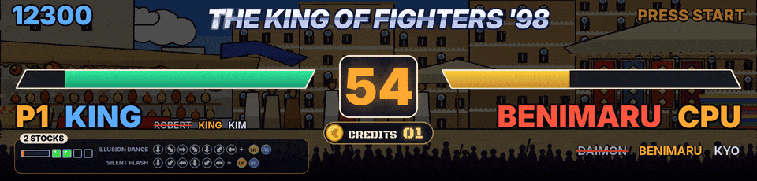

ArcadeDMD montre en direct ce qui se passe dans ton jeu d'arcade sur le marquee de la borne. Le score, les vies, les crédits, les barres de vie, les rounds, les boss, les coups spéciaux, chaque jeu avec sa propre scène animée. Il tourne en HD lisse sur un écran LCD de marquee (1920 x 460 sur une Vewlix, par exemple) ou sur une dalle LED 128 x 32 (Pixelcade LED, ZeDMD).

Il lit la mémoire du jeu pendant que tu joues, avec un petit plugin MAME ou par les commandes réseau de RetroArch (FinalBurn Neo, Genesis Plus GX). Rien n'est modifié dans le jeu ni dans l'émulateur. Il marche à côté de LaunchBox et BigBox, HyperSpin ou n'importe quel autre frontend, et montre ton Clear Logo LaunchBox quand un jeu démarre.

ArcadeDMD 1.33, en BETA. Libre et gratuit, licence MIT. Windows, Python 3.12 ou plus récent. Ce qui est marqué (prochaine version) tourne déjà sur la borne de l'auteur et arrive avec la prochaine version.

In English, [[Home]].

## Les jeux les plus soignés

Chaque jeu a sa scène, mais ceux-ci ont été réglés sur une vraie borne, round après round, avec des vidéos, des photos, les journaux des jeux et, depuis la 1.33, une partie enregistrée en entier (les valeurs lues, la mémoire du jeu, ses captures d'écran, voir [[Enregistrer une partie]]), jusqu'à ce que le marquee suive le jeu à l'instant près. Les jeux finalisés en 1.33, vérifiés image par image sur une partie enregistrée, sont The King of Fighters '98, les six Metal Slug Neo Geo, Windjammers et Puzzle Bobble 2.

- **The King of Fighters '98.** Ses neuf décors dessinés d'après les lieux du jeu, en style cartoon, qui changent avec les rounds comme dans le jeu, l'écran de sélection qui montre les choix. Sous chaque joueur, ses coups désespérés avec leurs commandes, les flèches qui s'allument quand le stick les fait, RATÉ, DM ! et SDM !, la jauge, les stocks et le MAX comme le jeu les montre. ROUND, FIGHT !, K.O., WIN, PERFECT, le combattant suivant qui entre en scène, l'équipe éliminée, et les matchs gagnés entre deux humains. Voir [[Marquee HD]] et [[Jeux de combat]].
- **Metal Slug 1 à 5 et X.** Les six, chacun réglé sur une partie enregistrée en entier (1.33). Le soldat choisi (Marco, Tarma, Eri, Fio...) à côté de J1 / J2, son arme et ses munitions, le laser en rayon tenu, les bombes et la grenade qui explose quand celle du jeu explose, les véhicules de chaque joueur (le char, le chameau, le Slugnoid, le Slug Flyer, le Slug Mariner, le Slug Gunner...) avec leur énergie et leurs obus, les vies comme le jeu les écrit, les prisonniers libérés, la vie de tous les ennemis à l'écran, le boss de la mission 1 de chaque jeu avec WARNING, son nom et sa barre de vie (Tetsuyuki, The Keesi II, Iron Nokana MKII, Huge Hermit, Brave Guerrier, Metal Rear), BOSS DÉTRUIT et MISSION COMPLETE au moment du jeu, les décors de chaque mission, les crédits avec la pièce qui tombe. Les boss des missions suivantes sont reconnus à leur vie et nommés d'après la liste du jeu, à confirmer en jouant.
- **Windjammers.** Le terrain du jeu en carte vivante, le disque et les deux joueurs là où le jeu les met, lus à chaque image, les lobs, un super qui se charge dans un anneau de flammes puis SUPER ! avec le nom du tir, les buts qui poussent toute l'image dans le mur, les sets et le match, les joueurs nommés comme dans le jeu, les pièces comptées même appuyées très vite.
- **Puzzle Bobble et Puzzle Bobble 2.** Les deux scores, la bulle du lanceur et la suivante à leurs couleurs, la flèche qui tourne comme celle du jeu, chaque bulle tirée qui part dans sa direction, le round, les matchs VS et les manches gagnées.
- **DoDonPachi.** Le score avec les continues, le compteur de hits, le vaisseau et son type, six stages dessinés d'après les cartes du jeu, et le boss de chaque stage avec sa vie lue dans le jeu, qui tombe quand elle est à zéro.
- **Appris sur une borne aussi.** Twinkle Star Sprites (sa propre scène, les cœurs et les chaînes), The King of Fighters 2002 et Fatal Fury (leurs écrans de sélection, leurs rounds et leurs équipes lus sur des parties enregistrées), Marvel vs. Capcom, X-Men vs. Street Fighter, Marvel Super Heroes vs. Street Fighter, X-Men: Children of the Atom et Hyper Street Fighter II (scores, crédits, la jauge POWER, les équipiers), Strikers 1945 Plus, Giga Wing et Mercs (scores, chrono, SUPER SHOT).

Les autres jeux lisent les adresses des bases de codes de triche et de RetroAchievements, qui restent à confirmer en jeu. [PROGRESS.md](https://github.com/Byoyoyo/ArcadeDMD/blob/main/PROGRESS.md) dit où en est chacun.

## Pour commencer

- [[Installer ArcadeDMD]], le téléchargement, l'installation, un premier essai sans jeu
- [[Utilisation]], ArcadeDMD avec ton frontend, les démos et les outils de test
- [[Réglages]], tous les réglages de `config.json`

## Affichages

- [[Marquee HD]], un écran LCD dans le marquee, en HD lisse ou en LED virtuelles
- [[Dalle Pixelcade]]
- [[ZeDMD et matériel]], monter une dalle LED 128 x 32 ou choisir un écran de marquee
- [[OBS et DOFLinx]], les fichiers texte pour le streaming et le pont DOFLinx

## Émulateurs

- [[Avec MAME]]
- [[Avec RetroArch]]

## Jeux

- [[Jeux de combat]], The King of Fighters, Samurai Shodown, Fatal Fury, Street Fighter...
- [[Les Metal Slug]], les six Metal Slug de la Neo Geo
- [[Jeux Neo Geo]], quatre-vingt-dix-sept jeux faits un par un et une scène par genre pour tous les autres
- [[Capcom et Cave]], tous les jeux CPS1, CPS2 et CPS3, tous les jeux Cave
- [[Autres jeux]], After Burner II, Sonic 1 et 2

## Pour aller plus loin

- [[Apprendre les adresses]], trouver un score ou des crédits qui manquent avec `learn.bat`
- [[Enregistrer une partie]], les enregistrements qui permettent de régler un jeu sans la borne
- [[Fichiers des jeux]], ajouter un jeu ou modifier une scène
- [[Tes propres images]], tes images à la place des dessins d'ArcadeDMD
- [[Dépannage]]

## Liens

- Télécharge la dernière version sur la page [Releases](https://github.com/Byoyoyo/ArcadeDMD/releases/latest).
- Ce qui change à chaque version est dans [CHANGELOG.md](https://github.com/Byoyoyo/ArcadeDMD/blob/main/CHANGELOG.md), où en est chaque jeu dans [PROGRESS.md](https://github.com/Byoyoyo/ArcadeDMD/blob/main/PROGRESS.md).
- Pour signaler un problème ou demander un nouveau jeu, ouvre une [issue](https://github.com/Byoyoyo/ArcadeDMD/issues) (voir [CONTRIBUTING.md](https://github.com/Byoyoyo/ArcadeDMD/blob/main/CONTRIBUTING.md)).
- In English, [[Home]].
