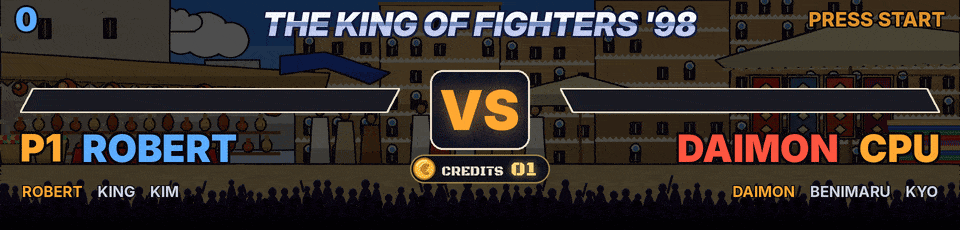
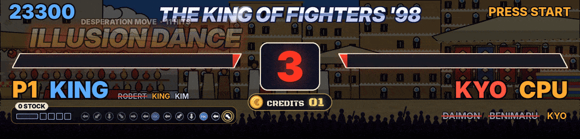
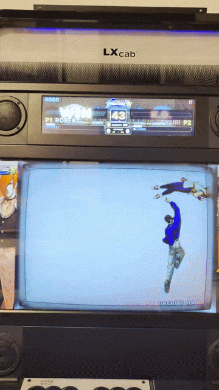
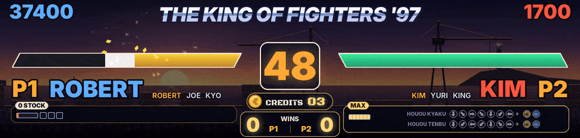

Each of the 57 Neo Geo fighting games has its own file in `games\`, official variants included, and the 34 Capcom fighting games fight on their own stages. The King of Fighters '98 was tuned round after round on a real cabinet, from recorded games, and so were '97 and 2002 in 1.33.1.

## What the HD screen shows

- At the top, each player's score, or CHALLENGER and BEAT BY in a VS match. In the middle, the health bars with a light trail for the hit just taken, and the timer or KO. At the bottom, P1, P2 or CPU with the current fighter, the full team in The King of Fighters '96 to 2000 (fighters already beaten struck out), and the credits.
- Sparks on every hit, the combo counter, FIRST ATTACK, a red heartbeat when the health is low.
- K.O. in big red letters on the loser's side and WIN in gold on the winner's, DOUBLE K.O., TIME UP, PERFECT, confetti for the winner.
- ROUND 2, ROUND 3... when the game starts the round, and FIGHT ! when the game says GO.
- The next King of Fighters fighter entering once the K.O. is over, and when a team loses its third fighter, P1 WINS and the team eliminated.
- A stage that follows the game's own backdrop, in The King of Fighters '96 to 2000, Rage of the Dragons, Garou, Samurai Shodown II to IV, the Street Fighter games and more (see [[HD Marquee]] for the list of backdrops). The nine stages of The King of Fighters '98 are drawn after the game's places and change with the rounds as in the game.
- When nobody plays, the coin screen (see [[Usage]]).

## The desperation moves panel, The King of Fighters '98, '97 and 2002

Under the name of each human player, a panel.

- A badge says the stocks (1 STOCK, 2 STOCKS), EXTRA, MAX when every stock is lit as the game says it, or the MAX of Advanced while it runs, its timer read in the game.
- The power gauge is drawn as the game draws it, the bar and a square per stock.
- When the gauge allows a desperation move, the commands of the fighter's ones show under it, their arrows facing the other fighter. The arrows light up as the stick does them, read at every frame.
- When a button ends an attempt that missed a step, the steps missed are crossed in red with RATÉ, and DM ! or SDM ! shows once the game took its stock.
- Otherwise the panel shows the inputs pressed, as training mode does.
- '97 has its own commands, its gauge, its three stock squares and the game's own flag of a desperation move, and 2002 its own commands, MAX by B+C and its timer, a desperation move free in MAX and an SDM taking a stock, the fighting order of each team read.

## The desperation move show

When a human lands a desperation move, its name takes the whole marquee for a moment, then flies above his bar while the hits land, counting them. The bar of the one taking them jolts at each hit, the part just lost white then red, and at its edge the spark of each hit bursts with pieces of the bar flying off. Two at once, each name slams onto its side with DOUBLE DM ! between them.

## VS matches between two humans

In a two-player match, the King of Fighters games show CHALLENGER above the player who just joined and BEAT BY 02 above the one who beat 2 challengers in a row, once these counters were learned (see [[Learning Addresses]]). A WINS pill under the credits counts the matches each one won. Each win goes to `obs\vs_history.txt` and the best streak of each game is kept (see [[OBS and DOFLinx]]).

## What each game reads

Each Neo Geo fighting game has its own file in `games\`, official variants included (Japanese, Korean, prototype). The addresses come from the FinalBurn Neo cheats, peon2's FinalBurn Neo training scripts and the MAME 2003-Plus cheat database, checked against the cheat collection of MAME (mamecheat.co.uk). It gives the super gauge of Art of Fighting and Art of Fighting 2, Garou, King of Fighters '96, Ninja Master's, the three Real Bout Fatal Fury, Rage of the Dragons, Samurai Shodown III, IV, V and V Special and World Heroes Perfect, shown under the fighters on the HD screen, the characters of Fatal Fury 2 and the timer of Karnov's Revenge. The score is known for the King of Fighters games and for Samurai Shodown II. RetroAchievements gives it for Art of Fighting, Fatal Fury 1, 2, 3 and Special, Galaxy Fight, Garou, Karnov's Revenge, King of Fighters '94 and 2003, Rage of the Dragons, Real Bout Fatal Fury 1 and Special, Samurai Shodown, The Last Blade 1 and 2 and Waku Waku 7 (its public scripts on GitHub and the data `tools/ra_notes.py` downloads, to be checked in game), with the rounds won of Fatal Fury 3 and Karnov's Revenge, gold stars under the health bars on the HD screen. For the others, learn it with `learn.bat` (`score=...` and `score2=...`).

When a health bar, a timer or a name does not match the screen, run `test_retroarch.bat` during a fight and post the result in a GitHub issue.

| Game | File | Health bars | Timer | Character names | Score |
|---|---|---|---|---|---|
| 3 Count Bout | `3countb.json` | - | - | - | to learn |
| Aggressors of Dark Kombat | `aodk.json` | yes | - | - | to learn |
| Art of Fighting | `aof.json` | yes | yes | yes (10) | RetroAchievements, to be checked |
| Art of Fighting 2 | `aof2.json` | yes | yes | yes (13) | to learn |
| Art of Fighting 3 | `aof3.json` | yes | yes | yes (10) | to learn |
| Breakers | `breakers.json` | yes | yes | - | to learn |
| Breakers Revenge | `breakrev.json` | yes | yes | - | to learn |
| Double Dragon | `doubledr.json` | yes | yes | yes (14) | to learn |
| Dragon's Heaven | `dragonsh.json` | - | - | - | to learn |
| Fatal Fury | `fatfury1.json` | yes | yes | yes (14) | RetroAchievements, to be checked |
| Fatal Fury 2 | `fatfury2.json` | yes | yes | - | RetroAchievements, to be checked |
| Fatal Fury 3 | `fatfury3.json` | yes | yes | yes (13) | RetroAchievements, to be checked |
| Fatal Fury Special | `fatfursp.json` | yes | yes | - | RetroAchievements, to be checked |
| Fight Fever | `fightfev.json` | yes | yes | yes (10) | to learn |
| Galaxy Fight | `galaxyfg.json` | yes | - | - | RetroAchievements, to be checked |
| Garou | `garou.json` | yes | yes | yes (14) | RetroAchievements, to be checked |
| Kabuki Klash | `kabukikl.json` | yes | yes | - | to learn |
| Karnov's Revenge | `karnovr.json` | yes | - | yes (14) | RetroAchievements, to be checked |
| King of the Monsters | `kotm.json` | yes | - | - | to learn |
| King of the Monsters 2 | `kotm2.json` | yes | yes | yes (10) | to learn |
| Kizuna Encounter | `kizuna.json` | yes | yes | - | to learn |
| Legend of Success Joe | `legendos.json` | yes | - | - | to learn |
| Matrimelee | `matrim.json` | yes | yes | - | to learn |
| Ninja Master's | `ninjamas.json` | yes | yes | - | to learn |
| Rage of the Dragons | `rotd.json` | yes | yes | - | RetroAchievements, to be checked |
| Ragnagard | `ragnagrd.json` | yes | - | - | to learn |
| Real Bout Fatal Fury | `rbff1.json` | yes | yes | yes (16) | RetroAchievements, to be checked |
| Real Bout Fatal Fury 2 | `rbff2.json` | yes | yes | yes (23) | to learn |
| Real Bout Fatal Fury Special | `rbffspec.json` | yes | yes | yes (20) | RetroAchievements, to be checked |
| Samurai Shodown | `samsho.json` | yes | yes | yes (13) | RetroAchievements, to be checked |
| Samurai Shodown II | `samsho2.json` | yes | yes | yes (17) | yes |
| Samurai Shodown III | `samsho3.json` | yes | yes | yes (14) | to learn |
| Samurai Shodown IV | `samsho4.json` | yes | yes | yes (18) | to learn |
| Samurai Shodown V | `samsho5.json` | yes | yes | yes (28) | to learn |
| Samurai Shodown V Special | `samsh5sp.json` | yes | yes | yes (28) | to learn |
| Savage Reign | `savagere.json` | - | - | - | to learn |
| SNK vs. Capcom | `svc.json` | yes | yes | yes (36) | to learn |
| SNK vs. Capcom (JAMMA PCB) | `svcpcb.json` | yes | yes | yes (36) | to learn |
| The King of Fighters '94 | `kof94.json` | yes | yes | - | RetroAchievements, to be checked |
| The King of Fighters '95 | `kof95.json` | yes | yes | - | to learn |
| The King of Fighters '96 | `kof96.json` | yes | yes | yes (29) | assumed, to be checked |
| The King of Fighters '97 | `kof97.json` | yes | yes | yes (32) | found (1.33.1) |
| The King of Fighters '98 | `kof98.json` | yes | yes | yes (38) | found |
| The King of Fighters '99 | `kof99.json` | yes | yes | yes (34) | assumed, to be checked |
| The King of Fighters 2000 | `kof2000.json` | yes | yes | yes (36) | assumed, to be checked |
| The King of Fighters 2001 | `kof2001.json` | yes | yes | - | assumed, to be checked |
| The King of Fighters 2002 | `kof2002.json` | yes | yes | - | assumed, to be checked |
| The King of Fighters 2003 | `kof2003.json` | - | yes | - | RetroAchievements, to be checked |
| The King of Fighters 2003 (Japan, JAMMA PCB) | `kf2k3pcb.json` | - | yes | - | to learn |
| The Last Blade | `lastblad.json` | yes | yes | yes (15) | RetroAchievements, to be checked |
| The Last Blade 2 | `lastbld2.json` | yes | yes | yes (20) | RetroAchievements, to be checked |
| Voltage Fighter Gowcaizer | `gowcaizr.json` | yes | yes | yes (12) | to learn |
| Waku Waku 7 | `wakuwak7.json` | yes | yes | yes (9) | RetroAchievements, to be checked |
| World Heroes | `wh1.json` | yes | yes | yes (9) | to learn |
| World Heroes 2 | `wh2.json` | yes | yes | yes (16) | to learn |
| World Heroes 2 Jet | `wh2j.json` | yes | yes | yes (17) | to learn |
| World Heroes Perfect | `whp.json` | yes | yes | yes (19) | to learn |

## Capcom fighting games

The 34 Capcom fighting games (Street Fighter II to III 3rd Strike, Alpha, Darkstalkers, Marvel vs. Capcom, X-Men...) fight on the stages of the game, with the super gauges under the fighters. See [[Capcom and Cave]].

## A fighting game that misbehaves

If ROUND, FIGHT !, K.O. or VS come at the wrong time, the capture of your game says why. See [[Recording a Game]].
