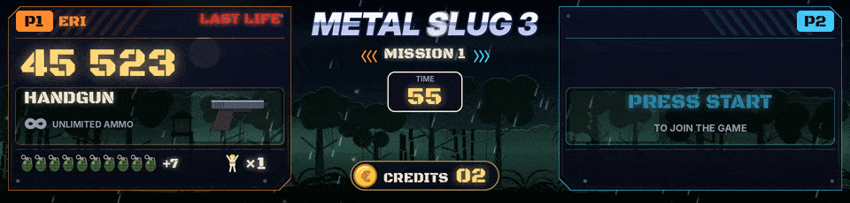

An LCD screen in the marquee shows the scenes in smooth HD, with animated backdrops, or as virtual LEDs. Any screen that Windows sees as an extra display works, plugged into the PC by HDMI, DisplayPort or USB-C. The scenes adapt to the screen. They were checked at 1920 x 360, 1280 x 390, 1920 x 460, 1920 x 480 and 1920 x 720.



## Setting it up

1. Run `screen_setup.bat` (the installer offers it too). It lists the screens, guesses which one is the marquee (the most elongated) and writes the `preview` section of `config.json`.
2. At the display question, choose smooth HD, or virtual LEDs.
3. Run `demo_fight.bat` to see the result, then a game from your frontend.

By hand, in `config.json`.

```json
"preview": {
  "enabled": true,
  "x": 1920, "y": 0,
  "width": 1920, "height": 460,
  "borderless": true,
  "topmost": true,
  "mode": "games",
  "takeover": "known",
  "style": "hd"
}
```

`x` and `y` are the position of the screen's top-left corner on the Windows desktop (Settings, Display). Here, a marquee placed to the right of a 1080p screen. Placed below it, it would be `"x": 0, "y": 1080`.

## With BigBox

With `"mode": "games"`, the window hides outside games and the screen belongs to the frontend, its Clear Logos and marquees. As soon as a known game starts, ArcadeDMD comes to the front, above the BigBox or HyperSpin marquee, without taking the focus from the game. If the frontend comes back in front during the game, ArcadeDMD returns within a second. When the game ends, the screen goes back to the frontend at once.

## Smooth HD or virtual LEDs

- `"style": "hd"` draws at the screen's resolution. Smooth texts, health bars with gradients, animated backdrops that follow the game's stage or mission, an effect for every event, the game's logo at the top.
- `"style": "led"` draws round LEDs like a real panel, twice as fine as a 128 x 32 panel on a large screen (`"hd": "auto"`). `"style": "pixel"` draws square pixels.

## Looks

- `"dim": 30` darkens the animated backdrops so that the information stands out (0 to 80 percent). The fighting games have their own, `"dim_fight": 55`.
- `"coins": false` brings back the plain INSERT COIN.
- `"stage_style": "flat"` gives back the look of the King of Fighters '98 stages before 1.33.

## The game's logo

The logo is your LaunchBox Clear Logo. ArcadeDMD finds the LaunchBox folder by itself when BigBox is running, or in the usual places (`C:\LaunchBox`, `E:\LaunchBox`...). Otherwise set `"launchbox": "E:\\LaunchBox"` in the `preview` section. The running game is matched to its logo through the ROM path in LaunchBox, and through the parent game for a clone. Without a logo, the game's title shows in metallic lettering.

## Game logo when a game starts

When a game starts, its logo comes first. On the HD screen it arrives big on a dark screen, with a flash and a light sweep, then glides to its place in the scene. On the Pixelcade and ZeDMD panels it zooms in on the 128 x 32 LEDs, then the scene comes. The Pixelcade shows it as soon as pixelweb has handed the panel over.


It is the game's LaunchBox Clear Logo, found as described just above. On a panel, a game without a Clear Logo goes straight to its scene. On the HD screen, its title in metallic lettering is used instead.

```json
"intro": {
  "logo": true,
  "seconds": 2.6,
  "launchbox": ""
}
```

- `"logo": false` turns it off, on the panel and on the HD screen.
- `"seconds"` is how long it lasts, from 1 to 10 seconds.
- `"launchbox"` is the LaunchBox folder, when it is not found by itself. With a panel and no HD screen, set it here. The one in the `preview` section works too.

## Animated HD scenes, Metal Slug and fighting games

With the smooth HD display, the Metal Slug games and the fighting games get a full scene of their own. Everything is drawn by the program, no image comes from the games.


- **Metal Slug.** One soldier panel per player, with the score, the weapon and its ammo gauge, the bombs, the lives and the rescued prisoners (first Metal Slug, X, 3 and 5). Shots follow the weapon (tracers and shell casings, shotgun blasts, rockets, flamethrower, the laser as a beam held from the gun to the backdrop, blue then red then green as in the game), bombs fly, bounce once and explode in the backdrop as they land again, as the game's do, shaking the whole screen (in the first Metal Slug and Metal Slug 2, at the very moment the game's own grenade blows up, on an enemy or on the ground, read in the game; the bombs the game hands back at a new life or a new mission are not throws), a crate drops when a weapon is picked up, the helmet falls when a life is lost and LAST LIFE blinks on the last one. Beside J1 / J2, the soldier chosen (Marco, Tarma, Eri, Fio, and Trevor and Nadia in Metal Slug 4; always Marco and Tarma in the first game). In a vehicle, the vehicle takes the place of the weapon, with its name (TANK, CAMEL SLUG, SLUGNOID, SLUG FLYER, SLUG COPTER, SLUG MARINER, DRILL SLUG, ASTRO SLUG, and the other rides of the series once their code is read), its energy in hits (three, like in the game) and its shells when the game gives them (the first Metal Slug, Metal Slug 2 and X). A mount (the camel, the elephant, the ostrich) shows its name and picture alone, the game keeps no energy or shells for it. A hit makes the lost case blink, a shell flies to the backdrop, BAIL OUT! blinks when it has no energy left and a destroyed vehicle blows up. To show your own pictures instead of ArcadeDMD's drawings, put them in `sprites\mslug\<name>.png` for all the Metal Slug games, or `sprites\mslug2\<name>.png` for one game: `tank`, `camel`, `slugnoid`, `flyer`, `copter`, `mariner`, `drill`, `astro`, and already `elephant`, `ostrich`, `bradley`, `mobile`, `gunner`, `claw`, `walker`, `armor` for the rides whose code is still to be read in a game (seen from the side, gun to the right; the camel, the elephant and the ostrich are mounts, the game does not count them as a vehicle, ArcadeDMD knows them by their kind), and `marco`, `tarma`, `eri`, `fio`, `trevor`, `nadia` for a small portrait beside the soldier's name. A plain background around the drawing is made transparent, empty margins are cut and it sits in the middle of the card (`sprites\mslug_tank_hd.png` still works for the tank; `.gif`, `.jpg` or `.webp` do as well, the French names as well, `char.png`, `chameau.png`). The log `runtime\arcadedmd.log` says for each vehicle which picture is used, or where one would be read from. Those pictures are yours, they stay out of the zip and of the repository. In the first Metal Slug and in Metal Slug 4, when the boss of the mission comes, WARNING flashes across the screen with its name (Tetsuyuki, Hairbuster Riberts, Tani Oh, Shoe & Karn, Iron Nokana, Hi-Do; Brave Guerrier, Toschka Dalanue, The Iron, Big John, Sea Satan, Amadeus Mother Computer), then its life bar stays under the logo until BOSS DESTROYED (in the first Metal Slug, the game's own flag says the moment it falls; a boss that comes back in phases, like Brave Guerrier, keeps its name with PHASE 2, PHASE 3); the big enemies of a mission (a helicopter, a tank, a machine met before the boss) get a quiet amber bar. Player 2 can join at any time. At the bottom of the column, the credits sit in a dark pill beside a coin struck with the currency symbol of `config.json`, and a coin put in falls onto it. Each mission has its own backdrop (jungle, desert, snowy mountain, city at war, harbor, enemy base), with MISSION COMPLETE and fireworks in between, at the moment the game shows it when the game says so (the first Metal Slug, Metal Slug 4). With nobody playing, the backdrops take turns.
- **Fighting games.** Sparks on every hit, combo counter, FIRST ATTACK, super moves (the screen darkens), a red heartbeat when health is low, an exploding K.O. with K.O. in big red letters on the loser's side and WIN in gold on the winner's, DOUBLE K.O., TIME UP when the timer has counted down to 0, PERFECT, confetti for the winner, the next King of Fighters fighter once the K.O. is over (in The King of Fighters '98, when the game shows him, after ROUND n), ROUND 2, ROUND 3... in the King of Fighters '96 to 2000 (in The King of Fighters '98 when the game starts the round, read in the state of the fight), and FIGHT ! with the game's own FIGHT or GO, when the round's timer starts counting down (at once in a game that reads no timer, 1.15 seconds after READY in The King of Fighters '97 and '98, which keep the state of the fight). When a King of Fighters team loses its third fighter, the winner in big letters (P1 WINS) and the team eliminated under it, for 5.5 seconds. On the select screen (both bars empty without a K.O.) and when the timer has not moved for 6 seconds, VS takes the place of the last fight's timer, on the panel too. The HD screen keeps the round's timer while it waits for GO. The crowd at the bottom reacts to the action. In the King of Fighters games that have the panel of the desperation moves ('98, '97, 2002), a human's DM ! or SDM ! has its show (1.33.1 test 51, chosen by Seb from mockups): the name of the move over the whole marquee for a moment, then above his bar while the hits land, counting them; the bar of the one taking them jolts, its lost part white then red, its outline red, and at its edge the spark of each hit, bigger when it hurts more, with pieces of the bar flying off (test 55, Seb's choice B); two at once, each on its side and DOUBLE DM ! between them.
- **The desperation moves of The King of Fighters '98** (since 1.32), **of '97** (1.33.1 test 49, its own commands, its gauge full sooner, three stock squares as its screen has, the game's own flag of a desperation move read) **and of 2002** (test 50, its own commands, its gauge full at 0x40, MAX by B+C and its timer, a desperation move free in MAX and an SDM taking a stock, the fighting order of each team read). Under the name of each human player, a panel. A badge says the stocks (1 STOCK, 2 STOCKS), EXTRA, MAX in gold when every stock is lit as the game says it, or MAX ACTIVÉ while the MAX of Advanced runs (its timer read in the game, shown running out in the bar), and the power gauge is drawn as the game draws it, the bar and a green square per stock, 3 for the first fighter of a team and one more for each teammate beaten. When the gauge allows a desperation move (a stock or MAX in Advanced, MAX or the health in the red in Extra, MAX lasting there until its bar is empty), the commands of the fighter's ones show under it (`"moves"` in the game file), their arrows facing the other fighter. The badge says why (MAX, VIE ROUGE when the life is nearly empty, MAX + VIE ROUGE for an SDM). Otherwise the panel shows the inputs pressed, as training mode does, each direction of the stick and the buttons pressed with it, the newest on the right, and in Extra how full the gauge is with the rule beside it (SUPER À 100 %). The arrows light up as the stick does them, read at every frame. When a button ends an attempt that missed a step or so, the steps missed are crossed in red with RATÉ, and DM ! or SDM ! shows once the game took its stock (its full gauge in Extra). A special move gives no RATÉ. The buttons are named in the game file (`"buttons"`, LP LK HP HK for A B C D). The team moves to the name's line, small, the beaten ones struck. When two humans play a game of teams, a VICTOIRES pill under the credits counts the matches each one won, P1 on the left and P2 on the right, back to 0 once one of them left 20 seconds ago. Against the computer it does not show.
- **Neo Geo games done one by one.** Blazing Star, Puzzle Bobble, Windjammers, Shock Troopers, Neo Turf Masters, Pulstar, Magical Drop III, Super Sidekicks 3, The Ultimate 11, Sengoku 3, Top Hunter, Baseball Stars 2, Last Resort, Aero Fighters 2, Aero Fighters 3, Strikers 1945 Plus, Street Hoop, Super Dodge Ball, Neo Bomberman, Twinkle Star Sprites, League Bowling, Neo Drift Out, Riding Hero, Thrash Rally, Magician Lord, NAM-1975, Cyber-Lip, Ghost Pilots, Alpha Mission II, Viewpoint, Zed Blade, Prehistoric Isle 2, Shock Troopers 2nd Squad, Robo Army, Burning Fight, Mutation Nation, Sengoku, Sengoku 2, Ninja Combat, Ninja Commando, Blue's Journey, Puzzle Bobble 2, Magical Drop II, Money Puzzle Exchanger, Puzzle De Pon!, Puzzle De Pon! R!, Panic Bomber, Pop 'n Bounce, Super Bubble Pop, Spin Master, Ganryu, Zupapa!, Neo Mr. Do!, Super Sidekicks, Super Sidekicks 2, Tecmo World Soccer '96, Goal! Goal! Goal!, Neo-Geo Cup '98, Soccer Brawl, Football Frenzy, Pleasure Goal, Baseball Stars Professional, 2020 Super Baseball, Top Player's Golf, Power Spikes II, Bang Bead, Battle Flip Shot, Over Top, Stakes Winner, Stakes Winner 2, Jockey Grand Prix, Gururin, Ghostlop, Pochi and Nyaa, Puzzled, Zintrick, Digger Man, The Irritating Maze, Andro Dunos, Captain Tomaday, Choutetsu Brikin'ger, Last Hope, Bang Bang Busters, Crossed Swords, Eight Man, Nightmare in the Dark, The Super Spy, Quiz King of Fighters, Quiz Daisousa Sen, Quiz Meitantei Neo & Geo, Chibi Maruko-chan Deluxe Quiz, Minasan no Okagesamadesu!, Mahjong Kyo Retsuden, Janshin Densetsu, Bakatonosama Mahjong Manyuuki, Idol Mahjong Final Romance 2 and Shougi no Tatsujin each have a scene of their own, see [[Neo Geo Games]].
- **Capcom games.** The 34 fighting games fight on the stages of the game, with the super gauges under the fighters. Fifty other Capcom games, from Final Fight to 1944, Strider and Ghouls'n Ghosts, each have a scene of their own, see [[Capcom and Cave]].
- **The credits.** In all these scenes the credits are as in Metal Slug during a game. The coin struck with the symbol of `config.json` (`coin_symbol`, € by default) and CRÉDITS 07 in a dark pill with a gold edge, at the bottom in the middle, or beside it when the game already has something there (the batter of baseball, the hand of mahjong, the answers of the quizzes...). Each coin put in falls onto it and +1 CREDIT rises.

### Backgrounds that follow the stage

The background changes with the game's stage when the game file knows where to read it.
- `backdrop` is the backdrop of the current fight, from the cheat databases ("Select Backdrop"). It picks the HD background in the `"hd"` list of the game file.
- `stage` is the match number in the run (Rage of the Dragons, "Select Stage"). It is shown as STAGE 2, STAGE 3... with the name of the place.
- `round` is the round of a King of Fighters match ('96 to 2000, "Select Current Round"), one more at each K.O. Fatal Fury 2 and Special, Real Bout Fatal Fury Special, World Heroes 2 Jet and Perfect read theirs too since 1.31.1 (from 1 in the game, `"add": -1`). It is shown as ROUND 2, ROUND 3... when the next fight begins, and the place of a new match comes under its ROUND 1.
- For Metal Slug, `mission` picks the backdrop of each mission.

| Games | Values |
|---|---|
| The King of Fighters '96, '97, '98, '99 and 2000 | `round` and `backdrop`, with the place of each backdrop in '98 (`"places"`) |
| Rage of the Dragons | `stage` and `backdrop` |
| The King of Fighters 2002, Garou, Fatal Fury 2, Fatal Fury Special, Real Bout Fatal Fury 2, Real Bout Fatal Fury Special, Samurai Shodown II, III and IV, World Heroes, World Heroes Perfect, SNK vs. Capcom (JAMMA PCB) | `backdrop` |
| Metal Slug 1 to 5 and X | `mission` |
| Street Fighter II, II' Champion Edition, II' Hyper Fighting, Super Street Fighter II and Turbo, Street Fighter Alpha, Alpha 2, Alpha 3, Zero 2 Alpha, Street Fighter III and its 2nd Impact and 3rd Strike, Darkstalkers, Night Warriors, Vampire Savior, Vampire Hunter 2, Vampire Savior 2, X-Men: Children of the Atom, Marvel vs. Capcom, Cyberbots, Super Gem Fighter, Red Earth | `backdrop`, with the place of each stage (`"places"`) |

These addresses come from the cheat databases and still have to be confirmed in game (`test_retroarch.bat` shows them). The other games always get the same background. `demo_fight.bat` changes the stage every two K.O. (in the King of Fighters when a team has lost its three fighters), so you can see it without playing.

Each game file says which background goes with each backdrop, in the order of the backdrop numbers. For example, in `games\kof98.json`

```json
"hd": {"stages": ["fight_kof_osaka", "fight_kof_china", "fight_kof_korea", "fight_kof_mideast", "fight_kof_spain", "fight_kof_yard", "fight_kof_dojo", "fight_kof_wharf", "fight_kof_noah"]}
```

Backdrop 0 (Japan, street) gets the street under the viaduct in Osaka, 3 (Mid-East) the market, 7 (USA, wharf) the wharf turned junkyard, and so on. These nine stages of The King of Fighters '98 (since 1.32) are drawn from the game's places, each changing with the rounds as in the game (the time of day, a fog, a wagon, the cars, the light). Since 1.33 they are drawn in a cartoon style, every shape inked, the colours bold, flat shadows, banded skies; `"stage_style": "flat"` in the `preview` section gives back the look of 1.32. The note of the `backdrop` value lists the game's backdrops. Change the list to your taste, the engine reloads the file by itself.

| Background | What it shows |
|---|---|
| `fight_city` | city at night, neon signs, elevated train, steam |
| `fight_temple` | temple at dusk, swinging lanterns, falling petals |
| `fight_harbor` | harbor at sunset, reflections on the water, lighthouse, gulls |
| `fight_ruins` | ruins at night, torches, embers, fireflies |
| `fight_desert`, `fight_jungle`, `fight_snow` | desert at dusk, jungle at night, snowy mountain |
| `arena` | arena with spotlights |
| `base`, `city_war` | enemy base (beacons, searchlights), city at war (fires, explosions) |
| `fight_castle` | castle roof in Japan at night, full moon, cherry petals |
| `fight_market` | Chinese street market, hanging lanterns, steam from the stalls |
| `fight_factory` | steel factory, furnaces, molten metal and sparks |
| `fight_gothic` | gothic manor under the moon, bats, lightning |
| `fight_palace` | Indian palace at sunset, elephants, torches |
| `fight_thai` | golden temple on its river, sky lanterns, glints on the water |
| `fight_lab` | laboratory, glowing tanks, screens |
| `fight_airbase` (or `fight_base`) | air base at dusk, hangars, jets, runway lights |
| `fight_kof_osaka` | The King of Fighters '98, Japan: under the viaduct in Osaka at night, cars and their headlights (the jam from the third round), the crossing |
| `fight_kof_china` | The King of Fighters '98, China: the boat on the river among the stone pillars, a temple, then a waterfall, then the fog, the cliffs going by |
| `fight_kof_korea` | The King of Fighters '98, Korea: the harbor in the sun, the houses, the boats, the red bridge to the pavilion, the gulls |
| `fight_kof_mideast` | The King of Fighters '98, Middle East: the market, tower houses, copper pots that glint, carpets |
| `fight_kof_spain` | The King of Fighters '98, Spain: the Court of the Lions, its fountain, day then sunset then night, the lanterns, the white cat |
| `fight_kof_yard` | The King of Fighters '98, USA: the train yard, the engines, the MOTEL sign, the wagon, the sunset from the third round |
| `fight_kof_dojo` | The King of Fighters '98, Japan: the ruined dojo in the forest, night then dawn then morning then day, the fireflies |
| `fight_kof_wharf` | The King of Fighters '98, USA: the wharf turned junkyard, the basketball hoop, sunset then night then fog |
| `fight_kof_noah` | The King of Fighters '98, the Black Noah: the hall under the sea, sharks and jellyfish behind the window, bluer at each round |

A Capcom game file can also give the place shown under the stage banner, in French and English, one per backdrop value (`"places": [["CHINE", "CHINA"], ...]`). Without it, the place of the background is shown.

The `fight_` backgrounds and `arena` have a crowd in front. Without the `fight_` prefix (`city`, `temple`, `harbor`, `ruins`, `desert`, `jungle`, `snow`), the same places have no crowd, as in the Metal Slug missions. A Metal Slug file can also have its own `"hd": {"stages": [...]}` list, one background per mission.

## Choosing a screen

See [[ZeDMD and Hardware]], option C.
