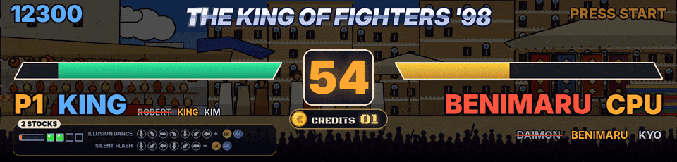

ArcadeDMD shows what happens in your arcade game on the marquee of the cabinet, live. Score, lives, credits, health bars, rounds, bosses, special moves, each game with its own animated scene. It runs in smooth HD on an LCD marquee screen (1920 x 460 on a Vewlix, for example) or on a 128 x 32 LED panel (Pixelcade LED, ZeDMD).

It reads the game's memory while you play, through a small MAME plugin or through RetroArch's network commands (FinalBurn Neo, Genesis Plus GX). Nothing in the game or the emulator is modified. It works next to LaunchBox and BigBox, HyperSpin or any other frontend, and shows your LaunchBox Clear Logo when a game starts.

ArcadeDMD 1.33.1, in BETA. Free and open source, MIT license. Windows, Python 3.12 or newer.

En français, [[Accueil]].

## The games done with the most care

Every game has a scene, but these were tuned on a real cabinet, round after round, with videos, photos, logs of the games and, since 1.33, one game recorded whole (the values read, the game's memory, its screenshots, see [[Recording a Game]]), until the marquee follows the game to the moment. The games finished in 1.33, checked frame by frame against a recorded game, are The King of Fighters '98, the six Neo Geo Metal Slug games, Windjammers and Puzzle Bobble 2.

- **The King of Fighters '98.** Its nine stages drawn after the game's places, in a cartoon style, changing with the rounds as the game does, the select screen showing the picks. Under each player, his desperation moves with their commands, the arrows lighting up as the stick does them, RATÉ, DM ! and SDM !, the power gauge, the stocks and MAX as the game shows them. ROUND, FIGHT !, K.O., WIN, PERFECT, the next fighter entering, the team eliminated, and the matches won between two humans. See [[HD Marquee]] and [[Fighting Games]].
- **Metal Slug 1 to 5 and X.** All six, each tuned on one game recorded whole (1.33). The soldier chosen (Marco, Tarma, Eri, Fio...) beside J1 / J2, his weapon and ammo, the laser as a held beam, the bombs and the grenade that blows up when the game's does, the vehicles of each player (the tank, the camel, the Slugnoid, the Slug Flyer, the Slug Mariner, the Slug Gunner...) with their energy and shells, the lives as the game writes them, the prisoners freed, the lives of every enemy on screen, the boss of mission 1 of each game with WARNING, its name and its life bar (Tetsuyuki, The Keesi II, Iron Nokana MKII, Huge Hermit, Brave Guerrier, Metal Rear), BOSS DESTROYED and MISSION COMPLETE at the game's moment, the backdrops of each mission, the credits with the coin dropping in. The bosses of the later missions are recognised by their life and named after the game's list, to confirm in play.
- **Windjammers.** The game's court as a live map, the disc and the two players where the game puts them, read at every frame, the lobs, a super charging in a ring of flames then SUPER ! with the shot's name, the goals pushing the whole image into the wall, the sets and the match, the players named as in the game, the coins counted even when pressed very fast.
- **Puzzle Bobble and Puzzle Bobble 2.** Both scores, the bubble in the launcher and the next one in their colours, the arrow turning as the game's, each bubble shot leaving in its direction, the round, the VS matches and the rounds won.
- **DoDonPachi.** The score with the continues, the hit counter, the ship and its type, six stages drawn after the maps of the game, and the boss of each stage with its life read in the game, falling when it runs out.
- **Learned on a cabinet too.** Twinkle Star Sprites (its own scene, the hearts and chains), The King of Fighters 2002 and Fatal Fury (their select screens, rounds and teams read from recorded games), Marvel vs. Capcom, X-Men vs. Street Fighter, Marvel Super Heroes vs. Street Fighter, X-Men: Children of the Atom and Hyper Street Fighter II (scores, credits, the POWER gauge, the partners), Strikers 1945 Plus, Giga Wing and Mercs (scores, timer, SUPER SHOT).

The other games read the addresses of the cheat databases and of RetroAchievements, which still have to be confirmed in game. [PROGRESS.md](https://github.com/Byoyoyo/ArcadeDMD/blob/main/PROGRESS.md) says where each one stands.

## Getting started

- [[Installation]], download, install, first try without a game
- [[Usage]], running ArcadeDMD with your frontend, the demos and test tools
- [[Configuration]], every setting of `config.json`

## Displays

- [[HD Marquee]], an LCD screen in the marquee, smooth HD or virtual LEDs
- [[Pixelcade LED]]
- [[ZeDMD and Hardware]], building a 128 x 32 LED panel or choosing an LCD marquee
- [[OBS and DOFLinx]], text files for streaming and the DOFLinx bridge

## Emulators

- [[MAME]]
- [[RetroArch]]

## Games

- [[Fighting Games]], The King of Fighters, Samurai Shodown, Fatal Fury, Street Fighter...
- [[Metal Slug]], the six Neo Geo Metal Slug games
- [[Neo Geo Games]], ninety-seven games done one by one and a scene by genre for all the others
- [[Capcom and Cave]], every CPS1, CPS2 and CPS3 game, every Cave game
- [[Other Games]], After Burner II, Sonic 1 and 2

## Going further

- [[Learning Addresses]], finding a missing score or credits with `learn.bat`
- [[Recording a Game]], the captures that let a game be tuned without the cabinet
- [[Game Files]], adding a game or editing a scene
- [[Your Own Pictures]], your pictures instead of ArcadeDMD's drawings
- [[Troubleshooting]]

## Links

- Download the latest version from the [Releases](https://github.com/Byoyoyo/ArcadeDMD/releases/latest) page.
- What changed in each version is in [CHANGELOG.md](https://github.com/Byoyoyo/ArcadeDMD/blob/main/CHANGELOG.md), where each game stands in [PROGRESS.md](https://github.com/Byoyoyo/ArcadeDMD/blob/main/PROGRESS.md).
- To report a problem or ask for a new game, open an [issue](https://github.com/Byoyoyo/ArcadeDMD/issues) (see [CONTRIBUTING.md](https://github.com/Byoyoyo/ArcadeDMD/blob/main/CONTRIBUTING.md)).
- En français, [[Accueil]].
