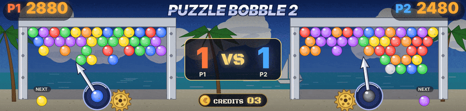
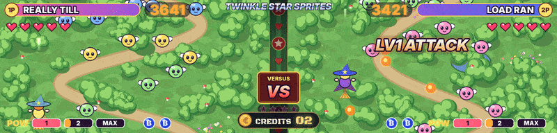

Tous les jeux Neo Geo connus de MAME et de FinalBurn Neo sont reconnus, clones, bootlegs et hacks compris. Une version prend le fichier de son jeu d'origine. Quatre-vingt-dix-sept jeux ont leur propre scène, et tous les autres ont une scène par genre sans rien à régler.

## Les jeux les plus soignés

- **Windjammers.** Le terrain du jeu en carte vivante, le disque et les deux joueurs là où le jeu les met, lus à chaque image, les lobs, un super qui se charge dans un anneau de flammes puis SUPER ! avec le nom du tir, les buts, les sets et le match. Tes propres images des joueurs peuvent se tenir sur le terrain (voir [[Tes propres images]]).
- **Puzzle Bobble et Puzzle Bobble 2.** Les deux scores, la bulle du lanceur et la suivante à leurs couleurs, la flèche qui tourne comme celle du jeu, chaque bulle tirée qui part dans sa direction, le round, les matchs VS et les manches gagnées.
- **Twinkle Star Sprites.** Les cœurs avec les demis, les bombes, la jauge Pow, le personnage, les chaînes et le PERFECT de chaque joueur, le stage, K.O. et WIN. Chaque sorcière vole là où le jeu la met et les manches gagnées sont comptées (1.33.1).

## Quatre-vingt-dix-sept jeux faits un par un

Jeu après jeu, les jeux Neo Geo ont reçu une scène de dalle et une scène HD animée à leur image, les plus connus d'abord, et maintenant ils en ont tous une. [PROGRESS.md](https://github.com/Byoyoyo/ArcadeDMD/blob/main/PROGRESS.md) montre où on en est et ce qui vient ensuite. Tout est dessiné par le programme, aucune image ne vient des jeux.

Dans les shoot'em up (Blazing Star, Pulstar, Last Resort, Aero Fighters 2 et 3, Strikers 1945 Plus, Ghost Pilots, Alpha Mission II, Viewpoint, Zed Blade, Prehistoric Isle 2, Andro Dunos, Captain Tomaday, Choutetsu Brikin'ger, Last Hope), dès que le score est lu, les ennemis de l'écran HD n'explosent que quand le jeu marque des points. L'ennemi que nos tirs touchent part d'abord, ses points s'affichent au-dessus, et plus le gain est gros plus l'explosion est forte. Une bombe ou une arme spéciale du jeu détruit ce qu'elle touche, et un bonus compté par le jeu en fin de niveau s'affiche en un seul compteur. Tant que le score d'un jeu n'a pas été appris avec `learn.bat`, sa scène HD joue toute seule. Un bonus de puissance affiche POWER UP au-dessus du vaisseau avec le niveau atteint dessous, une case par niveau, et POWER MAX au plus haut, dans chaque shoot'em up dont la puissance est lue.

La dalle de ces jeux reste simple pendant la partie. Le score en gros au milieu, ou le titre du jeu tant que le score n'est pas appris. Tes vies en bas à gauche (un avion et x2), tes bombes en bas à droite. Ni crédits ni INSERT COIN pendant la partie. Entre les deux vole ton vaisseau. Il suit ton stick et tire tant que tu tiens le bouton de tir (le BIOS de la Neo Geo les garde, avec MAME comme avec RetroArch), et vole tout seul tant que tu n'y as pas touché. À deux, les deux scores en haut, les vies et les bombes de chaque joueur en dessous, et les deux vaisseaux face à face. Tout le reste prend la dalle un instant, une chose à la fois, comme sur un flipper. BOMBE! et ses explosions, POWER UP puis MAX POWER, l'avion qui explose avec les vies qui restent, LAST LIFE, 1UP, ROUND 2 ou STAGE 2, SPEED UP, le SUPER SHOT de Strikers 1945 Plus, CONTINUE?, GAME OVER, PLAYER 1 et PLAYER 2 quand quelqu'un commence, et CRÉDIT 1 quand une pièce entre en pleine partie. Chaque ennemi détruit dans le jeu explose devant ton vaisseau, de la taille et au rythme des explosions de DOFLinx, une grosse pour un gros ennemi, et rien n'explose pendant un décompte de bonus. Tant que le score n'est pas appris, un ennemi explose devant lui de temps en temps pendant qu'il tire, comme sur l'écran HD. L'écran des pièces, quand personne ne joue, ne change pas.

Tes propres animations (les GIF de DOFLinx ou de la Pixelcade par exemple) peuvent remplacer les nôtres sur la dalle. Mets-les dans un dossier `artwork` à côté d'`arcadedmd.py`, il n'est jamais publié et une mise à jour n'y touche pas. `artwork\boom.gif` est l'explosion d'un ennemi, `boom_big.gif` la grosse, `bomb.gif` et `shock.gif` la bombe, `super.gif` le super tir de Strikers 1945 Plus, `charge.gif` le tir chargé de Pulstar et `ship.gif` ton vaisseau (tourné vers la droite, environ 14 x 5). Pour un seul jeu, mets-les dans `artwork\<jeu>\` (`artwork\s1945p\boom.gif` par exemple). Un GIF de 128 x 32 se joue sur toute la dalle et son noir laisse voir la scène, mais quand son dessin tient au milieu (les explosions de DOFLinx), il est recadré et part à l'endroit de l'action.

| Jeu | Fichier | Dalle | Écran HD |
|---|---|---|---|
| Blazing Star | `blazstar.json` | le score ou le titre, les vies, le vaisseau qui suit le stick et tire, POWER UP, ROUND 2, une vie perdue | l'espace et une grosse planète. Le vaisseau tire, un ennemi explose quand le score monte, POWER UP, ROUND avec une pointe de vitesse, le vaisseau explose quand une vie est perdue |
| Puzzle Bobble | `pbobblen.json` | la bulle dans le lanceur et la suivante, à leurs couleurs, ROUND, et en partie VS à deux, VS et les victoires de chaque joueur | le lanceur avec sa flèche et son engrenage, la flèche tournant comme celle du jeu (lue dans le jeu, 256 pas par tour). Chaque bulle tirée dans le jeu part du lanceur dans cette direction et colle à un petit plateau, trois de la même couleur éclatent et celles qui ne tiennent plus tombent. Le score du joueur 2 en haut à droite. En VS, VS remplace le ROUND entre les plateaux avec les victoires de chaque joueur en gros, et un match gagné affiche J1 GAGNE ! ou J2 GAGNE ! avec le score des victoires |
| Windjammers | `wjammers.json` | les points du set avec le chrono entre les deux, le terrain, le pays de l'adversaire, un palet qui fait des allers-retours | le terrain du jeu (plage, gazon, carrelage, béton, terre battue, stade) en carte vivante : le disque et les deux joueurs là où le jeu les met, lus à chaque image, les lobs en l'air, un joueur qui charge son super dans un anneau de flammes, SUPER ! et le nom de son tir quand il vole, le disque qui traîne du feu. Les buts éclatent sur la ligne de but avec +3 ou +5 et poussent toute l'image dans le mur, une chute de l'autre côté donne +2, un set gagné claque WIN du côté du gagnant, le match VICTOIRE ou DÉFAITE. Le tableau a les noms, pays, scores et sets des joueurs. Pour afficher tes propres images des joueurs à la place des athlètes d'ArcadeDMD, dépose-les dans `sprites\wjammers\` en `scott.png`, `costa.png`, `wessel.png`, `yoo.png` (ou `miller.png`), `biaggi.png` et `mita.png` (un fond uni devient transparent, chacune tient dans sa case) |
| Shock Troopers | `shocktro.json` | l'énergie, l'arme et ses munitions, l'arme spéciale et ce qu'il en reste, le chrono | une jungle en guerre, un panneau par joueur avec l'énergie, l'arme, les munitions et les grenades. Les tirs, les grenades qui explosent dans la jungle, le panneau qui tremble quand on est touché |
| Neo Turf Masters | `turfmast.json` | le club et sa distance, le coup, la jauge de puissance, le golfeur, le vent avec une flèche | un parcours de golf, le club, la jauge de puissance et la boussole du vent. Le vent pousse les nuages et le drapeau, et la balle part vers le green à chaque coup |
| Pulstar | `pulstar.json` | le score ou le titre, les vies, le vaisseau qui suit le stick et tire, le tir chargé, SPEED UP, STAGE 2 | un monde par stage (la Terre, la veine d'eau, le feu, la station spatiale, la forêt, la nébuleuse). La charge brille au nez du vaisseau et part en rayon, les modules et le bouclier avant suivent le vaisseau, un ennemi explose quand le score monte, STAGE avec son nom |
| Magical Drop III | `magdrop3.json` | les cartes de tarot des deux joueurs, le quota, le niveau | deux champs de gouttes sous un ciel de tarot, les deux cartes au milieu. Quand le quota baisse, le fou lance une goutte et autant de gouttes éclatent, un gros groupe fait une chaîne, le niveau fait descendre une rangée, la carte se retourne quand le personnage change |
| Super Sidekicks 3 | `ssideki3.json` | les buts des deux équipes, BUT ! quand il y en a un, un ballon qui fait des allers-retours | un stade de jour, le match vu par la caméra de télé. Quand les buts montent, le ballon finit au fond du filet, BUT !, confettis, le public saute |
| The Ultimate 11 | `ssideki4.json` | les buts et les jauges de puissance des deux joueurs | le même match de nuit sous les projecteurs, avec la jauge de puissance. Quand la jauge pleine se vide, le super tir part en feu |
| Sengoku 3 | `sengoku3.json` | la vie et la magie des deux joueurs, le chrono, le combattant, l'arme de jet et ce qu'il en reste | un temple sous la lune et des guerriers de l'ombre, un panneau par combattant. Les armes de jet partent (shuriken, kunai, bombe, disque), un guerrier tombe sous le sabre quand le score monte, la magie balaie l'écran, le panneau tremble quand on est touché |
| Top Hunter | `tophuntr.json` | les vies en petits chasseurs, le chrono, la jauge de puissance en cinq segments, des collines | des chasseurs aussi grands que dans le jeu sur quatre planètes (forêt, glace, vent, feu) avec leurs deux voies, du feuillage, de la glace ou de la roche en haut de l'écran comme dans le jeu. Des robots et des machines à turbines arrivent sur les deux voies, le chasseur saute d'une voie à l'autre et les frappe, les jette ou leur tire dessus quand le score monte, la jauge de puissance pleine qui se vide donne un coup spécial, les chasseurs passent à la planète suivante quand le chrono repart pour un nouveau stage. En haut, la tête du chasseur avec 1UP= et les vies, le score, la puissance, TIME |
| Baseball Stars 2 | `bstars2.json` | les points des deux équipes, RUN! quand il y en a un, les lampes des balles, des prises et des retraits, les deux jauges POW | le terrain comme dans la vue de frappe du jeu, une herbe vert vif vue de derrière le marbre, le frappeur en grand devant, le lanceur sur le monticule. Chaque balle, prise et retrait lu dans le jeu est un lancer, annoncé en grosses lettres arc-en-ciel, le frappeur frappe et un joueur attrape la balle, les points envoient la balle loin et les coureurs au marbre (feu d'artifice quand elle passe le mur), l'autre équipe passe à la batte après le troisième retrait. Le compte en pastilles de couleur |
| Last Resort | `lresort.json` | le score ou le titre, les vies, le vaisseau qui suit le stick et tire, POWER UP, SPEED UP | la ville la nuit du premier stage du jeu, des tours géantes aux fenêtres orange, des immeubles violets, l'autoroute avec ses réverbères et ses voitures. L'unité tourne autour du vaisseau, du côté opposé à sa route, et tire avec lui, de temps en temps elle part droit devant puis revient, un ennemi explose quand le score monte. 1P= et les vies en haut, POW en bas |
| Aero Fighters 2 | `sonicwi2.json` | le score ou le titre, les vies et les bombes, l'avion qui suit le stick et tire, BOMBE!, POWER UP, MAX POWER | une ville vue du ciel en plein jour, ses avenues et leurs voitures, des parkings et des parcs. Des avions de chasse dessinés d'après de vrais avions volent avec leur ombre dessous, les avions ennemis, les hélicoptères et les chars explosent quand le score monte, une bombe envoie une salve de missiles qui nettoie l'écran. Les bombes dans leur cadre comme dans le jeu |
| Aero Fighters 3 | `sonicwi3.json` | la même chose, avec le nom du pilote du joueur 1 | une ville au bord d'un fleuve à la tombée de la nuit vue du ciel, avec l'avion du pilote choisi par le joueur 1 (douze avions, le biplan Swordfish, le Seiran et ses flotteurs...), de gros bombardiers et des chars sur les avenues. La grosse bombe tombe et tout saute |
| Strikers 1945 Plus | `s1945p.json` | le score ou le titre, les vies et les bombes, l'avion qui suit le stick et tire, BOMBE!, SUPER SHOT, POWER UP | les deux panneaux de côté du jeu (SCORE, les avions qui restent, BOMB, la jauge SUPER SHOT) autour d'un sol ravagé vu du ciel, des villages aux toits de tuiles crevés par les bombes, une voie ferrée et son train, une rivière et ses ponts. L'avion choisi par le joueur, dessiné d'après le vrai aux couleurs de son sprite dans le jeu (P-38 Lightning, F5U, Spitfire, Ta 152, Zero, Fiat G.56, XP-55 Ascender), un petit onglet 1P ou 2P au-dessus de chacun quand les deux joueurs volent sur le même avion. La case SUPER SHOT se remplit comme la barre du jeu, brille quand elle est pleine, et donne les super tirs en réserve (x2). Chacun part en long trait de lumière, une bombe amène une formation de bombardiers dont le tapis de bombes nettoie l'écran |
| Street Hoop | `strhoop.json` | les points des deux équipes, l'horloge, les deux jauges SUPER SHOT, le terrain et son panier | un demi-terrain dans un parc comme dans le jeu, des arbres, une barrière de bois, du monde sur les bancs, un vélo dans l'herbe, l'asphalte peint et le panier à droite. Trois contre trois, la balle passe de main en main, les points lus dans le jeu sont des tirs de loin, des tirs en suspension ou des smashs, un tir rate de temps en temps. La jauge pleine qui se vide est un super tir enflammé. Les points en grosses lettres en haut, rouge et bleu, l'horloge dans son cadre orange entre les deux jauges SUPER SHOT, 1P au-dessus du joueur |
| Super Dodge Ball | `sdodgeb.json` | la vie des trois joueurs de chaque équipe en trois couleurs, TIME, les deux jauges POW | un terrain vague pavé en fin d'après-midi, des gens qui regardent par-dessus la palissade, des boîtes et des bouteilles qui traînent. Deux équipes de trois joueurs à nous, grosses têtes sur petits corps. La balle traverse et se fait attraper, un joueur dont la vie baisse la prend en pleine figure, à zéro il est éliminé, la jauge POW pleine qui se vide donne un tir enflammé. Les barres de vie des deux équipes en haut avec les noms, TIME au milieu |
| Neo Bomberman | `neobombe.json` | les vies en petites têtes, le feu, le stage, un labyrinthe et ses blocs | le labyrinthe vu de haut comme dans le jeu, un style par monde (ruines, eau, usine, château), des piliers de pierre une case sur deux, des blocs qui cassent et reviennent. De petits robots mineurs à nous parcourent les couloirs, les bombes posées dans le jeu sont posées ici et sautent, les flammes partent en croix, des boules errent. Une bande de couleur en haut avec les vies, le feu et le stage |
| Twinkle Star Sprites | `twinspri.json` | les cœurs, les bombes, la jauge Pow et le nom du personnage, une colonne entre deux terrains | deux terrains côte à côte comme dans le jeu, une forêt vue de haut qui défile vers le bas, la colonne ornée entre les deux. Dans chaque terrain une petite sorcière à nous, là où le jeu met le joueur (sa place lue dans le jeu, le manche quand un fichier n'en donne pas), tire sur les boules qui descendent. En haut le nom du personnage en grand sur une plaque à ses couleurs, le score, cinq gros cœurs avec les demi-cœurs (l'énergie du jeu). En bas POW 1 2 MAX en trois blocs et les bombes. Dans la colonne, VERSUS et VS à deux, STAGE et son numéro contre l'ordinateur, les manches gagnées en étoiles d'or dessous, dont le côté montre son personnage avec PRESS START à la place de son score. Les grands moments viennent du jeu. La chaîne que compte le jeu (4 HIT, 7 HIT..., pour chaque joueur, apprise sur une borne comme l'étape), les boules de feu d'une attaque traversent la colonne et arrivent avec LV1 ou LV2 ATTACK, un tir chargé (le bouton A tenu puis relâché) part en rayon de lumière, MAX ! la jauge pleine, une bombe fait gronder tout l'écran trois fois, le fait flasher en blanc puis en or, de grands rayons de lumière tournent dessus, trois ondes de choc traversent les deux terrains et une pluie d'étoiles tombe dessus, avec BOMB ! qui rebondit et un bouclier arc-en-ciel, une attaque de boss assombrit l'autre terrain sous BOSS ATTACK !, un cœur perdu éclate et un cœur rendu se remplit, et le dernier cœur perdu donne K.O. d'un côté et WIN ! avec un feu d'artifice de l'autre. Le PERFECT du jeu (un groupe de boules balayé d'une seule chaîne) affiche PERFECT ! en grand de ce côté (`perfect` et `perfect_p2`, appris sur une borne) |
| League Bowling | `lbowling.json` | le chrono du lancer, une piste et ses quilles | la salle vue de derrière le joueur comme dans le jeu, les pistes cirées qui filent vers leurs quilles, les pistes voisines, les panneaux éclairés du mur du fond. Chaque fois que le chrono du jeu repart, un joueur à nous lance, la boule file en courbe et les quilles volent, STRIKE ! ou SPARE ! de temps en temps. TIME dans son cadre en haut |
| Neo Drift Out | `neodrift.json` | le temps avec ses centièmes, une route et une voiture de rallye | les spéciales vues du ciel, une piste de terre dans les bois, puis une route goudronnée dans la campagne. La voiture de rallye blanche dérape dans les virages et soulève la poussière, une arche de contrôle passe quand du temps s'ajoute. TIME en gros chiffres bleus avec les centièmes, comme dans le jeu |
| Riding Hero | `ridhero.json` | le temps, les turbos, le classement, une route et ses vibreurs | la route vue de derrière la moto file vers l'horizon comme dans le jeu, ses vibreurs rouges et blancs, les virages qui la balancent, un volcan enneigé, des montagnes, la grande tribune et un dirigeable. Le pilote se penche dans les virages, les autres sont dépassés ou reviennent, un turbo dépensé donne un coup d'accélérateur. SPEED, TIME, TURBO et RANK là où le jeu les met |
| Thrash Rally | `trally.json` | le temps et la vitesse, une route et une voiture de rallye | une piste de terre entre des barrières jaunes et noires, puis une route enneigée avec vibreurs rouges et blancs et bonshommes de neige, vues du ciel. La voiture rouge dérape au milieu de ses rivales, une arche de contrôle passe quand du temps s'ajoute, la vitesse lue dans le jeu règle l'allure. TIME en jaune, SPEED en rouge |
| Magician Lord | `maglord.json` | les HP, les vies, le nom de la forme prise, un chemin de planches et les arbres | les villages de huttes dans les arbres géants comme dans le jeu, puis un temple au visage de pierre géant. Un héros à nous parcourt les chemins et lance sa magie sur les morts-vivants, et prend la forme lue dans le jeu (ninja, homme-poisson, samouraï, guerrier dragon, guerrier des mers, dieu du tonnerre). 1UP et les vies en haut, HP et POW dans leurs jauges en bas |
| NAM-1975 | `nam1975.json` | les grenades, les balles de l'arme spéciale, une ville en feu et sa route | notre soldat vu de dos en bas de l'écran tire dans la ville en feu, puis la jungle et sa rivière, comme dans le jeu. Les ennemis courent sur la route, des chars et des hélicoptères passent, le viseur suit sa cible. Les balles, les grenades et l'arme lues dans le jeu s'affichent (fusil, mitrailleuse, lance-flammes, bazooka), une grenade saute là où est le viseur |
| Cyber-Lip | `cyberlip.json` | P= et les vies, le chrono, la ville la nuit, notre héros qui tire | notre héros parcourt la ville la nuit, devant le théâtre et les boutiques, et tire sur les robots marcheurs et les drones. L'arme dont les munitions baissent dans le jeu est celle qu'il tire (auto, wide, fire, bazooka, grenade). 1P et TIME en bleu en haut, l'arme et ses munitions dans la barre bleue en bas, P= et les vies, comme dans le jeu |
| Ghost Pilots | `gpilots.json` | le score ou le titre, les avions qui restent et les bombes, l'avion qui suit le stick et tire, BOMBE!, POWER UP | vu du ciel comme dans le jeu, la terre brune et sa jungle, puis la mer d'un bleu profond. Notre chasseur à gros moteur en étoile, des chasseurs ennemis rouges et des bombardiers, des chars au sol. Une bombe dépensée tombe et nettoie l'écran. 1-PLAYER et le score en haut, les avions qui restent, B= et les étoiles en bas à gauche |
| Alpha Mission II | `alpham2.json` | le score ou le titre, les vaisseaux qui restent, le vaisseau qui suit le stick et tire, POWER UP | notre chasseur survole une immense forteresse dans l'espace comme dans le jeu, des soucoupes arrivent, les tourelles de la forteresse sautent. Les vaisseaux qui restent =02 et le score en haut, G= l'or et la puissance de l'arme en bas |
| Viewpoint | `viewpoin.json` | le score ou le titre, les vaisseaux qui restent, le vaisseau qui suit le stick et tire, BOMBE! quand la bombe portée part | le sol de dalles d'ardoise vu de biais défile comme dans le jeu, notre vaisseau le survole avec son ombre, des rampants et des mines en anneau arrivent. La bombe portée dans le jeu (plasma, feu, chercheuse) s'affiche, quand elle part elle balaie l'écran dans sa couleur. 1UP, le score et les trois voyants de bombe en bas |
| Zed Blade | `zedblade.json` | le score ou le titre, les vaisseaux qui restent et les bombes, le vaisseau qui suit le stick et tire, BOMBE!, POWER UP | notre chasseur survole une vallée à l'aube comme dans le jeu, montagnes, forêt, piliers de pierre, les hélicoptères ennemis arrivent par groupes, une bombe dépensée les fait tous sauter. 1P- en rouge et 2P- en bleu en haut, les bombes en capsules bleues en bas à gauche, LEVEL et le niveau du tir |
| Prehistoric Isle 2 | `preisle2.json` | le score ou le titre, les hélicoptères qui restent et les bombes, le vaisseau qui suit le stick et tire, BOMBE!, POWER UP | notre hélicoptère survole la mer au bord de l'île comme dans le jeu, des piliers de pierre sortent des vagues, les reptiles volants arrivent, une bombe dépensée fait sauter l'écran. PLAYER 1 et le score en haut, les hélicoptères qui restent, Lv le niveau de l'arme et les bombes en bas à gauche |
| Shock Troopers 2nd Squad | `shocktr2.json` | les grenades, le chrono, la jauge de puissance, une route, un commando et un char | la rue de la ville vue du dessus comme dans le jeu, le jardin et le mur fissuré, le trottoir blanc carrelé et ses lampadaires, la route grise et sa ligne jaune, des voitures brûlées. Notre commando remonte la route et tire sur les soldats, les jeeps et les chars qui arrivent. L'arme lue dans le jeu est celle qu'il tire (normal, fire, round, missile, boomerang), une grenade dépensée est lancée, une vie perdue explose à côté de lui. En haut un visage à nous, 1P- et le score, TIME en gros chiffres jaunes, en bas les grenades, le cadre de l'arme et LV |
| Robo Army | `roboarmy.json` | la jauge LIFE, x et les vies, les orbes POW, la ville au soir | le bord de la ville au soir comme dans le jeu, un ciel violet, des palissades de bois, une maison de béton fissurée, des arbres et de l'herbe sèche. Un cyborg à nous combat les robots qui arrivent des deux côtés. Les points lus dans le jeu sont des coups portés, la LIFE qui baisse un coup reçu, une vie perdue une chute. LIFE en bleu, 1P- et le score, x et les vies, les orbes POW en haut |
| Burning Fight | `burningf.json` | la jauge de vie, le chrono, P= et les vies, des boutiques et leurs lanternes | une rue de petites boutiques la nuit comme dans le jeu, des enseignes carrées, des lanternes de papier rouges, des vitrines éclairées, des distributeurs et des pavés. Notre combattant affronte les voyous qui arrivent des deux côtés. Les points sont des coups portés, la vie qui baisse un coup reçu. 1UP et le score avec la jauge jaune, TIME en gros chiffres jaunes au milieu, P= et les vies en bas à gauche |
| Mutation Nation | `mutnat.json` | la jauge LIFE, B et les objets d'attaque, une ville en ruine | la ville en ruine comme dans le jeu, des tours bleues sous un ciel violet, de vieux immeubles de pierre aux vitres cassées, des gravats, une épave et la route fissurée. Notre combattant affronte les mutants qui arrivent des deux côtés, les points sont des coups portés, la LIFE qui baisse un coup reçu, un objet d'attaque dépensé balaie l'écran. 1P et le score, LIFE en segments arc-en-ciel, B et les objets en haut |
| Sengoku | `sengoku.json` | les vies, les six cases de LIFE, la couleur de la sphère, un coucher de soleil rouge | la fin du monde au coucher du soleil comme dans le jeu, un ciel rouge sang et orange, un château flottant sur son île, les ruines violettes et les bannières d'un village, le champ doré et la brume grise. Notre sabreur à nous combat les guerriers fantômes en armure et les ninjas, chaque coup laisse une traînée de lumière, la sphère prise dans le jeu fait briller la lame de sa couleur. SCORE-, un visage à nous, les vies et les six cases de LIFE |
| Sengoku 2 | `sengoku2.json` | les vies, les six cases de LIFE, la couleur de la sphère, un ciel de crépuscule et le sable | sous le grand pont de bois au crépuscule comme dans le jeu, un ciel violet et orange, des montagnes sombres, les toits d'un village dans la brume, l'arche du pont sur sa pile de pierre, le sable et ses pierres. Notre sabreur combat les guerriers en armure sombre, la sphère lue dans le jeu (bleue, rose, jaune) s'affiche. 1P-, un visage à nous, les vies et les cases de LIFE |
| Ninja Combat | `ncombat.json` | LIFE et POW, les vies, un parc la nuit et ses lampadaires | un parc la nuit comme dans le jeu, des arbres sombres, des lampadaires aux globes blancs, un portique aux piliers or et bleu sous son toit, la grille et les pavés gris. Notre ninja rouge affronte les ninjas noirs, gris et violets. En bas comme dans le jeu un visage à nous, POW et LIFE, TIME en minutes et secondes, les vies et le nom du personnage |
| Ninja Commando | `ncommand.json` | la jauge LIFE, le chrono, un chemin dans la jungle | la jungle vue du dessus comme dans le jeu, un chemin de terre qui serpente entre les buissons, des rochers violets, une rivière et son pont de bois. Notre ninja bleu remonte le chemin et lance des dragons de feu sur les ninjas ennemis. En bas comme dans le jeu un visage à nous, LIFE en jaune, TIME en minutes et secondes |
| Blue's Journey | `bjourney.json` | les cœurs, les vies, les fleurs, l'herbe et la terre | le pays des plantes géantes comme dans le jeu, de longues feuilles rayées de jaune qui pendent du haut, un arbre bleu, des feuilles rouges, un énorme pot de terre, des boutons roses, l'herbe sur la terre dorée. Notre petit héros à nous lance des feuilles aux escargots et aux abeilles. 1P=, les vies, TIME=, LIFE et ses cœurs en haut, les fleurs en bas à gauche |
| Puzzle Bobble 2 | `pbobbl2n.json` | les scores, la bulle de chaque lanceur et la suivante, les flèches, le round, le mode VS et les manches gagnées, le chrono du tir | la plage des premiers rounds comme dans le jeu, un ciel bleu profond et ses gros nuages, des palmiers, la mer et un voilier. Les plateaux dans leurs cadres de métal, le lanceur et sa flèche, les bulles partent quand le chrono du tir du jeu repart. En VS, les victoires de chaque joueur gardées d'un match à l'autre jusqu'au prochain lancement du jeu, les trophées du match en dessous (1.34) |
| Magical Drop II | `magdrop2.json` | LEVEL, les quotas des deux joueurs | le mur de briques orange et ses colonnes de marbre pâle autour des deux champs bleu-vert, comme dans le jeu. Le fou lance les gouttes, le quota qui baisse les fait éclater, le niveau qui monte pousse une rangée. LEVEL en haut, les quotas en bas |
| Money Puzzle Exchanger | `miexchng.json` | la chaîne, MAX CHAIN, le niveau | les losanges pastel bleus, blancs et lilas comme dans le jeu, les deux champs encadrés de rose pleins de pièces de 10, 50, 100 et 500, une petite tirelire à nous sous chaque champ. Une chaîne lue dans le jeu fait éclater des pièces. STAGE et MAX CHAIN entre les champs |
| Puzzle De Pon! | `puzzledp.json` | la bulle du lanceur et la suivante, LEVEL | le ciel bleu pâle plein de grandes étoiles douces comme dans le jeu, les plateaux entre leurs piliers de briques autour d'une nuit étoilée, le cadran étoilé dont l'aiguille tourne avec le temps qui reste. La bulle tirée et la suivante viennent du jeu. LEVEL en bas |
| Puzzle De Pon! R! | `puzzldpr.json` | la bulle du lanceur et la suivante, LEVEL | les mêmes plateaux entre leurs piliers de briques et le même cadran étoilé que Puzzle De Pon!, sous un ciel rose étoilé, comme dans le jeu |
| Panic Bomber | `panicbom.json` | les jauges de puissance des deux joueurs, le niveau | deux champs sur le damier vert comme dans le jeu, les pièces de trois petites têtes rondes à nous tombent et s'empilent, trois de la même couleur éclatent, les bombes sautent en croix de flammes. Les points lus dans le jeu font sauter les bombes, la puissance qui monte fait une grosse explosion. SCORE et NEXT au-dessus de chaque champ |
| Pop 'n Bounce | `popbounc.json` | les vies, une balle qui rebondit | la jungle au crépuscule comme dans le jeu, des créatures rondes et molles à nous entassées en haut du champ, la barre du bas renvoie la balle, une créature touchée éclate avec celles de sa couleur qui la touchent. ATTACK en haut, 1P, les vies et BALL au milieu |
| Super Bubble Pop | `sbp.json` | les blocs de couleur | le tourbillon magenta et ses bulles lilas comme dans le jeu, le plateau blanc vu de biais où tombent les bulles, notre petit robot à nous tire sa bulle dans une colonne, trois de la même couleur éclatent. Le score dans sa capsule en haut |
| Spin Master | `spinmast.json` | les segments de vie, B et les bombes, les vies, le désert | le désert des pyramides comme dans le jeu, un ciel bleu profond, de grandes pyramides, un sphinx, des dunes et un mur de blocs de pierre. Notre héros à nous lance son yo-yo sur les soldats et les oiseaux, une bombe dépensée fait sauter l'écran. 1P, la vie en segments orange et les bombes B en haut, les vies en bas |
| Ganryu | `ganryu.json` | le chrono, les vies, les armes qui restent, une rue la nuit | une rue du vieux Japon la nuit comme dans le jeu, des maisons de bois sous leurs toits de tuiles sombres, des rideaux au blason rond, des lanternes. Notre sabreur à nous combat les ninjas de la nuit, sa lame laisse une traînée de lumière, une arme dépensée dans le jeu est lancée. PLAYER_1 et le score, la jauge jaune, un visage par vie, TIME en gros chiffres, l'arme et son nombre |
| Zupapa! | `zupapa.json` | les vies, les plateformes | la grotte bleue et ses vieilles statues de pierre comme dans le jeu, les plateformes rayées orange et bleu. Notre petit héros rond à nous parcourt les plateformes, saute de l'une à l'autre et chasse les monstres, qui s'envolent dans une pluie d'étoiles. P1, le score et les vies |
| Neo Mr. Do! | `neomrdo.json` | les vies en cerises, le champ de cases | le champ de cases colorées et leurs jouets et outils dans un cadre d'étoiles, comme dans le jeu. Notre petit mineur à nous creuse ses tunnels, ramasse les cerises, les monstres bleus le suivent dans les tunnels et tombent sous sa boule. 1P-, les vies et EXTRA qui s'allume lettre par lettre |
| Super Sidekicks | `ssideki.json` | les buts des deux équipes en gros, le temps | le match dans le stade, les deux drapeaux avec les buts dans leurs cadres orange et TIME sur son panneau, comme dans le jeu. Un but lu dans le jeu envoie le ballon au fond des filets |
| Super Sidekicks 2 | `ssideki2.json` | les buts des deux équipes en gros | le match dans le stade, le bandeau bleu en haut avec les deux drapeaux et les buts en gros chiffres blancs, comme dans le jeu. Un but lu dans le jeu envoie le ballon au fond des filets |
| Tecmo World Soccer '96 | `twsoc96.json` | le terrain et un ballon qui le traverse | le match dans le stade, les deux drapeaux en haut et l'horloge ronde entre eux, comme dans le jeu. Aucune valeur du jeu n'est encore connue, alors le match se joue tout seul |
| Goal! Goal! Goal! | `goalx3.json` | les buts des deux équipes en gros, le temps | le match dans le stade, les drapeaux et les buts en gros chiffres jaunes en haut, le temps avec sa petite lune, comme dans le jeu. Un but lu dans le jeu envoie le ballon au fond des filets |
| Neo-Geo Cup '98 | `neocup98.json` | les buts des deux équipes en gros | le match dans le stade, le bandeau bleu en haut avec les deux drapeaux et les buts, comme dans le jeu. Un but lu dans le jeu envoie le ballon au fond des filets |
| Soccer Brawl | `socbrawl.json` | les buts des deux équipes en gros, le POWER METER de chaque équipe, le temps | le football du futur sur un terrain de nuit, nos joueurs à nous dans leur armure, le POWER METER de chaque équipe en haut et TIME dessous, comme dans le jeu. Les buts et la puissance lus dans le jeu |
| Football Frenzy | `fbfrenzy.json` | les points des deux équipes en gros, le chrono du quart-temps, les lignes du terrain | le terrain vu de haut avec ses lignes et ses zones d'en-but rouge et bleue, comme dans le jeu. Deux équipes à nous s'alignent, la balle est mise en jeu, le porteur file jusqu'au plaquage. Les points lus dans le jeu sont des touchdowns. Les points des deux équipes en gros chiffres jaunes et le chrono du quart-temps en haut |
| Pleasure Goal | `pgoal.json` | les buts des deux équipes en gros, le temps | le futsal, cinq contre cinq dans le stade, un visage à nous pour chaque équipe à côté de ses buts et le temps au milieu, comme dans le jeu. Un but lu dans le jeu envoie le ballon au fond des filets |
| Baseball Stars Professional | `bstars.json` | la manche, le compte B S O en voyants | le terrain vu de derrière le marbre, notre batteur à nous, le compte B S O en voyants avec l'horloge et la boîte de la manche, comme dans le jeu. Les balles, prises et retraits lus dans le jeu font les lancers |
| 2020 Super Baseball | `2020bb.json` | le terrain et le temps | le baseball du futur sur son terrain clair, la boîte bleue avec la manche et le temps, comme dans le jeu. Les retraits comptés dans le jeu font les actions, entre deux le jeu se joue tout seul |
| Top Player's Golf | `tpgolf.json` | STROKE et les coups, le temps qui reste pour le coup | le parcours et son drapeau, les cadres bleus avec HOLE et PAR, STROKE et le temps, comme dans le jeu. La balle vole vers le drapeau à chaque coup lu dans le jeu |
| Power Spikes II | `pspikes2.json` | les jauges de puissance des deux joueurs, le temps | la salle avec ses projecteurs et ses tribunes pleines, trois joueurs à nous de chaque côté du filet, comme dans le jeu. Le ballon passe d'un côté à l'autre, les joueurs sautent et smashent. Un super coup dépensé dans le jeu est un smash en feu. Le temps sur son panneau et les jauges POWER |
| Bang Bead | `bangbead.json` | le terrain dans la rue et la balle, TIME, les jauges du pouvoir 'Miracle' et leurs étoiles | le terrain dans la rue vu du dessus comme dans le jeu, les voitures garées le long du trottoir, la plaque d'égout et les marques orange. Deux joueurs à nous se renvoient la balle d'un bout à l'autre, les lignes de but et leurs étoiles jaunes s'allument à chaque but, un pouvoir 'Miracle' dépensé dans le jeu est un tir en feu. PLAYER et le score, TIME au milieu, les jauges de pouvoir en bas |
| Battle Flip Shot | `flipshot.json` | l'arène et sa cible, la balle, TIME | l'arène de métal bleu-vert vue du dessus comme dans le jeu, ses circuits, la grande cible orange au milieu. Deux joueurs à nous derrière leurs boucliers renvoient la balle lumineuse, les six cibles de chaque joueur le long de son mur se fissurent et cassent, une cible touchée dans le jeu est un tir sur elle. SCORE et TIME en haut |
| Over Top | `overtop.json` | le temps, RANK, la vitesse, le temps du tour | les étapes vues du ciel comme dans le jeu, une piste de terre dans la forêt de pins, puis une route grise entre les champs, la voiture rouge parmi ses rivales. La carte dans sa petite télévision en haut à gauche, le temps en gros chiffres jaunes, RANK, le compteur et le temps du tour. Une place gagnée dans le jeu est une rivale dépassée |
| Stakes Winner | `stakwin.json` | un cheval au galop, la vitesse, l'endurance et la force du cheval | un hippodrome japonais comme dans le jeu, le gazon vert et ses lisses blanches, la tribune et son public. Huit chevaux et jockeys à nous galopent, le cheval du joueur porte son 1P, le poteau d'arrivée vient et le vainqueur s'affiche. Le chrono de la course en haut à gauche, la jauge du cheval en bas, sa vitesse, son endurance et sa force lues dans le jeu |
| Stakes Winner 2 | `stakwin2.json` | un cheval au galop, POWER, la vitesse, l'endurance et l'accélération du cheval | Longchamp comme dans le jeu, sa tribune et son moulin, le gazon vert. Les chevaux à nous galopent, POWER en bas lu dans le jeu, la puissance dépensée fait foncer le cheval du joueur, sa vitesse, son endurance et son accélération |
| Jockey Grand Prix | `jockeygp.json` | un cheval au galop sur la terre, CREDIT | la piste en terre et sa lisse verte comme dans le jeu, huit chevaux numérotés à nous, le tableau des cotes en haut avec les numéros, WAGER et les crédits comme dans Metal Slug à côté. Le numéro du vainqueur s'allume sur le tableau. Aucune valeur du jeu n'est encore connue, alors les courses vont toutes seules |
| Gururin | `gururin.json` | la pièce suivante dans ses couleurs, le niveau | le damier bleu et violet comme dans le jeu, les piliers dorés et leurs médaillons, les plateaux dans leurs cadres dorés. Les petits bonshommes ronds à nous tombent par trois, quatre de la même couleur qui se touchent s'en vont, et le plateau tourne d'un quart de temps en temps, tout retombe de l'autre côté. La pièce et la suivante dans leurs couleurs lues dans le jeu, LEVEL |
| Ghostlop | `ghostlop.json` | TIME | une rue de la ville la nuit comme dans le jeu, les deux champs pleins de petits fantômes à nous de toutes les couleurs, un petit chasseur sous chaque champ tire les fantômes vers le haut, trois de la même couleur qui se touchent disparaissent. Au milieu, PLAYER 1 et son score, TIME en gros chiffres, PLAYER 2 ou COMPUTER |
| Pochi and Nyaa | `pnyaa.json` | les blocs | la forêt verte et ses lumières douces comme dans le jeu, les champs de blocs tout doux aux petites têtes de chats et de chiens à nous, les paires tombent, quatre de la même couleur qui se touchent partent et les chaînes comptent. NEXT à côté du champ, le score en haut, et de gros ours en peluche à nous assis dans la forêt |
| Puzzled | `joyjoy.json` | la pièce suivante dans sa couleur, les ballons qui restent | les collines vertes et les nuages blancs comme sur le titre du jeu, les tours de briques et leurs puits. Les pièces tombent et remplissent les lignes, les lignes pleines partent, et quand les briques de l'étape sont parties le ballon de l'enfant s'envole. NEXT dans sa couleur lue dans le jeu, le score, STAGE et les ballons qui restent au milieu |
| Zintrick | `zintrckb.json` | le temps, les jauges ENERGY | les montagnes vertes sous un ciel pâle comme dans le jeu, les deux champs dans leurs cadres violets, les joyaux en forme de gouttes suspendus en haut. Un petit lanceur à nous sous chaque champ lance un joyau dans une colonne, trois de la même couleur alignés partent, un objet utilisé dans le jeu vide une rangée. Le temps en gros entre les champs, ENERGY, ITEM et LEVEL de chaque joueur |
| Digger Man | `diggerma.json` | les vies, les bombes, ENERGY, un petit mineur | la mine dans son cadre de briques grises comme dans le jeu, la terre orange, les murs de pierre grise, les rochers qui tombent dans les tunnels, les joyaux de couleur. Notre petit mineur à nous creuse jusqu'à chaque joyau, une bombe dépensée dans le jeu fait sauter les pierres autour de lui. Le score, les joyaux qui restent en gros chiffres bleus, ENERGY, les vies et les bombes |
| The Irritating Maze | `irrmaze.json` | TIME et ses dixièmes, les vies | le sol en damier rouge comme dans le jeu, le couloir du labyrinthe entre ses rails bleus, la grande flèche, le butoir et la caisse. Notre pointeur suit le couloir sans toucher les rails, une vie perdue dans le jeu est une décharge électrique. TIME en chiffres rouges lumineux avec ses dixièmes, la carte du labyrinthe et le pointeur |
| Andro Dunos | `androdun.json` | le score ou le titre, les vaisseaux qui restent, le vaisseau qui suit le stick et tire, POWER UP | l'espace au-dessus d'une planète comme dans le jeu, la lueur bleue de l'horizon et le sol rocheux, notre petit chasseur à nous contre des capsules ennemies rondes. 1P et le score, les quatre armes et leurs niveaux lus dans le jeu dans leurs couleurs, les vaisseaux qui restent |
| Captain Tomaday | `ctomaday.json` | le score ou le titre, les vies, le vaisseau qui suit le stick et tire, POWER UP | la forêt vue du ciel comme dans le jeu, ses petites maisons aux toits rouges, la voie ferrée et son train à vapeur, une rivière. Notre petit engin rouge à nous et sa crête de feuilles vertes contre des robots volants en fer-blanc. PLAYER 1 et le score, les vies et la puissance des deux bras lues dans le jeu |
| Choutetsu Brikin'ger | `ironclad.json` | le score ou le titre, la jauge de vie, le vaisseau qui suit le stick et tire, POWER UP, LEVEL 2 | la mer au crépuscule, les cuirassés de fer à l'horizon, notre chasseur à vapeur à nous et son poing de robot contre des canonnières volantes. La jauge de vie, POWER et LEVEL lus dans le jeu, les armes des bras |
| Last Hope | `lasthope.json` | le score ou le titre, le vaisseau qui suit le stick et tire | l'espace profond comme dans le jeu, plein d'étoiles bleues et blanches, les nébuleuses et une grosse planète bleue, notre petit chasseur à nous et son module bleu contre des drones en tonneau rouges. Le score en haut |
| Bang Bang Busters | `b2b.json` | les cœurs, la jauge du boss | le monde de glace comme dans le jeu, le ciel bleu et son aurore, les plateformes de blocs de glace. Notre petit chasseur à nous enferme les pingouins et les phoques à nous dans ses bulles et les chasse. Le score et les cœurs en haut, l'étape, la jauge du boss lue dans le jeu |
| Crossed Swords | `crsword.json` | l'énergie, GOLD, la magie | la forêt la nuit comme dans le jeu, un chevalier en armure à nous face à nous avec son bouclier et son épée, notre chevalier vu de dos en contour de lumière. Les épées se croisent, ENEMY et sa jauge en haut. L'énergie, l'or et la magie lus dans le jeu, un coup reçu, l'or qui monte, un sort d'éclairs |
| Eight Man | `eightman.json` | LIFE, BOMB, le temps | la ville en ruine au coucher du soleil comme dans le jeu, des tours dorées et un pont effondré. Un cyborg rapide à nous, bleu et argent, combat des mutants violets et des cyborgs armés, et laisse une traînée de copies derrière lui quand le jeu allume son 8 Power. 1P et le score, LIFE, BOMB et le temps dans sa case rouge |
| Nightmare in the Dark | `nitd.json` | les vies, le temps, la pleine lune, un petit gardien | le cimetière la nuit sous une énorme pleine lune comme dans le jeu, les plateformes de pierres moussues, les arbres nus et les tombes. Notre petit gardien à nous enflamme les zombies et les fantômes à nous avec sa lanterne et chasse les boules de feu. 1UP et le score, les vies et TIME en jaune lus dans le jeu |
| The Super Spy | `superspy.json` | l'énergie, les balles, le couloir | le couloir de l'immeuble comme dans le jeu, ses portes et leurs signaux rouges, un combattant masqué à nous face à nous avec ses couteaux, nos poings frappent d'en bas. L'énergie lue dans le jeu baisse quand il nous touche, une balle dépensée est un tir, il tombe et on monte d'un étage. 1P et le score, EX, l'arme et ses balles, l'étage |
| Quiz King of Fighters | `quizkof.json` | les vies en cœurs, Q et les quatre réponses | une scène dans la ville la nuit comme dans le jeu, deux combattants à nous face à face. Le panneau de la question et ses quatre réponses A B C D, le temps qui passe. Les questions sont à nous, le score qui monte est une bonne réponse et un grand rond, une vie perdue est une mauvaise réponse et une grande croix. P1, le score et LIFE |
| Quiz Daisousa Sen | `quizdais.json` | les vies en cœurs, Q et les quatre réponses | le grillage devant la ville au crépuscule comme dans le jeu, un détective encapuchonné à nous et son équipier. Le panneau de la question et ses quatre réponses A B C D, le temps qui passe. Les questions sont à nous, le score qui monte est une bonne réponse et un grand rond, une vie perdue est une mauvaise réponse et une grande croix. P1, le score et LIFE |
| Quiz Meitantei Neo & Geo | `quizdai2.json` | les vies en cœurs, Q et les quatre réponses | le bureau d'un détective comme dans le jeu, ses étagères de livres et sa fenêtre, un vieux détective à nous et son jeune assistant. Le panneau de la question et ses quatre réponses A B C D, le temps qui passe. Les questions sont à nous, le score qui monte est une bonne réponse et un grand rond, une vie perdue est une mauvaise réponse et une grande croix. P1, le score et LIFE |
| Chibi Maruko-chan Deluxe Quiz | `marukodq.json` | les vies en cœurs, Q et les quatre réponses | un studio de télévision comme dans le jeu, ses projecteurs et son arc-en-ciel, deux enfants à nous sur le plateau. Le panneau de la question et ses quatre réponses A B C D, le temps qui passe. Les questions sont à nous, le score qui monte est une bonne réponse et un grand rond, une vie perdue est une mauvaise réponse et une grande croix. P1, le score et LIFE |
| Minasan no Okagesamadesu! | `minasan.json` | les tuiles, les pas du dé | la table bleue et sa partie de mahjong comme dans le jeu. La main cachée de l'adversaire en haut, les tuiles jetées au milieu, notre main de treize tuiles en bas. Une tuile est piochée, une tuile est jetée, de temps en temps une main gagne par RON ou TSUMO, et les cases des points à droite suivent notre partie. Les pas du jeu de plateau lus dans le jeu lancent un dé, le temps pour jouer |
| Mahjong Kyo Retsuden | `mahretsu.json` | les tuiles, le temps | le tapis vert et les dos de tuiles jaunes comme dans le jeu. La main cachée de l'adversaire en haut, les tuiles jetées au milieu, notre main de treize tuiles en bas. Une tuile est piochée, une tuile est jetée, de temps en temps une main gagne par RON ou TSUMO, et les cases des points à droite suivent notre partie. Le temps pour jouer lu dans le jeu |
| Janshin Densetsu | `janshin.json` | les tuiles, HP | le tapis violet et les dos de tuiles verts comme dans le jeu. La main cachée de l'adversaire en haut, les tuiles jetées au milieu, notre main de treize tuiles en bas. Une tuile est piochée, une tuile est jetée, de temps en temps une main gagne par RON ou TSUMO, et les cases des points à droite suivent notre partie. Le panneau du héros avec HP, MP, WEAPON et SHIELD lus dans le jeu, les HP qui baissent, le temps pour jouer |
| Bakatonosama Mahjong Manyuuki | `bakatono.json` | les tuiles, le temps | le tapis olive et les dos de tuiles orange comme dans le jeu. La main cachée de l'adversaire en haut, les tuiles jetées au milieu, notre main de treize tuiles en bas. Une tuile est piochée, une tuile est jetée, de temps en temps une main gagne par RON ou TSUMO, et les cases des points à droite suivent notre partie. Le temps pour jouer lu dans le jeu |
| Idol Mahjong Final Romance 2 | `froman2b.json` | les tuiles | le tapis vert dans son cadre de bois et les dos de tuiles orange comme dans le jeu. La main cachée de l'adversaire en haut, les tuiles jetées au milieu, notre main de treize tuiles en bas. Une tuile est piochée, une tuile est jetée, de temps en temps une main gagne par RON ou TSUMO, et les cases des points à droite suivent notre partie |
| Shougi no Tatsujin | `moshougi.json` | le plateau de bois | la côte rocheuse au bord de la mer comme dans le jeu, le plateau de bois et ses deux supports, celui de l'adversaire en haut à gauche et le nôtre en bas à droite. Nos pièces avancent une à une, une pièce prise va sur le support de celui qui l'a prise, la pendule de chacun tourne |

- Les valeurs viennent des codes de triche de FinalBurn Neo et de MAME 2003-Plus, vérifiées avec la collection de codes de MAME (mamecheat.co.uk), qui ajoute le chrono de Football Frenzy et de The Irritating Maze et les vies et les bombes du joueur 2 dans Zed Blade. Elles doivent encore être confirmées en jeu (`test_retroarch.bat` les affiche). Le score de Top Hunter, Super Dodge Ball, Neo Bomberman, League Bowling, NAM-1975, Alpha Mission II, Zed Blade, Robo Army, Sengoku, Sengoku 2, Ninja Combat, Ninja Commando, Puzzle Bobble 2, Puzzle De Pon!, Puzzle De Pon! R!, Panic Bomber, Pop 'n Bounce, Super Bubble Pop, Ganryu, Neo Mr. Do!, Battle Flip Shot, Gururin, Ghostlop, Pochi and Nyaa, Puzzled, Zintrick, Digger Man, Andro Dunos, Captain Tomaday, Choutetsu Brikin'ger, Last Hope, Bang Bang Busters, Crossed Swords, Nightmare in the Dark, The Super Spy, Quiz King of Fighters, Quiz Daisousa Sen, Quiz Meitantei Neo & Geo et Chibi Maruko-chan Deluxe Quiz n'est dans aucune base, apprends-le avec `learn.bat` (voir Apprendre le score). En attendant, le titre défile à sa place sur la dalle. RetroAchievements (ses scripts publics sur GitHub et les données que télécharge `tools/ra_notes.py`) donne le score de Blazing Star, Puzzle Bobble, Shock Troopers, Pulstar, Magical Drop III, Sengoku 3, Last Resort, Aero Fighters 2, Aero Fighters 3, Magician Lord, Cyber-Lip, Ghost Pilots, Viewpoint, Prehistoric Isle 2, Shock Troopers 2nd Squad, Burning Fight, Mutation Nation, Blue's Journey, Magical Drop II, Money Puzzle Exchanger, Spin Master, Zupapa!, Bang Bead et Eight Man, à vérifier en jeu. Le score des deux joueurs de Strikers 1945 Plus a été appris sur une borne, un nombre binaire là où le mettent les notes de RetroAchievements.
- Quand le stick et les boutons se lisent (le BIOS de la Neo Geo les garde, avec MAME comme avec RetroArch), les vaisseaux de Blazing Star, de Pulstar, de Last Resort, de Viewpoint, de Zed Blade et de Prehistoric Isle 2, les avions des Aero Fighters, de Strikers 1945 Plus, de Ghost Pilots et d'Alpha Mission II, le commando de Shock Troopers 2nd Squad et le ninja de Ninja Commando (haut et bas), les chasseurs de Top Hunter, les sorcières de Twinkle Star Sprites (placées d'après le jeu lui-même, le manche seulement quand un fichier ne donne pas la place), les flèches de Puzzle Bobble, de Puzzle Bobble 2 et des deux Puzzle De Pon!, les fous de Magical Drop II et III et les tirelires de Money Puzzle Exchanger les suivent. Le bouton A tire dans Blazing Star, Pulstar, Last Resort, les Aero Fighters, les deux Shock Troopers et Ninja Commando, et frappe dans Sengoku 3 et Top Hunter. Dans Top Hunter, haut et bas font sauter d'une voie à l'autre et B fait sauter. Dans Last Resort, le bouton B lance l'unité. Dans Magical Drop II et III et Money Puzzle Exchanger, le bouton A prend les gouttes ou les pièces et B les relance. Tant que le joueur n'y a pas touché, la scène joue toute seule. Sur la dalle des quinze shoot'em up aussi, le vaisseau suit le stick et tire avec le bouton A.
- Quand personne ne joue, l'écran des pièces, comme pour les jeux de combat (voir [[Avec RetroArch]], Écran des pièces).
- `demo_neogeo.bat` les montre sans jouer. Choisis le jeu dans la liste, ou donne-le directement, `demo_neogeo.bat wjammers` par exemple.

## Une scène par genre pour tous les autres

| Genre | Fichier | Ce qui est affiché |
|---|---|---|
| Combat | `neogeo_combat.json` | le score, les barres de vie et le chrono, P1 et CPU ou P2, le nom du combattant dans 34 jeux, l'écran des pièces quand personne ne joue. Voir [[Jeux de combat]] |
| Shoot'em up | `neogeo_shoot.json` | un petit vaisseau qui vole dans un champ d'étoiles et tire quand le score monte |
| Sport et course | `neogeo_sport.json` | un terrain avec un ballon qui rebondit |
| Réflexion, quiz, mahjong | `neogeo_reflexion.json` | une rangée de blocs de couleur qui changent sans arrêt |
| Action, plates-formes, beat'em up et le reste | `neogeo.json` | des collines bleues, et les barres de vie des deux joueurs quand elles sont connues |

Un jeu qui a son propre fichier passe toujours avant la scène partagée. Apprendre le score d'un jeu avec `learn.bat` crée son fichier, garde la scène du genre et ajoute le score. Les fichiers partagés ne sont jamais modifiés.

## Les crédits

Les crédits d'une Neo Geo MVS sont dans la mémoire de sauvegarde de la borne. MAME la lit. Avec RetroArch, ArcadeDMD les devine d'après le BIOS Neo Geo, et `coin_buttons.bat` lui fait voir chaque pièce (voir [[Avec RetroArch]]).
