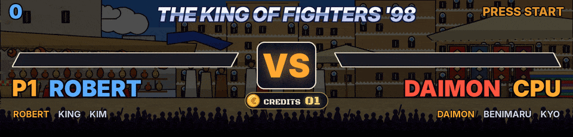
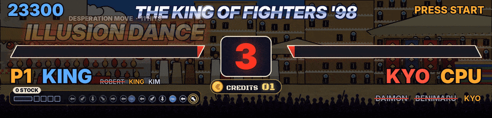
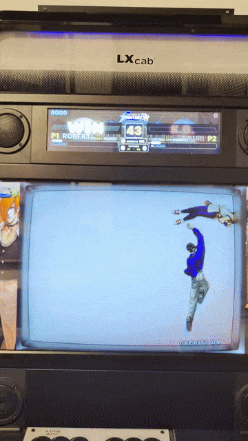
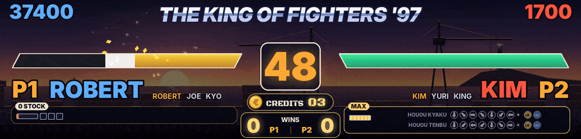

Chacun des 57 jeux de combat Neo Geo a son propre fichier dans `games\`, variantes officielles comprises, et les 34 jeux de combat Capcom se battent dans leurs propres décors. The King of Fighters '98 a été réglé round après round sur une vraie borne, à partir de parties enregistrées, de même que '97 et 2002 dans la 1.33.1.

## Ce que montre l'écran HD

- En haut, le score de chaque joueur, ou CHALLENGER et BEAT BY en match VS. Au milieu, les barres de vie avec une traînée claire pour le coup qui vient d'être pris, et le chrono ou KO. En bas, P1, P2 ou CPU avec le combattant en cours, toute l'équipe dans The King of Fighters '96 à 2000 (les combattants déjà battus barrés), et les crédits.
- Des étincelles à chaque coup, le compteur de combo, FIRST ATTACK, un battement de cœur rouge quand la vie est basse.
- K.O. en grosses lettres rouges du côté du perdant et WIN en or du côté du gagnant, DOUBLE K.O., TIME UP, PERFECT, des confettis pour le gagnant.
- ROUND 2, ROUND 3... quand le jeu lance le round, et FIGHT ! quand le jeu dit GO.
- Le combattant suivant de King of Fighters qui entre une fois le K.O. passé, et quand une équipe perd son troisième combattant, P1 WINS et l'équipe éliminée.
- Un décor qui suit celui du jeu, dans The King of Fighters '96 à 2000, Rage of the Dragons, Garou, Samurai Shodown II à IV, les Street Fighter et d'autres (voir [[Marquee HD]] pour la liste des décors). Les neuf décors de The King of Fighters '98 sont dessinés d'après les lieux du jeu et changent avec les rounds comme dans le jeu.
- Quand personne ne joue, l'écran des pièces (voir [[Utilisation]]).

## Le panneau des coups désespérés, The King of Fighters '98, '97 et 2002

Sous le nom de chaque joueur humain, un panneau.

- Un badge dit les stocks (1 STOCK, 2 STOCKS), EXTRA, MAX quand tous les stocks sont allumés comme le dit le jeu, ou le MAX de l'Advanced pendant qu'il dure, son chrono lu dans le jeu.
- La jauge est dessinée comme le jeu la dessine, la barre et un carré par stock.
- Quand la jauge permet un coup désespéré, les commandes de ceux du combattant s'affichent dessous, leurs flèches tournées vers l'autre combattant. Les flèches s'allument quand le stick les fait, lues à chaque image.
- Quand un bouton finit une tentative qui a raté une étape, les étapes ratées sont barrées en rouge avec RATÉ, et DM ! ou SDM ! s'affiche une fois que le jeu a pris son stock.
- Sinon le panneau montre les touches appuyées, comme le mode entraînement.
- '97 a ses propres commandes, sa jauge, ses trois carrés de stock et le drapeau du jeu pour un coup désespéré, et 2002 ses propres commandes, le MAX par B+C et son chrono, un coup désespéré gratuit en MAX et un SDM qui prend un stock, l'ordre de combat de chaque équipe lu.

## Le spectacle du coup désespéré

Quand un humain place un coup désespéré, son nom prend tout le marquee un instant, puis vole au-dessus de sa barre pendant que les coups tombent, en les comptant. La barre de celui qui les prend sursaute à chaque coup, la partie perdue blanche puis rouge, et à son bord l'étincelle de chaque coup éclate avec des morceaux de la barre qui volent. Deux à la fois, chaque nom s'écrase de son côté avec DOUBLE DM ! entre les deux.

## Les matchs VS entre deux humains

Dans un match à deux joueurs, les King of Fighters affichent CHALLENGER au-dessus du joueur qui vient d'arriver et BEAT BY 02 au-dessus de celui qui a battu 2 challengers de suite, une fois ces compteurs appris (voir [[Apprendre les adresses]]). Une pastille VICTOIRES sous les crédits compte les matchs gagnés par chacun. Chaque victoire va dans `obs\vs_history.txt` et la meilleure série de chaque jeu est gardée (voir [[OBS et DOFLinx]]).

## Ce que lit chaque jeu

Chaque jeu de combat Neo Geo a son propre fichier dans `games\`, versions officielles comprises (japonaise, coréenne, prototype). Les adresses viennent des codes de triche de FinalBurn Neo, des scripts d'entraînement FinalBurn Neo de peon2 et de la base de triche de MAME 2003-Plus, vérifiées avec la collection de codes de MAME (mamecheat.co.uk). Elle donne la jauge de super d'Art of Fighting et Art of Fighting 2, Garou, King of Fighters '96, Ninja Master's, des trois Real Bout Fatal Fury, Rage of the Dragons, Samurai Shodown III, IV, V et V Special et World Heroes Perfect, affichée sous les combattants sur l'écran HD, les personnages de Fatal Fury 2 et le chrono de Karnov's Revenge. Le score est connu pour les King of Fighters et pour Samurai Shodown II. RetroAchievements le donne pour Art of Fighting, Fatal Fury 1, 2, 3 et Special, Galaxy Fight, Garou, Karnov's Revenge, King of Fighters '94 et 2003, Rage of the Dragons, Real Bout Fatal Fury 1 et Special, Samurai Shodown, The Last Blade 1 et 2 et Waku Waku 7 (ses scripts publics sur GitHub et les données que télécharge `tools/ra_notes.py`, à vérifier en jeu), avec les rounds gagnés de Fatal Fury 3 et Karnov's Revenge, des étoiles dorées sous les barres de vie sur l'écran HD. Pour les autres, apprends-le avec `learn.bat` (`score=...` et `score2=...`).

Quand une barre de vie, un chrono ou un nom ne colle pas à l'écran, lance `test_retroarch.bat` pendant un combat et poste le résultat dans une issue GitHub.

| Jeu | Fichier | Barres de vie | Chrono | Nom des personnages | Score |
|---|---|---|---|---|---|
| 3 Count Bout | `3countb.json` | - | - | - | à apprendre |
| Aggressors of Dark Kombat | `aodk.json` | oui | - | - | à apprendre |
| Art of Fighting | `aof.json` | oui | oui | oui (10) | RetroAchievements, à vérifier |
| Art of Fighting 2 | `aof2.json` | oui | oui | oui (13) | à apprendre |
| Art of Fighting 3 | `aof3.json` | oui | oui | oui (10) | à apprendre |
| Breakers | `breakers.json` | oui | oui | - | à apprendre |
| Breakers Revenge | `breakrev.json` | oui | oui | - | à apprendre |
| Double Dragon | `doubledr.json` | oui | oui | oui (14) | à apprendre |
| Dragon's Heaven | `dragonsh.json` | - | - | - | à apprendre |
| Fatal Fury | `fatfury1.json` | oui | oui | oui (14) | RetroAchievements, à vérifier |
| Fatal Fury 2 | `fatfury2.json` | oui | oui | - | RetroAchievements, à vérifier |
| Fatal Fury 3 | `fatfury3.json` | oui | oui | oui (13) | RetroAchievements, à vérifier |
| Fatal Fury Special | `fatfursp.json` | oui | oui | - | RetroAchievements, à vérifier |
| Fight Fever | `fightfev.json` | oui | oui | oui (10) | à apprendre |
| Galaxy Fight | `galaxyfg.json` | oui | - | - | RetroAchievements, à vérifier |
| Garou | `garou.json` | oui | oui | oui (14) | RetroAchievements, à vérifier |
| Kabuki Klash | `kabukikl.json` | oui | oui | - | à apprendre |
| Karnov's Revenge | `karnovr.json` | oui | - | oui (14) | RetroAchievements, à vérifier |
| King of the Monsters | `kotm.json` | oui | - | - | à apprendre |
| King of the Monsters 2 | `kotm2.json` | oui | oui | oui (10) | à apprendre |
| Kizuna Encounter | `kizuna.json` | oui | oui | - | à apprendre |
| Legend of Success Joe | `legendos.json` | oui | - | - | à apprendre |
| Matrimelee | `matrim.json` | oui | oui | - | à apprendre |
| Ninja Master's | `ninjamas.json` | oui | oui | - | à apprendre |
| Rage of the Dragons | `rotd.json` | oui | oui | - | RetroAchievements, à vérifier |
| Ragnagard | `ragnagrd.json` | oui | - | - | à apprendre |
| Real Bout Fatal Fury | `rbff1.json` | oui | oui | oui (16) | RetroAchievements, à vérifier |
| Real Bout Fatal Fury 2 | `rbff2.json` | oui | oui | oui (23) | à apprendre |
| Real Bout Fatal Fury Special | `rbffspec.json` | oui | oui | oui (20) | RetroAchievements, à vérifier |
| Samurai Shodown | `samsho.json` | oui | oui | oui (13) | RetroAchievements, à vérifier |
| Samurai Shodown II | `samsho2.json` | oui | oui | oui (17) | oui |
| Samurai Shodown III | `samsho3.json` | oui | oui | oui (14) | à apprendre |
| Samurai Shodown IV | `samsho4.json` | oui | oui | oui (18) | à apprendre |
| Samurai Shodown V | `samsho5.json` | oui | oui | oui (28) | à apprendre |
| Samurai Shodown V Special | `samsh5sp.json` | oui | oui | oui (28) | à apprendre |
| Savage Reign | `savagere.json` | - | - | - | à apprendre |
| SNK vs. Capcom | `svc.json` | oui | oui | oui (36) | à apprendre |
| SNK vs. Capcom (JAMMA PCB) | `svcpcb.json` | oui | oui | oui (36) | à apprendre |
| The King of Fighters '94 | `kof94.json` | oui | oui | - | RetroAchievements, à vérifier |
| The King of Fighters '95 | `kof95.json` | oui | oui | - | à apprendre |
| The King of Fighters '96 | `kof96.json` | oui | oui | oui (29) | supposé, à vérifier |
| The King of Fighters '97 | `kof97.json` | oui | oui | oui (32) | trouvé (1.33.1) |
| The King of Fighters '98 | `kof98.json` | oui | oui | oui (38) | trouvé |
| The King of Fighters '99 | `kof99.json` | oui | oui | oui (34) | supposé, à vérifier |
| The King of Fighters 2000 | `kof2000.json` | oui | oui | oui (36) | supposé, à vérifier |
| The King of Fighters 2001 | `kof2001.json` | oui | oui | - | supposé, à vérifier |
| The King of Fighters 2002 | `kof2002.json` | oui | oui | - | supposé, à vérifier |
| The King of Fighters 2003 | `kof2003.json` | - | oui | - | RetroAchievements, à vérifier |
| The King of Fighters 2003 (Japan, JAMMA PCB) | `kf2k3pcb.json` | - | oui | - | à apprendre |
| The Last Blade | `lastblad.json` | oui | oui | oui (15) | RetroAchievements, à vérifier |
| The Last Blade 2 | `lastbld2.json` | oui | oui | oui (20) | RetroAchievements, à vérifier |
| Voltage Fighter Gowcaizer | `gowcaizr.json` | oui | oui | oui (12) | à apprendre |
| Waku Waku 7 | `wakuwak7.json` | oui | oui | oui (9) | RetroAchievements, à vérifier |
| World Heroes | `wh1.json` | oui | oui | oui (9) | à apprendre |
| World Heroes 2 | `wh2.json` | oui | oui | oui (16) | à apprendre |
| World Heroes 2 Jet | `wh2j.json` | oui | oui | oui (17) | à apprendre |
| World Heroes Perfect | `whp.json` | oui | oui | oui (19) | à apprendre |

## Les jeux de combat Capcom

Les 34 jeux de combat Capcom (de Street Fighter II à III 3rd Strike, Alpha, Darkstalkers, Marvel vs. Capcom, X-Men...) se battent dans les décors du jeu, avec les jauges de super sous les combattants. Voir [[Capcom et Cave]].

## Un jeu de combat qui se comporte mal

Si ROUND, FIGHT !, K.O. ou VS arrivent au mauvais moment, l'enregistrement de ta partie dit pourquoi. Voir [[Enregistrer une partie]].
