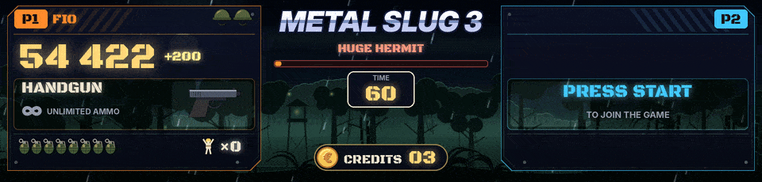

Metal Slug 1 à 5 et X ont chacun leur propre scène, chacune réglée sur une partie enregistrée en entier sur une vraie borne. Avec RetroArch (cœur FinalBurn Neo) ou MAME.

## Sur l'écran HD

- Un panneau de soldat par joueur, avec le soldat choisi (Marco, Tarma, Eri, Fio, et Trevor et Nadia dans Metal Slug 4), le score, l'arme et sa jauge de munitions, les bombes, les vies comme le jeu les écrit et les prisonniers libérés.
- Les tirs suivent l'arme (traçantes, gerbes du fusil à pompe, roquettes, lance-flammes, le laser en rayon tenu). Les bombes volent, rebondissent et explosent quand la grenade du jeu explose, en secouant tout l'écran. Une caisse tombe quand une arme est ramassée, le casque tombe quand une vie est perdue et LAST LIFE clignote sur la dernière.
- Dans un véhicule, le véhicule prend la place de l'arme, avec son nom (TANK, CAMEL SLUG, SLUGNOID, SLUG FLYER, SLUG COPTER, SLUG MARINER, DRILL SLUG, ASTRO SLUG...), son énergie et ses obus quand le jeu les donne. BAIL OUT! clignote quand il n'a plus d'énergie.
- Le boss de la mission 1 de chaque jeu avec WARNING, son nom et sa barre de vie (Tetsuyuki, The Keesi II, Iron Nokana MKII, Huge Hermit, Brave Guerrier, Metal Rear), BOSS DESTROYED et MISSION COMPLETE au moment du jeu. Les gros ennemis d'une mission ont une barre ambre plus discrète. Les boss des missions suivantes sont reconnus à leur vie et nommés d'après la liste du jeu, à confirmer en jeu.
- Chaque mission a son décor (jungle, désert, montagne enneigée, ville en guerre, port, base ennemie), et les décors se relaient quand personne ne joue.
- Le joueur 2 peut arriver à tout moment. Les crédits sont en bas, et une pièce mise tombe dessus.

## Sur la dalle LED

En haut, le titre défile. En dessous, P1 et le score, les vies à droite. La ligne suivante alterne entre les bombes, l'arme avec ses munitions et les crédits. Tout en bas, de petites collines et un petit tank qui avance et tire quand le score monte. À deux joueurs, 1UP et 2UP avec les vies et le score de chacun.

## Ce que lit chaque jeu

| Jeu | Lu | Encore à confirmer en jeu |
|---|---|---|
| Metal Slug (`mslug`) | le score de chaque joueur, les vies, les bombes, les grenades, l'arme et les munitions, les prisonniers, la mission, le tank et son énergie et ses obus | |
| Metal Slug 2 (`mslug2`) | la même chose, le soldat choisi et le véhicule de chaque joueur | |
| Metal Slug X (`mslugx`) | la même chose, le chrono, la vie de tous les ennemis, le MISSION COMPLETE du jeu | le joueur 2, les boss des missions 2 à 6 |
| Metal Slug 3 (`mslug3`) | la même chose, le véhicule, la vie de chaque ennemi, le MISSION COMPLETE du jeu | l'énergie des véhicules, le Camel Slug de la mission 4, les boss des missions 2, 3 et 5 |
| Metal Slug 6, le bootleg de Metal Slug 3 (`mslug3b6`), depuis la 1.33.1 | tout ce que lit Metal Slug 3, avec son propre compte des missions | la même chose que Metal Slug 3 |
| Metal Slug 4 (`mslug4`) | la même chose, dans un véhicule ou non et son énergie, le boss par phases, la fin de la mission | quel véhicule |
| Metal Slug 5 (`mslug5`) | la même chose, le véhicule et son énergie, le drapeau de boss du jeu et son MISSION COMPLETE | les boss des missions 2 à 5 |

Si un jeu affiche une vie de moins que l'écran, enlève les lignes `"add"` et `"min"` de son entrée des vies dans `games\mslugX.json`. S'il en affiche une de plus, ajoute `"add": -1, "min": 0`.

## Tes propres images

Tous les emplacements pour tes propres images, tous les jeux ensemble, sont dans [[Tes propres images]].

Pour afficher tes propres images à la place des dessins d'ArcadeDMD, mets-les dans `sprites\mslug\<nom>.png` pour tous les Metal Slug, ou `sprites\mslug2\<nom>.png` pour un seul jeu. Les véhicules `tank`, `camel`, `slugnoid`, `flyer`, `copter`, `mariner`, `drill`, `astro`, et `elephant`, `ostrich`, `bradley`, `mobile`, `gunner`, `claw`, `walker`, `armor` (vus de côté, canon à droite). Les soldats `marco`, `tarma`, `eri`, `fio`, `trevor`, `nadia` pour un petit portrait à côté du nom. Un fond uni autour du dessin est rendu transparent et les marges vides sont coupées. `.gif`, `.jpg` et `.webp` marchent aussi. `runtime\arcadedmd.log` dit pour chaque véhicule quelle image est utilisée, ou où une image serait lue.

Pour le tank de la dalle LED, dépose `mslug_tank.gif` (ou une bande `mslug_tank.png` de 3 images) dans `sprites\`, 5 pixels de haut au plus, canon à droite.
