Les 155 jeux Neo Geo sur le marquee HD et, dessous, sur la dalle LED 128 x 32. Les deux sont dessinés par ArcadeDMD lui-même à partir d'une partie enregistrée, avec les fichiers de jeux de la version 1.39. Ce que montre chaque jeu est dans [[Jeux de combat]], [[Les Metal Slug]] et [[Jeux Neo Geo]].

## Jeux de combat Neo Geo

**3 Count Bout** (`3countb`). 8 combattants nommés, leurs coups sous le nom, coups reconnus au stick.

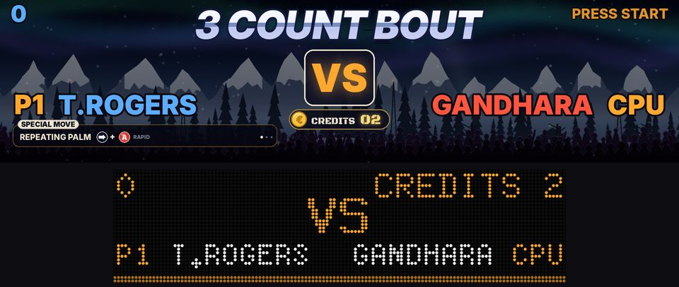

**Aggressors of Dark Kombat** (`aodk`). Barres de vie, 7 lieux.

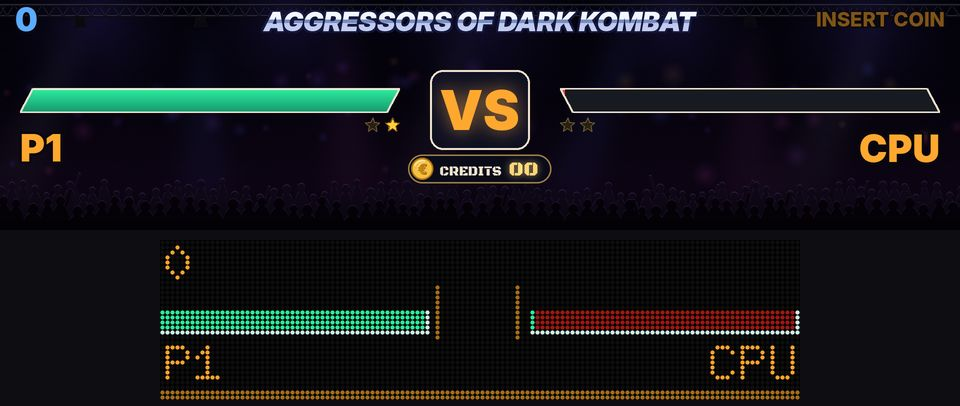

**Art of Fighting** (`aof`). Barres de vie, chrono, 10 combattants nommés, leurs coups sous le nom, coups reconnus au stick, 10 lieux, jauge.

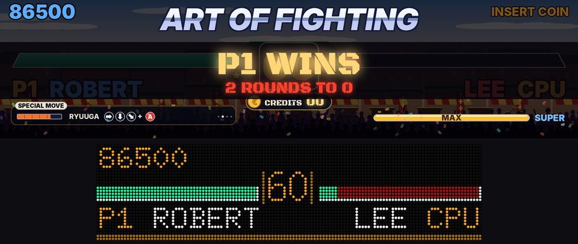

**Art of Fighting 2** (`aof2`). Barres de vie, chrono, 13 combattants nommés, leurs coups sous le nom, coups reconnus au stick, 12 lieux, jauge.

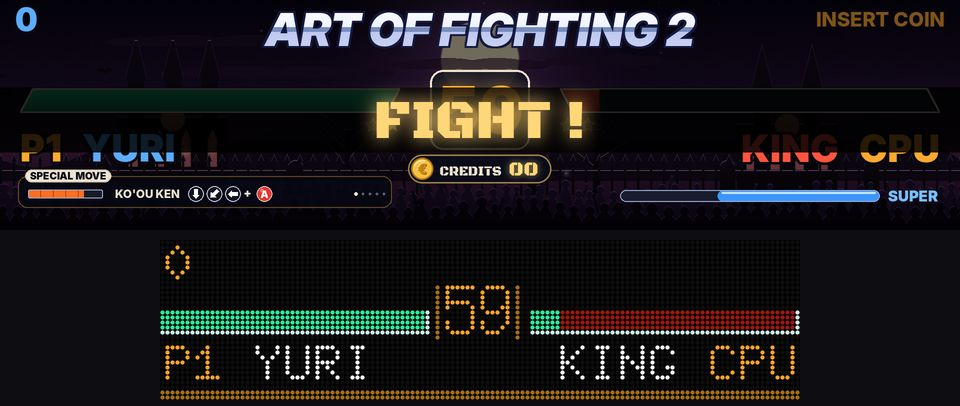

**Art of Fighting 3** (`aof3`). Barres de vie, chrono, 10 combattants nommés, leurs coups sous le nom, coups reconnus au stick, 10 lieux.

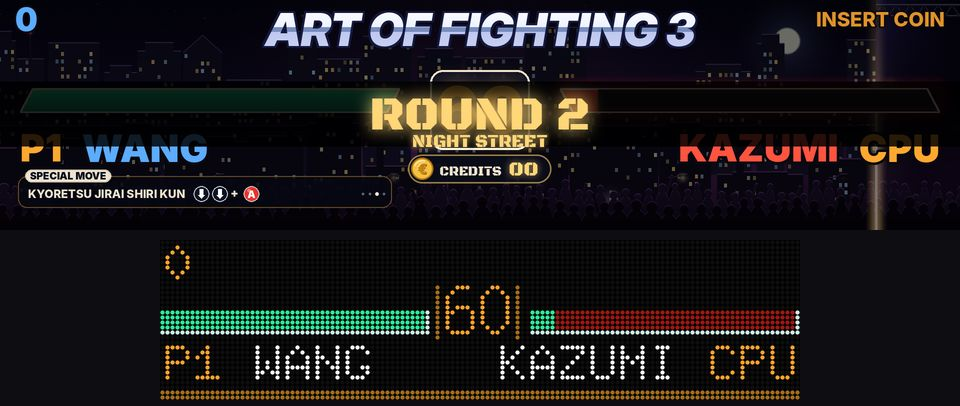

**Breakers** (`breakers`). Barres de vie, chrono, 9 combattants nommés, leurs coups sous le nom, coups reconnus au stick, 9 lieux.

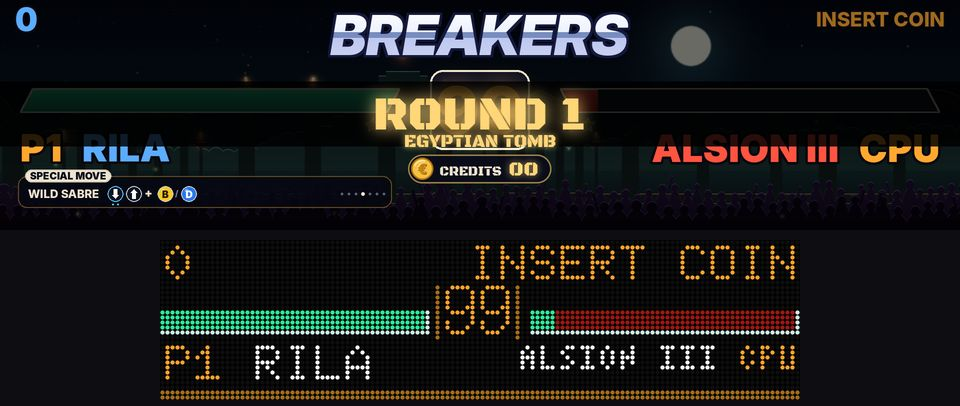

**Breakers Revenge** (`breakrev`). Barres de vie, chrono, 10 combattants nommés, leurs coups sous le nom, coups reconnus au stick, 10 lieux.

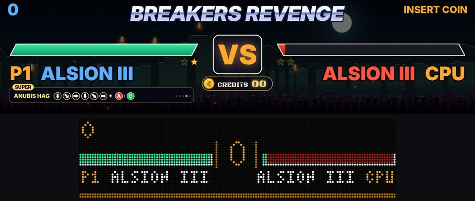

**Double Dragon** (`doubledr`). Barres de vie, chrono, 14 combattants nommés, leurs coups sous le nom, coups reconnus au stick, 6 lieux.

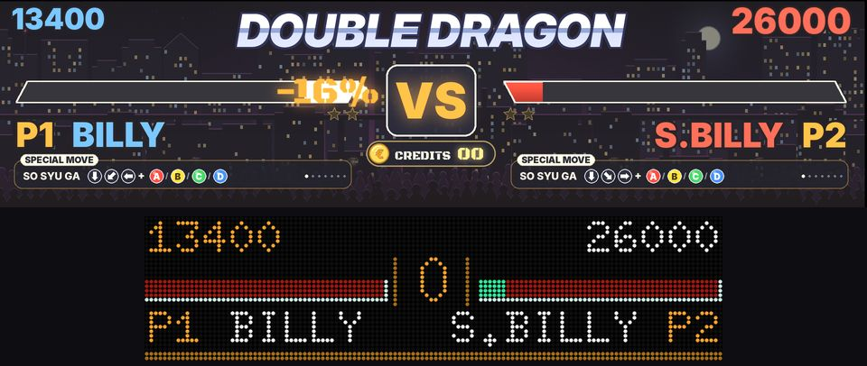

**Fatal Fury** (`fatfury1`). Barres de vie, chrono, 14 combattants nommés, leurs coups sous le nom, coups reconnus au stick.

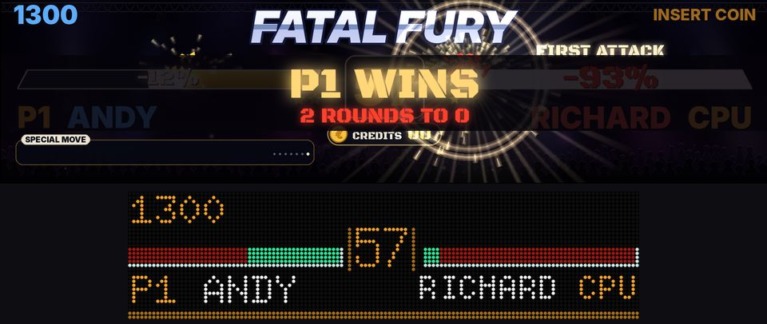

**Fatal Fury 2** (`fatfury2`). Barres de vie, chrono, 12 combattants nommés, leurs coups sous le nom, coups reconnus au stick, 12 lieux.

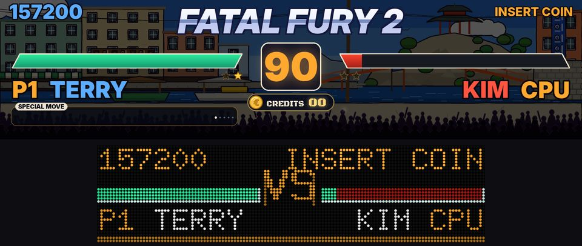

**Fatal Fury 3** (`fatfury3`). Barres de vie, chrono, 13 combattants nommés, leurs coups sous le nom, coups reconnus au stick, 15 lieux.

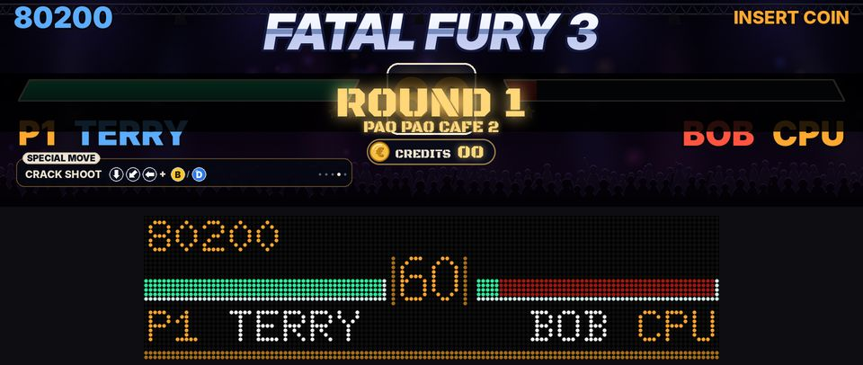

**Fatal Fury Special** (`fatfursp`). Barres de vie, chrono, 12 combattants nommés, leurs coups sous le nom, coups reconnus au stick, les décors du jeu.

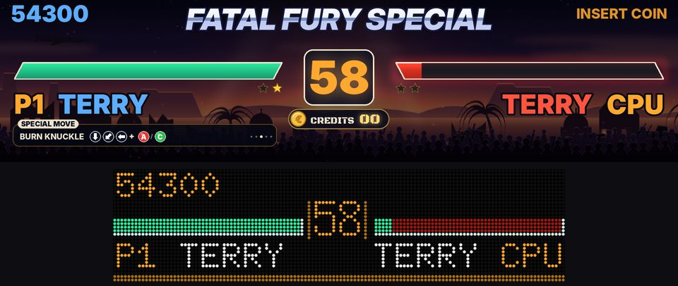

**Fight Fever** (`fightfev`). Barres de vie, chrono, 10 combattants nommés, leurs coups sous le nom, coups reconnus au stick, 10 lieux.

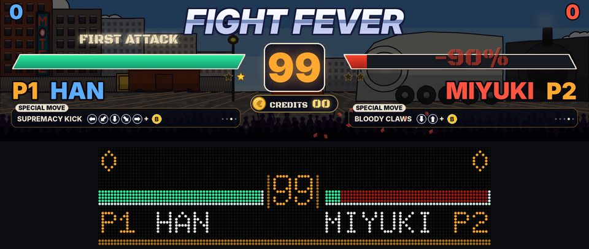

**Galaxy Fight** (`galaxyfg`). Barres de vie, chrono, 10 combattants nommés, leurs coups sous le nom, coups reconnus au stick, 9 lieux.

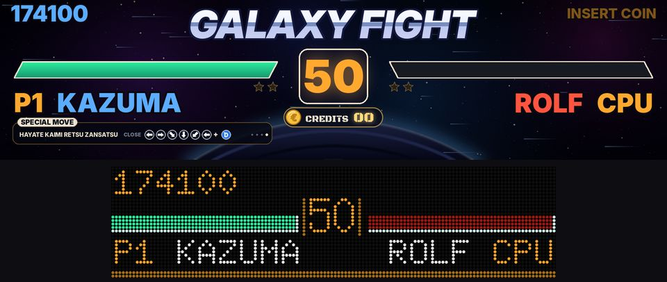

**Garou** (`garou`). Barres de vie, chrono, 14 combattants nommés, leurs coups sous le nom, coups reconnus au stick, 14 lieux, jauge.

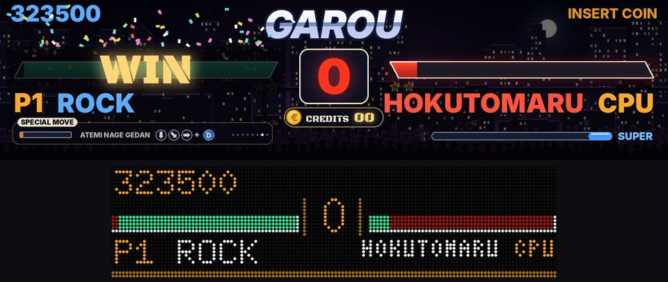

**Kabuki Klash** (`kabukikl`). Barres de vie, chrono, 12 combattants nommés, leurs coups sous le nom, coups reconnus au stick, 10 lieux, jauge.

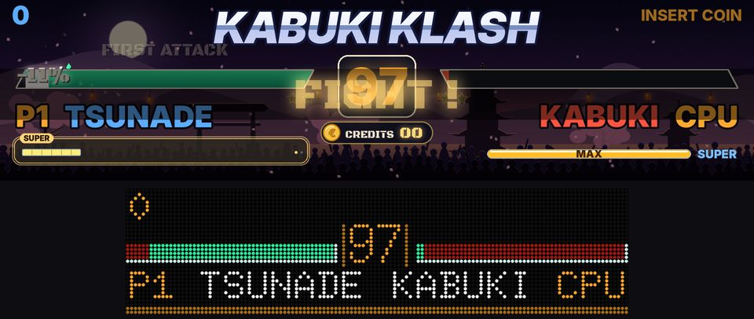

**Karnov's Revenge** (`karnovr`). Barres de vie, chrono, 14 combattants nommés, leurs coups sous le nom, coups reconnus au stick.

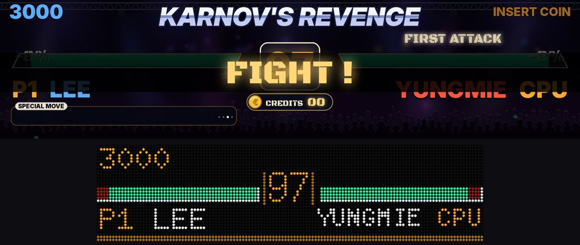

**King of the Monsters** (`kotm`). Barres de vie.

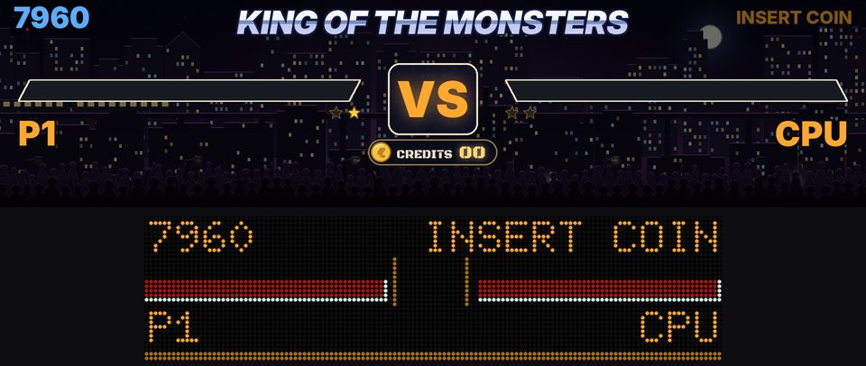

**King of the Monsters 2** (`kotm2`). Barres de vie, chrono, 10 combattants nommés.

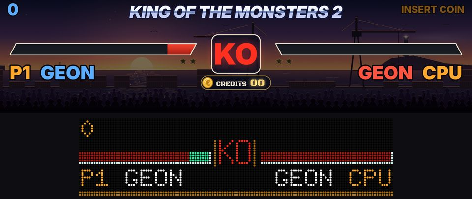

**Kizuna Encounter** (`kizuna`). Barres de vie, chrono, 13 combattants nommés, leurs coups sous le nom, coups reconnus au stick, 10 lieux.

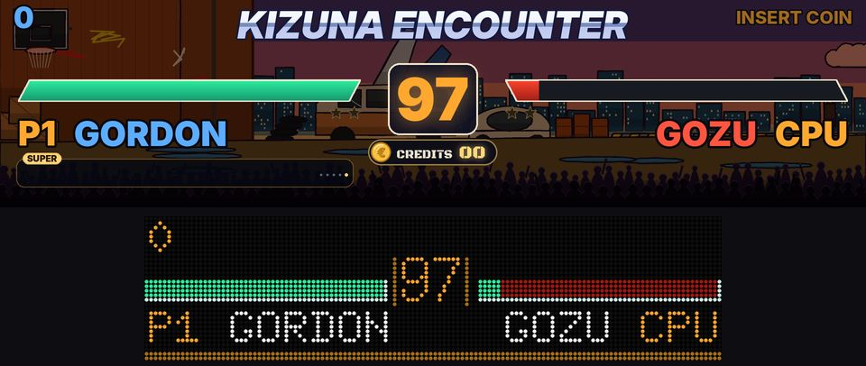

**Legend of Success Joe** (`legendos`). Barres de vie.

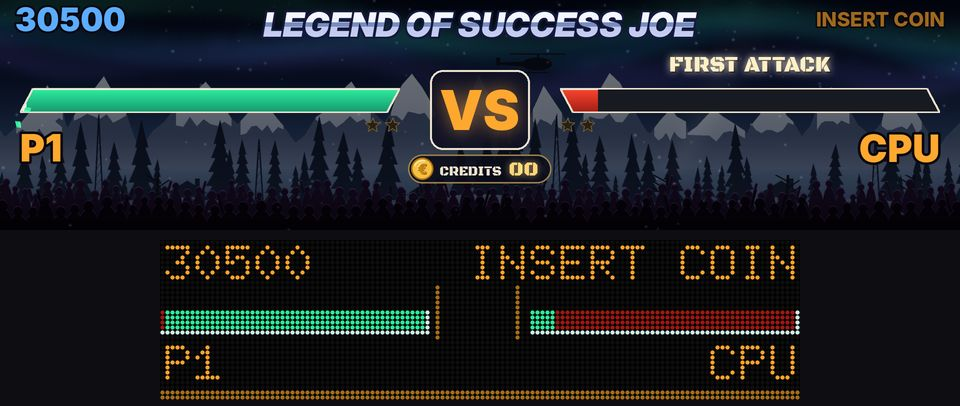

**Matrimelee** (`matrim`). Barres de vie, chrono, 16 combattants nommés, leurs coups sous le nom, coups reconnus au stick, 9 lieux.

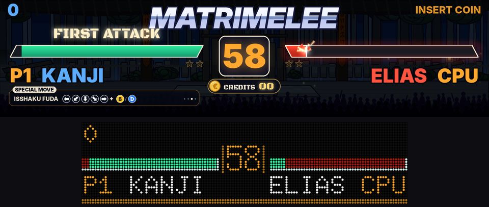

**Ninja Master's** (`ninjamas`). Barres de vie, chrono, 12 combattants nommés, leurs coups sous le nom, coups reconnus au stick, 12 lieux, jauge.

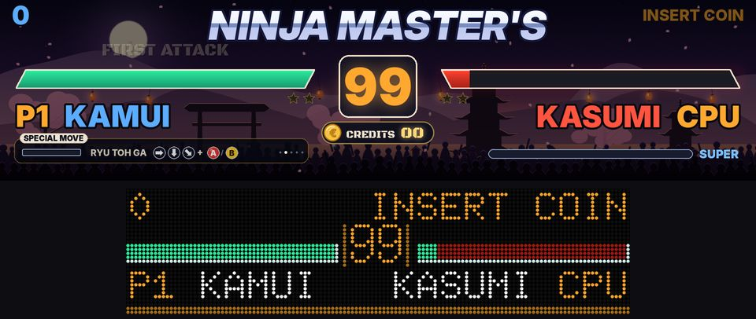

**Rage of the Dragons** (`rotd`). Barres de vie, chrono, 16 combattants nommés, leurs coups sous le nom, coups reconnus au stick, 8 lieux, jauge.

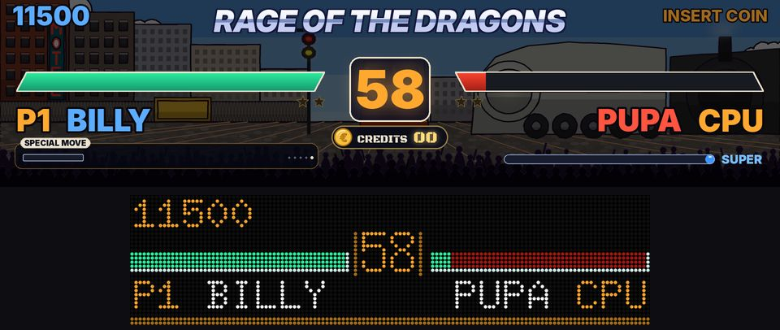

**Ragnagard** (`ragnagrd`). Barres de vie, 12 combattants nommés, leurs coups sous le nom, coups reconnus au stick, 4 lieux.

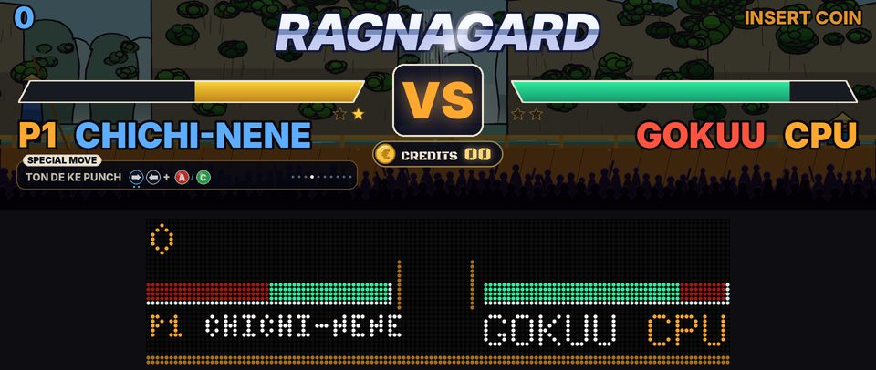

**Real Bout Fatal Fury** (`rbff1`). Barres de vie, chrono, 16 combattants nommés, leurs coups sous le nom, coups reconnus au stick, 13 lieux, jauge.

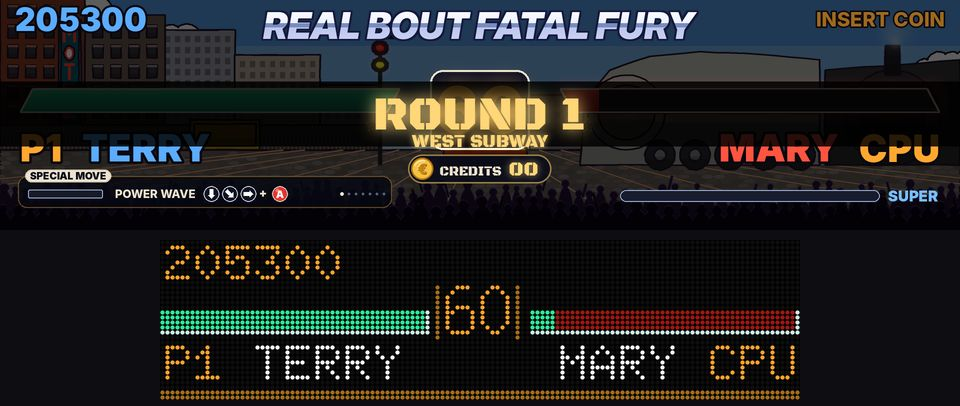

**Real Bout Fatal Fury 2** (`rbff2`). Barres de vie, chrono, 23 combattants nommés, leurs coups sous le nom, coups reconnus au stick, 10 lieux, jauge.

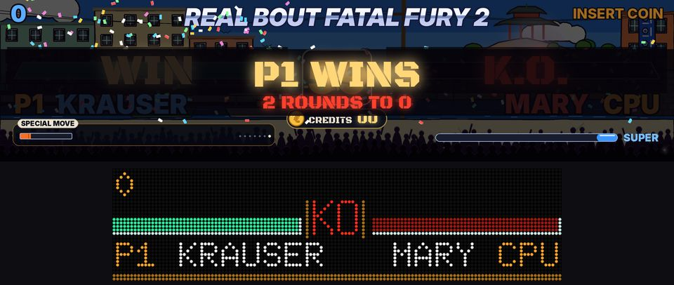

**Real Bout Fatal Fury Special** (`rbffspec`). Barres de vie, chrono, 20 combattants nommés, leurs coups sous le nom, coups reconnus au stick, 10 lieux, jauge.

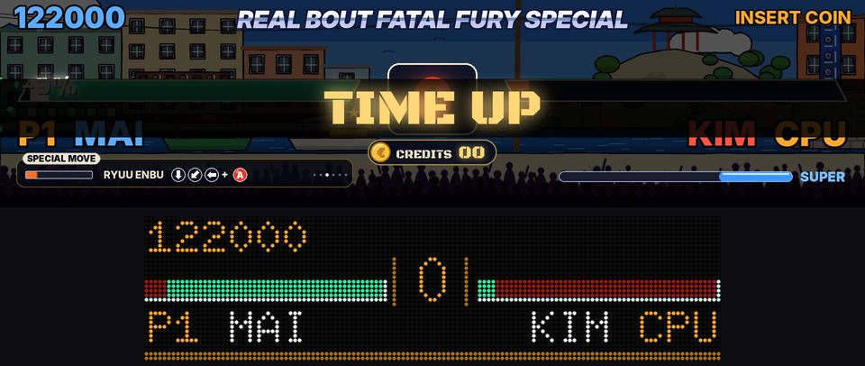

**Samurai Shodown** (`samsho`). Barres de vie, chrono, 13 combattants nommés, leurs coups sous le nom, coups reconnus au stick, 12 lieux.

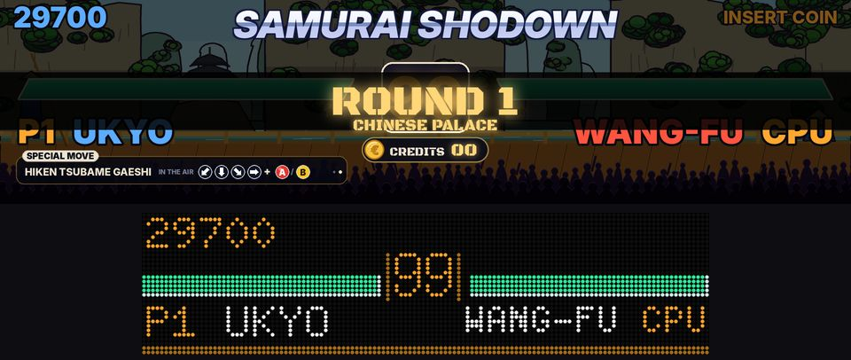

**Samurai Shodown II** (`samsho2`). Barres de vie, chrono, 17 combattants nommés, leurs coups sous le nom, coups reconnus au stick, 12 lieux, jauge.

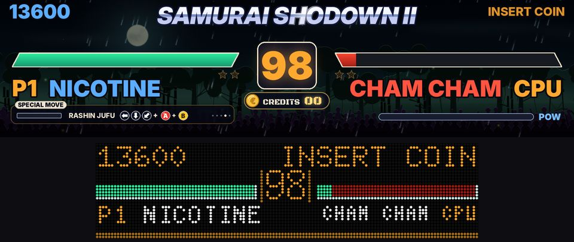

**Samurai Shodown III** (`samsho3`). Barres de vie, chrono, 14 combattants nommés, leurs coups sous le nom, coups reconnus au stick, 3 lieux, jauge.

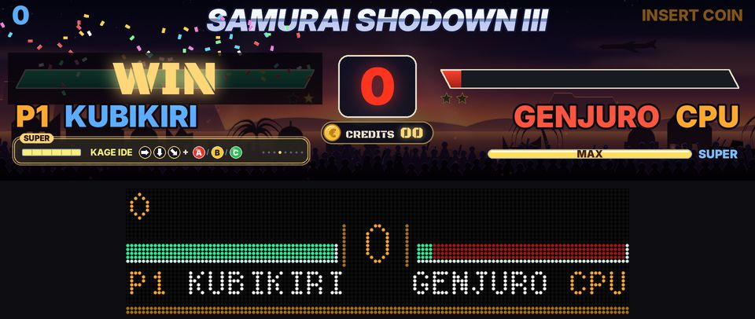

**Samurai Shodown IV** (`samsho4`). Barres de vie, chrono, 18 combattants nommés, leurs coups sous le nom, coups reconnus au stick, 12 lieux, jauge.

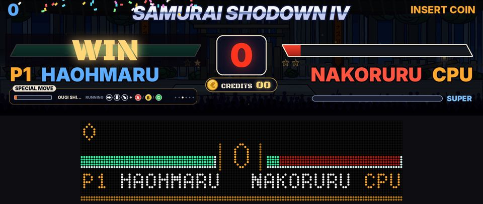

**Samurai Shodown V** (`samsho5`). Barres de vie, chrono, 28 combattants nommés, leurs coups sous le nom, coups reconnus au stick, 15 lieux, jauge.

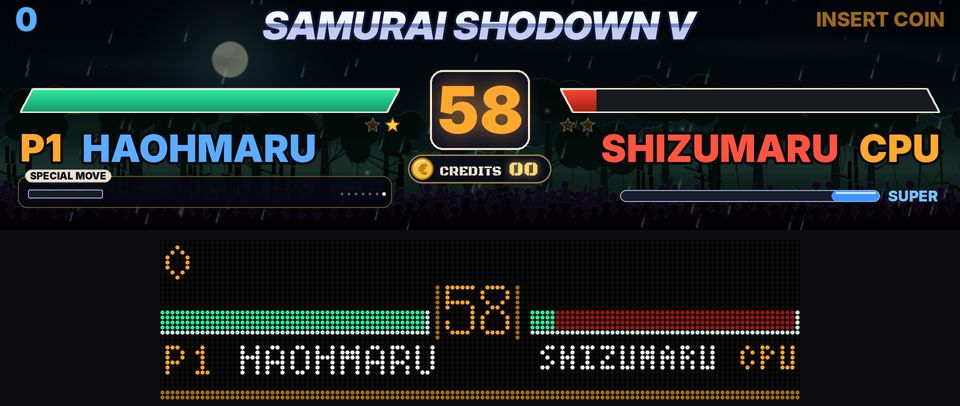

**Samurai Shodown V Special** (`samsh5sp`). Barres de vie, chrono, 28 combattants nommés, leurs coups sous le nom, coups reconnus au stick, 15 lieux, jauge.

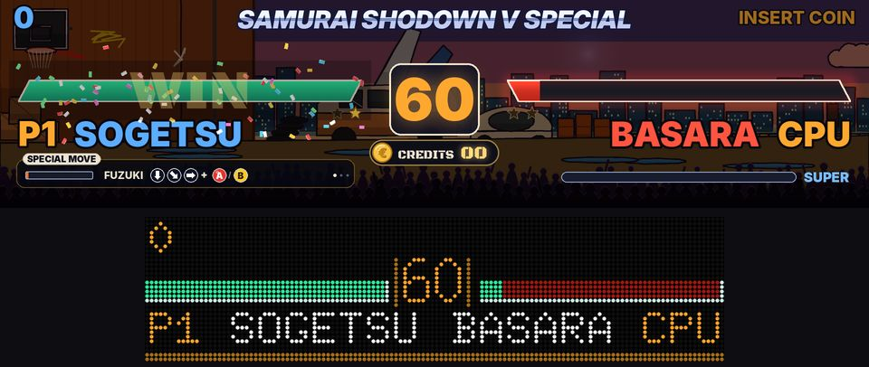

**Savage Reign** (`savagere`). 12 combattants nommés, leurs coups sous le nom, coups reconnus au stick, 5 lieux.

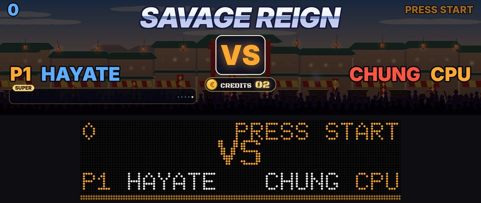

**SNK vs. Capcom** (`svc`). Barres de vie, chrono, 36 combattants nommés, leurs coups sous le nom, coups reconnus au stick, 8 lieux.

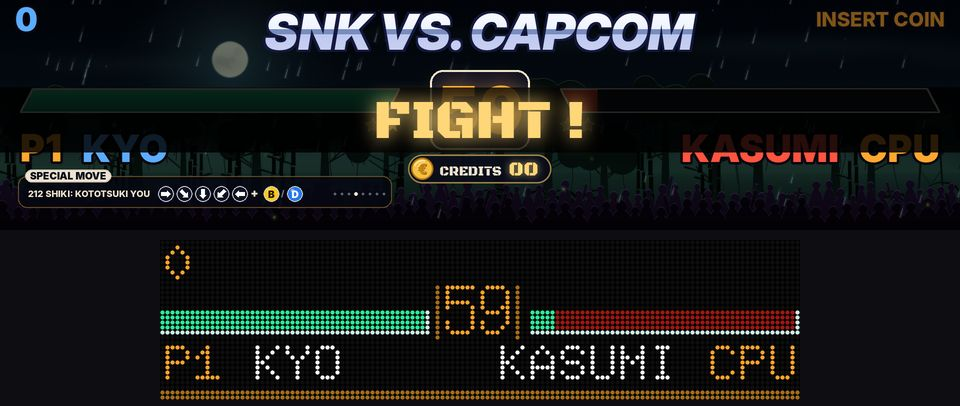

**The King of Fighters '94** (`kof94`). Barres de vie, chrono, 26 combattants nommés, leurs coups sous le nom, coups reconnus au stick, 9 lieux, jauge.

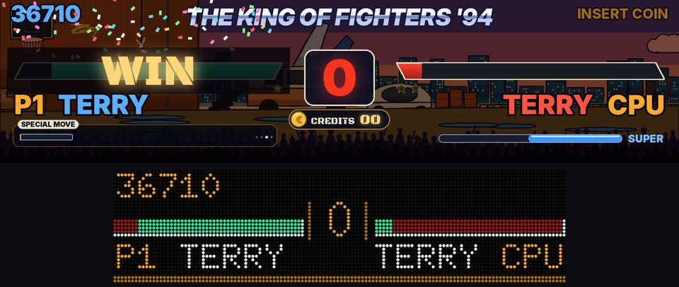

**The King of Fighters '95** (`kof95`). Barres de vie, chrono, 26 combattants nommés, leurs coups sous le nom, coups reconnus au stick, 9 lieux, jauge.

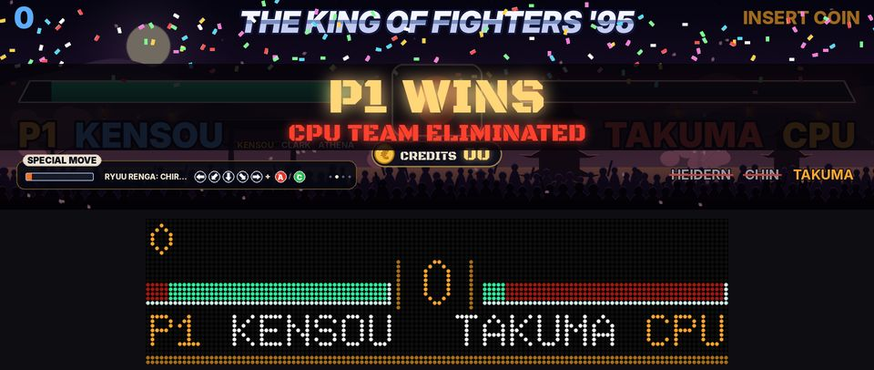

**The King of Fighters '96** (`kof96`). Barres de vie, chrono, 29 combattants nommés, leurs coups sous le nom, coups reconnus au stick, 9 lieux, jauge.

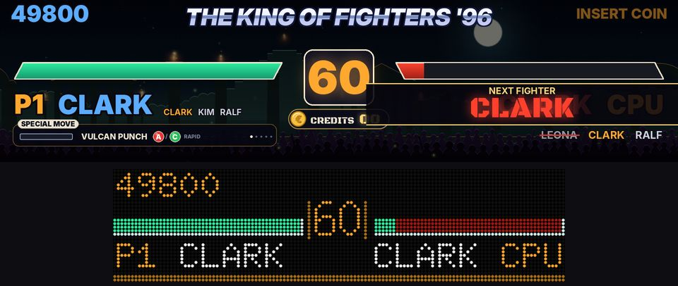

**The King of Fighters '97** (`kof97`). Barres de vie, chrono, 32 combattants nommés, coups désespérés sous la jauge, coups reconnus au stick, 6 lieux.

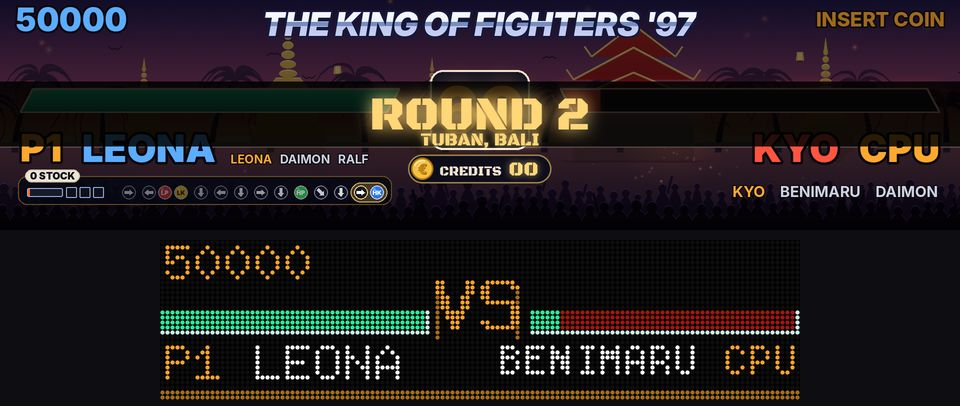

**The King of Fighters '98** (`kof98`). Barres de vie, chrono, 38 combattants nommés, coups désespérés sous la jauge, coups reconnus au stick, 9 lieux.

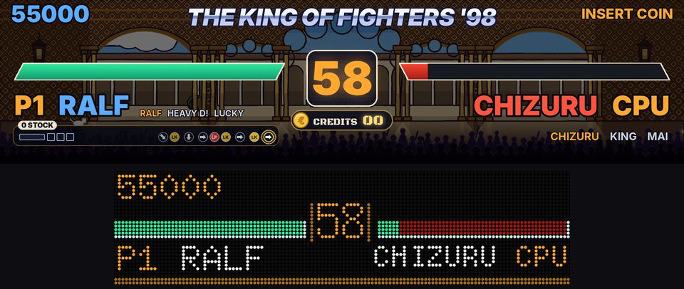

**The King of Fighters '99** (`kof99`). Barres de vie, chrono, 34 combattants nommés, leurs coups sous le nom, coups reconnus au stick, 6 lieux.

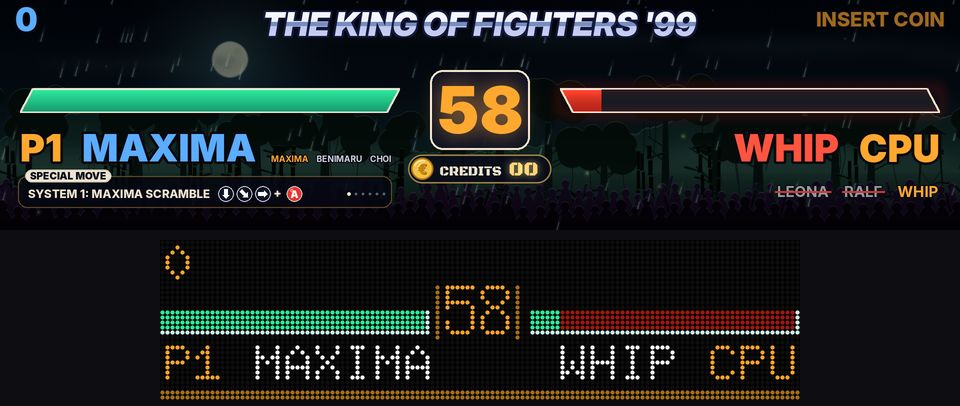

**The King of Fighters 2000** (`kof2000`). Barres de vie, chrono, 36 combattants nommés, leurs coups sous le nom, coups reconnus au stick, 9 lieux.

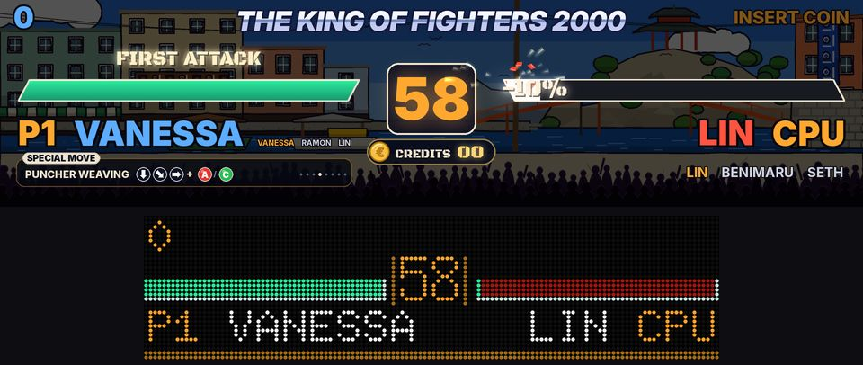

**The King of Fighters 2001** (`kof2001`). Barres de vie, chrono, 42 combattants nommés, leurs coups sous le nom, coups reconnus au stick, 6 lieux.

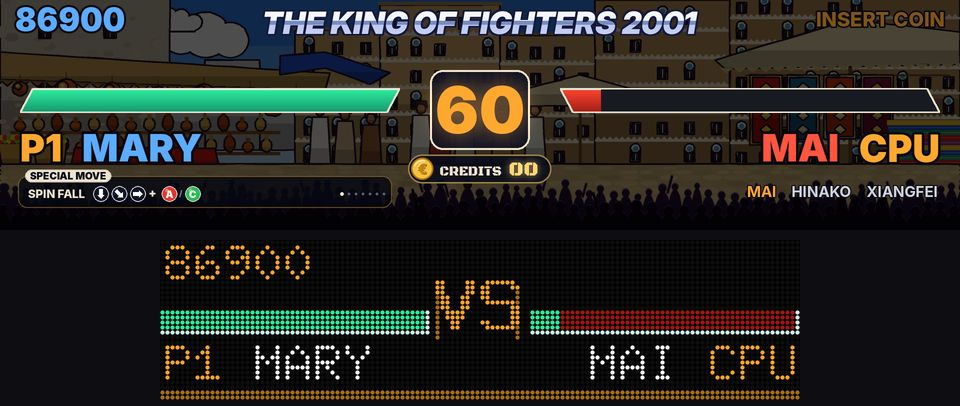

**The King of Fighters 2002** (`kof2002`). Barres de vie, chrono, 41 combattants nommés, coups désespérés sous la jauge, coups reconnus au stick, 7 lieux, jauge.

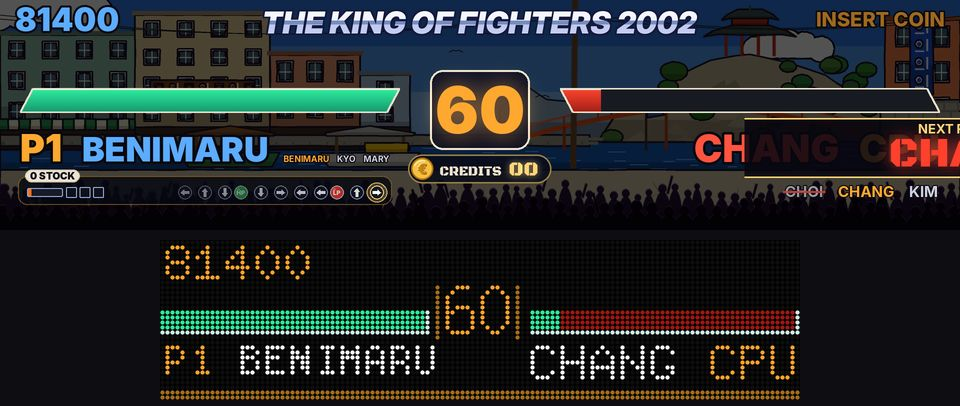

**The King of Fighters 2003** (`kof2003`). Chrono, 37 combattants nommés, leurs coups sous le nom, coups reconnus au stick.

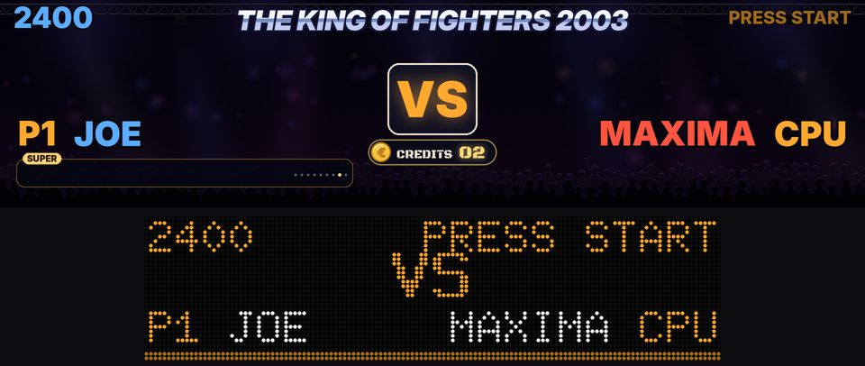

**The Last Blade** (`lastblad`). Barres de vie, chrono, 15 combattants nommés, leurs coups sous le nom, coups reconnus au stick, 9 lieux.

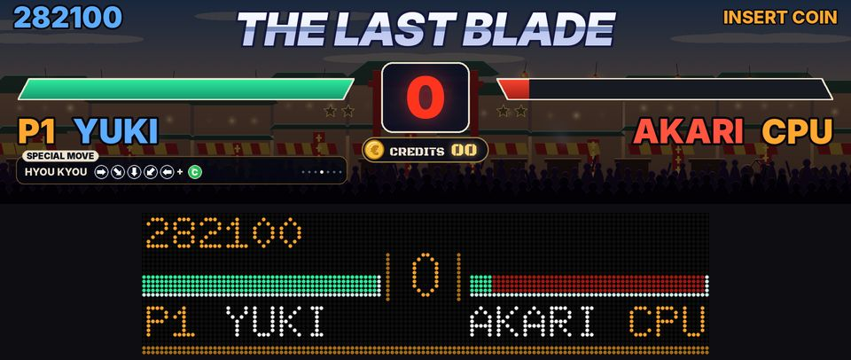

**The Last Blade 2** (`lastbld2`). Barres de vie, chrono, 20 combattants nommés, leurs coups sous le nom, coups reconnus au stick, 10 lieux, jauge.

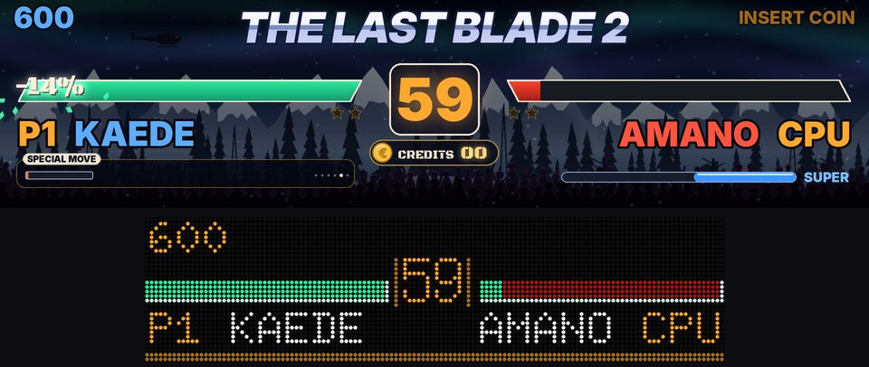

**Voltage Fighter Gowcaizer** (`gowcaizr`). Barres de vie, chrono, 12 combattants nommés, leurs coups sous le nom, coups reconnus au stick, 12 lieux.

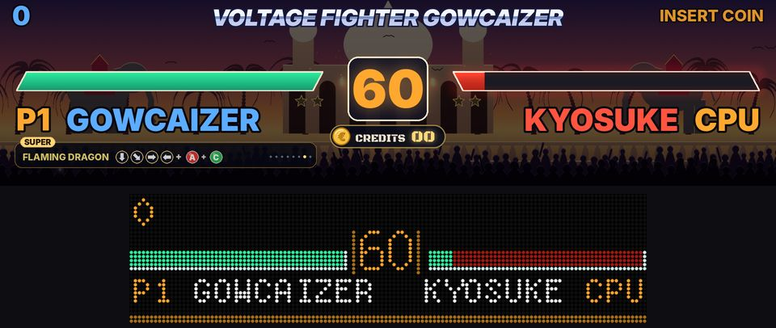

**Waku Waku 7** (`wakuwak7`). Barres de vie, chrono, 9 combattants nommés, leurs coups sous le nom, coups reconnus au stick, 6 lieux.

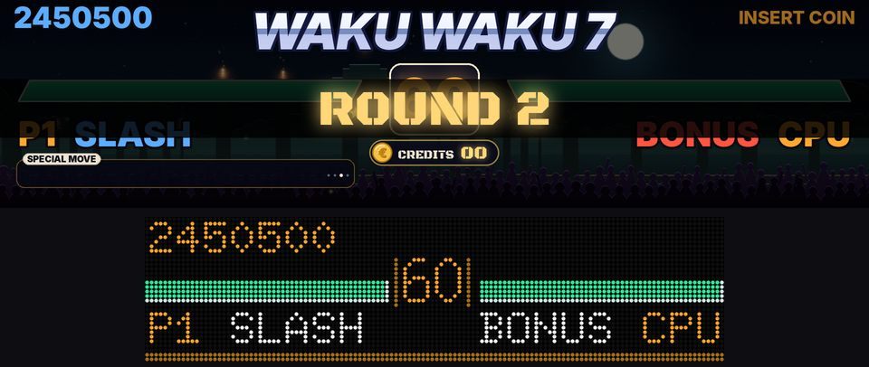

**World Heroes** (`wh1`). Barres de vie, chrono, 9 combattants nommés, leurs coups sous le nom, coups reconnus au stick, 15 lieux.

**World Heroes 2** (`wh2`). Barres de vie, chrono, 16 combattants nommés, leurs coups sous le nom, coups reconnus au stick, 15 lieux.

**World Heroes 2 Jet** (`wh2j`). Barres de vie, chrono, 17 combattants nommés, leurs coups sous le nom, coups reconnus au stick, 21 lieux.

**World Heroes Perfect** (`whp`). Barres de vie, chrono, 19 combattants nommés, leurs coups sous le nom, coups reconnus au stick, 12 lieux, jauge.

## Shoot'em up

**Aero Fighters 2** (`sonicwi2`). Score, vies, bombes, puissance.

**Aero Fighters 3** (`sonicwi3`). Score, vies, bombes, puissance.

**Alpha Mission II** (`alpham2`). Score, vies, puissance.

**Andro Dunos** (`androdun`). Score, vies.

**Blazing Star** (`blazstar`). Score, vies, puissance.

**Captain Tomaday** (`ctomaday`). Vies, puissance.

**Choutetsu Brikin'ger** (`ironclad`). Score, puissance.

**Ghost Pilots** (`gpilots`). Score, vies, bombes, puissance.

**Last Resort** (`lresort`). Score, vies, puissance.

**Prehistoric Isle 2** (`preisle2`). Score, vies, bombes, puissance.

**Pulstar** (`pulstar`). Score, vies, stage.

**Strikers 1945 Plus** (`s1945p`). Score, vies, bombes, puissance.

**Twinkle Star Sprites** (`twinspri`). Score, vies, bombes, puissance, stage.

**Viewpoint** (`viewpoin`). Score, vies.

**Zed Blade** (`zedblade`). Score, vies, bombes.

## Run and gun

**Cyber-Lip** (`cyberlip`). Score, chrono, vies.

**Metal Slug** (`mslug`). Score, chrono, vies, bombes, mission.

**Metal Slug 2** (`mslug2`). Score, chrono, vies, bombes, mission.

**Metal Slug 3** (`mslug3`). Score, chrono, vies, bombes, mission.

**Metal Slug 4** (`mslug4`). Score, chrono, vies, bombes, mission.

**Metal Slug 5** (`mslug5`). Score, chrono, vies, bombes, mission.

**Metal Slug X** (`mslugx`). Score, chrono, vies, bombes, mission.

**NAM-1975** (`nam1975`). Score.

**Ninja Commando** (`ncommand`). Score, chrono.

**Shock Troopers** (`shocktro`). Score, chrono, énergie, nom du soldat et son équipe, arme spéciale, stage et route, barre de vie du boss.

**Shock Troopers 2nd Squad** (`shocktr2`). Score, chrono, vies, énergie, nom du soldat, arme et son niveau de puissance, grenades, second joueur.

## Action et plates-formes

**Bang Bang Busters** (`b2b`). Vies.

**Blue's Journey** (`bjourney`). Score, chrono, vies.

**Burning Fight** (`burningf`). Score, chrono, vies.

**Crossed Swords** (`crsword`). Scène de son genre.

**Digger Man** (`diggerma`). Vies, bombes.

**Eight Man** (`eightman`). Score, chrono, vies, bombes.

**Ganryu** (`ganryu`). Score, chrono, vies.

**Magician Lord** (`maglord`). Vies, puissance.

**Mutation Nation** (`mutnat`). Score, bombes.

**Neo Bomberman** (`neobombe`). Vies, bombes, stage.

**Neo Mr. Do!** (`neomrdo`). Score, vies.

**Nightmare in the Dark** (`nitd`). Score, chrono, vies.

**Ninja Combat** (`ncombat`). Score, chrono, vies, puissance.

**Robo Army** (`roboarmy`). Vies, bombes.

**Sengoku** (`sengoku`). Score, vies.

**Sengoku 2** (`sengoku2`). Score, vies.

**Sengoku 3** (`sengoku3`). Score, chrono.

**Spin Master** (`spinmast`). Score, vies, bombes.

**The Super Spy** (`superspy`). Score.

**Top Hunter - Roddy & Cathy** (`tophuntr`). Chrono, vies, puissance.

**Zupapa!** (`zupapa`). Score, vies.

## Sport

**2020 Super Baseball** (`2020bb`). Chrono.

**Bang Bead** (`bangbead`). Score, puissance.

**Baseball Stars 2** (`bstars2`). Scène de son genre.

**Baseball Stars Professional** (`bstars`). Chrono.

**Battle Flip Shot** (`flipshot`). Score, chrono.

**Football Frenzy** (`fbfrenzy`). Scène de son genre.

**Goal! Goal! Goal!** (`goalx3`). Chrono.

**League Bowling** (`lbowling`). Chrono.

**Neo Turf Masters** (`turfmast`). Puissance.

**Neo-Geo Cup '98** (`neocup98`). Scène de son genre.

**Pleasure Goal** (`pgoal`). Scène de son genre.

**Power Spikes II** (`pspikes2`). Puissance.

**Soccer Brawl** (`socbrawl`). Scène de son genre.

**Street Hoop** (`strhoop`). Scène de son genre.

**Super Dodge Ball** (`sdodgeb`). Score, chrono, puissance.

**Super Sidekicks** (`ssideki`). Scène de son genre.

**Super Sidekicks 2** (`ssideki2`). Scène de son genre.

**Super Sidekicks 3 - The Next Glory** (`ssideki3`). Scène de son genre.

**Tecmo World Soccer '96** (`twsoc96`). Scène de son genre.

**The Ultimate 11 - The SNK Football Championship** (`ssideki4`). Puissance.

**Top Player's Golf** (`tpgolf`). Chrono.

**Windjammers** (`wjammers`). Score, chrono.

## Course

**Neo Drift Out - New Technology** (`neodrift`). Chrono.

**Over Top** (`overtop`). Chrono.

**Riding Hero** (`ridhero`). Chrono.

**Stakes Winner** (`stakwin`). Scène de son genre.

**Stakes Winner 2** (`stakwin2`). Puissance.

**Thrash Rally** (`trally`). Chrono.

## Réflexion

**Ghostlop** (`ghostlop`). Chrono.

**Gururin** (`gururin`). Scène de son genre.

**Magical Drop II** (`magdrop2`). Scène de son genre.

**Magical Drop III** (`magdrop3`). Scène de son genre.

**Money Puzzle Exchanger** (`miexchng`). Scène de son genre.

**Panic Bomber** (`panicbom`). Score, puissance.

**Pochi and Nyaa** (`pnyaa`). Score.

**Pop 'n Bounce** (`popbounc`). Vies.

**Puzzle Bobble** (`pbobblen`). Score.

**Puzzle Bobble 2** (`pbobbl2n`). Score.

**Puzzle De Pon!** (`puzzledp`). Score, chrono.

**Puzzle De Pon! R!** (`puzzldpr`). Score, chrono.

**Puzzled** (`joyjoy`). Scène de son genre.

**Super Bubble Pop** (`sbp`). Score.

**The Irritating Maze** (`irrmaze`). Chrono, vies.

**Zintrick** (`zintrckb`). Chrono.

## Quiz, mahjong et shogi

**Bakatonosama Mahjong Manyuuki** (`bakatono`). Scène de son genre.

**Chibi Maruko-chan Deluxe Quiz** (`marukodq`). Vies.

**Idol Mahjong Final Romance 2** (`froman2b`). Scène de son genre.

**Janshin Densetsu** (`janshin`). Chrono.

**Mahjong Kyo Retsuden** (`mahretsu`). Scène de son genre.

**Minasan no Okagesamadesu!** (`minasan`). Scène de son genre.

**Quiz Daisousa Sen** (`quizdais`). Vies.

**Quiz King of Fighters** (`quizkof`). Vies.

**Quiz Meitantei Neo & Geo** (`quizdai2`). Vies.

**Shougi no Tatsujin** (`moshougi`). Scène de son genre.

