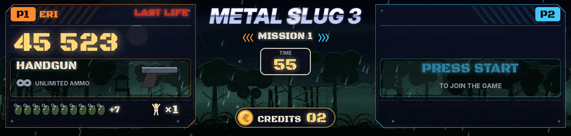

Un écran LCD dans le marquee montre les scènes en HD lisse, avec des décors animés, ou en LED virtuelles. N'importe quel écran que Windows voit comme un écran en plus convient, branché au PC en HDMI, DisplayPort ou USB-C. Les scènes s'adaptent à l'écran. Elles ont été vérifiées en 1920 x 360, 1280 x 390, 1920 x 460, 1920 x 480 et 1920 x 720.



## Le mettre en place

1. Lance `screen_setup.bat` (l'installeur le propose aussi). Il liste les écrans, devine lequel est le marquee (le plus allongé) et écrit la section `preview` de `config.json`.
2. À la question de l'affichage, choisis la HD lisse, ou les LED virtuelles.
3. Lance `demo_fight.bat` pour voir le résultat, puis un jeu depuis ton frontend.

À la main, dans `config.json`.

```json
"preview": {
  "enabled": true,
  "x": 1920, "y": 0,
  "width": 1920, "height": 460,
  "borderless": true,
  "topmost": true,
  "mode": "games",
  "takeover": "known",
  "style": "hd"
}
```

`x` et `y` sont la place du coin en haut à gauche de l'écran sur le bureau de Windows (Paramètres, Affichage). Ici, un marquee placé à droite d'un écran 1080p. Placé en dessous, ce serait `"x": 0, "y": 1080`.

## Avec BigBox

Avec `"mode": "games"`, la fenêtre se cache en dehors des jeux et l'écran appartient au frontend, à ses Clear Logos et à ses marquees. Dès qu'un jeu connu démarre, ArcadeDMD passe devant, au-dessus du marquee de BigBox ou d'HyperSpin, sans prendre le focus du jeu. Si le frontend repasse devant pendant le jeu, ArcadeDMD revient en moins d'une seconde. À la fin du jeu, l'écran revient tout de suite au frontend.

## HD lisse ou LED virtuelles

- `"style": "hd"` dessine à la résolution de l'écran. Des textes lisses, des barres de vie en dégradé, des décors animés qui suivent le stage ou la mission du jeu, un effet pour chaque événement, le logo du jeu en haut.
- `"style": "led"` dessine des LED rondes comme une vraie dalle, deux fois plus fines qu'une dalle 128 x 32 sur un grand écran (`"hd": "auto"`). `"style": "pixel"` dessine des pixels carrés.

## L'allure

- `"dim": 30` assombrit les décors animés pour que les informations ressortent (de 0 à 80 pour cent). Les jeux de combat ont le leur, `"dim_fight": 55`.
- `"coins": false` remet le simple INSERT COIN.
- `"stage_style": "flat"` remet l'allure des décors de King of Fighters '98 d'avant la 1.33.

## Le logo du jeu

Le logo est ton Clear Logo LaunchBox. ArcadeDMD trouve tout seul le dossier de LaunchBox quand BigBox tourne, ou aux endroits habituels (`C:\LaunchBox`, `E:\LaunchBox`...). Sinon mets `"launchbox": "E:\\LaunchBox"` dans la section `preview`. Le jeu en cours est relié à son logo par le chemin de la ROM dans LaunchBox, et par le jeu parent pour un clone. Sans logo, le titre du jeu s'affiche en lettres métalliques.

## Logo du jeu au lancement

Quand un jeu démarre, son logo arrive d'abord. Sur l'écran HD, il entre en grand sur un écran sombre, avec un éclair et un reflet, puis glisse à sa place dans la scène. Sur la Pixelcade et les dalles ZeDMD, il grandit sur les LED 128 x 32, puis la scène arrive. La Pixelcade l'affiche dès que pixelweb lui a laissé la dalle.


C'est le Clear Logo LaunchBox du jeu, trouvé comme expliqué juste au-dessus. Sur une dalle, un jeu sans Clear Logo passe directement à sa scène. Sur l'écran HD, son titre en lettres métal le remplace.

```json
"intro": {
  "logo": true,
  "seconds": 2.6,
  "launchbox": ""
}
```

- `"logo": false` le coupe, sur la dalle et sur l'écran HD.
- `"seconds"` est sa durée, de 1 à 10 secondes.
- `"launchbox"` est le dossier LaunchBox, s'il n'est pas trouvé tout seul. Avec une dalle et sans écran HD, c'est ici qu'il faut l'indiquer. Celui de la section `preview` marche aussi.

## Scènes HD animées, Metal Slug et jeux de combat

Avec l'affichage HD lisse, les Metal Slug et les jeux de combat ont une scène complète à eux. Tout est dessiné par le programme, aucune image ne vient des jeux.


- **Metal Slug.** Un panneau de soldat par joueur, avec le score, l'arme et sa jauge de munitions, les bombes, les vies et les prisonniers libérés (premier Metal Slug, X, 3 et 5). Les tirs suivent l'arme (traçantes et douilles, décharges du fusil à pompe, roquettes, lance-flammes, le laser en un rayon tenu du canon au décor, bleu puis rouge puis vert comme dans le jeu), les bombes volent, rebondissent une fois et explosent dans le décor en retombant, comme celles du jeu, en faisant trembler tout l'écran (dans le premier Metal Slug et Metal Slug 2, au moment même où la grenade du jeu explose, sur un ennemi ou au sol, lue dans le jeu ; les bombes que le jeu redonne à une nouvelle vie ou une nouvelle mission ne sont pas des lancers), une caisse tombe quand on ramasse une arme, le casque tombe quand on perd une vie et DERNIÈRE VIE clignote sur la dernière. À côté de J1 / J2, le soldat choisi (Marco, Tarma, Eri, Fio, et Trevor et Nadia dans Metal Slug 4 ; toujours Marco et Tarma dans le premier). Dans un véhicule, le véhicule prend la place de l'arme, avec son nom (CHAR, CAMEL SLUG, SLUGNOID, SLUG FLYER, SLUG COPTER, SLUG MARINER, DRILL SLUG, ASTRO SLUG, et les autres montures de la série une fois leur code lu), son énergie en coups (trois, comme dans le jeu) et ses obus quand le jeu les donne (le premier Metal Slug, Metal Slug 2 et X). Une monture (le chameau, l'éléphant, l'autruche) montre son nom et son image seuls, le jeu ne lui garde ni énergie ni obus. Un coup reçu fait clignoter la case perdue, un obus part vers le décor, ÉJECTE-TOI ! clignote quand il n'a plus d'énergie et le véhicule détruit explose. Pour afficher tes propres images à la place des dessins d'ArcadeDMD, dépose-les dans `sprites\mslug\<nom>.png` pour tous les Metal Slug, ou `sprites\mslug2\<nom>.png` pour un seul jeu : `tank`, `camel`, `slugnoid`, `flyer`, `copter`, `mariner`, `drill`, `astro`, et déjà `elephant`, `ostrich`, `bradley`, `mobile`, `gunner`, `claw`, `walker`, `armor` pour les montures dont le code reste à lire dans une partie (vus de profil, canon vers la droite ; le chameau, l'éléphant et l'autruche sont des montures, le jeu ne les compte pas comme un véhicule, ArcadeDMD les reconnaît à leur type), et `marco`, `tarma`, `eri`, `fio`, `trevor`, `nadia` pour un petit portrait à côté du nom du soldat. Un fond uni autour du dessin devient transparent, les marges vides sont coupées et il se place au milieu de la carte (`sprites\mslug_tank_hd.png` vaut toujours pour le char ; `.gif`, `.jpg` ou `.webp` passent aussi, le nom français aussi, `char.png`, `chameau.png`). Le journal `runtime\arcadedmd.log` dit à chaque véhicule quelle image sert, ou d'où une image serait lue. Ces images sont à toi, elles restent hors du zip et du dépôt. Dans le premier Metal Slug et dans Metal Slug 4, quand le boss de la mission arrive, WARNING clignote en travers de l'écran avec son nom (Tetsuyuki, Hairbuster Riberts, Tani Oh, Shoe & Karn, Iron Nokana, Hi-Do ; Brave Guerrier, Toschka Dalanue, The Iron, Big John, Sea Satan, Amadeus Mother Computer), puis sa barre de vie reste sous le logo jusqu'à BOSS DÉTRUIT (dans le premier Metal Slug, le drapeau du jeu lui-même dit le moment où il tombe ; un boss qui revient par phases, comme Brave Guerrier, garde son nom avec PHASE 2, PHASE 3) ; les gros ennemis d'une mission (un hélicoptère, un char, un engin rencontré avant le boss) ont une barre ambre discrète. Le joueur 2 peut arriver à tout moment. En bas de la colonne, les crédits sont dans une pastille sombre à côté d'une pièce frappée du symbole de `config.json`, et une pièce mise tombe dessus. Chaque mission a son décor (jungle, désert, montagne enneigée, ville en guerre, port, base ennemie), avec MISSION COMPLETE et un feu d'artifice entre les deux, au moment où le jeu l'affiche quand le jeu le dit (le premier Metal Slug, Metal Slug 4). Quand personne ne joue, les décors passent à tour de rôle.
- **Jeux de combat.** Étincelles à chaque coup, compteur de combo, PREMIER COUP, super coups (l'écran s'assombrit), battement de cœur rouge quand la vie est basse, K.O. qui explose avec K.O. en grosses lettres rouges du côté du perdant et WIN doré du côté du gagnant, DOUBLE K.O., TIME UP quand le chrono a décompté jusqu'à 0, PERFECT, confettis pour le vainqueur, combattant suivant des King of Fighters une fois le K.O. passé (dans The King of Fighters '98, quand le jeu le montre, après ROUND n), ROUND 2, ROUND 3... dans les King of Fighters '96 à 2000 (dans The King of Fighters '98 quand le jeu commence le round, lu dans l'état du combat), et FIGHT ! avec le FIGHT ou le GO du jeu, quand le chrono du round se met à décompter (tout de suite dans un jeu qui ne lit pas de chrono, 1,15 seconde après READY dans The King of Fighters '97 et '98, qui gardent l'état du combat). Quand une équipe de King of Fighters perd son troisième combattant, le vainqueur en grand (VICTOIRE P1) et l'équipe éliminée dessous, pendant 5,5 secondes. À l'écran de sélection (les deux barres vides sans K.O.) et quand le chrono n'a pas bougé depuis 6 secondes, VS prend la place du chrono du combat d'avant, sur la dalle aussi. L'écran HD garde le chrono du round tant qu'il attend le GO. Le public en bas réagit à l'action. Dans les King of Fighters qui ont le panneau des coups désespérés ('98, '97, 2002), un DM ! ou SDM ! d'un humain a son spectacle (test 51 de la 1.33, choisi par Seb sur maquettes) : le nom du coup sur tout le fronton un instant, puis au-dessus de sa barre tant que les coups tombent, en les comptant ; la barre de celui qui les prend tressaute, sa part perdue blanche puis rouge, son contour rouge, et à son bord l'étincelle de chaque coup, plus grosse quand il fait mal, avec des morceaux de la barre qui volent (test 55, le choix B de Seb) ; deux coups en même temps, chacun de son côté et DOUBLE DM ! entre les deux.
- **Les coups désespérés de The King of Fighters '98** (depuis la 1.32), **de '97** (test 49 de la 1.33, ses propres commandes, sa jauge pleine plus tôt, trois carrés de stock comme sur son écran, le drapeau de coup désespéré du jeu lu) **et de 2002** (test 50, ses propres commandes, sa jauge pleine à 0x40, le MAX par B+C et son chrono, un coup désespéré gratuit en MAX et un SDM qui prend un stock, l'ordre des combats de chaque équipe lu). Sous le nom de chaque joueur humain, un panneau. Une pastille dit les stocks (1 STOCK, 2 STOCKS), EXTRA, MAX en doré quand tous les stocks sont allumés comme le dit le jeu, ou MAX ACTIVÉ tant que le MAX d'Advanced tourne (son chrono lu dans le jeu, qu'on voit se vider dans la barre), et la jauge est dessinée comme dans le jeu, la barre et un carré vert par stock, 3 pour le premier combattant d'une équipe et un de plus pour chaque équipier battu. Quand la jauge permet un coup désespéré (un stock ou le MAX en Advanced, le MAX ou la vie dans le rouge en Extra, où le MAX dure jusqu'à ce que sa barre soit vide), les commandes de ceux du combattant s'affichent dessous (`"moves"` dans le fichier du jeu), leurs flèches tournées vers l'autre combattant. La pastille dit pourquoi (MAX, VIE ROUGE quand la vie est presque vide, MAX + VIE ROUGE pour un SDM). Sinon le panneau montre les touches appuyées, comme le mode entraînement, chaque direction du stick et les boutons appuyés avec, la plus récente à droite, et en Extra le remplissage de la jauge avec la règle à côté (SUPER À 100 %). Les flèches s'allument quand le stick les fait, lu à chaque image. Quand un bouton finit une tentative à qui il manque une étape ou deux, les étapes manquées sont barrées en rouge avec RATÉ, et DM ! ou SDM ! s'affiche quand le jeu a pris son stock (sa jauge pleine en Extra). Un coup spécial ne donne pas de RATÉ. Les boutons sont nommés dans le fichier du jeu (`"buttons"`, LP LK HP HK pour A B C D). L'équipe monte sur la ligne du nom, en petit, les battus barrés. Quand deux humains jouent à un jeu d'équipes, une pastille VICTOIRES sous les crédits compte les matchs gagnés par chacun, P1 à gauche et P2 à droite, remise à 0 quand l'un des deux est parti depuis 20 secondes. Contre l'ordinateur elle ne s'affiche pas.
- **Jeux Neo Geo faits un par un.** Blazing Star, Puzzle Bobble, Windjammers, Shock Troopers, Neo Turf Masters, Pulstar, Magical Drop III, Super Sidekicks 3, The Ultimate 11, Sengoku 3, Top Hunter, Baseball Stars 2, Last Resort, Aero Fighters 2, Aero Fighters 3, Strikers 1945 Plus, Street Hoop, Super Dodge Ball, Neo Bomberman, Twinkle Star Sprites, League Bowling, Neo Drift Out, Riding Hero, Thrash Rally, Magician Lord, NAM-1975, Cyber-Lip, Ghost Pilots, Alpha Mission II, Viewpoint, Zed Blade, Prehistoric Isle 2, Shock Troopers 2nd Squad, Robo Army, Burning Fight, Mutation Nation, Sengoku, Sengoku 2, Ninja Combat, Ninja Commando, Blue's Journey, Puzzle Bobble 2, Magical Drop II, Money Puzzle Exchanger, Puzzle De Pon!, Puzzle De Pon! R!, Panic Bomber, Pop 'n Bounce, Super Bubble Pop, Spin Master, Ganryu, Zupapa!, Neo Mr. Do!, Super Sidekicks, Super Sidekicks 2, Tecmo World Soccer '96, Goal! Goal! Goal!, Neo-Geo Cup '98, Soccer Brawl, Football Frenzy, Pleasure Goal, Baseball Stars Professional, 2020 Super Baseball, Top Player's Golf, Power Spikes II, Bang Bead, Battle Flip Shot, Over Top, Stakes Winner, Stakes Winner 2, Jockey Grand Prix, Gururin, Ghostlop, Pochi and Nyaa, Puzzled, Zintrick, Digger Man, The Irritating Maze, Andro Dunos, Captain Tomaday, Choutetsu Brikin'ger, Last Hope, Bang Bang Busters, Crossed Swords, Eight Man, Nightmare in the Dark, The Super Spy, Quiz King of Fighters, Quiz Daisousa Sen, Quiz Meitantei Neo & Geo, Chibi Maruko-chan Deluxe Quiz, Minasan no Okagesamadesu!, Mahjong Kyo Retsuden, Janshin Densetsu, Bakatonosama Mahjong Manyuuki, Idol Mahjong Final Romance 2 et Shougi no Tatsujin ont chacun une scène à eux, voir [[Jeux Neo Geo]].
- **Jeux Capcom.** Les 34 jeux de combat se battent dans les décors du jeu, avec les jauges de super sous les combattants. Cinquante autres jeux Capcom, de Final Fight à 1944, Strider et Ghouls'n Ghosts, ont chacun une scène à eux, voir [[Capcom et Cave]].
- **Les crédits.** Dans toutes ces scènes, les crédits sont comme dans Metal Slug pendant une partie. La pièce frappée du symbole de `config.json` (`coin_symbol`, € par défaut) et CRÉDITS 07 dans une pastille sombre au bord doré, en bas au milieu, ou à côté quand le jeu y a déjà quelque chose (le frappeur du baseball, la main du mahjong, les réponses des quiz...). Chaque pièce mise tombe dessus et +1 CRÉDIT monte.

### Des décors qui suivent le stage

Le décor change avec le stage du jeu quand le fichier du jeu sait où le lire.
- `backdrop` est le décor du combat en cours, tiré des bases de triche (« Select Backdrop »). Il choisit le décor HD dans la liste `"hd"` du fichier du jeu.
- `stage` est le numéro du match dans la partie (Rage of the Dragons, « Select Stage »). Il s'affiche en STAGE 2, STAGE 3... avec le nom du lieu.
- `round` est le round d'un match de King of Fighters ('96 à 2000, « Select Current Round »), un de plus à chaque K.O. Fatal Fury 2 et Special, Real Bout Fatal Fury Special, World Heroes 2 Jet et Perfect lisent aussi le leur depuis la 1.31.1 (à partir de 1 dans le jeu, `"add": -1`). Il s'affiche en ROUND 2, ROUND 3... quand le combat suivant commence, et le lieu d'un nouveau match vient sous son ROUND 1.
- Pour les Metal Slug, `mission` choisit le décor de chaque mission.

| Jeux | Valeurs |
|---|---|
| The King of Fighters '96, '97, '98, '99 et 2000 | `round` et `backdrop`, avec le lieu de chaque décor dans le '98 (`"places"`) |
| Rage of the Dragons | `stage` et `backdrop` |
| The King of Fighters 2002, Garou, Fatal Fury 2, Fatal Fury Special, Real Bout Fatal Fury 2, Real Bout Fatal Fury Special, Samurai Shodown II, III et IV, World Heroes, World Heroes Perfect, SNK vs. Capcom (JAMMA PCB) | `backdrop` |
| Metal Slug 1 à 5 et X | `mission` |
| Street Fighter II, II' Champion Edition, II' Hyper Fighting, Super Street Fighter II et Turbo, Street Fighter Alpha, Alpha 2, Alpha 3, Zero 2 Alpha, Street Fighter III et ses 2nd Impact et 3rd Strike, Darkstalkers, Night Warriors, Vampire Savior, Vampire Hunter 2, Vampire Savior 2, X-Men: Children of the Atom, Marvel vs. Capcom, Cyberbots, Super Gem Fighter, Red Earth | `backdrop`, avec le lieu de chaque décor (`"places"`) |

Ces adresses viennent des bases de triche et restent à confirmer en jeu (`test_retroarch.bat` les affiche). Les autres jeux gardent toujours le même décor. `demo_fight.bat` change de stage tous les deux K.O. (dans les King of Fighters quand une équipe a perdu ses trois combattants), pour le voir sans jouer.

Chaque fichier de jeu dit quel décor HD va avec chaque décor du jeu, dans l'ordre de leurs numéros. Par exemple, dans `games\kof98.json`

```json
"hd": {"stages": ["fight_kof_osaka", "fight_kof_china", "fight_kof_korea", "fight_kof_mideast", "fight_kof_spain", "fight_kof_yard", "fight_kof_dojo", "fight_kof_wharf", "fight_kof_noah"]}
```

Le décor 0 (Japon, rue) donne la rue sous le viaduc à Osaka, le 3 (Moyen-Orient) le marché, le 7 (USA, quai) le quai devenu une casse, et ainsi de suite. Ces neuf décors de The King of Fighters '98 (depuis la 1.32) sont dessinés d'après les lieux du jeu, chacun change avec les rounds comme dans le jeu (l'heure du jour, une brume, un wagon, les voitures, la lumière). Depuis la 1.33 ils sont dessinés en style cartoon, chaque forme cernée d'un trait, des couleurs franches, des ombres en aplat, des ciels en bandes ; `"stage_style": "flat"` dans la section `preview` redonne le dessin de la 1.32. La note de la valeur `backdrop` liste les décors du jeu. Change la liste à ton goût, le moteur recharge le fichier tout seul.

| Décor | Ce qu'il montre |
|---|---|
| `fight_city` | ville la nuit, néons, métro aérien, vapeur |
| `fight_temple` | temple au crépuscule, lanternes qui se balancent, pétales qui tombent |
| `fight_harbor` | port au soleil couchant, reflets sur l'eau, phare, mouettes |
| `fight_ruins` | ruines la nuit, torches, braises, lucioles |
| `fight_desert`, `fight_jungle`, `fight_snow` | désert au crépuscule, jungle de nuit, montagne enneigée |
| `arena` | arène avec projecteurs |
| `base`, `city_war` | base ennemie (gyrophares, projecteurs), ville en guerre (incendies, explosions) |
| `fight_castle` | toit de château au Japon la nuit, pleine lune, pétales de cerisier |
| `fight_market` | marché chinois, lanternes suspendues, vapeur des étals |
| `fight_factory` | aciérie, hauts fourneaux, coulée de métal et étincelles |
| `fight_gothic` | manoir gothique sous la lune, chauves-souris, éclairs |
| `fight_palace` | palais indien au couchant, éléphants, torches |
| `fight_thai` | temple d'or au bord du fleuve, lanternes qui s'envolent, reflets sur l'eau |
| `fight_lab` | laboratoire, cuves lumineuses, écrans |
| `fight_airbase` (ou `fight_base`) | base aérienne au crépuscule, hangars, avions, balises de piste |
| `fight_kof_osaka` | The King of Fighters '98, Japon : sous le viaduc à Osaka la nuit, les voitures et leurs phares (l'embouteillage à partir du troisième round), le passage piéton |
| `fight_kof_china` | The King of Fighters '98, Chine : le bateau sur la rivière entre les piliers de pierre, un temple, puis une cascade, puis la brume, les falaises qui défilent |
| `fight_kof_korea` | The King of Fighters '98, Corée : le port au soleil, les maisons, les bateaux, le pont rouge vers le pavillon, les mouettes |
| `fight_kof_mideast` | The King of Fighters '98, Moyen-Orient : le marché, les maisons-tours, les cuivres qui brillent, les tapis |
| `fight_kof_spain` | The King of Fighters '98, Espagne : la cour des Lions, sa fontaine, le jour puis le couchant puis la nuit, les lanternes, le chat blanc |
| `fight_kof_yard` | The King of Fighters '98, États-Unis : le dépôt de trains, les locomotives, l'enseigne MOTEL, le wagon, le couchant à partir du troisième round |
| `fight_kof_dojo` | The King of Fighters '98, Japon : le dojo en ruine dans la forêt, la nuit puis l'aube puis le matin puis le jour, les lucioles |
| `fight_kof_wharf` | The King of Fighters '98, États-Unis : le quai devenu une casse, le panier de basket, le couchant puis la nuit puis la brume |
| `fight_kof_noah` | The King of Fighters '98, le Black Noah : la salle sous la mer, requins et méduses derrière la vitre, plus bleue à chaque round |

Un fichier de jeu Capcom peut aussi donner le lieu affiché sous le bandeau du décor, en français et en anglais, un par valeur de `backdrop` (`"places": [["CHINE", "CHINA"], ...]`). Sans lui, c'est le lieu du décor HD qui s'affiche.

Les décors `fight_` et `arena` ont du public devant. Sans le préfixe `fight_` (`city`, `temple`, `harbor`, `ruins`, `desert`, `jungle`, `snow`), les mêmes lieux n'ont pas de public, comme dans les missions des Metal Slug. Un fichier Metal Slug peut aussi avoir sa propre liste `"hd": {"stages": [...]}`, un décor par mission.

## Choisir un écran

Voir [[ZeDMD et matériel]], option C.
