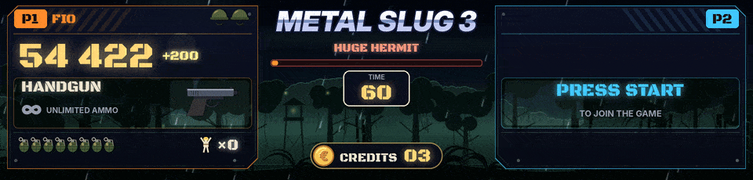

Metal Slug 1 to 5 and X each have a scene of their own, each tuned on one game recorded whole on a real cabinet. With RetroArch (FinalBurn Neo core) or MAME.

## On the HD screen

- One soldier panel per player, with the soldier chosen (Marco, Tarma, Eri, Fio, and Trevor and Nadia in Metal Slug 4), the score, the weapon and its ammo gauge, the bombs, the lives as the game writes them and the prisoners freed.
- Shots follow the weapon (tracers, shotgun blasts, rockets, flamethrower, the laser as a held beam). Bombs fly, bounce and blow up when the game's own grenade does, shaking the whole screen. A crate drops when a weapon is picked up, the helmet falls when a life is lost and LAST LIFE blinks on the last one.
- In a vehicle, the vehicle takes the place of the weapon, with its name (TANK, CAMEL SLUG, SLUGNOID, SLUG FLYER, SLUG COPTER, SLUG MARINER, DRILL SLUG, ASTRO SLUG...), its energy and its shells when the game gives them. BAIL OUT! blinks when it has no energy left.
- The boss of mission 1 of each game with WARNING, its name and its life bar (Tetsuyuki, The Keesi II, Iron Nokana MKII, Huge Hermit, Brave Guerrier, Metal Rear), BOSS DESTROYED and MISSION COMPLETE at the game's moment. The big enemies of a mission get a quieter amber bar. The bosses of the later missions are recognised by their life and named after the game's list, to confirm in play.
- Each mission has its own backdrop (jungle, desert, snowy mountain, city at war, harbour, enemy base), and the backdrops take turns when nobody plays.
- Player 2 can join at any time. The credits sit at the bottom, and a coin put in falls onto them.

## On the LED panel

At the top, the title scrolls. Below, P1 and the score, the lives on the right. The next line alternates between the bombs, the weapon with its ammo and the credits. At the very bottom, small hills and a little tank that moves forward and fires when the score goes up. With two players, 1UP and 2UP with each player's lives and score.

## What each game reads

| Game | Read | Still to confirm in play |
|---|---|---|
| Metal Slug (`mslug`) | score of each player, lives, bombs, the grenades, weapon and ammo, prisoners, mission, the tank and its energy and shells | |
| Metal Slug 2 (`mslug2`) | the same, the soldier chosen and the vehicle of each player | |
| Metal Slug X (`mslugx`) | the same, the timer, the lives of all the enemies, the game's own MISSION COMPLETE | player 2, the bosses of missions 2 to 6 |
| Metal Slug 3 (`mslug3`) | the same, the vehicle, the lives of every enemy, the game's own MISSION COMPLETE | the vehicles' energy, the Camel Slug of mission 4, the bosses of missions 2, 3 and 5 |
| Metal Slug 6, the Metal Slug 3 bootleg (`mslug3b6`), next release | everything Metal Slug 3 reads, with its own mission count | the same as Metal Slug 3 |
| Metal Slug 4 (`mslug4`) | the same, in a vehicle or not and its energy, the boss by phases, the end of the mission | which vehicle |
| Metal Slug 5 (`mslug5`) | the same, the vehicle and its energy, the game's own boss flag and MISSION COMPLETE | the bosses of missions 2 to 5 |

If a game shows one life fewer than the screen, remove the `"add"` and `"min"` lines of its lives entry in `games\mslugX.json`. If it shows one more, add `"add": -1, "min": 0`.

## Your own pictures

All the places for your own pictures, every game together, are in [[Your Own Pictures]].

To show your own pictures instead of ArcadeDMD's drawings, put them in `sprites\mslug\<name>.png` for all the Metal Slug games, or `sprites\mslug2\<name>.png` for one game. Vehicles `tank`, `camel`, `slugnoid`, `flyer`, `copter`, `mariner`, `drill`, `astro`, and `elephant`, `ostrich`, `bradley`, `mobile`, `gunner`, `claw`, `walker`, `armor` (seen from the side, gun to the right). Soldiers `marco`, `tarma`, `eri`, `fio`, `trevor`, `nadia` for a small portrait beside the name. A plain background around the drawing is made transparent and empty margins are cut. `.gif`, `.jpg` and `.webp` work too. `runtime\arcadedmd.log` says for each vehicle which picture is used, or where one would be read from.

For the LED tank, drop `mslug_tank.gif` (or a `mslug_tank.png` strip of 3 frames) into `sprites\`, 5 pixels high at most, cannon to the right.
