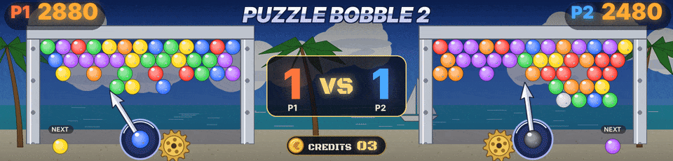
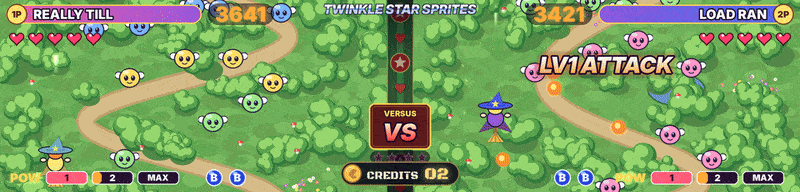

Every Neo Geo game known to MAME and FinalBurn Neo is recognised, clones, bootlegs and hacks included. A version takes the file of its original game. Ninety-seven games have a scene of their own, and all the others get a scene by genre with nothing to set up.

## The games done with the most care

- **Windjammers.** The game's court as a live map, the disc and the two players where the game puts them, read at every frame, the lobs, a super charging in a ring of flames then SUPER ! with the shot's name, the goals, the sets and the match. Your own pictures of the players can stand on the court (see [[Your Own Pictures]]).
- **Puzzle Bobble and Puzzle Bobble 2.** Both scores, the bubble in the launcher and the next one in their colours, the arrow turning as the game's, each bubble shot leaving in its direction, the round, the VS matches and the rounds won.
- **Twinkle Star Sprites.** The hearts with the half ones, the bombs, the Pow gauge, the character, the chains and PERFECT of each player, the stage, K.O. and WIN. Each witch flies where the game puts her and the rounds won are counted (1.33.1).

## Ninety-seven games done one by one

Game after game, the Neo Geo games got a panel scene and an animated HD scene of their own, the best-known first, and now they all have one. [PROGRESS.md](https://github.com/Byoyoyo/ArcadeDMD/blob/main/PROGRESS.md) shows where things stand and what comes next. Everything is drawn by the program, no image comes from the games.

In the shoot'em ups (Blazing Star, Pulstar, Last Resort, Aero Fighters 2 and 3, Strikers 1945 Plus, Ghost Pilots, Alpha Mission II, Viewpoint, Zed Blade, Prehistoric Isle 2, Andro Dunos, Captain Tomaday, Choutetsu Brikin'ger, Last Hope), once the score is read, the enemies of the HD screen only blow up when the game scores points. The enemy our shots are hitting goes first, its points show above it, and the bigger the gain the bigger the blast. A bomb or a special weapon of the game destroys what it hits, and a bonus that the game counts at the end of a stage shows as one counter. As long as the score of a game has not been learned with `learn.bat`, its HD scene plays by itself. A power-up shows POWER UP over the ship with the level reached under it, a case per level, and POWER MAX at the top, in every shoot'em up whose power is read.

The panel of these games keeps it simple during a game. The score in big digits in the middle, or the title of the game as long as the score has not been learned. Your lives at the bottom left (a plane and x2), your bombs at the bottom right. No credits and no INSERT COIN during a game. Between them flies your ship. It follows your stick and fires while you hold the fire button (the Neo Geo BIOS keeps them, with MAME as with RetroArch), and flies by itself until you touch them. With two players, both scores at the top, the lives and bombs of each player below, and both ships face to face. Everything else takes the panel for a moment, one thing at a time, as on a pinball. BOMB! and its explosions, POWER UP then MAX POWER, the plane that blows up with the lives left, LAST LIFE, 1UP, ROUND 2 or STAGE 2, SPEED UP, the SUPER SHOT of Strikers 1945 Plus, CONTINUE?, GAME OVER, PLAYER 1 and PLAYER 2 when someone starts, and CREDIT 1 when a coin goes in during a game. Each enemy destroyed in the game blows up ahead of your ship, the size and pace of the DOFLinx explosions, a big one for a big enemy, and nothing blows up during a bonus count. As long as the score has not been learned, an enemy blows up ahead of it now and then while it fires, as on the HD screen. The coin screen, when nobody plays, does not change.

Your own animations (the GIFs of DOFLinx or of the Pixelcade, for example) can replace ours on the panel. Put them in an `artwork` folder next to `arcadedmd.py`, it is never published and an update never touches it. `artwork\boom.gif` is the explosion of an enemy, `boom_big.gif` the big one, `bomb.gif` and `shock.gif` the bomb, `super.gif` the super shot of Strikers 1945 Plus, `charge.gif` the charged shot of Pulstar and `ship.gif` your ship (facing right, about 14 x 5). For one game only, put them in `artwork\<game>\` (`artwork\s1945p\boom.gif`, for example). A 128 x 32 GIF plays over the whole panel and its black lets the scene show through, but when its drawing fits in the middle (the explosions of DOFLinx) it is cropped and plays at the place of the action.

| Game | File | Panel | HD screen |
|---|---|---|---|
| Blazing Star | `blazstar.json` | the score or the title, the lives, the ship that follows the stick and fires, POWER UP, ROUND 2, a life lost | space and a big planet. The ship fires, an enemy blows up when the score goes up, POWER UP, ROUND with a burst of speed, the ship explodes when a life is lost |
| Puzzle Bobble | `pbobblen.json` | the bubble in the launcher and the next one, in their colors, ROUND, and in a VS game between two players, VS and each player's wins | the launcher with its arrow and its gear, the arrow turning as the game's does (read in the game, 256 steps per turn). Each bubble shot in the game leaves the launcher in that direction and sticks to a little board, three of a color pop and the ones left hanging fall. Player 2's score at the top right. In VS, VS takes the place of ROUND between the boards with each player's wins in big, and a match won shows P1 WINS! or P2 WINS! with the score of the wins |
| Windjammers | `wjammers.json` | points of the set with the timer in between, the court, the opponent's country, a disc going back and forth | the court of the game (beach, lawn, tiles, concrete, clay, stadium) as a live map: the disc and the two players where the game has them, read at every image, the lobs in the air, a player charging his super in a ring of flames, SUPER ! and the name of his shot when it flies, the disc burning a trail. Goals burst on the goal line with +3 or +5 and push the whole image into the wall, a drop on the other side gives +2, a set won slams WIN on the winner's side, the match VICTOIRE or DÉFAITE. The scoreboard has the players' names, nations, scores and sets. To show your own pictures of the players instead of ArcadeDMD's athletes, put them in `sprites\wjammers\` as `scott.png`, `costa.png`, `wessel.png`, `yoo.png` (or `miller.png`), `biaggi.png` and `mita.png` (a plain background is made transparent, each one fits in its box) |
| Shock Troopers | `shocktro.json` | energy, gun and ammo, special weapon and what is left, timer | jungle at war, one panel per player with energy, gun, ammo and grenades. Shots, grenades blowing up in the jungle, the panel shakes when hit |
| Neo Turf Masters | `turfmast.json` | club and distance, stroke, power gauge, golfer, wind with an arrow | golf course, club, power gauge and wind compass. The wind pushes the clouds and the flag, and the ball flies to the green at each stroke |
| Pulstar | `pulstar.json` | the score or the title, the lives, the ship that follows the stick and fires, the charged shot, SPEED UP, STAGE 2 | one world per stage (Earth, water vein, fire, space station, forest, nebula). The charge glows on the nose and leaves as a beam, the pods and the front shield follow the ship, an enemy blows up when the score goes up, STAGE with its name |
| Magical Drop III | `magdrop3.json` | both players' tarot cards, quota, level | two fields of drops under a tarot sky, both cards in the middle. When the quota goes down, the jester throws a drop and as many pop, a big group makes a chain, the level pushes a row down, the card flips when the character changes |
| Super Sidekicks 3 | `ssideki3.json` | both teams' goals, GOAL! when one goes in, a ball going back and forth | a stadium by day, the match seen by the TV camera. When the goals go up, the ball ends in the net, GOAL!, confetti, the crowd jumps |
| The Ultimate 11 | `ssideki4.json` | goals and both players' power gauges | the same match at night under the floodlights, with the power gauge. When the full gauge empties, the super shot flies on fire |
| Sengoku 3 | `sengoku3.json` | health and magic of both players, timer, fighter, throwing weapon and how many are left | a temple under the moon and shadow warriors, one panel per fighter. The throwing weapons fly (shuriken, kunai, bomb, saucer), a warrior falls under the sword when the score goes up, the magic sweeps the screen, the panel shakes when hit |
| Top Hunter | `tophuntr.json` | lives as small hunters, timer, power gauge in five segments, hills | hunters as big as in the game on four planets (forest, ice, wind, fire) with their two lanes, leaves, ice or rock across the top of the screen as in the game. Robots and walking machines with turbines come on both lanes, the hunter jumps from one lane to the other and punches, throws or shoots them when the score goes up, the full power gauge that empties is a special move, the hunters move on to the next planet when the timer starts again for a new stage. At the top, the hunter's head with 1UP= and the lives, the score, the power, TIME |
| Baseball Stars 2 | `bstars2.json` | both teams' runs, RUN! when one comes in, balls, strikes and outs lights, both POW gauges | the field as in the game's batting view, bright green grass seen from behind home plate, the batter big in front, the pitcher on the mound. Each ball, strike and out read in the game is a pitch, called in big rainbow letters, the batter hits and a fielder catches, the runs send the ball far and the runners home (fireworks when it goes over the wall), the other team comes to bat after the third out. The count in coloured dots |
| Last Resort | `lresort.json` | the score or the title, the lives, the ship that follows the stick and fires, POWER UP, SPEED UP | the city at night of the game's first stage, giant towers lit with orange windows, purple buildings, the highway with its lamps and its cars. The unit turns around the ship on the side away from where it goes and fires with it, now and then it flies straight ahead and comes back, an enemy blows up when the score goes up. 1P= and the lives at the top, POW at the bottom |
| Aero Fighters 2 | `sonicwi2.json` | the score or the title, the lives and the bombs, the jet that follows the stick and fires, BOMB!, POWER UP, MAX POWER | a city seen from the sky in daylight, its avenues and their cars, car parks and parks. Jets drawn after real fighters fly with their shadows below, enemy jets, helicopters and tanks blow up when the score goes up, a bomb sends a salvo of missiles that clears the screen. The bombs in their frames as in the game |
| Aero Fighters 3 | `sonicwi3.json` | the same, with the name of player 1's pilot | a city by a river at nightfall seen from the sky, with the plane of the pilot chosen by player 1 (twelve planes, the Swordfish biplane, the Seiran and its floats...), big bombers and tanks on the avenues. The big bomb falls and everything blows up |
| Strikers 1945 Plus | `s1945p.json` | the score or the title, the lives and the bombs, the plane that follows the stick and fires, BOMB!, SUPER SHOT, POWER UP | the game's two side panels (SCORE, the planes left, BOMB, the SUPER SHOT gauge) around war-torn ground seen from the sky, villages of tiled roofs broken by the bombs, a railway and its train, a river and its bridges. The plane chosen by the player, drawn after the real one in the colours of its sprite in the game (P-38 Lightning, F5U, Spitfire, Ta 152, Zero, Fiat G.56, XP-55 Ascender), a small 1P or 2P tab over each when both players fly the same plane. The SUPER SHOT box fills as the bar of the game does, glows when it is full, and gives the super shots in stock (x2). Each one fired leaves as a long blast of light, a bomb brings a formation of bombers whose carpet of bombs clears the screen |
| Street Hoop | `strhoop.json` | both teams' points, the clock, both SUPER SHOT gauges, the court and its hoop | a half court in a park as in the game, trees, a wooden fence, people on the benches, a bike in the grass, the painted asphalt and the hoop on the right. Three against three, the ball goes from hand to hand, the points read in the game are shots from far, jump shots or dunks, a shot misses now and then. The full gauge that empties is a super shot on fire. The points in big letters at the top, red and blue, the clock in its orange box between the two SUPER SHOT gauges, 1P above the player's man |
| Super Dodge Ball | `sdodgeb.json` | the health of the three players of each team in three colours, TIME, both POW gauges | a cobbled lot at the end of the afternoon, people watching over the fence, cans and bottles lying about. Two teams of three players of our own, big heads on short bodies. The ball crosses and is caught, a player whose health goes down takes it full in the face, at zero he is out, the full POW gauge that empties is a power shot on fire. The health bars of both teams at the top with the names, TIME in the middle |
| Neo Bomberman | `neobombe.json` | lives as small heads, fire, the stage, a maze with its blocks | the maze seen from above as in the game, one look per world (ruins, water, factory, castle), stone pillars on every other cell, blocks that break and come back. Little miner robots of our own walk the corridors, the bombs dropped in the game are dropped here and blow up, the flames run in a cross, blobs wander. A coloured band at the top with the lives, the fire and the stage |
| Twinkle Star Sprites | `twinspri.json` | hearts, bombs, the Pow gauge and the character's name, a column between two fields | two fields side by side as in the game, a forest seen from above that scrolls down, the ornate column between them. A little witch of our own in each field, where the game puts the player (his place read in the game, test 47; the stick when a file gives none), shoots the puffballs that come down. At the top the character's name in big letters on a plate in its colours, the score, five big hearts with the half ones (the game's energy). At the bottom POW 1 2 MAX in three blocks and the bombs. In the column, VERSUS and VS between two players, STAGE and its number against the computer, the rounds won as gold stars under it, whose side shows its character with PRESS START in place of its score. The big moments come from the game. The chain the game counts (4 HIT, 7 HIT..., for each player, learned on a cabinet like the stage), the fireballs of an attack cross the column and land with LV1 or LV2 ATTACK, a charged shot (the A button held, then released) leaves as a beam of light, MAX ! on a full gauge, a bomb rumbles the whole screen three times, flashes it white then gold, giant rays of light turn over it, three shockwaves cross both fields and a shower of stars falls on them, with BOMB ! bouncing in and a rainbow shield, a boss attack darkens the other field under BOSS ATTACK !, a heart lost breaks and one given back fills up, and the last heart lost gives K.O. on one side and WIN ! with fireworks on the other. The game's PERFECT (a formation cleared in one chain) shows PERFECT ! in big letters on that side (`perfect` and `perfect_p2`, learned on a cabinet) |
| League Bowling | `lbowling.json` | the shot clock, a lane and its pins | the alley seen from behind the bowler as in the game, the polished lanes running to their pins, the lanes next door, the lit panels of the back wall. Each time the game's shot clock starts again, a bowler of our own throws, the ball hooks down the lane and the pins fly, STRIKE! or SPARE! now and then. TIME in its box at the top |
| Neo Drift Out | `neodrift.json` | the time with its hundredths, a road and a rally car | the rally stages seen from the sky, a dirt road through the woods, then a tarmac road in the countryside. The white rally car drifts in the bends and throws dust, a checkpoint arch goes by when time is added. TIME in big blue numbers with the hundredths, as in the game |
| Riding Hero | `ridhero.json` | time, turbos, rank, a road and its kerbs | the road seen from behind the bike rushes to the horizon as in the game, its red and white kerbs, the bends that sweep it, a snowy volcano, mountains, the long grandstand and a blimp. The rider leans into the bends, the others are passed or come back, a turbo spent is a burst of speed. SPEED, TIME, TURBO and RANK where the game puts them |
| Thrash Rally | `trally.json` | the time and the speed, a road and a rally car | a dirt track between yellow and black barriers, then a snowy road with red and white kerbs and snowmen, seen from the sky. The red car drifts among its rivals, a checkpoint arch goes by when time is added, the speed read in the game sets the pace. TIME in yellow, SPEED in red |
| Magician Lord | `maglord.json` | HP, lives, the name of the shape taken, a walkway and the trees | the villages of huts in the giant trees as in the game, then a temple with a huge stone face. A hero of our own walks the walkways and throws his magic at the undead, and takes the shape read in the game (ninja, merman, samurai, dragon warrior, sea warrior, thunder god). 1UP and the lives at the top, HP and POW in their gauges at the bottom |
| NAM-1975 | `nam1975.json` | grenades, the bullets of the special weapon, a burning city and its road | our soldier seen from behind at the bottom of the screen shoots into the burning city, then the jungle and its river, as in the game. Enemies run along the road, tanks and helicopters cross, the crosshair follows its target. The bullets, the grenades and the weapon read in the game are shown (rifle, machine gun, flamethrower, bazooka), a grenade blows up where the crosshair is |
| Cyber-Lip | `cyberlip.json` | P= and the lives, the timer, the city at night, our hero firing | our hero runs down the city at night, past the theater and the shops, and shoots the walking robots and the drones. The weapon whose ammo goes down in the game is the one he fires (auto, wide, fire, bazooka, grenade). 1P and TIME in blue at the top, the weapon and its ammo in the blue bar at the bottom, P= and the lives, as in the game |
| Ghost Pilots | `gpilots.json` | the score or the title, the planes left and the bombs, the plane that follows the stick and fires, BOMB!, POWER UP | seen from the sky as in the game, the brown earth and its jungle, then the deep blue sea. Our fighter with its big radial engine, red enemy fighters and bombers, tanks on the ground. A bomb spent falls and clears the screen. 1-PLAYER and the score at the top, the planes left, B= and the stars at the bottom left |
| Alpha Mission II | `alpham2.json` | the score or the title, the ships left, the ship that follows the stick and fires, POWER UP | our fighter flies over a huge fortress in deep space as in the game, saucers come, the turrets of the fortress blow up. The ships left =02 and the score at the top, G= the gold and the power of the weapon at the bottom |
| Viewpoint | `viewpoin.json` | the score or the title, the ships left, the ship that follows the stick and fires, BOMB! when the bomb carried goes | the floor of slate tiles seen at an angle slides by as in the game, our hover-ship flies over it with its shadow, crawlers and ring mines come. The bomb carried in the game (plasma, fire, homing) is shown, when it is spent it sweeps the screen in its colour. 1UP, the score and the three bomb lights at the bottom |
| Zed Blade | `zedblade.json` | the score or the title, the ships left and the bombs, the ship that follows the stick and fires, BOMB!, POWER UP | our fighter flies over a valley at dawn as in the game, mountains, forest, stone pillars, the enemy helicopters come in packs, a bomb spent blows them all up. 1P- in red and 2P- in blue at the top, the bombs as blue capsules at the bottom left, LEVEL and the shot level |
| Prehistoric Isle 2 | `preisle2.json` | the score or the title, the helicopters left and the bombs, the ship that follows the stick and fires, BOMB!, POWER UP | our helicopter flies over the sea by the island as in the game, stone pillars rise from the waves, the flying reptiles come, a bomb spent blows up the screen. PLAYER 1 and the score at the top, the helicopters left, Lv the weapon level and the bombs at the bottom left |
| Shock Troopers 2nd Squad | `shocktr2.json` | grenades, the timer, the power gauge, a road, a commando and a tank | the city street seen from above as in the game, the garden and the cracked wall, the white tiled pavement and its lamp posts, the grey road with its yellow line and its burnt cars. Our commando goes up the road and shoots the soldiers, the jeeps and the tanks that come. The weapon read in the game is the one he fires (normal, fire, round, missile, boomerang), a grenade spent is thrown, a life lost blows up next to him. At the top a face of our own, 1P- and the score, TIME in big yellow numbers, at the bottom the grenades, the weapon box and LV |
| Robo Army | `roboarmy.json` | the LIFE gauge, x and the lives, the POW orbs, the town at dusk | the edge of the town at dusk as in the game, a purple sky, wooden fences, a cracked concrete house, trees and dry grass. A cyborg of our own fights the robots that come from both sides. The points read in the game are blows that land, the LIFE that goes down is a blow taken, a life lost a fall. LIFE in blue, 1P- and the score, x and the lives, the POW orbs at the top |
| Burning Fight | `burningf.json` | the health gauge, the timer, P= and the lives, shops with lanterns | a street of small shops at night as in the game, square signs, red paper lanterns, lit windows, vending machines and cobbles. Our street fighter faces the thugs that come from both sides. The points are blows that land, the health that goes down a blow taken. 1UP and the score with the yellow gauge, TIME in big yellow numbers in the middle, P= and the lives at the bottom left |
| Mutation Nation | `mutnat.json` | the LIFE gauge, B and the attack items, a ruined city | the ruined city as in the game, blue towers under a violet sky, old stone buildings with broken windows, rubble, a wrecked car and the cracked road. Our street fighter faces the mutants that come from both sides, the points are blows that land, the LIFE that goes down a blow taken, an attack item spent sweeps the screen. 1P and the score, LIFE in rainbow segments, B and the items at the top |
| Sengoku | `sengoku.json` | the lives, the six LIFE boxes, the colour of the sphere, a red sunset | the end of the world at sunset as in the game, a blood-red and orange sky, a castle floating on its island, the violet ruins and banners of a village, the golden field and the grey mist. Our swordsman of our own fights the armoured ghost warriors and the ninjas, each blow leaves a trail of light, the sphere taken in the game makes the blade glow in its colour. SCORE-, a face of our own, the lives and the six LIFE boxes |
| Sengoku 2 | `sengoku2.json` | the lives, the six LIFE boxes, the colour of the sphere, a dusk sky and the sand | under the great wooden bridge at dusk as in the game, a violet and orange sky, dark mountains, the roofs of a village in the mist, the arch of the bridge on its stone pier, the sand and its stones. Our swordsman fights the dark armoured warriors, the sphere read in the game (blue, pink, yellow) is shown. 1P-, a face of our own, the lives and the LIFE boxes |
| Ninja Combat | `ncombat.json` | LIFE and POW, the lives, a park at night with its lamp posts | a park at night as in the game, dark trees, lamp posts with white globes, a gate of gold and blue pillars under its roof, the fence and the grey paving stones. Our red ninja faces the black, grey and purple ninjas. At the bottom as in the game a face of our own, POW and LIFE, TIME in minutes and seconds, the lives and the name of the character |
| Ninja Commando | `ncommand.json` | the LIFE gauge, the timer, a jungle path | the jungle seen from above as in the game, a winding dirt path between thick bushes, purple boulders, a river and its wooden bridge. Our blue ninja runs up the path and throws fire dragons at the enemy ninjas. At the bottom as in the game a face of our own, LIFE in yellow, TIME in minutes and seconds |
| Blue's Journey | `bjourney.json` | the hearts, the lives, the flowers, the grass and the soil | the land of giant plants as in the game, long leaves striped with yellow hanging from the top, a blue tree, red leaves, a huge clay pot, pink buds, the grass over the golden soil. Our little hero of our own throws leaves at the snails and the bees. 1P=, the lives, TIME=, LIFE and its hearts at the top, the flowers at the bottom left |
| Puzzle Bobble 2 | `pbobbl2n.json` | the scores, the bubble in each launcher and the next one, the arrows, the round, the VS mode and the rounds won (test 41, from one recorded game), the shot timer | the beach of the first rounds as in the game, a deep blue sky and its big clouds, palm trees, the sea and a sailing boat. The boards in their metal frames, the launcher and its arrow, the bubbles leave when the game's shot timer starts again |
| Magical Drop II | `magdrop2.json` | LEVEL, the quotas of both players | the orange brick wall and its pale marble columns around the two fields of deep teal, as in the game. The jester throws the drops, the quota going down pops them, the level rising pushes a row. LEVEL at the top, the quotas at the bottom |
| Money Puzzle Exchanger | `miexchng.json` | the chain, MAX CHAIN, the level | the pastel diamonds of blue, white and lilac as in the game, the two fields framed in pink full of coins of 10, 50, 100 and 500, a little piggy bank of our own under each field. A chain read in the game pops coins. STAGE and MAX CHAIN between the fields |
| Puzzle De Pon! | `puzzledp.json` | the bubble in the launcher and the next one, LEVEL | the pale blue sky full of big soft stars as in the game, the boards between brick pillars around a starry night, the star dial whose hand turns with the time left. The bubble shot and the next one come from the game. LEVEL at the bottom |
| Puzzle De Pon! R! | `puzzldpr.json` | the bubble in the launcher and the next one, LEVEL | the same boards between their brick pillars and the star dial as Puzzle De Pon!, under a pink sky full of stars, as in the game |
| Panic Bomber | `panicbom.json` | the power gauges of both players, the level | two fields on the green checkerboard as in the game, the pieces of three little round heads of our own fall and stack, three of a colour burst, the bombs blow up in a cross of flames. The points read in the game set the bombs off, the power going up is a big blast. SCORE and NEXT above each field |
| Pop 'n Bounce | `popbounc.json` | the lives, a bouncing ball | the jungle at dusk as in the game, soft round creatures of our own piled up at the top of the field, the bar at the bottom sends the ball back, a creature hit bursts with the ones of its colour that touch it. ATTACK at the top, 1P, the lives and BALL in the middle |
| Super Bubble Pop | `sbp.json` | the coloured blocks | the magenta swirl and its lilac bubbles as in the game, the white board seen at an angle where the bubbles fall, our little robot of our own shoots its bubble up a column, three of a colour burst. The score in its capsule at the top |
| Spin Master | `spinmast.json` | the health segments, B and the bombs, the lives, the desert | the desert of the pyramids as in the game, a deep blue sky, great pyramids, a sphinx, dunes and a wall of stone blocks. Our hero of our own throws his yo-yo at the soldiers and the birds, a bomb spent blows up the screen. 1P, the health in orange segments and the bombs B at the top, the lives at the bottom |
| Ganryu | `ganryu.json` | the timer, the lives, the weapons left, a street at night | a street of old Japan at night as in the game, wooden houses under their dark tiled roofs, curtains with a round crest, lanterns. Our swordsman of our own fights the ninjas of the night, his blade leaves a trail of light, a weapon spent in the game is thrown. PLAYER_1 and the score, the yellow gauge, a face for each life, TIME in big numbers, the weapon and its count |
| Zupapa! | `zupapa.json` | the lives, the platforms | the blue cave and its old stone statues as in the game, the platforms striped orange and blue. Our little round hero of our own walks the platforms, jumps from one to the other and boots the monsters, who fly off in a shower of stars. P1, the score and the lives |
| Neo Mr. Do! | `neomrdo.json` | the lives as cherries, the field of tiles | the field of coloured tiles and their toys and tools inside a frame of stars, as in the game. Our little digger of our own digs his tunnels, picks the cherries, the blue monsters follow him in the tunnels and fall to his power ball. 1P-, the lives and EXTRA lit letter by letter |
| Super Sidekicks | `ssideki.json` | the goals of both teams in big numbers, the time | the match in the stadium, the two flags with the goals in their orange boxes and TIME on its panel, as in the game. A goal read in the game sends the ball into the net |
| Super Sidekicks 2 | `ssideki2.json` | the goals of both teams in big numbers | the match in the stadium, the blue band at the top with the two flags and the goals in big white numbers, as in the game. A goal read in the game sends the ball into the net |
| Tecmo World Soccer '96 | `twsoc96.json` | the pitch and a ball crossing it | the match in the stadium, the two flags at the top and the round clock between them, as in the game. No value of the game is known yet, so the match plays by itself |
| Goal! Goal! Goal! | `goalx3.json` | the goals of both teams in big numbers, the time | the match in the stadium, the flags and the goals in big yellow numbers at the top, the time with its little moon, as in the game. A goal read in the game sends the ball into the net |
| Neo-Geo Cup '98 | `neocup98.json` | the goals of both teams in big numbers | the match in the stadium, the blue band at the top with the two flags and the goals, as in the game. A goal read in the game sends the ball into the net |
| Soccer Brawl | `socbrawl.json` | the goals of both teams in big numbers, the POWER METER of each team, the time | football of the future on a pitch at night, the players of our own in their armour, the POWER METER of each team at the top and TIME below, as in the game. The goals and the power read in the game |
| Football Frenzy | `fbfrenzy.json` | the points of both teams in big numbers, the clock of the quarter, the yard lines | the field seen from above with its yard lines and its red and blue end zones, as in the game. Two teams of our own line up, the ball is snapped, the runner breaks through until he is tackled. The points read in the game are touchdowns. The points of both teams in big yellow numbers and the clock of the quarter at the top |
| Pleasure Goal | `pgoal.json` | the goals of both teams in big numbers, the time | futsal, five against five in the stadium, a face of our own for each team beside its goals and the time in the middle, as in the game. A goal read in the game sends the ball into the net |
| Baseball Stars Professional | `bstars.json` | the inning, the count B S O in lights | the field seen from behind home plate, the batter of our own, the count B S O in lights with the clock and the box with the inning, as in the game. The balls, strikes and outs read in the game make the pitches |
| 2020 Super Baseball | `2020bb.json` | the field and the time | baseball of the future on its bright field, the blue box with the inning and the time, as in the game. The outs counted in the game make the plays, between them the game plays by itself |
| Top Player's Golf | `tpgolf.json` | STROKE and the strokes, the time left for the stroke | the course and its flag, the blue boxes with HOLE and PAR, STROKE and the time, as in the game. The ball flies to the flag at each stroke read in the game |
| Power Spikes II | `pspikes2.json` | the power gauges of both players, the time | the indoor arena with its lamps and its stands full of people, three players of our own on each side of the net, as in the game. The ball flies from one side to the other, the players jump and spike. A super shot spent in the game is a spike on fire. The time on its board and the POWER gauges |
| Bang Bead | `bangbead.json` | the street court and the ball, TIME, the 'Miracle' power gauges and their stars | the street court seen from above as in the game, the cars parked along the pavement, the manhole and the orange lane marks. Two players of our own hit the ball from one end to the other, the goal lines and their yellow stars light up at each goal, a 'Miracle' power spent in the game is a shot on fire. PLAYER and the score, TIME in the middle, the power gauges at the bottom |
| Battle Flip Shot | `flipshot.json` | the arena and its target, the ball, TIME | the arena of teal metal seen from above as in the game, its circuits, the big orange target in the middle. Two players of our own behind their shields send the glowing ball back, the six targets of each player along his wall crack and break, a target hit in the game is a shot on it. SCORE and TIME at the top |
| Over Top | `overtop.json` | the time, RANK, the speed, the lap time | the stages seen from the sky as in the game, a dirt track through the pine forest, then a grey road between the fields, the red car among its rivals. The map in its little television at the top left, the time in big yellow numbers, RANK, the speedometer and the lap time. A place won in the game is a rival overtaken |
| Stakes Winner | `stakwin.json` | a galloping horse, the speed, stamina and strength of the horse | a Japanese racecourse as in the game, the green turf and its white rails, the grandstand and its crowd. Eight horses and jockeys of our own gallop, the player's horse wears its 1P, the finish post comes and the winner is shown. The race clock at the top left, the horse's gauge at the bottom, its speed, stamina and strength read in the game |
| Stakes Winner 2 | `stakwin2.json` | a galloping horse, POWER, the speed, stamina and burst of the horse | Longchamp as in the game, its grandstand and its windmill, the green turf. The horses of our own gallop, POWER at the bottom read in the game, power spent is a dash of the player's horse, its speed, stamina and burst |
| Jockey Grand Prix | `jockeygp.json` | a galloping horse on the dirt, CREDIT | the dirt track and its green rail as in the game, eight numbered horses of our own, the odds board at the top with the race numbers, WAGER and the credits as in Metal Slug beside it. The winner's number lights up on the board. No value of the game is known yet, so the races run by themselves |
| Gururin | `gururin.json` | the next piece in its colours, the level | the blue and purple checkerboard as in the game, the golden pillars and their medallions, the boards in their golden frames. The little round fellows of our own fall three by three, four of a colour that touch leave, and the board turns a quarter now and then, everything falling the other way. The piece and the next one in their colours read in the game, LEVEL |
| Ghostlop | `ghostlop.json` | TIME | a city street at night as in the game, the two fields full of little ghosts of our own in their colours, a little ghost hunter below each field shoots the ghosts up, three of a colour that touch vanish. In the middle, PLAYER 1 and its score, TIME in big numbers, PLAYER 2 or COMPUTER |
| Pochi and Nyaa | `pnyaa.json` | the blocks | the green forest and its soft lights as in the game, the fields of soft blocks with the little faces of cats and dogs of our own, the pairs fall, four of a colour that touch leave and the chains count. NEXT beside the field, the score at the top, and big plush bears of our own sitting in the forest |
| Puzzled | `joyjoy.json` | the next piece in its colour, the balloons left | the green hills and the white clouds as on the title of the game, the brick towers and their wells. The pieces fall and fill the lines, the full lines leave, and when the bricks of the stage are gone the kid's balloon floats away. NEXT in its colour read in the game, the score, STAGE and the balloons left in the middle |
| Zintrick | `zintrckb.json` | the time, the ENERGY gauges | green mountains under a pale sky as in the game, the two fields in their purple frames, the jewels shaped like drops hang from the top. A little thrower of our own below each field throws a jewel up a column, three of a colour in a line leave, an item used in the game clears a row. The time in big numbers between the fields, ENERGY, ITEM and LEVEL of each player |
| Digger Man | `diggerma.json` | the lives, the bombs, ENERGY, a little digger | the mine in its grey brick frame as in the game, the orange earth, the grey stone walls, the rocks that fall into the tunnels, the coloured jewels. Our little digger of our own digs his way to each jewel, a bomb spent in the game blows up the stones around him. The score, the jewels left in big blue numbers, ENERGY, the lives and the bombs |
| The Irritating Maze | `irrmaze.json` | TIME and its tenths, the lives | the red checkered floor as in the game, the corridor of the maze between its blue rails, the big arrow, the bumper and the crate. Our pointer goes along the corridor without touching the rails, a life lost in the game is an electric shock. TIME in red LED numbers with its tenths, the map of the maze with the pointer |
| Andro Dunos | `androdun.json` | the score or the title, the ships left, the ship that follows the stick and fires, POWER UP | space over a planet as in the game, the blue glow of the horizon and the rocky ground, our small fighter of our own against round enemy pods. 1P and the score, the four weapons and their levels read in the game in their colours, the ships left |
| Captain Tomaday | `ctomaday.json` | the score or the title, the lives, the ship that follows the stick and fires, POWER UP | the forest seen from the sky as in the game, its little red-roofed houses, the railway and its steam train, a river. Our little red craft of our own with its green leafy crest against flying tin robots. PLAYER 1 and the score, the lives and the power of both arms read in the game |
| Choutetsu Brikin'ger | `ironclad.json` | the score or the title, the life meter, the ship that follows the stick and fires, POWER UP, LEVEL 2 | the sea at dusk, the iron warships on the horizon, our steam fighter of our own and its robot fist against flying gunboats. The life meter, POWER and LEVEL read in the game, the arm weapons |
| Last Hope | `lasthope.json` | the score or the title, the ship that follows the stick and fires | deep space as in the game, full of blue and white stars, the nebulas and a big blue planet, our small fighter of our own and its blue pod against red barrel drones. The score at the top |
| Bang Bang Busters | `b2b.json` | the hearts, the boss gauge | the ice world as in the game, the blue sky and its aurora, the platforms of ice blocks. Our little buster of our own traps the penguins and the seals of our own in his bubbles and kicks them away. The score and the hearts at the top, the stage, the boss gauge read in the game |
| Crossed Swords | `crsword.json` | the energy, GOLD, the magic | the forest at night as in the game, an armoured knight of our own faces us with his shield and his sword, our own knight is seen from behind as an outline of light. They cross swords, ENEMY and its gauge at the top. The energy, the gold and the magic read in the game, a blow taken, the gold that rises, a spell of lightning |
| Eight Man | `eightman.json` | LIFE, BOMB, the time | the ruined city at sunset as in the game, golden towers and a fallen bridge. A fast cyborg of our own, blue and silver, fights purple mutants and armed cyborgs, and leaves a trail of copies behind him when the game turns its 8 Power on. 1P and the score, LIFE, BOMB and the time in its red box |
| Nightmare in the Dark | `nitd.json` | the lives, the time, the full moon, a little gravekeeper | the graveyard at night under a huge full moon as in the game, the platforms of mossy stones, the bare trees and the graves. Our little gravekeeper of our own sets the zombies and the ghosts of our own on fire with his lantern and kicks the balls of fire away. 1UP and the score, the lives and TIME in yellow read in the game |
| The Super Spy | `superspy.json` | the energy, the bullets, the corridor | the corridor of the building as in the game, its doors and their red signs, a masked fighter of our own faces us with his knives, our fists strike from below. The energy read in the game drops when he hits us, a bullet spent is a shot, he falls and we go up a floor. 1P and the score, EX, the weapon and its bullets, the floor |
| Quiz King of Fighters | `quizkof.json` | the lives as hearts, Q and the four answers | a stage in the city at night as in the game, two fighters of our own face to face. The question panel and its four answers A B C D, the time that runs. The questions are our own, the score that rises is a right answer and a big circle, a life lost is a wrong answer and a big cross. P1, the score and LIFE |
| Quiz Daisousa Sen | `quizdais.json` | the lives as hearts, Q and the four answers | the wire fence in front of the city at dusk as in the game, a hooded detective of our own and his partner. The question panel and its four answers A B C D, the time that runs. The questions are our own, the score that rises is a right answer and a big circle, a life lost is a wrong answer and a big cross. P1, the score and LIFE |
| Quiz Meitantei Neo & Geo | `quizdai2.json` | the lives as hearts, Q and the four answers | a detective's office as in the game, its shelves of books and its window, an old detective of our own and his young assistant. The question panel and its four answers A B C D, the time that runs. The questions are our own, the score that rises is a right answer and a big circle, a life lost is a wrong answer and a big cross. P1, the score and LIFE |
| Chibi Maruko-chan Deluxe Quiz | `marukodq.json` | the lives as hearts, Q and the four answers | a television studio as in the game, its lights and its rainbow, two children of our own on the set. The question panel and its four answers A B C D, the time that runs. The questions are our own, the score that rises is a right answer and a big circle, a life lost is a wrong answer and a big cross. P1, the score and LIFE |
| Minasan no Okagesamadesu! | `minasan.json` | the tiles, the steps of the die | the blue table and its mahjong game as in the game. The hidden hand of the opponent at the top, the tiles thrown in the middle, our hand of thirteen tiles at the bottom. A tile is drawn, a tile is thrown, now and then a hand wins with RON or TSUMO, and the boxes of points on the right follow our own game. The steps of the board game read in the game roll a die, the time to play |
| Mahjong Kyo Retsuden | `mahretsu.json` | the tiles, the time | the green felt and the yellow tile backs as in the game. The hidden hand of the opponent at the top, the tiles thrown in the middle, our hand of thirteen tiles at the bottom. A tile is drawn, a tile is thrown, now and then a hand wins with RON or TSUMO, and the boxes of points on the right follow our own game. The time to play read in the game |
| Janshin Densetsu | `janshin.json` | the tiles, HP | the purple felt and the green tile backs as in the game. The hidden hand of the opponent at the top, the tiles thrown in the middle, our hand of thirteen tiles at the bottom. A tile is drawn, a tile is thrown, now and then a hand wins with RON or TSUMO, and the boxes of points on the right follow our own game. The panel of the hero with HP, MP, WEAPON and SHIELD read in the game, the HP that drop, the time to play |
| Bakatonosama Mahjong Manyuuki | `bakatono.json` | the tiles, the time | the olive felt and the orange tile backs as in the game. The hidden hand of the opponent at the top, the tiles thrown in the middle, our hand of thirteen tiles at the bottom. A tile is drawn, a tile is thrown, now and then a hand wins with RON or TSUMO, and the boxes of points on the right follow our own game. The time to play read in the game |
| Idol Mahjong Final Romance 2 | `froman2b.json` | the tiles | the green felt in its wooden frame and the orange tile backs as in the game. The hidden hand of the opponent at the top, the tiles thrown in the middle, our hand of thirteen tiles at the bottom. A tile is drawn, a tile is thrown, now and then a hand wins with RON or TSUMO, and the boxes of points on the right follow our own game |
| Shougi no Tatsujin | `moshougi.json` | the wooden board | the rocky coast by the sea as in the game, the wooden board and its two stands, the opponent's at the top left and ours at the bottom right. Our own pieces move one by one, a piece taken goes onto the stand of the one who took it, each player's clock runs |

- The values come from the FinalBurn Neo and MAME 2003-Plus cheats, checked against the cheat collection of MAME (mamecheat.co.uk), which adds the timer of Football Frenzy and The Irritating Maze and the lives and bombs of player 2 in Zed Blade. They still have to be confirmed in game (`test_retroarch.bat` shows them). The score of Top Hunter, Super Dodge Ball, Neo Bomberman, League Bowling, NAM-1975, Alpha Mission II, Zed Blade, Robo Army, Sengoku, Sengoku 2, Ninja Combat, Ninja Commando, Puzzle Bobble 2, Puzzle De Pon!, Puzzle De Pon! R!, Panic Bomber, Pop 'n Bounce, Super Bubble Pop, Ganryu, Neo Mr. Do!, Battle Flip Shot, Gururin, Ghostlop, Pochi and Nyaa, Puzzled, Zintrick, Digger Man, Andro Dunos, Captain Tomaday, Choutetsu Brikin'ger, Last Hope, Bang Bang Busters, Crossed Swords, Nightmare in the Dark, The Super Spy, Quiz King of Fighters, Quiz Daisousa Sen, Quiz Meitantei Neo & Geo and Chibi Maruko-chan Deluxe Quiz is in no database, learn it with `learn.bat` (see Learning the score). Until then, the title scrolls in its place on the panel. RetroAchievements (its public scripts on GitHub and the data `tools/ra_notes.py` downloads) gives the score of Blazing Star, Puzzle Bobble, Shock Troopers, Pulstar, Magical Drop III, Sengoku 3, Last Resort, Aero Fighters 2, Aero Fighters 3, Magician Lord, Cyber-Lip, Ghost Pilots, Viewpoint, Prehistoric Isle 2, Shock Troopers 2nd Squad, Burning Fight, Mutation Nation, Blue's Journey, Magical Drop II, Money Puzzle Exchanger, Spin Master, Zupapa!, Bang Bead and Eight Man, to be checked in game. The score of both players in Strikers 1945 Plus was learned on a cabinet, a binary number where RetroAchievements' code notes put it.
- When the stick and the buttons can be read (the Neo Geo BIOS keeps them, with MAME as with RetroArch), the ships of Blazing Star, Pulstar, Last Resort, Viewpoint, Zed Blade and Prehistoric Isle 2, the planes of the Aero Fighters, Strikers 1945 Plus, Ghost Pilots and Alpha Mission II, the commando of Shock Troopers 2nd Squad and the ninja of Ninja Commando (up and down), the hunters of Top Hunter, the witches of Twinkle Star Sprites (placed from the game itself since test 47, the stick only when a file gives no place), the arrows of Puzzle Bobble, Puzzle Bobble 2 and the two Puzzle De Pon!, the jesters of Magical Drop II and III and the piggy banks of Money Puzzle Exchanger follow them. Button A fires in Blazing Star, Pulstar, Last Resort, the Aero Fighters, the two Shock Troopers and Ninja Commando, and strikes in Sengoku 3 and Top Hunter. In Top Hunter, up and down jump from one lane to the other and B jumps. In Last Resort, button B launches the unit. In Magical Drop II and III and Money Puzzle Exchanger, button A grabs the drops or the coins and B throws them back. As long as the player has not touched them, the scene plays by itself. On the panel of the fifteen shoot'em ups, the ship follows the stick and fires with button A too.
- With nobody playing, the coin screen, as for the fighting games (see [[RetroArch]], Coin screen).
- `demo_neogeo.bat` shows them without playing. Pick the game in the list, or give it directly, `demo_neogeo.bat wjammers` for example.

## A scene by genre for all the others

| Genre | File | What is shown |
|---|---|---|
| Fighting | `neogeo_combat.json` | the score, the health bars and the timer, P1 and CPU or P2, the fighter's name in 34 games, the coin screen when nobody plays. See [[Fighting Games]] |
| Shoot'em up | `neogeo_shoot.json` | a small ship flying through a star field, firing when the score goes up |
| Sports and racing | `neogeo_sport.json` | a field with a bouncing ball |
| Puzzle, quiz, mahjong | `neogeo_reflexion.json` | a row of coloured blocks that keep changing |
| Action, platformers, beat'em ups and the rest | `neogeo.json` | blue hills, and both players' health bars when they are known |

A game that has its own file always takes priority over the shared scene. Learning a game's score with `learn.bat` creates its file, keeps the genre scene and adds the score. The shared files are never changed.

## Credits

The credits of a Neo Geo MVS live in the cabinet's backup memory. MAME reads it. With RetroArch, ArcadeDMD guesses them from the Neo Geo BIOS, and `coin_buttons.bat` makes it see every coin (see [[RetroArch]]).
