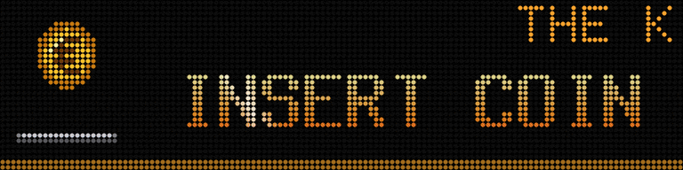

The Pixelcade LED is itself a 128 x 32 panel. ArcadeDMD drives it directly through its USB port, with the same protocol as Visual Pinball (dmdext, libdmdutil). V1 and V2 boards are detected by themselves. No other panel to buy.



## How it shares the panel with pixelweb

pixelweb, the Pixelcade software, cannot share the panel. ArcadeDMD does what Pixelcade recommends for Visual Pinball.

1. When a game that has its file in `games\` starts, ArcadeDMD stops pixelweb through its API (`/quit`) and takes the panel.
2. When you quit the game, it releases the panel at once and restarts pixelweb. The game's marquee stays shown meanwhile, then ArcadeDMD asks pixelweb to show it, as BigBox would.
3. BigBox takes the Pixelcade back at every game change, as before.

For all other games, pixelweb keeps showing its marquees.

## Setup

`install.bat` asks about it and sets the port by itself. By hand.

1. Run `ports.bat` and find the Pixelcade's port (if in doubt, unplug it and see which port disappears).
2. In `config.json`, `pixelcade` section, set `"enabled": true` and that port.

```json
"pixelcade": {
  "enabled": true,
  "device": "COM4",
  "color_order": "auto",
  "mode": "games",
  "takeover": "known",
  "max_fps": 30
}
```

3. Run `test_pixelcade.bat`. The test pattern shows RED, GREEN and BLUE, then the test asks whether each word is in its own colour. If you answer n, it swaps green and blue in `config.json`. Run it again to check.
4. Run `demo_fight.bat`. The scene moves to the Pixelcade, then pixelweb comes back when you close it.

## Options

| Setting | Effect |
|---|---|
| `"takeover": "known"` | takes the panel only for games that have a file in `games\` |
| `"takeover": "all"` | takes the panel for every MAME game, with the generic scene |
| `"mode": "always"` | keeps the panel all the time (if you no longer use pixelweb), black outside games |
| `"pixelweb_exe"` | path to pixelweb.exe, usually found by itself. If it needs options, put here a .bat that launches it with them |
| `"art_dir"` | the Pixelcade folder, to reuse its marquees as the background of the generic scene |
| `"gamma": 2.2` | LEDs light up in proportion to the value they get, so a dark grey made for a screen glows on the panel. ArcadeDMD corrects the colours so that the panel looks like the preview. `1.0` sends them as they are |

V1 boards show 3 bits per colour in direct mode, a hardware limit. V2 boards show all colours.

A game that has a file but no scene of its own (a game learned with `learn.bat`, for example) gets the generic scene, its Pixelcade marquee dimmed behind the score and credits.

## Your own INSERT COIN

A Pixelcade GIF of your own, 128 x 32, in `sprites\insert_coin.gif` (or `.png`) replaces the coin screen as long as there is no credit. The coin still drops when you insert one.

## With DOFLinx

ArcadeDMD does not touch DOFLinx's files, nor the `output` setting of `mame.ini` that DOFLinx needs. With the Pixelcade and without ZeDMD, ArcadeDMD opens no other COM port, so the devices driven by DOFLinx are not disturbed. See [[OBS and DOFLinx]].

If something goes wrong, see [[Troubleshooting]].
