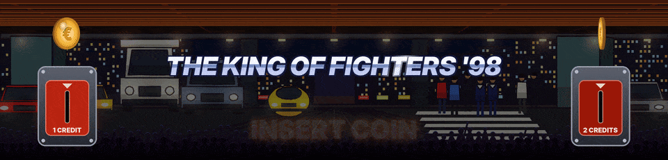
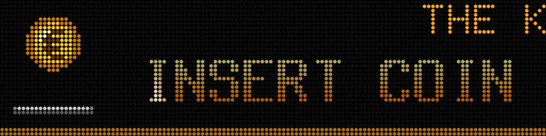

## Running ArcadeDMD

Launch `run.bat`, or let the automatic start do it when Windows starts. Then start your games as usual, from LaunchBox, BigBox, HyperSpin or directly in MAME or RetroArch. The frontend needs no setting.

Since 1.37 ArcadeDMD has no console any more. Its icon sits near the clock, among the hidden icons (the ^ arrow) until you drag it onto the taskbar. A click opens its window, a right click its menu (open, log, restart, start with Windows, quit). `run.bat` opens the window too, the automatic start only puts the icon. Running `run.bat` while ArcadeDMD is already running opens the window of the one running. `run_console.bat` starts it with its console, as before, to look for a problem. Everything it does is written to `runtime\arcadedmd.log`.

## The window

- **Status** shows the game running, the marquee and the LED panel live, RetroArch, MAME, the screens, the last lines of the log, and starts ArcadeDMD with Windows or not.
- **Screens** picks the marquee screen among those Windows sees (Identify the screens shows a big number on each), the HD or virtual LED display, and the LED panel (Pixelcade and its port, ZeDMD and its brightness). Test plays a 12 second demo.
- **Emulators** checks RetroArch's network commands and fixes them in one click, with RetroArch closed (a copy of the old `retroarch.cfg` is kept next to it). It checks MAME and the plugin version and installs or updates the plugin. It shows your coin and START buttons, sets what is recorded of each game and zips the last game with the log, ready to send.
- **Frontend** picks where the logos come from, LaunchBox / BigBox, RetroBat or none, and what the marquee shows between games.
- **Log** follows `runtime\arcadedmd.log` live, with a search.

What is changed in the window goes into `config.json`, and ArcadeDMD starts again with it by itself. The window is a page ArcadeDMD serves on your PC only (`127.0.0.1`), opened in Microsoft Edge in app mode.

## What happens during a game

1. The game starts. ArcadeDMD recognises it (its MAME name, or the content RetroArch loaded) and takes the marquee if the game has a file in `games\`. On an LCD marquee, its window comes in front of the BigBox marquee without taking the focus from the game.
2. The game's logo comes first, your LaunchBox Clear Logo, big then gliding to its place. A game without a Clear Logo gets its title in metallic lettering on the HD screen.
3. The scene of the game follows the game live. The values read in the game's memory drive it.
4. You quit the game. The marquee goes back to the frontend at once (the Pixelcade goes back to pixelweb).

With `"mode": "always"` (see [[Configuration]]) the marquee stays with ArcadeDMD all the time, black outside games.

## When nobody plays

The fighting games wait for a coin. The game's logo sits between two coin doors, a coin spinning above each one. Insert a coin and it drops into its slot with +1 and the credits rolling, then PRESS START shows in big while the doors and their coins stay. The game's own demo, behind, sets off nothing.

With RetroArch, run `coin_buttons.bat` once so that ArcadeDMD sees every coin and every START (see [[RetroArch]]). With MAME, the credits are read in the game.

## Tools in the folder

| File | Purpose |
|---|---|
| `install.bat` | installs everything |
| `run.bat` | starts ArcadeDMD, its icon near the clock and its window |
| `run_console.bat` | starts ArcadeDMD with its console, to look for a problem |
| `screen_setup.bat` | puts the scene on an LCD marquee, as virtual LEDs or in smooth HD |
| `demo_fight.bat`, `demo_neogeo.bat`, `demo_capcom.bat`, `demo_cave.bat`, `demo_afterburner.bat`, `demo_sonic.bat` | the scenes with simulated values |
| `learn.bat` | finds a missing address (score, credits...), see [[Learning Addresses]] |
| `coin_buttons.bat` | shows ArcadeDMD your coin and START buttons (RetroArch) |
| `test_retroarch.bat` | checks RetroArch, the loaded core and the memory reading |
| `test_coins.bat` | writes down what the Neo Geo BIOS does when a coin goes in, to send if a coin does not drop |
| `test_pixelcade.bat` | test pattern on the Pixelcade |
| `test_panel.bat` | test pattern on a ZeDMD panel |
| `ports.bat` | lists the COM ports, to find the Pixelcade's |

## Language

Texts are in English, or in French when Windows is in French. `"language"` at the top of `config.json` chooses (`"auto"`, `"en"`, `"fr"`).

## Pause

When the game is paused, PAUSE blinks on the LED panel (`"show_pause": false` turns it off).
