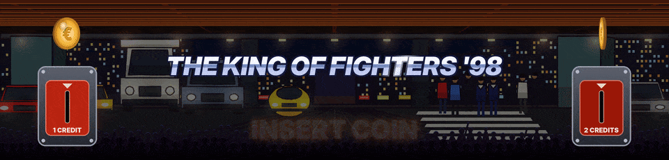
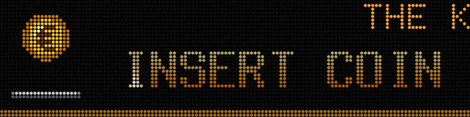

## Lancer ArcadeDMD

Lance `run.bat`, ou laisse le lancement automatique le faire au démarrage de Windows. Ensuite lance tes jeux comme d'habitude, depuis LaunchBox, BigBox, HyperSpin ou directement dans MAME ou RetroArch. Le frontend n'a besoin d'aucun réglage.

`run.bat` montre la console. Le lancement automatique fait tourner le même moteur sans fenêtre. Tout ce qu'il fait est écrit dans `runtime\arcadedmd.log`.

## Ce qui se passe pendant un jeu

1. Le jeu démarre. ArcadeDMD le reconnaît (son nom MAME, ou le contenu chargé par RetroArch) et prend le marquee si le jeu a un fichier dans `games\`. Sur un marquee LCD, sa fenêtre passe devant le marquee de BigBox sans prendre le focus du jeu.
2. Le logo du jeu arrive d'abord, ton Clear Logo LaunchBox, en grand puis il glisse à sa place. Un jeu sans Clear Logo a son titre en lettres métalliques sur l'écran HD.
3. La scène du jeu suit le jeu en direct. Les valeurs lues dans la mémoire du jeu la font vivre.
4. Tu quittes le jeu. Le marquee revient tout de suite au frontend (la Pixelcade revient à pixelweb).

Avec `"mode": "always"` (voir [[Réglages]]) le marquee reste à ArcadeDMD tout le temps, noir en dehors des jeux.

## Quand personne ne joue

Les jeux de combat attendent une pièce. Le logo du jeu est entre deux monnayeurs, une pièce qui tourne au-dessus de chacun. Mets une pièce, elle tombe dans sa fente avec +1 et les crédits qui roulent, puis PRESS START s'affiche en grand, les monnayeurs et leurs pièces restent. La démo du jeu, derrière, ne déclenche rien.

Avec RetroArch, lance une fois `coin_buttons.bat` pour qu'ArcadeDMD voie chaque pièce et chaque START (voir [[Avec RetroArch]]). Avec MAME, les crédits sont lus dans le jeu.

## Les outils du dossier

| Fichier | Rôle |
|---|---|
| `install.bat` | installe tout |
| `run.bat` | lance le moteur avec la console visible |
| `screen_setup.bat` | met la scène sur un marquee LCD, en LED virtuelles ou en HD lisse |
| `demo_fight.bat`, `demo_neogeo.bat`, `demo_capcom.bat`, `demo_cave.bat`, `demo_afterburner.bat`, `demo_sonic.bat` | les scènes avec des valeurs simulées |
| `learn.bat` | trouve une adresse qui manque (score, crédits...), voir [[Apprendre les adresses]] |
| `coin_buttons.bat` | montre à ArcadeDMD tes boutons de pièce et de START (RetroArch) |
| `test_retroarch.bat` | vérifie RetroArch, le cœur chargé et la lecture de la mémoire |
| `test_coins.bat` | note ce que fait le BIOS Neo Geo quand une pièce entre, à envoyer si une pièce ne tombe pas |
| `test_pixelcade.bat` | mire sur la Pixelcade |
| `test_panel.bat` | mire sur une dalle ZeDMD |
| `ports.bat` | liste les ports COM, pour trouver celui de la Pixelcade |

## Langue

Les textes sont en anglais, ou en français quand Windows est en français. `"language"` en haut de `config.json` choisit (`"auto"`, `"en"`, `"fr"`).

## Pause

Quand le jeu est en pause, PAUSE clignote sur la dalle LED (`"show_pause": false` le coupe).
